<<< SECTION: NetSanctum Overview [1-netsanctum-overview] >>>

# NetSanctum Overview

<details>
<summary>Relevant source files</summary>

The following files were used as context for generating this wiki page:

- [.env.example](.env.example)
- [Dockerfile](Dockerfile)
- [README.md](README.md)
- [app/core/integrations_router.py](app/core/integrations_router.py)
- [app/core/module_types.py](app/core/module_types.py)
- [app/core/modules.py](app/core/modules.py)
- [app/modules/alllib/module.py](app/modules/alllib/module.py)
- [app/modules/music/integrations.py](app/modules/music/integrations.py)
- [app/modules/music/module.py](app/modules/music/module.py)
- [app/modules/video_archiver/module.py](app/modules/video_archiver/module.py)
- [app/modules/youtube/module.py](app/modules/youtube/module.py)
- [docker-compose.yml](docker-compose.yml)
- [docs/architecture.md](docs/architecture.md)
- [start.sh](start.sh)
- [tests/test_integration_contracts.py](tests/test_integration_contracts.py)

</details>


NetSanctum is a single-user, self-hosted platform designed as a **modular monolith** [README.md:3-5](). It provides a private runtime where independent modules share a common infrastructure layer without becoming tightly coupled [README.md:5-7](). The core framework focuses on shared infrastructure—such as authentication, database management, task execution, and storage—while individual modules own their specific product logic, routes, and data models [README.md:5-7]().

Sources: [README.md:3-7]()

---

### High-Level System Architecture

The system consists of a FastAPI web application, a Celery worker for asynchronous background processing, a PostgreSQL database for persistent storage, and Redis instances for session management and task tracking [docs/architecture.md:43-115]().

#### Natural Language to Code Entity Mapping: Core System
| Concept | Code Entity / Symbol | Description |
|:---|:---|:---|
| **Entry Point** | `app.main:app` | FastAPI application instantiation and lifecycle management [Dockerfile:97-97]() |
| **Module Registry** | `app.core.modules:ModuleRegistry` | Discovers and manages module lifecycles and capabilities [app/core/modules.py:59-63]() |
| **Task Queue** | `app.core.scheduler:celery_app` | The Celery instance handling background jobs |
| **Module Spec** | `app.core.module_types:ModuleSpec` | Declarative manifest defining module metadata and routers [README.md:42-43]() |

#### Architecture Diagram: The Modular Monolith Structure

This diagram illustrates how the core infrastructure supports various independent modules via `app.core.modules:ModuleRegistry` [docs/architecture.md:67-106]().

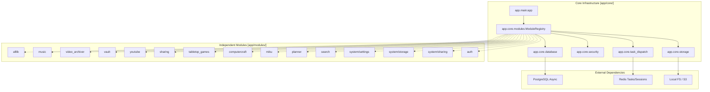
Sources: [README.md:13-30](), [docs/architecture.md:67-115](), [app/core/modules.py:59-63]()

---

### Module Catalog

NetSanctum includes a diverse catalog of first-party modules that can be enabled or disabled based on deployment requirements. Each module registers through a declarative `ModuleSpec` manifest [README.md:42-43]():

*   **`alllib`**: Downloads and reads novels, manga, and anime from supported Lib-network sources [README.md:23-23]().
*   **`video_archiver`**: Downloads, stores, and streams videos, subtitles, metadata, and comments from various platforms [README.md:27](), [app/modules/video_archiver/module.py:14-14]().
*   **`music`**: Archives audio from YouTube, SoundCloud, or Spotify, organizes playlists, and serves a local web player [README.md:24](), [app/modules/music/module.py:14-14]().
*   **`vault`**: Personal scrapbook for notes, bookmarks, collections, spreadsheets, whiteboards, and media progress tracking [README.md:25]().
*   **`youtube`**: Streaming-first YouTube front-end built on the shared `ytdlp_pipeline` and browser runtime, exposing search, channels, and MSE streaming [docs/architecture.md:78-80]().
*   **`planner`**: Manages tasks, plans, and calendar events [docs/architecture.md:94-94]().
*   **`search`**: Maintains a private cross-module metadata index used for ranked local search [docs/architecture.md:90-91]().
*   **`miku`**: An opt-in conversational AI assistant that queries and acts across NetSanctum modules via integrations, with memory, briefings, cascades/undo, and voice I/O [docs/architecture.md:97-98](). Miku is opt-in and not part of a default installation [docs/architecture.md:19-19]().
*   **`tabletop_games`**: Hosts token-scoped live multiplayer social deduction games (such as Mafia and Blood on the Clocktower) with Redis-backed realtime events [docs/architecture.md:95-95]().
*   **`system/settings`**: Global, module, and user-scoped configuration storage with secret encryption support [docs/architecture.md:102-102]().
*   **`system/sharing`**: Publishes isolated, read-only module views with optional content selection, password protection, and tokenized expiry [docs/architecture.md:40-40]().
*   **`system/storage`**: Disk usage telemetry and module-aware file cleanup operations [docs/architecture.md:103-103]().
*   **`auth`**: Single-user master token authentication and session management [docs/architecture.md:101-101]().
*   **`computercraft`**: Runs the NetSanctumOS controller, monitor viewers, and speaker playback for Minecraft ComputerCraft integrations [docs/architecture.md:96-96]().

Sources: [README.md:22-30](), [docs/architecture.md:78-104](), [app/modules/video_archiver/module.py:14-22](), [app/modules/music/module.py:14-22]()

---

### Optional AI, Voice, and Agent Runtimes

NetSanctum supports optional advanced runtimes that can be enabled via Docker Compose profiles and environment variables:

*   **Agent Engine and Runtime**: A shared LLM-driven tool-calling engine (`app/core/agent/`) and a hardened `agent-runtime` sidecar for executing actions. This runtime is network-isolated and does not have direct access to sensitive core components [docker-compose.yml:190-203]().
*   **Voice Services (STT/TTS)**: Provides OpenAI-compatible speech-to-text (STT) and text-to-speech (TTS) endpoints with local and online engine options [.env.example:96-130]().
*   **Browser Runtime**: An isolated Chromium sidecar with domain-restricted egress proxying (`browser-proxy`) to safely fetch external web content [docker-compose.yml:106-189]().

Sources: [docker-compose.yml:106-203](), [.env.example:96-130]()

---

### Key Design Principles

1.  **Module Isolation**: Modules live in `app/modules/<name>/` and must be removable without breaking core infrastructure [README.md:31-35](). They communicate through explicit capabilities and integrations rather than direct code imports [README.md:32-34]().
2.  **Single-User Security**: The platform is engineered for a single owner model. Access is enforced via a master physical token generated on the first run and stored as a secure hash [.env.example:79-89]().
3.  **Infrastructure as a Service**: The core provides database session factories, object storage interfaces (with optional AES-256-GCM block encryption), and Jinja2/HTMX rendering engines [README.md:112-124]().
4.  **Declarative Manifests**: Each module defines a `ModuleSpec` specifying metadata, routers, system packages, and integration capabilities [README.md:42-68]().
5.  **Configuration Management**: All application-level settings are loaded from environment variables or a `.env` file [.env.example:1-130](). Modules must not define independent configuration schemas [app/core/config.py:3-5]().

Sources: [README.md:31-130](), [.env.example:1-130]()

---

### Getting Started and Application Lifecycle

NetSanctum is managed through containerized orchestration scripts. For quick-start instructions, environment configuration, and profile toggles, see the **[Getting Started](#1.1)** child page. For details on FastAPI instantiation, lifespan hooks, and router auto-mounting, see the **[Application Entry Point and Startup Lifecycle](#1.2)** child page.

Sources: [start.sh:1-21](), [Dockerfile:87-97]()

---

### Major Wiki Sections

For deeper technical dives into individual subsystems, consult the corresponding sections of the wiki:

*   **[Getting Started](#1.1)** — Quick-start guide, Docker Compose setup, and `.env` configuration.
*   **[Application Entry Point and Startup Lifecycle](#1.2)** — Technical deep dive into application startup and router mounting.
*   **[Core Architecture](#2)** — Shared infrastructure (Module System, Security, Storage, Celery Tasks, Database, Integrations, Observability, Browser Runtime, and Settings).
*   **[Frontend Architecture](#3)** — Jinja2 shells, HTMX interactions, Tailwind CSS design system, media player scripts, and i18n catalogs.
*   **[AllLib Module](#4)** — E-reader, manga, and anime downloading framework.
*   **[Video Archiver Module](#5)** — Video ingestion, storage, and streaming infrastructure.
*   **[Music Module](#6)** — Audio archiving, playlists, and metadata processing.
*   **[Vault Module](#7)** — Personal scrapbook, tables, and whiteboards.
*   **[YouTube Module](#8)** — Streaming-first YouTube client and MSE player.
*   **[Miku AI Assistant Module](#9)** — Conversational AI assistant with memory, briefings, and voice I/O.
*   **[Agent Engine and Runtime](#10)** — LLM-driven tool-calling engine and hardened sidecar.
*   **[Voice Services (STT/TTS)](#11)** — Speech-to-text and text-to-speech services.
*   **[Planner and Search Modules](#12)** — Task management, calendar, and cross-module indexing.
*   **[Sharing Module](#13)** — Tokenized, read-only public sharing links.
*   **[Tabletop Games Module](#14)** — Realtime multiplayer social-deduction games (Mafia, Blood on the Clocktower).
*   **[Auxiliary Modules and Clients](#15)** — Storage Manager and ComputerCraft Lua clients.
*   **[Infrastructure and Deployment](#16)** — Docker multi-stage builds, compose topologies, and module build scripts.
*   **[Testing](#17)** — Contract, static, security, and migration test suite.
*   **[Glossary](#18)** — Codebase-specific terminology and domain concepts.

Sources: [README.md:127-145](), [docs/architecture.md:1-155]()

---

<<< SECTION: Getting Started [1.1-getting-started] >>>

# Page: Getting Started

# Getting Started

<details>
<summary>Relevant source files</summary>

The following files were used as context for generating this wiki page:

- [.env.example](.env.example)
- [Dockerfile](Dockerfile)
- [README.md](README.md)
- [docker-compose.yml](docker-compose.yml)
- [start.sh](start.sh)

</details>


## Purpose and Scope

This guide details the initial environment configuration, cryptographic secret provisioning, Docker Compose topology, and the management lifecycle automation script (`start.sh`) for **NetSanctum**. It explains how application settings (`app/core/config.py`) parse environment variables (`.env.example`), how runtime secrets and encryption keys are initialized, and how profiles (`--miku-local`, `--voice`, `--no-agent`, `--no-browser-runtime`) shape the modular monolith's execution footprint.

Sources: [.env.example:1-130](), [start.sh:1-170](), [docker-compose.yml:1-203]()

---

## Environment Configuration (`.env`)

NetSanctum centralizes configuration through `app/core/config.py`, which leverages Pydantic's settings management. At runtime, configuration values are loaded from the `.env` file unless `NETSANCTUM_LOAD_DOTENV=0` is set. A documented template is provided in `.env.example`.

### Key Environment Variables

| Variable | Purpose | Default / Example |
| :--- | :--- | :--- |
| `HOST_PORT` | HTTP port exposed on the host machine. | `8000` [.env.example:33]() |
| `DATABASE_URL` | Async SQLAlchemy connection string (`asyncpg`). | `postgresql+asyncpg://...` [.env.example:5]() |
| `REDIS_URL` | Primary Redis broker and cache connection string. | `redis://...` [.env.example:10]() |
| `MASTER_API_KEY` | Administrative master API key. | `dev-api-key-change-me` [.env.example:79]() |
| `NETSANCTUM_MODULES` | Build-time and runtime module selection bundle. | `default` [.env.example:52]() |
| `FEATURE_BROWSER_RUNTIME` | Toggles the isolated browser runtime sidecar. | (empty) [.env.example:38]() |
| `FEATURE_AGENT_RUNTIME` | Toggles the isolated agent runtime sidecar. | (empty) [.env.example:39]() |
| `FEATURE_VOICE` | Toggles server-side voice processing services. | (empty) [.env.example:40]() |
| `MIKU_LLM_URL` | Endpoint for the Miku LLM provider. | (empty) [.env.example:93]() |

### Natural Language to Code Entity Space: Configuration Loading

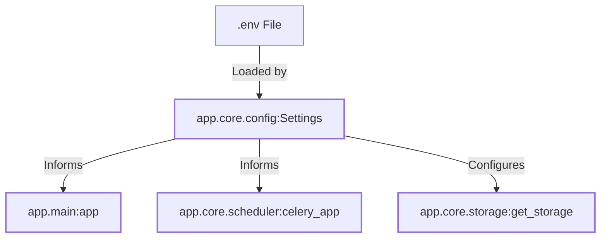

Sources: [.env.example:1-130](), [start.sh:1-77]()

---

## Secret Generation and Key Provisioning

Production and development instances require secure tokens and cryptographic keys. The `start.sh` management script automatically bootstraps `.env` files and provisions secure random keys using Python's `secrets.token_urlsafe(32)` if placeholder values are detected [start.sh:79-85](), [start.sh:148-167]().

### Cryptographic Provisioning Architecture

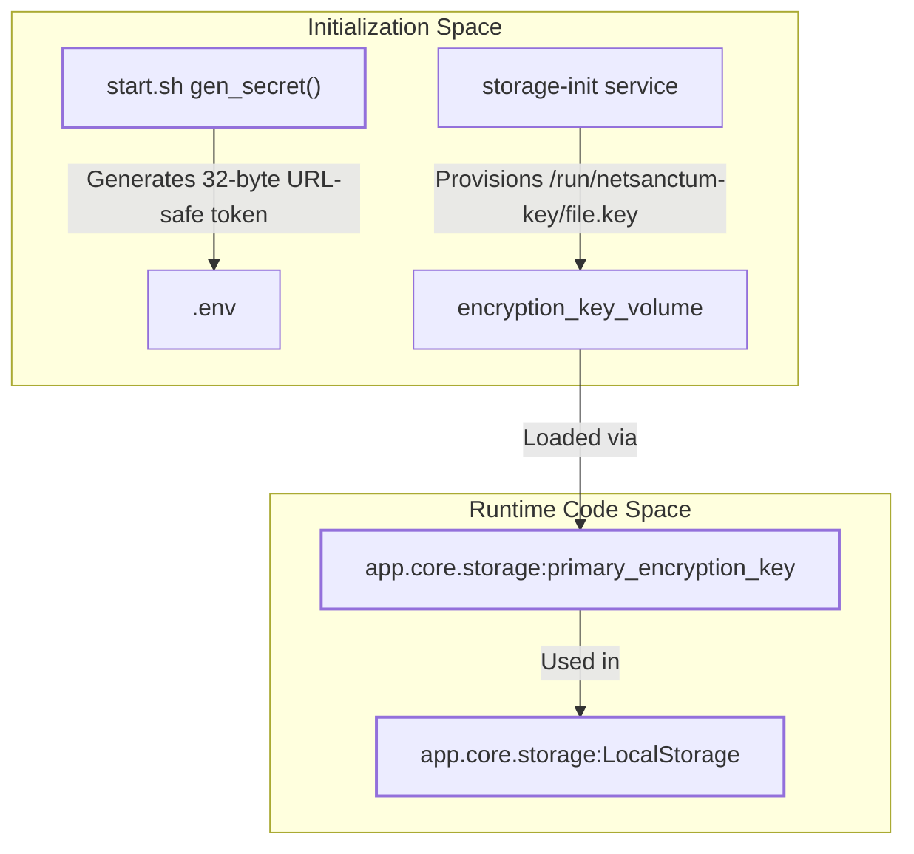

Sources: [start.sh:79-85](), [docker-compose.yml:1-203](), [app/core/storage.py:1-88]()

---

## Docker Compose Topology and Profiles

NetSanctum runs via Docker Compose, orchestrating core persistence layers (`postgres`, `redis`, `redis-state`), proof-of-origin tokens (`youtube-pot`), and optional feature containers controlled via compose profiles [docker-compose.yml:9-203]().

### Compose Profiles and Flags

The management script `start.sh` maps command-line arguments to Docker Compose profiles and environment settings:

*   `--no-browser-runtime`: Omits the `browser-runtime` and `browser-proxy` services.
*   `--no-agent`: Omits the `agent-runtime` service.
*   `--miku-local`: Activates local LLM inference containers (`miku-llm`, `model-init`).
*   `--voice`: Activates server-side speech recognition and synthesis (`miku-voice`).

Sources: [start.sh:1-21](), [docker-compose.yml:107-203]()

---

## Management Lifecycle with `start.sh`

The `start.sh` script is the primary orchestration utility. It ensures the environment file exists, backfills newly introduced variables from `.env.example`, generates secure cryptographic keys, manages file ownership via `PUID`/`PGID`, and invokes `docker compose` [start.sh:87-167]().

### Script Flow and Helper Functions

1.  **Environment Check:** If `.env` is absent, it copies `.env.example` and triggers initial secret substitution [start.sh:87-104]().
2.  **Backfilling:** Scans `.env.example` and injects missing keys into `.env` without overwriting user customizations [start.sh:112-146]().
3.  **Secret Rotation/Generation:** Automatically replaces placeholders like `change_me_in_production` or `dev-api-key-change-me` with cryptographically secure strings [start.sh:148-167]().
4.  **Permissions Lockdown:** Applies `chmod 600` on the `.env` file and management scripts [start.sh:58]().

Sources: [start.sh:23-170]()

---

## First-Run Initialization and Storage Architecture

When containers launch, the application performs automated migration and database initialization steps before accepting HTTP traffic.

1.  **Dependency Synchronization:** The multi-stage `Dockerfile` utilizes `scripts/module_build.py` and `uv` to install Python modules declared by `NETSANCTUM_MODULES` [Dockerfile:1-45]().
2.  **Database Migration:** Both web and worker services execute `python -m app.core.migrations upgrade` prior to serving requests [Dockerfile:97]().
3.  **Path Traversal Protection:** `LocalStorage` ensures all file I/O operations are strictly confined within the designated storage root, throwing validation errors on path traversal attempts [app/core/storage.py:34-168]().

Sources: [Dockerfile:1-97](), [app/core/storage.py:34-168]()

---

<<< SECTION: Application Entry Point and Startup Lifecycle [1.2-application-entry-point-and-startup-lifecycle] >>>

# Page: Application Entry Point and Startup Lifecycle

# Application Entry Point and Startup Lifecycle

<details>
<summary>Relevant source files</summary>

The following files were used as context for generating this wiki page:

- [app/core/i18n.py](app/core/i18n.py)
- [app/core/scheduler.py](app/core/scheduler.py)
- [app/main.py](app/main.py)
- [app/modules/alllib/epub_builder.py](app/modules/alllib/epub_builder.py)
- [app/modules/alllib/i18n.py](app/modules/alllib/i18n.py)
- [app/modules/alllib/router.py](app/modules/alllib/router.py)
- [app/modules/alllib/tasks.py](app/modules/alllib/tasks.py)
- [app/modules/alllib/templates/alllib_dashboard.html](app/modules/alllib/templates/alllib_dashboard.html)
- [app/modules/alllib/templates/alllib_detail.html](app/modules/alllib/templates/alllib_detail.html)
- [app/modules/music/__init__.py](app/modules/music/__init__.py)

</details>


## Purpose and Scope

This page provides a deep technical dive into `app/main.py` [app/main.py:1-329](), which serves as the core entry point and initialization coordinator for NetSanctum. It covers FastAPI application creation, the asynchronous `lifespan` initialization lifecycle, physical master token bootstrap, default settings and secret rotation, CORS and security middleware configuration, dynamic module router auto-mounting, system health and module metadata endpoints (`/health` and `/api/modules`), as well as template engine and internationalization (`i18n`) wiring.

---

## Initialization Flow and Lifespan Hook

NetSanctum runs as a modular monolith. Its startup sequence is governed by the asynchronous context manager `lifespan` defined in `app/main.py` [app/main.py:37-168](). This hook ensures that security invariants, database tables, secret key rotation, default settings, and active module hooks are fully resolved before the ASGI server begins serving traffic.

### Startup Sequence Diagram

The following diagram maps the startup execution flow from the application entry point to database initialization and module registration, bridging natural language descriptions with exact code entities.

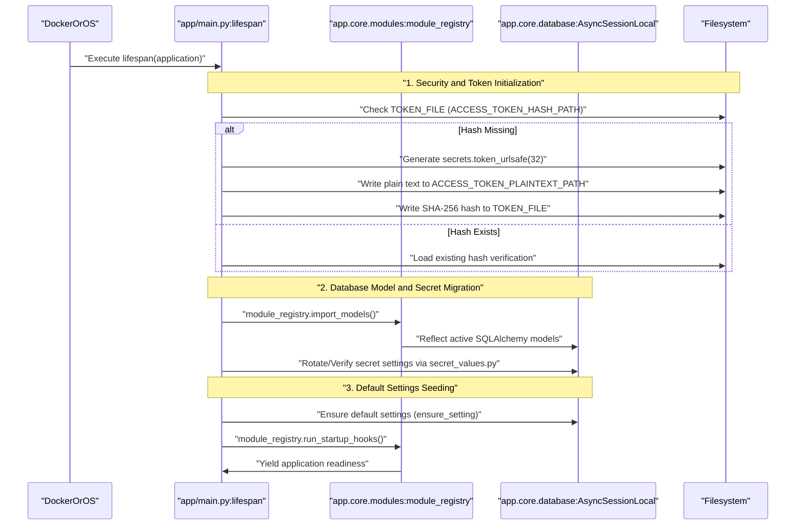
**Sources:** [app/main.py:37-168](), [app/core/modules.py:335-345]()

---

## Physical Access Token Generation

NetSanctum implements a "physical-first" bootstrapping model for single-user self-hosting. Because there is no web-based registration flow, the owner identity is anchored to a physical token generated on first run.

1. **Detection**: The application checks whether `TOKEN_FILE` (`ACCESS_TOKEN_HASH_PATH`) exists on the filesystem [app/main.py:34]().
2. **Generation**: If the hash file is absent, a cryptographically secure 32-byte token is generated via `secrets.token_urlsafe(32)` [app/main.py:48]().
3. **Persistence**:
   - The plaintext token is written to `ACCESS_TOKEN_PLAINTEXT_PATH` (`access_token.txt`) with `0600` permissions and printed to `stdout` inside a prominent alert banner [app/main.py:51-71]().
   - The SHA-256 hash of the token is written to `TOKEN_FILE` (`access_token.hash`) with `0600` permissions last, preventing partial bootstraps from locking out the owner [app/main.py:60-63]().

**Sources:** [app/main.py:34-78]()

---

## Module Discovery and Mounting

The core application does not statically import individual module routers. Instead, `app/main.py` leverages `module_registry` to discover packages under `app/modules/` [app/core/modules.py:79-87]().

### Router Auto-Mounting & Code Entity Mapping

The auto-mounting mechanism queries active modules, registers their SQLAlchemy models, mounts their FastAPI routers under designated prefixes (such as `/api/{module_id}`), and injects their template directories into the Jinja2 engine search path.

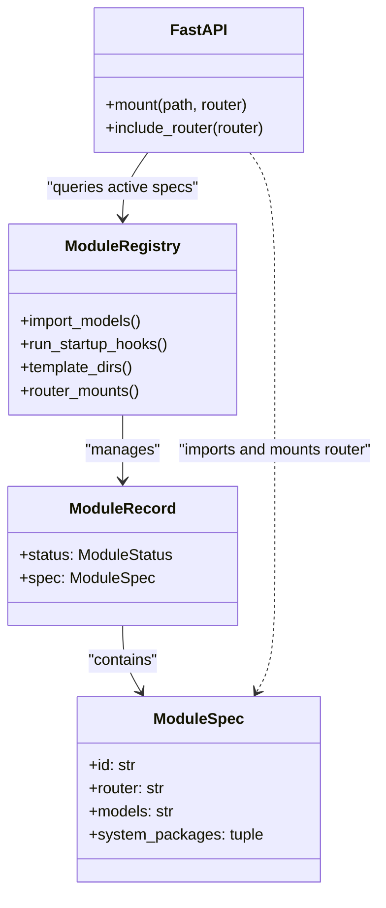
**Sources:** [app/core/module_types.py:126-160](), [app/core/modules.py:38-53](), [app/main.py:81-157]()

---

## System Health and Metadata Endpoints

Two primary inspection endpoints are exposed at the application root:

### 1. Health Check (`/health`)
A lightweight, unauthenticated endpoint utilized by Docker healthchecks and container orchestrators to verify process vitality. It returns a static status dictionary: `{"status": "ok"}` [app/main.py:255-257]().

### 2. Module Registry Inspection (`/api/modules`)
An authenticated endpoint that returns runtime diagnostic information for all discovered modules, including their status (`active`, `disabled`, `unavailable`, `failed`, `incompatible`), version metadata, and declared capabilities.

**Sources:** [app/main.py:260-272](), [app/core/modules.py:30-35]()

---

## CORS and Security Middleware

To support external companion tools and browser userscripts (such as those used by the AllLib module on external domains like `mangalib.me`), NetSanctum configures strict CORS policies alongside security headers middleware:

*   **CORS Middleware (`CORSMiddleware`)**: Configured with explicit origin regex patterns to allow cross-site API communication when pairing with authorized domains [app/main.py:166-170]().
*   **Security Headers**: `security_headers_middleware` enforces robust browser-level protections (such as XSS filtering, content type sniffing defenses, and frame options) [app/core/http_security.py:67-86](). The `is_cross_site_request` function [app/core/http_security.py:46-64]() determines if a request should be rejected based on method, path, and `sec-fetch-site` or `Origin` headers. Specific paths are whitelisted for cross-site capabilities or browser extensions [app/core/http_security.py:6-23]().
*   **Trusted Host Middleware**: Restricts incoming HTTP `Host` headers to prevent DNS rebinding attacks.

**Sources:** [app/main.py:163-174](), [app/core/http_security.py:1-86](), [tests/test_security_regressions.py:140-156]()

---

## Default Settings Seeding and Secret Rotation

During startup within the `lifespan` context manager, the application performs database-level maintenance for configuration and secrets:

1.  **Secret Value Rotation**: Iterates over all database settings where `is_secret` is true, ensuring cipher-text values conform to the active encryption key via `rotate_secret_value()` [app/main.py:85-99]().
2.  **Default Settings Seeding**: Automatically seeds essential system variables (e.g., `system_theme`, `system_language`, `openai_api_key`, `max_upload_size_mb`, `encryption_cipher`, and `external_sync_key`) if they have not yet been initialized by the operator [app/main.py:101-148]().

**Sources:** [app/main.py:85-148]()

---

## Templates and Internationalization (i18n) Wiring

Template rendering and localization dictionaries are centralized during core initialization:

*   **Jinja2 Engine (`app/core/templates.py`)**: `create_templates()` constructs a unified `Jinja2Templates` instance that searches core templates (`app/core/templates/`) first, followed by template directories contributed by active modules (`app/modules/<name>/templates/`) [app/core/templates.py:18-38](). It injects the global translation helper `_` into the Jinja2 environment [app/core/templates.py:37]().
*   **Internationalization (`app/core/i18n.py`)**: `discover_and_load_translations()` scans active modules for translation dictionaries (`TRANSLATIONS`), caching English, Russian, and localized string mappings in memory [app/core/i18n.py:22-42](). The `translate` helper resolves locale preferences from template context, request cookies, or defaults to English [app/core/i18n.py:45-102]().

**Sources:** [app/core/templates.py:1-43](), [app/core/i18n.py:1-102]()

---

<<< SECTION: Core Architecture [2-core-architecture] >>>

# Page: Core Architecture

# Core Architecture

<details>
<summary>Relevant source files</summary>

The following files were used as context for generating this wiki page:

- [app/core/config.py](app/core/config.py)
- [app/core/integrations_router.py](app/core/integrations_router.py)
- [app/core/module_types.py](app/core/module_types.py)
- [app/core/modules.py](app/core/modules.py)
- [app/core/storage.py](app/core/storage.py)
- [app/modules/alllib/module.py](app/modules/alllib/module.py)
- [app/modules/music/integrations.py](app/modules/music/integrations.py)
- [app/modules/music/module.py](app/modules/music/module.py)
- [app/modules/system/storage/router.py](app/modules/system/storage/router.py)
- [app/modules/video_archiver/module.py](app/modules/video_archiver/module.py)
- [app/modules/youtube/module.py](app/modules/youtube/module.py)
- [scripts/vault_verify_media.py](scripts/vault_verify_media.py)
- [tests/fixtures/seekable_v2_legacy_aad.bin](tests/fixtures/seekable_v2_legacy_aad.bin)
- [tests/fixtures/seekable_v2_legacy_aad.sha256](tests/fixtures/seekable_v2_legacy_aad.sha256)
- [tests/test_integration_contracts.py](tests/test_integration_contracts.py)
- [tests/test_storage_seekable.py](tests/test_storage_seekable.py)

</details>


NetSanctum is built as a **modular monolith**. The core infrastructure layer, located in `app/core/`, provides shared services that individual modules consume to maintain consistency and isolation. This layer handles everything from module discovery and security to database migrations, encryption, browser automation, agent execution, and background task dispatching.

### Architectural Overview

The system relies on a central `ModuleRegistry` to orchestrate the lifecycle of all components [app/core/modules.py:59-73](). Modules are prohibited from directly accessing the file system or environment variables; instead, they interact with core abstractions defined across the infrastructure layer.

#### Relationship of Core Subsystems
The following diagram illustrates how core entities interact to serve a request or execute a background task, bridging high-level system concepts to concrete codebase symbols.

**Core Entity Interaction Flow**
```mermaid
graph TD
    subgraph "Request Lifecycle"
        [FastAPI_App] --> |"Authenticates via"| [security_py]
        [security_py] --> |"Validates"| [MasterToken]
        [FastAPI_App] --> |"Dispatches via"| [ModuleRegistry]
    end

    subgraph "Resource Management"
        [ModuleRegistry] --> |"Discovers"| [ModuleSpec]
        [ModuleSpec] --> |"Defines owned tables"| [MigrationSpec]
        [MigrationSpec] --> |"Applies via"| [database_py]
        [ModuleSpec] --> |"Requests I/O via"| [StorageInterface]
    end

    subgraph "Execution & State"
        [ModuleRegistry] --> |"Triggers tasks"| [task_dispatch_py]
        [task_dispatch_py] --> |"Enqueues to"| [Celery_Worker]
        [Celery_Worker] --> |"Aggregates logs in"| [observability_py]
    end

    [security_py] -.-> [app/core/security.py:1-100]()
    [ModuleSpec] -.-> [app/core/module_types.py:55-110]()
    [StorageInterface] -.-> [app/core/storage.py:1-50]()
```
Sources: [app/core/modules.py:59-73](), [app/core/module_types.py:55-110](), [app/core/storage.py:1-50]()

---

### Configuration and Environment
NetSanctum uses a centralized configuration model via `app/core/config.py`. The `Settings` class loads values from environment variables or a `.env` file at startup [app/core/config.py:17-24]().

*   **Global Access:** All configuration is accessed through the `get_settings()` singleton factory [app/core/config.py:9-10]() (and [app/core/config.py:17]()).
*   **Settings Scope:** Modules do not define their own configurations; they read centralized parameters such as database URLs, storage paths, encryption keys, and runtime flags [app/core/config.py:1-6]().

Sources: [app/core/config.py:1-24]()

---

### Module System
The `ModuleRegistry` is the single source of truth for all installed and enabled modules [app/core/modules.py:59-73](). It handles:
*   **Discovery:** Scanning `app.modules.*` and Python entry points [app/core/modules.py:84-127]().
*   **Capability Validation:** Ensuring no two modules claim conflicting database tables, storage namespaces, or integration IDs [app/core/modules.py:157-181]().
*   **Lifecycle Hooks:** Managing `startup` and `shutdown` procedures declared in the `ModuleSpec`.

For details, see [Module System](#2.1).

Sources: [app/core/modules.py:59-181](), [app/core/module_types.py:55-110]()

---

### Security and Authentication
NetSanctum implements a single-user ownership model. Security is enforced via `app/core/security.py`, which provides:
*   **Token Management:** Master token generation, hashing, Redis session cookies, and support for Bearer/query-param tokens.
*   **Request Guards:** Cross-site request checks in `http_security.py` to prevent unauthorized cross-origin mutations.

For details, see [Security and Authentication](#2.2).

Sources: [app/core/security.py:1-100]()

---

### Storage, Encryption and Secrets
The storage subsystem abstracts physical file backends (`LocalStorage` and `S3Storage`) via `get_storage()` [app/core/storage.py:1-5]().
*   **Encryption:** Symmetric AES-256-GCM encryption with chunked seekable envelope headers (`SEEKABLE_MAGIC_V2`) for protected media files [app/core/storage.py:34-52]().
*   **Key Provisioning & Migration:** Key management via `encryption_keys.py` and automated background migration of legacy ciphertexts via `encryption_migration.py`.
*   **Path Safety:** Strict path traversal protection and staging directories configured through `app/core/config.py` [app/core/config.py:108-126]().

For details, see [Storage, Encryption and Secrets](#2.3).

Sources: [app/core/storage.py:1-52](), [app/core/config.py:108-126]()

---

### Background Tasks and Celery
Asynchronous processing is orchestrated via Celery workers and scheduler helpers (`scheduler.py`).
*   **Tracked Dispatch:** Helpers like `dispatch_tracked_async` and `dispatch_tracked_sync` manage task execution and populate Redis progress key patterns [app/core/task_dispatch.py:1-50]().
*   **Realtime Integration:** Task events, progress updates, and notifications are pushed to clients through `realtime.py`.

For details, see [Background Tasks and Celery](#2.4).

Sources: [app/core/task_dispatch.py:1-50]()

---

### Database and Migrations
NetSanctum uses SQLAlchemy async engines (`database.py`) paired with a custom per-module Alembic migration system (`migrations.py`) [app/core/modules.py:157-168]().
*   **Schema Ownership:** Each module declares owned tables via `MigrationSpec` to prevent collision.
*   **Migration Execution:** Global and per-module migration environments (`alembic/module_env`) handle schema upgrades safely.

For details, see [Database and Migrations](#2.5).

Sources: [app/core/modules.py:157-168](), [app/core/module_types.py:55-110]()

---

### Integrations, Contracts and Packages
Modules communicate across boundaries using versioned contracts and specifications.
*   **IntegrationSpec:** Declares typed cross-module API handlers and request/result models [app/core/module_types.py:55-84]().
*   **UI Actions & Packages:** `UiActionSpec` injects buttons into foreign UI slots, while offline NetOutpost packages (`NSP`) use manifests for modular distribution [app/core/module_types.py:87-107]().

For details, see [Integrations, Contracts and Packages](#2.6).

Sources: [app/core/module_types.py:55-107]()

---

### Observability and Control Center
System telemetry is managed centrally [app/core/config.py:53-57]().
*   **Log Aggregation:** Redis-backed log buffering with automatic log redaction for sensitive strings [app/core/observability.py:1-50]().
*   **Runtime Overview:** Aggregates worker health, module states, and active task tracking for the `/dashboard` Control Center UI templates.

For details, see [Observability and Control Center](#2.7).

Sources: [app/core/config.py:53-57](), [app/core/observability.py:1-50]()

---

### Browser Runtime and Remote Fetch
An isolated Chromium sidecar subsystem handles complex web scraping and authentication flows [app/core/config.py:69-78]().
*   **Browser Subsystem:** Managed via `browser_runtime.py`, `browser_client`, and `browser_router`, featuring cookie capture and domain allowlisting (`BROWSER_EGRESS_HOSTS`) [app/core/config.py:69-72]().
*   **SSRF Protection:** `remote_fetch.py` provides safe HTTP fetching, while `ytdlp_pipeline.py` wraps yt-dlp operations for media downloading.

For details, see [Browser Runtime and Remote Fetch](#2.8).

Sources: [app/core/config.py:69-78]()

---

### Agent Runtime
The agent subsystem (`app/core/agent/` and `app/core/agent_runtime.py`) provides an isolated cascade executor for LLM-driven tool calling.
*   **Tool Catalog:** Exposes versioned module integrations as callable tools via `catalog.py` and `engine.py`.
*   **Security Isolation:** Communicates with the hardened agent runtime sidecar using dedicated tokens and internal keys defined in `app/core/config.py` [app/core/config.py:43-52]().

Sources: [app/core/config.py:43-52]()

---

### Settings Service
The settings module provides hierarchical configuration storage.
*   **Models:** `SettingDefinition` and `Setting` SQLAlchemy models.
*   **Service API:** A scoped settings API supporting secret value encryption, consumed by all modules needing persistent runtime parameters.

For details, see [Settings Service](#2.9).

**Core Entity Mapping**
| Code Entity | Purpose | Location |
| :--- | :--- | :--- |
| `ModuleRegistry` | Runtime discovery and lifecycle orchestration | [app/core/modules.py:59-73]() |
| `ModuleSpec` | Declarative module manifest | [app/core/module_types.py:55-110]() |
| `StorageInterface` | Abstract file storage backend | [app/core/storage.py:1-50]() |
| `Settings` | Centralized Pydantic configuration | [app/core/config.py:17-24]() |
| `IntegrationSpec` | Versioned cross-module integration contract | [app/core/module_types.py:55-84]() |

Sources: [app/core/modules.py:59-73](), [app/core/module_types.py:55-84](), [app/core/storage.py:1-50](), [app/core/config.py:17-24]()

---

<<< SECTION: Module System [2.1-module-system] >>>

# Page: Module System

# Module System

<details>
<summary>Relevant source files</summary>

The following files were used as context for generating this wiki page:

- [app/core/integrations_router.py](app/core/integrations_router.py)
- [app/core/module_types.py](app/core/module_types.py)
- [app/core/modules.py](app/core/modules.py)
- [app/modules/alllib/module.py](app/modules/alllib/module.py)
- [app/modules/music/integrations.py](app/modules/music/integrations.py)
- [app/modules/music/module.py](app/modules/music/module.py)
- [app/modules/video_archiver/module.py](app/modules/video_archiver/module.py)
- [app/modules/youtube/module.py](app/modules/youtube/module.py)
- [module-build.json](module-build.json)
- [pyproject.toml](pyproject.toml)
- [tests/test_integration_contracts.py](tests/test_integration_contracts.py)
- [tests/test_migrations.py](tests/test_migrations.py)
- [tests/test_module_contracts.py](tests/test_module_contracts.py)
- [uv.lock](uv.lock)

</details>


## Purpose and Scope

The NetSanctum Module System is a declarative framework for extending the modular monolith application. It provides a standardized contract for module discovery, lifecycle management, capability validation, and cross-module integration. This page details the implementation of `ModuleSpec` declarations, `ModuleRegistry` discovery logic, runtime activation states (`ModuleStatus`), capability validation constraints, and build-time module resolution via `NETSANCTUM_MODULES`.

Sources:
- [app/core/modules.py:1-40]()
- [app/core/module_types.py:1-20]()

---

## Module Specification (`ModuleSpec`)

Every module within NetSanctum must export a `MODULE` instance of type `ModuleSpec` inside its `module.py` file [app/modules/alllib/module.py:10-75](). The `ModuleSpec` class acts as the single source of truth for a module's identity, router configurations, database migrations, storage namespaces, tasks, and system dependencies.

### Key Manifest Attributes

| Attribute | Type | Description |
| :--- | :--- | :--- |
| `id` | `str` | Unique string identifier matching `^[a-z][a-z0-9_]*$` [app/core/module_types.py:12](). |
| `version` | `str` | Semantic version string for the module. |
| `title_en` / `title_ru` | `str` | Localized titles for the module dashboard and control center. |
| `router` | `str` | Import path to the FastAPI APIRouter (e.g., `app.modules.music.router:router`) [app/modules/music/module.py:21](). |
| `models` | `str` | Import path to the module's SQLAlchemy models [app/modules/music/module.py:22](). |
| `migrations` | `MigrationSpec` | Declaration of owned database tables, Alembic path, and baseline revisions [app/core/module_types.py:1-160](). |
| `tasks` | `str` | Import path to the module's Celery tasks [app/modules/music/module.py:29](). |
| `templates` | `str` | Path to the module's Jinja2 templates [app/modules/music/module.py:30](). |
| `i18n` | `str` | Import path to the module's internationalization catalog [app/modules/music/module.py:31](). |
| `file_cleanup` | `str` | Import path to a function for cleaning up individual files [app/modules/music/module.py:32](). |
| `module_cleanup` | `str` | Import path to a function for cleaning up all module resources [app/modules/music/module.py:33](). |
| `storage_namespaces` | `tuple[str, ...]` | Logical file storage namespaces isolated for this module [app/modules/music/module.py:34](). |
| `package_prefixes` | `tuple[str, ...]` | Prefixes for NSP packages managed by this module [app/modules/music/module.py:35](). |
| `package_resolver` | `str` | Import path to a function resolving package resources [app/modules/music/module.py:36](). |
| `share` | `ShareSpec` | Configuration for module content sharing [app/modules/music/module.py:37-59](). |
| `entity_types` | `tuple[str, ...]` | Types of entities managed by this module, used for cross-module resolution. |
| `entity_resolver` | `str` | Import path to a function resolving entities by type and ID. |
| `integrations` | `tuple[IntegrationSpec, ...]` | Cross-module contracts exposed by the module [app/modules/music/module.py:60-96](). |
| `uses_integrations` | `tuple[str, ...]` | IDs of integrations provided by other modules that this module consumes [app/modules/video_archiver/module.py:125](). |
| `uses_integration_contracts` | `tuple[str, ...]` | IDs of integration contracts provided by other modules that this module consumes [app/modules/video_archiver/module.py:126](). |
| `ui_actions` | `tuple[UiActionSpec, ...]` | Structured UI contributions that invoke integrations [app/modules/music/module.py:98-107](). |
| `progress_key_patterns` | `tuple[str, ...]` | Redis key patterns for tracking task progress [app/modules/music/module.py:108](). |
| `dependency_extra` | `str` | Name of the `pyproject.toml` optional extra for this module's Python dependencies [app/modules/music/module.py:109](). |
| `system_packages` | `tuple[str, ...]` | External system packages (e.g., `ffmpeg`, `deno`) required at build time [app/modules/music/module.py:110](). |

Sources:
- [app/core/module_types.py:1-60]()
- [app/modules/alllib/module.py:10-75]()
- [app/modules/music/module.py:14-111]()
- [app/modules/video_archiver/module.py:14-140]()

---

## Module Discovery and Registry

The `ModuleRegistry` manages installed and enabled modules within the application process [app/core/modules.py:59-155](). Discovery occurs upon startup by scanning the `app.modules` package directory and Python entry points.

### Discovery Workflow

Title: Module Discovery and Activation Flow
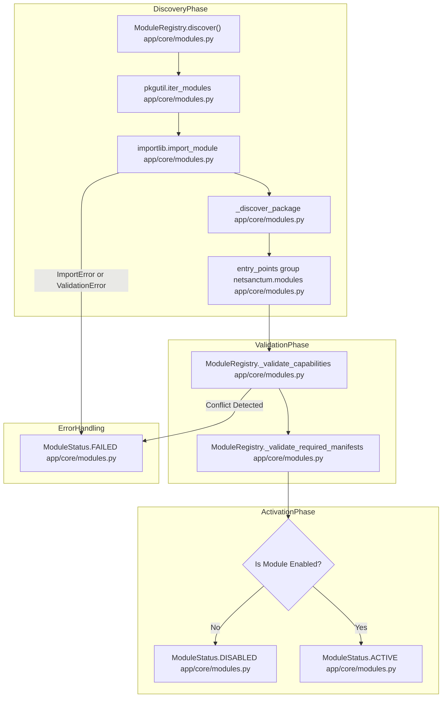

1. **Package Iteration**: `ModuleRegistry.discover()` scans the `app.modules` namespace using `pkgutil.iter_modules` [app/core/modules.py:75-89](). It also specifically includes modules under `app.modules.system` [app/core/modules.py:98-109]().
2. **Manifest Extraction**: For each discovered sub-package, it attempts to import `{package}.module` and extract the `MODULE` attribute [app/core/modules.py:113-126]().
3. **Entry Points**: External modules registered under the `netsanctum.modules` entry point group are loaded and validated [app/core/modules.py:127]().

Sources:
- [app/core/modules.py:59-155]()
- [tests/test_module_contracts.py:51-63]()

---

## Activation, Disabling, and `ModuleStatus`

Each discovered module is assigned a `ModuleStatus` enum value reflecting its availability and runtime state [app/core/modules.py:35-40]().

### Status Definitions
- `ModuleStatus.ACTIVE`: The module is installed, its manifest is valid, and it is enabled in the configuration [app/core/modules.py:36]().
- `ModuleStatus.DISABLED`: The module is installed in the environment but omitted from the active configuration set [app/core/modules.py:37]().
- `ModuleStatus.UNAVAILABLE`: The module is requested by configuration but missing from the runtime container image [app/core/modules.py:38](). This can happen if `installed_modules` is provided and the module ID is not in the set [app/core/modules.py:116-124]().
- `ModuleStatus.FAILED`: The module failed to load due to syntax errors, validation failures, or capability conflicts [app/core/modules.py:39]().
- `ModuleStatus.INCOMPATIBLE`: The module's manifest specifies an `api_version` incompatible with `MODULE_API_VERSION` [app/core/modules.py:40]().

Required core modules (`auth`, `settings`, `sharing`) are defined in `REQUIRED_MODULE_IDS` and cannot be disabled [app/core/modules.py:32](). If an explicitly enabled module is not installed or is unavailable, a `RuntimeError` is raised if `strict_enabled` is true [app/core/modules.py:149-153]().

Sources:
- [app/core/modules.py:35-58]()
- [tests/test_module_contracts.py:64-91]()

---

## Capability Validation

During discovery, `ModuleRegistry._validate_capabilities()` enforces strict architectural invariants to prevent runtime collisions between modules [app/core/modules.py:157-181]().

| Resource Type | Validation Constraint | Code Reference |
| :--- | :--- | :--- |
| **Database Migrations** | No two modules may claim ownership of the same database table. | [app/core/modules.py:158-168]() |
| **Dashboard URLs** | Dashboard endpoint routes must not collide. | [app/core/modules.py:170]() |
| **Storage Namespaces** | Storage namespace strings must be globally unique across all modules. | [app/core/modules.py:171]() |
| **Package Prefixes** | NSP package import/export prefixes must be unique. | [app/core/modules.py:172]() |
| **Entity Types** | Entity types must be unique across modules. | [app/core/modules.py:173](). |
| **Integration IDs** | Versioned integration handlers must declare unique IDs. | [app/core/modules.py:174]() |
| **Integration Contracts** | Integration contracts must be unique. | [app/core/modules.py:175](). |
| **UI Actions** | UI action IDs must be unique. | [app/core/modules.py:176](). |
| **Browser Policies** | Browser policy IDs must be unique. | [app/core/modules.py:177](). |
| **Browser Credential Scopes** | Browser credential scopes must be unique. | [app/core/modules.py:178](). |

Sources:
- [app/core/modules.py:157-181]()
- [app/core/module_types.py:1-40]()

---

## Startup and Shutdown Hooks

Modules can provide optional startup initialization logic and shutdown cleanups via attributes on `ModuleSpec` or registered callbacks.
- **Startup**: The `startup` attribute on `ModuleSpec` points to an async function that is awaited during FastAPI lifespan startup to initialize background workers, register event listeners, or verify connectivity.
- **Shutdown**: The `shutdown` attribute on `ModuleSpec` points to an async function that is awaited during application teardown to flush buffers, close persistent handles, or execute module cleanup.
- **File and Module Cleanup Hooks**: `module_cleanup` and `file_cleanup` functions can be registered in the manifest to clear out orphaned resources when items or modules are purged [app/modules/music/module.py:32-33]().

Sources:
- [tests/test_module_contracts.py:40-49]()
- [app/core/modules.py:59-155]()
- [app/modules/music/module.py:32-33]()

---

## Module Configuration and Build Arguments (`NETSANCTUM_MODULES`)

Module activation is controlled by the `NETSANCTUM_MODULES` build argument or the runtime `INSTALLED_MODULES` configuration setting [tests/test_module_contracts.py:64-103]().

### Build-Time Resolution

Title: Build Argument to System Entity Mapping
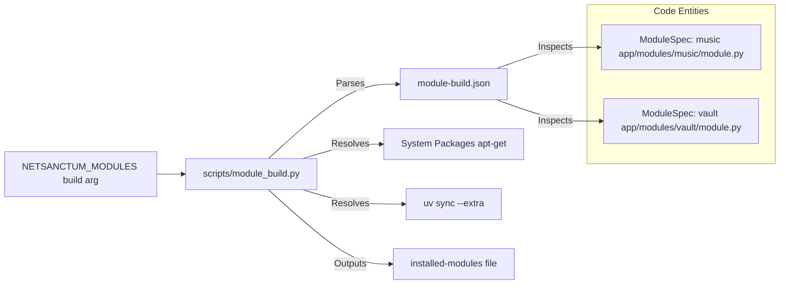

- **`NETSANCTUM_MODULES`**: A comma-separated list of modules included in the Docker build. If set to `default`, modules flagged as default-enabled are included. If set to `core`, only required modules (`auth`, `settings`, `sharing`) are bundled [tests/test_module_contracts.py:130-138]().
- **`module-build.json`**: A declarative catalog mapping module identifiers to their respective python optional dependencies, system packages (`apt` packages like `ffmpeg`, `deno`), and frontend assets [module-build.json:1-105]().
- **Installed Marker**: The build script writes the active module list to `/opt/netsanctum/installed-modules`, which `app.core.module_config` reads to restrict runtime discovery [tests/test_module_contracts.py:92-103]().
- **External Modules**: External Python packages can register server-side modules via `netsanctum.modules` entry points. These modules must be explicitly listed in `NETSANCTUM_EXTERNAL_MODULES` during the build process to be installed and discovered [tests/test_module_contracts.py:140-164]().

Sources:
- [module-build.json:1-105]()
- [tests/test_module_contracts.py:112-184]()
- [app/core/modules.py:1-40]()

---

<<< SECTION: Security and Authentication [2.2-security-and-authentication] >>>

# Page: Security and Authentication

# Security and Authentication

<details>
<summary>Relevant source files</summary>

The following files were used as context for generating this wiki page:

- [app/core/http_security.py](app/core/http_security.py)
- [app/core/security.py](app/core/security.py)
- [app/core/templates.py](app/core/templates.py)
- [app/core/templates/dashboard.html](app/core/templates/dashboard.html)
- [app/modules/auth/__init__.py](app/modules/auth/__init__.py)
- [app/modules/auth/router.py](app/modules/auth/router.py)
- [scripts/render_load_check.py](scripts/render_load_check.py)
- [tests/test_dashboard_csp_migration.py](tests/test_dashboard_csp_migration.py)
- [tests/test_render_load_check.py](tests/test_render_load_check.py)
- [tests/test_vault_dispatch.py](tests/test_vault_dispatch.py)

</details>


## Purpose and Scope

This wiki page covers the security and authentication subsystem of NetSanctum, designed around a **single-user authentication model** tailored for private, self-hosted environments. Topics include the singleton owner identity (`OwnerUser`), master token generation and SHA-256 hashing, Redis session cookies, Bearer and query token validation, cross-site request forgery (CSRF) guards, WebSocket/extension origin validation in `app/core/http_security.py`, and the authentication module router (`app/modules/auth/router.py`) alongside its Neo-brutalist login terminal.

Sources: `[app/core/security.py:1-177]()`, `[app/core/http_security.py:1-153]`, `[app/modules/auth/router.py:1-136]()`

---

## 1. The Owner Identity

NetSanctum avoids multi-user registration workflows in favor of a single administrative owner occupant. The system defines a static `OwnerUser` class that represents this occupant with full superuser privileges across all modules `[app/core/security.py:81-100]()`.

| Attribute | Type | Default Value | Description |
| :--- | :--- | :--- | :--- |
| `id` | `int` | `1` | Primary key used for ownership associations in database models. |
| `username` | `str` | `"owner"` | System username for the single occupant. |
| `email` | `str` | `"owner@netsanctum.local"` | Static email identifier. |
| `is_active` | `bool` | `True` | Account status flag. |
| `is_superuser` | `bool` | `True` | Grants administrative access across global and module-level routes. |

The class also provides a `model_validate` compatibility helper for Pydantic serialization `[app/core/security.py:90-100]()`.

Sources: `[app/core/security.py:81-100]()`

---

## 2. Master Token Lifecycle and Hashing

Access to a NetSanctum instance is anchored by a master token generated during the initial bootstrap.

### Token Hashing and Verification
- **Generation:** During application startup (`lifespan` function in `app/main.py`), if the access token hash file does not exist, a new URL-safe token is generated using `secrets.token_urlsafe(32)`. The plaintext token is temporarily written for user retrieval and then its SHA-256 hash is persisted `[app/core/security.py:38-78]()`.
- **Storage:** The raw master token is never stored permanently. Instead, its SHA-256 digest is written to the path defined by `ACCESS_TOKEN_HASH_PATH` (`TOKEN_FILE_PATH`) `[app/core/security.py:38-78]()`.
- **Verification:** `verify_access_token(token: str)` reads the stored hash from disk, computes the SHA-256 hash of the input token, and compares them using `hmac.compare_digest` to prevent timing attacks `[app/core/security.py:67-78]()`.
- **Bootstrap Cleanup:** Once an access token or session is successfully authenticated, `delete_bootstrap_plaintext()` attempts to remove any residual plaintext token file from disk `[app/core/security.py:59-64]()`, `[app/modules/auth/router.py:65]()`.

### API Sessions and Master API Key
- **API Sessions:** Clients exchanging a valid master token via `POST /auth/login` receive an ephemeral bearer session token generated via `create_api_session()` `[app/core/security.py:53-56]()`, `[app/modules/auth/router.py:51-66]()`. These tokens are hashed with SHA-256 under the Redis key pattern `api-session:{digest}` with an 86,400-second (24-hour) TTL `[app/core/security.py:48-50]()`.
- **Master API Key:** External integrations requiring static header authentication pass an `X-API-Key` header, which is validated by `verify_api_key()` against `settings.MASTER_API_KEY` using constant-time comparison `[app/core/security.py:164-177]()`.

Sources: `[app/core/security.py:36-78]()`, `[app/core/security.py:164-177]()`, `[app/modules/auth/router.py:51-66]()`

---

## 3. Session Management and Authentication Dependencies

UI interactions and API calls are authenticated via FastAPI dependencies defined in `app/core/security.py`.

### Authentication Strategy Hierarchy
The `get_current_user` dependency evaluates incoming requests in a specific order `[app/core/security.py:104-126]`:
1. **Bearer Token (API):** Inspects the `Authorization` header for the `Bearer ` prefix. If present, it strips the prefix, computes the API session key digest, and queries `redis_client` for a matching active session (`"1"`) `[app/core/security.py:110-114]()`.
2. **Session Cookie (UI):** Inspects request cookies for `access_token`. If present, it queries Redis for `session:{session_id}` `[app/core/security.py:116-121]()`.

If either check succeeds, `get_current_user` returns an `OwnerUser` instance; otherwise, it raises an HTTP 401 `HTTPException` `[app/core/security.py:123-126]()`.

### Security Data Flow Diagram

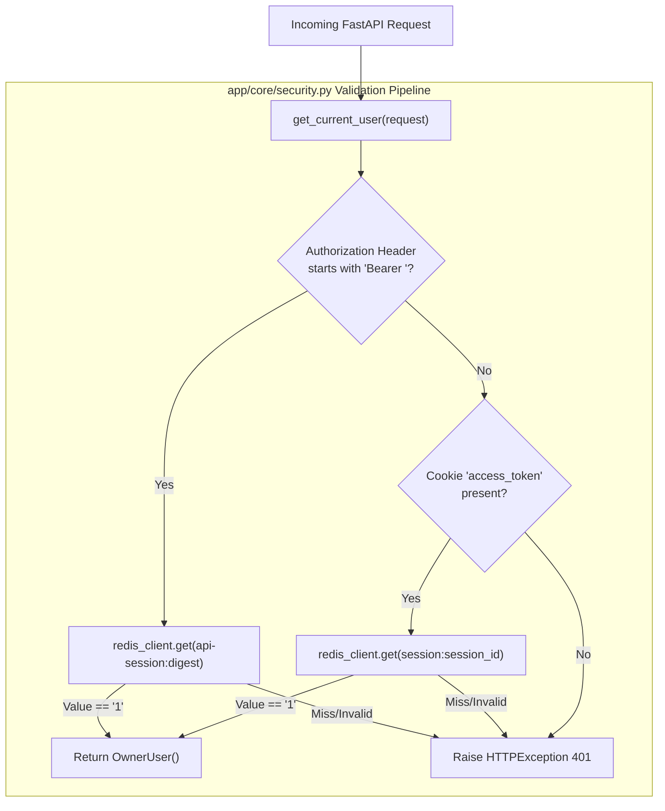

Sources: `[app/core/security.py:104-126]()`

---

## 4. Cross-Site Request Checks, Extension Origins, and CSP (`http_security.py`)

To protect against Cross-Site Request Forgery (CSRF) and secure transport layers, NetSanctum implements request filtering and security helpers in `app/core/http_security.py`.

### Cross-Site Mutation Protection
The `is_cross_site_request(request: Request)` helper intercepts unsafe HTTP methods (`POST`, `PUT`, `PATCH`, `DELETE`) `[app/core/http_security.py:10, 74-77]`:
- **Capability Routes Bypass:** Specific interactive capability routes (such as external token saving or tabletop room joining) are excluded from strict cross-site checks `[app/core/http_security.py:11-12, 38-43, 78-79]()`.
- **Extension Origin Bypass:** Packaged browser extension origins (e.g., `chrome-extension://<id>`) are allowed for specific routes like `/auth/login` and `/api/vault/capture` when matched against `NETSANCTUM_EXTENSION_ORIGIN_IDS`, because they authenticate with bearer tokens rather than cookies `[app/core/http_security.py:14-27, 30-72, 80-81]()`.
- **Sec-Fetch-Site / Origin Headers:** If the `sec-fetch-site` header is explicitly `"cross-site"`, the request is flagged `[app/core/http_security.py:83-85]()`. Otherwise, the `origin` header is parsed and compared against the request's `host` or `netloc` headers to ensure domain alignment `[app/core/http_security.py:87-102]()`.

### Dashboard Content Security Policy (CSP) and Nonces
For sensitive interfaces like `/vault/dashboard`, a strict Content Security Policy is applied `[app/core/http_security.py:131-153]()`:
- Responses generate a per-request nonce stored in a `ContextVar` (`_CSP_NONCE`) accessed via `csp_nonce()` `[app/core/http_security.py:135-147]()`.
- This ensures inline scripts require the nonce, preventing unauthorized script execution while allowing nonced template execution.

### Security Entity Map Diagram

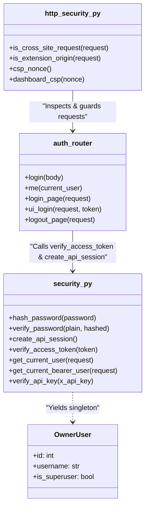

Sources: `[app/core/http_security.py:1-153]`, `[app/core/security.py:1-177]()`

---

## 5. Auth Module Router and Login Template

The `auth` module exposes both JSON API endpoints for programmatic clients and server-rendered endpoints backed by templates `[app/modules/auth/router.py:1-136]()`.

### Router Endpoints
- `POST /auth/login`: Exchanges a master token for an ephemeral Bearer token (`TokenResponse`) `[app/modules/auth/router.py:51-66]()`.
- `GET /auth/me`: Returns the static owner profile (`OwnerResponse`) `[app/modules/auth/router.py:69-82]()`.
- `GET /auth/login-page`: Renders the Neo-brutalist access terminal (`login.html`) `[app/modules/auth/router.py:86-90]()`.
- `POST /auth/ui/login`: HTMX form handler that validates the token, generates a 7-day Redis session cookie (`access_token`), and returns success partials `[app/modules/auth/router.py:93-124]()`.
- `POST /auth/logout-page`: Revokes the session in Redis, deletes the session cookie, and redirects to the login terminal `[app/modules/auth/router.py:127-136]()`.

Sources: `[app/modules/auth/router.py:1-136]()`

---

<<< SECTION: Storage, Encryption and Secrets [2.3-storage,-encryption-and-secrets] >>>

# Page: Storage, Encryption and Secrets

# Storage, Encryption and Secrets

<details>
<summary>Relevant source files</summary>

The following files were used as context for generating this wiki page:

- [app/core/config.py](app/core/config.py)
- [app/core/crypto/__init__.py](app/core/crypto/__init__.py)
- [app/core/crypto/asymmetric.py](app/core/crypto/asymmetric.py)
- [app/core/crypto/codec.py](app/core/crypto/codec.py)
- [app/core/crypto/envelope.py](app/core/crypto/envelope.py)
- [app/core/crypto/kdf.py](app/core/crypto/kdf.py)
- [app/core/encryption_keys.py](app/core/encryption_keys.py)
- [app/core/encryption_migration.py](app/core/encryption_migration.py)
- [app/core/staging.py](app/core/staging.py)
- [app/core/storage.py](app/core/storage.py)
- [app/modules/system/storage/router.py](app/modules/system/storage/router.py)
- [scripts/vault_verify_media.py](scripts/vault_verify_media.py)
- [tests/fixtures/crypto_wire_vectors.json](tests/fixtures/crypto_wire_vectors.json)
- [tests/fixtures/seekable_v2_legacy_aad.bin](tests/fixtures/seekable_v2_legacy_aad.bin)
- [tests/fixtures/seekable_v2_legacy_aad.sha256](tests/fixtures/seekable_v2_legacy_aad.sha256)
- [tests/fixtures/write_crypto_vectors.py](tests/fixtures/write_crypto_vectors.py)
- [tests/test_core_crypto_boundary.py](tests/test_core_crypto_boundary.py)
- [tests/test_core_crypto_wire.py](tests/test_core_crypto_wire.py)
- [tests/test_staging.py](tests/test_staging.py)
- [tests/test_storage_seekable.py](tests/test_storage_seekable.py)

</details>


## Purpose and Scope
This page covers the shared storage abstraction layer, AES-256-GCM file and seekable envelope mechanisms, key provisioning routines, legacy ciphertext migration pipelines, secret management, file staging, the core crypto package, and path traversal defenses implemented in `app/core/`. Modules are strictly prohibited from writing to disk or S3 directly; instead, they interact with storage through the unified `StorageInterface` [app/core/storage.py:63-64]().

---

## Storage Abstraction and Backends

The storage layer defines an Abstract Base Class (`StorageInterface`) that specifies standard file operations: saving, streaming, deleting, size inspection, and existence checks [app/core/storage.py:63-290](). The active backend is instantiated via the `get_storage()` singleton [app/core/config.py:109-110](), supporting both local filesystem storage (`LocalStorage`) and S3-compatible object storage (`S3Storage`) [app/core/storage.py:300-]().

**Storage Architecture and Encryption Mapping**
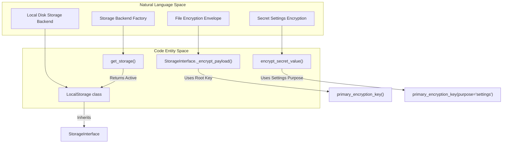
**Sources:** [app/core/storage.py:63-104](), [app/core/storage.py:300-314](), [app/core/secret_values.py:19-24](), [app/core/encryption_keys.py:30-39]()

### StorageInterface Methods
* `save_file(data: bytes, path: str) -> str`: Persists binary data at a logical path [app/core/storage.py:78-83]().
* `save_file_encrypted(data: bytes, path: str) -> str`: Encrypts payload with AES-256-GCM before saving [app/core/storage.py:90-95]().
* `get_file_stream(path: str) -> BinaryIO`: Opens a readable binary stream [app/core/storage.py:128-133]().
* `get_file_stream_decrypted(path: str) -> BinaryIO`: Retrieves and transparently decrypts stored payloads [app/core/storage.py:135-152]().
* `delete_file(path: str) -> bool`: Removes stored file [app/core/storage.py:200-205]().

**Sources:** [app/core/storage.py:63-290]()

---

## AES-256-GCM File Encryption and Envelope Format

Files marked for encryption use the `cryptography` library's `AESGCM` implementation [app/core/storage.py:20-22]().

* **Magic Header**: Current encrypted payloads begin with the magic bytes `NSENC\x02\x00\x00` (`ENCRYPTED_FILE_MAGIC`) [app/core/storage.py:25-25]().
* **Nonce**: A 12-byte random cryptographic nonce is generated via `os.urandom(NONCE_SIZE)` [app/core/storage.py:26-26]().
* **Authenticated Additional Data (AAD)**: The encryption binds ciphertext integrity to its logical path using `ENCRYPTED_FILE_MAGIC + b"\x00" + path.encode("utf-8")` [app/core/storage.py:101-102]().
* **Envelope Structure**: The stored binary stream is arranged as `[Magic Header (8 bytes)] || [Nonce (12 bytes)] || [Ciphertext + Auth Tag]`.

When decrypting, `_decrypt_payload` checks for the magic header, validates lengths, and attempts decryption against the primary key followed by any registered legacy keys [app/core/storage.py:114-125]().

**Sources:** [app/core/storage.py:20-125]()

---

## Chunked, Seekable AES-256-GCM Envelopes

Standard AES-GCM over a single monolithic blob cannot be randomly seeked without decrypting the entire file. For large media (such as archived videos and audio), NetSanctum uses a chunked, seekable envelope (`SEEKABLE_MAGIC` / `SEEKABLE_MAGIC_V2`) [app/core/storage.py:34-51]().

* **Chunk Size**: Payloads are split into 1 MB chunks (`SEEKABLE_CHUNK_SIZE = 1024 * 1024`) [app/core/storage.py:35-35]().
* **Nonce Indexing**: Each chunk's encryption nonce incorporates the chunk index, ensuring no `(key, nonce)` pair repeats across chunks and that each chunk authenticates independently [app/core/storage.py:32-33]().
* **Version 2 Envelope**: `SEEKABLE_MAGIC_V2` (`NSENCS\x02\x00\x00`) binds the plaintext length, chunk size, and chunk count directly into every chunk's associated data [app/core/storage.py:45-50](). This prevents header tampering from going unnoticed.
* **Streaming and Range Reads**: `_RangeReader` and `_S3RangeStream` allow seeking and partial range retrieval over local disks and S3 objects without reading or decrypting unrequested byte ranges [app/core/storage.py:54-175]().

**Sources:** [app/core/storage.py:32-175](), [tests/test_storage_seekable.py:1-184]()

---

## Key Provisioning (`encryption_keys.py`)

Root key derivation and purpose-specific subkeys are managed centrally in `app/core/encryption_keys.py` [app/core/encryption_keys.py:1-73]().

* **Root Key (`_root_encryption_key`)**: In production, `FILE_ENCRYPTION_KEY_PATH` must point to a secure runtime file containing at least 32 bytes of key material, which is hashed with SHA-256 [app/core/encryption_keys.py:8-19](). In development environments, it falls back to hashing `FILE_ENCRYPTION_KEY` [app/core/encryption_keys.py:24-25]().
* **Purpose Isolation (`primary_encryption_key`)**: Using HMAC-SHA256 with the root key and a purpose string (`netsanctum:files:v2` or `netsanctum:settings:v2`), keys are isolated between file storage and secret settings storage [app/core/encryption_keys.py:30-39]().
* **Legacy Keys (`legacy_encryption_keys`)**: Collects historical fallback keys and values from `LEGACY_FILE_ENCRYPTION_KEYS_PATH` to support smooth key rotation and ciphertext migration [app/core/encryption_keys.py:42-73]().

**Sources:** [app/core/encryption_keys.py:1-73]()

---

## Legacy Ciphertext Migration (`encryption_migration.py`)

To upgrade legacy encrypted objects to current key iterations without downtime, NetSanctum provides an asynchronous background migration service [app/core/encryption_migration.py:1-82]().

**Decryption, Migration and Secret Handling**
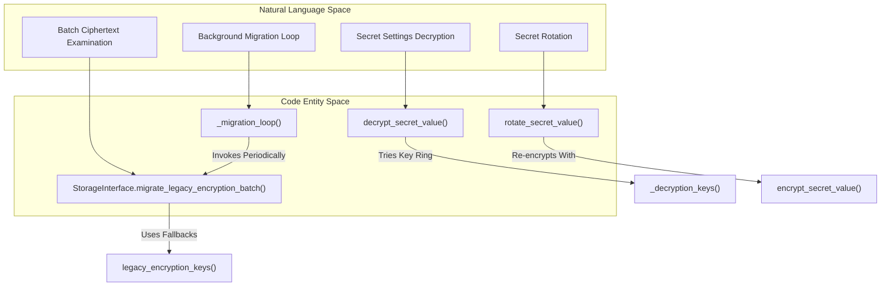
**Sources:** [app/core/encryption_migration.py:32-65](), [app/core/storage.py:291-296](), [app/core/secret_values.py:31-46](), [app/core/encryption_keys.py:42-73]()

* **Status Tracking**: `encryption_migration_status()` exposes runtime metrics including migrated counts, pending files, unreadable items, and error states [app/core/encryption_migration.py:23-25]().
* **Lifecycle**: Started via `start_encryption_migration()` during application startup and gracefully stopped via `stop_encryption_migration()` [app/core/encryption_migration.py:70-82]().

**Sources:** [app/core/encryption_migration.py:1-82](), [app/core/storage.py:291-296]()

---

## Secret Values Management (`secret_values.py`)

Module configurations and sensitive database settings store encrypted values prefixed with `enc:v1:` [app/core/secret_values.py:1-56]().

* **Encryption (`encrypt_secret_value`)**: Prepends `enc:v1:` to a base64-encoded payload containing a 12-byte nonce and AES-256-GCM ciphertext encrypted using the `settings` purpose key [app/core/secret_values.py:19-24]().
* **Decryption (`decrypt_secret_value`)**: Strips the prefix, decodes base64, and iterates through current and legacy settings keys until successful decryption [app/core/secret_values.py:27-38]().
* **Rotation (`rotate_secret_value`)**: Decrypts existing ciphertext and re-encrypts it under the current primary key [app/core/secret_values.py:40-46]().

**Sources:** [app/core/secret_values.py:1-56]()

---

## Staging Directory and File Ingestion

Incoming downloads, spooled chunk envelopes, and staged screenshots are processed via `app/core/staging.py` before being committed to persistent storage.

* **Staging Path (`STAGING_DIR`)**: Configured via settings (defaulting to `/tmp/netsanctum-staging`) [app/core/config.py:125-125](). In production deployments, this directory is expected to reside on a tmpfs mount to prevent plaintext from resting on unencrypted block storage [app/core/config.py:117-124]().
* **Tmpfs Enforcement**: `STAGING_REQUIRE_TMPFS` can be enabled to refuse startup if the staging directory is not mounted on tmpfs [app/core/config.py:126-126]().
* **Orphan Cleanup**: Files left behind by interrupted writes or crashes older than `STAGING_ORPHAN_MINUTES` are automatically cleaned up [app/core/config.py:127-130]().

**Sources:** [app/core/config.py:112-130](), [tests/test_staging.py:1-](), [app/core/staging.py:1-]()

---

## Core Crypto Package (`app/core/crypto/`)

The core cryptography package under `app/core/crypto/` provides modular primitives for key derivation, authenticated envelopes, and asymmetric sealing [app/core/crypto/__init__.py:1-23]().

* `codec.py`: URL-safe base64 encoding and decoding helpers (`encode_b64`, `decode_b64`) [app/core/crypto/codec.py:1-19]()
* `kdf.py`: Argon2id passphrase stretching into key-encryption keys (`derive_kek`), data key generation (`new_data_key`), and wrapped key serialization (`WrappedKey`) [app/core/crypto/kdf.py:1-169]()
* `envelope.py`: Row-bound AES-GCM payload sealing (`seal`, `unseal`, `context_for`) and HKDF subkey derivation (`derive_subkey`) [app/core/crypto/envelope.py:1-67]()
* `asymmetric.py`: X25519 keypairs and blind-write inbox envelopes (`generate_inbox_keypair`, `seal_for_inbox`, `open_from_inbox`) allowing unauthenticated writers to securely deposit records into encrypted collections [app/core/crypto/asymmetric.py:1-157]()

Boundary tests in `tests/test_core_crypto_boundary.py` verify that `app/core/crypto` remains entirely independent of module-level imports [tests/test_core_crypto_boundary.py:1-42]().

**Sources:** [app/core/crypto/__init__.py:1-196](), [app/core/crypto/kdf.py:1-169](), [app/core/crypto/envelope.py:1-67](), [app/core/crypto/asymmetric.py:1-157](), [tests/test_core_crypto_boundary.py:1-67]()

---

## Path Traversal Protection

The `LocalStorage` backend implements strict path sanitization to prevent directory traversal attacks [app/core/storage.py:300-314]().

* **Sanitization (`_full_path`)**: Resolves requested relative paths against `self._root` [app/core/storage.py:309-311]().
* **Boundary Check**: Uses `resolved.is_relative_to(self._root)` to verify that the target path does not escape the storage root directory, raising a `ValueError` if traversal is detected [app/core/storage.py:312-314]().

**Sources:** [app/core/storage.py:300-314]()

---

<<< SECTION: Background Tasks and Celery [2.4-background-tasks-and-celery] >>>

# Page: Background Tasks and Celery

# Background Tasks and Celery

<details>
<summary>Relevant source files</summary>

The following files were used as context for generating this wiki page:

- [app/core/notifications.py](app/core/notifications.py)
- [app/core/task_dispatch.py](app/core/task_dispatch.py)
- [app/core/worker_loop.py](app/core/worker_loop.py)
- [app/modules/miku/tasks.py](app/modules/miku/tasks.py)
- [app/modules/planner/sweep.py](app/modules/planner/sweep.py)
- [app/modules/planner/tasks.py](app/modules/planner/tasks.py)
- [app/modules/system/storage/templates/storage_browser.html](app/modules/system/storage/templates/storage_browser.html)
- [tests/test_miku_initiative.py](tests/test_miku_initiative.py)
- [tests/test_planner.py](tests/test_planner.py)
- [tests/test_task_registration.py](tests/test_task_registration.py)

</details>


NetSanctum utilizes Celery for asynchronous processing, allowing long-running operations like media downloading, metadata syncing, and library exports to execute outside the request-response cycle. The system implements a "tracker-before-broker" pattern to ensure task visibility and progress monitoring via Redis before a task is picked up by a worker, alongside a process-safe Redis Pub/Sub hub (`app/core/realtime.py`) for live client updates, process-wide worker event loops (`app/core/worker_loop.py`), and self-arming periodic background tasks.

---

## Task Dispatching and Tracking

NetSanctum avoids direct `task.apply_async()` calls in favor of tracked dispatchers. These helpers create a Redis entry representing the task's metadata (status, parameters, target) before sending it to the broker.

### Tracked Dispatch Helpers
Two primary helpers exist in `app/core/task_dispatch.py`():
1.  `dispatch_tracked_async`: Designed for use within asynchronous FastAPI route handlers [app/core/task_dispatch.py:27-54]().
2.  `dispatch_tracked_sync`: Designed for use in synchronous execution contexts [app/core/task_dispatch.py:57-73]().

### The Tracker-Before-Broker Pattern
The dispatchers follow a strict sequence to prevent ghost tasks or synchronization races:
1.  **UUID Generation**: A unique `task_id` (`str(uuid.uuid4())`) is generated [app/core/task_dispatch.py:46]().
2.  **Redis Tracking**: A key is set in Redis using a provided prefix (e.g., `key_prefix:task_id`) containing the task payload and the ID with a default TTL of 24 hours [app/core/task_dispatch.py:47-48]().
3.  **Broker Submission**: The task is sent to the Celery broker using the pre-generated `task_id` [app/core/task_dispatch.py:50]().
4.  **Atomic Rollback**: If broker submission fails, the Redis tracking key is immediately deleted to prevent orphaned progress entries in the Control Center [app/core/task_dispatch.py:51-53]().

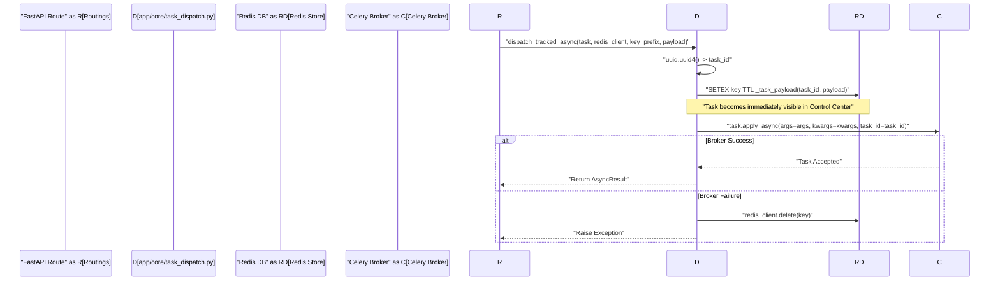
Sources: [app/core/task_dispatch.py:27-73]()

---

## Redis Progress Key Patterns and Terminal State Filtering

Progress tracking and task metadata are stored in Redis using module-defined key patterns. The Control Center inspects these keys to build a global overview of active operations.

### Terminal Task Payload Detection
To prevent finished or failed tasks from clogging the active tasks list, `app/core/task_dispatch.py`() implements `is_terminal_task_payload()` [app/core/task_dispatch.py:10-20]():
*   Checks if the payload state is within `TERMINAL_TASK_STATES` (`completed`, `failed`, `cancelled`) [app/core/task_dispatch.py:7, 10-11]().
*   Inspects status strings and titles for terms like `completed`, `already available`, `error`, or ending with `(finished)` [app/core/task_dispatch.py:13-20]().

### Tracked Tasks Scanning
The Control Center queries active module manifests for their `progress_key_patterns`, scans Redis using `scan_iter`, filters out terminal states via `is_terminal_task_payload`, and returns the aggregated active task list [app/core/control_center.py:146-180]().

Sources: [app/core/task_dispatch.py:7-20](), [app/core/control_center.py:146-180]()

---

## Realtime Event Delivery (`realtime.py`)

NetSanctum uses an asynchronous, process-safe Redis Pub/Sub hub (`RealtimeHub` in `app/core/realtime.py`()) to fan out realtime events to local WebSocket clients.

### Key Components of `RealtimeHub`
*   **Channel Validation**: `CHANNEL_PATTERN` restricts channel names to safe alphanumeric strings with colons, hyphens, and underscores (`^[a-z][a-z0-9:_-]{0,127}$`) [app/core/realtime.py:16, 30-33]().
*   **Publishing**: `publish()` serializes events into JSON payloads and pushes them to Redis Pub/Sub channels (`netsanctum:realtime:{channel}`) [app/core/realtime.py:35-44]().
*   **Subscription Management**: `connect()` and `disconnect()` manage local WebSocket connections per channel and spawn background listener tasks (`_listen`) on demand [app/core/realtime.py:46-67]().
*   **Broadcasting**: `_broadcast()` iterates over active local WebSockets for a given channel, dispatching text messages and pruning stale connections automatically [app/core/realnet.py:85-94]().

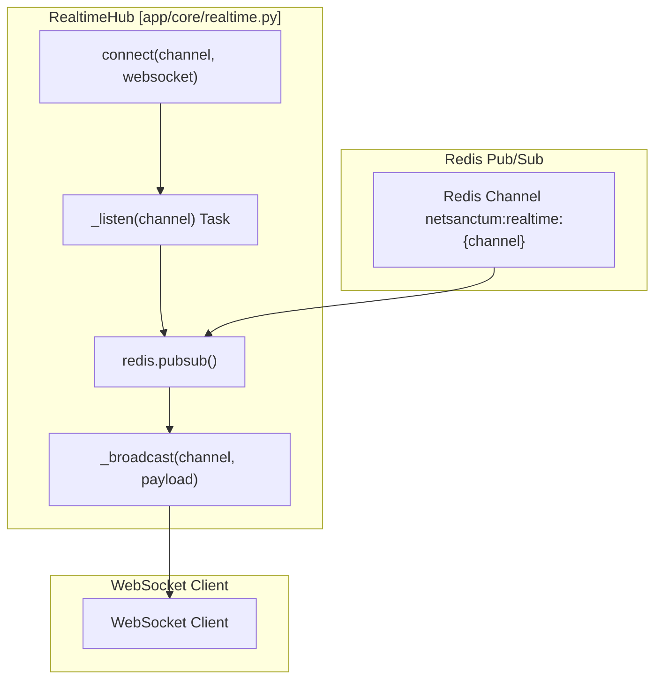
Sources: [app/core/realtime.py:1-107]()

---

## Task Cancellation via Revoke

Task cancellation is handled through Celery control commands. When a user requests task termination via the Control Center:
1.  The task ID is validated against `TASK_ID_PATTERN` to prevent command injection or malformed identifiers [app/core/control_center.py:22]().
2.  `celery_app.control.revoke` is invoked with `terminate=True` and `signal='SIGTERM'` to forcefully halt underlying worker processes (such as `yt-dlp` or `ffmpeg`).

Sources: [app/core/control_center.py:22](), [tests/test_control_center.py:82-85]()

---

## Celery Worker Setup and Self-Rescheduling Loops (`scheduler.py`)

The `scheduler.py` file configures the Celery application instance, its broker, backend, and task routing. Rather than relying on an external Celery Beat container for periodic execution, NetSanctum employs self-rescheduling worker loops.

### Self-Rescheduling Tasks (`miku` and `planner`)
Modules like Miku and the Planner execute recurring loops by re-arming themselves upon completion:
*   **Miku Continuation**: `continue_tasks()` claims due assistant goals, executes them via `run_async(continue_due_tasks())`, and re-arms itself using `apply_async(countdown=SELF_RESCHEDULE_SECONDS)` [app/modules/miku/tasks.py:89-94](). It is initialized on worker boot via the `@worker_ready.connect` signal [app/modules/miku/tasks.py:96-102]().
*   **Planner Reminders Sweep**: `sweep_reminders()` runs synchronously, pushing due reminders via `sweep_due_reminders_sync(session)` and rescheduling itself via countdown [app/modules/planner/tasks.py:67-78](). Concurrency locks in Redis via `SETNX` ensure that multi-worker deployments do not fork duplicate loops [app/modules/planner/tasks.py:31-42]().

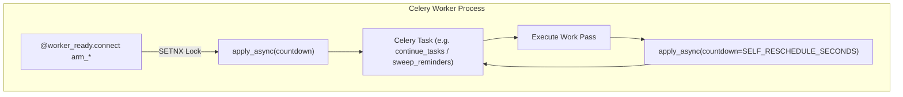
Sources: [app/modules/miku/tasks.py:15-102](), [app/modules/planner/tasks.py:16-94]()

---

## Worker Event Loop (`worker_loop.py`)

Celery workers often need to perform asynchronous operations, but `asyncio.run` creates a new event loop for each call, causing issues with database connections bound to specific loops. `app/core/worker_loop.py` provides a solution by maintaining a single, long-lived event loop per worker process.

### `worker_loop()`
The `worker_loop()` function [app/core/worker_loop.py:23-29]() returns the process-wide `asyncio.AbstractEventLoop`. It creates a new loop on its first call or if the existing one is closed, ensuring all async tasks within a worker share the same loop context.

### `run_async(coro)`
The `run_async()` helper [app/core/worker_loop.py:32-49]() allows synchronous Celery tasks to execute asynchronous coroutines on the worker's dedicated event loop without raising "Future attached to a different loop" errors.

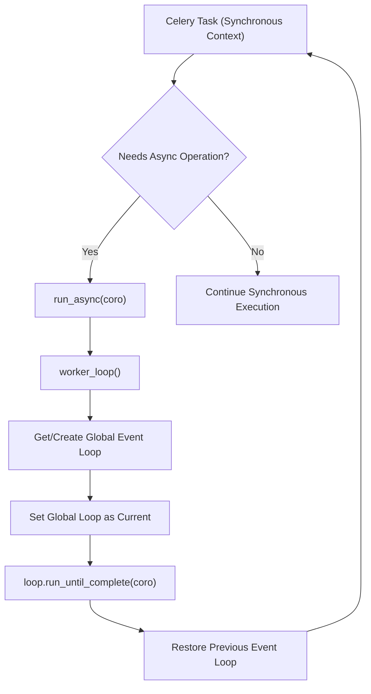
Sources: [app/core/worker_loop.py:1-51]()

---

## Notifications (`notifications.py`)

The `app/core/notifications.py` module provides a mechanism for pushing background notices to the user. These notifications are queued in Redis and polled by the web frontend.

### `push_notification()` and `push_notification_sync()`
*   `push_notification(user_id, text, kind)` [app/core/notifications.py:48-60]() is an asynchronous function used by web-side components or async tasks to queue a notification via the async Redis client.
*   `push_notification_sync(user_id, text, kind)` [app/core/notifications.py:64-79]() is its synchronous counterpart for Celery workers, using a dedicated synchronous client (`sync_redis_client()` [app/core/notifications.py:28-38]()).

Notifications are stored as JSON payloads in Redis lists (`miku:notify:{user_id}`) [app/core/notifications.py:23](), trimmed to `MAX_NOTIFICATIONS` (20) with a 7-day TTL [app/core/notifications.py:20-21]().

### `pop_notifications()`
`pop_notifications(user_id)` [app/core/notifications.py:96-105]() retrieves all pending notifications oldest-first and clears the Redis key upon read.

Sources: [app/core/notifications.py:1-115](), [app/modules/planner/sweep.py:6-7]()

---

<<< SECTION: Database and Migrations [2.5-database-and-migrations] >>>

# Page: Database and Migrations

# Database and Migrations

<details>
<summary>Relevant source files</summary>

The following files were used as context for generating this wiki page:

- [alembic.ini](alembic.ini)
- [alembic/module_env/env.py](alembic/module_env/env.py)
- [alembic/module_env/script.py.mako](alembic/module_env/script.py.mako)
- [alembic/versions/a1b2c3d4e5f6_add_cover_offset_to_songs.py](alembic/versions/a1b2c3d4e5f6_add_cover_offset_to_songs.py)
- [alembic/versions/b2c3d4e5f6a7_add_cover_song_id_to_playlists.py](alembic/versions/b2c3d4e5f6a7_add_cover_song_id_to_playlists.py)
- [alembic/versions/c3d4e5f6a7b8_add_torrent_module_tables.py](alembic/versions/c3d4e5f6a7b8_add_torrent_module_tables.py)
- [alembic/versions/d4e5f6a7b8c9_add_video_channels_table.py](alembic/versions/d4e5f6a7b8c9_add_video_channels_table.py)
- [alembic/versions/e5f6a7b8c9d0_add_platform_to_video_archiver.py](alembic/versions/e5f6a7b8c9d0_add_platform_to_video_archiver.py)
- [alembic/versions/f6a7b8c9d0e1_add_updated_at_to_archived_videos.py](alembic/versions/f6a7b8c9d0e1_add_updated_at_to_archived_videos.py)
- [alembic/versions/g1h2i3j4k5l6_add_vault_module_tables.py](alembic/versions/g1h2i3j4k5l6_add_vault_module_tables.py)
- [alembic/versions/h2i3j4k5l6m7_add_workspace_fields_to_vault.py](alembic/versions/h2i3j4k5l6m7_add_workspace_fields_to_vault.py)
- [app/core/database.py](app/core/database.py)
- [app/core/migrations.py](app/core/migrations.py)
- [app/modules/alllib/migrations/versions/alllib_0001_initial.py](app/modules/alllib/migrations/versions/alllib_0001_initial.py)
- [app/modules/auth/i18n.py](app/modules/auth/i18n.py)

</details>


NetSanctum employs a hybrid database architecture that supports both asynchronous FastAPI request handlers and synchronous Celery workers. The system utilizes a per-module Alembic migration strategy, allowing independent modules to manage their own schema lifecycles while maintaining a unified global state and table ownership rules.

## Purpose and Scope
This page covers the database infrastructure and migration framework of NetSanctum, detailing:
- The dual SQLAlchemy engine setup for async FastAPI and sync Celery execution (`[app/core/database.py]()`).
- The global `alembic/` environment (`[alembic/module_env/env.py]()`) and the modular per-module Alembic migration engine (`[app/core/migrations.py]()`, `[alembic/module_env/env.py]()`).
- `MigrationSpec` declarations and the table ownership registry (`netsanctum_migration_ownership`).
- Legacy adoption logic for transitioning older schemas.
- CLI-driven migration management commands and transactional safety guards using PostgreSQL advisory locks.

---

## SQLAlchemy Engine Setup

The application provides two distinct database engines and session factories to accommodate different execution environments. All models across all modules inherit from a shared `Base` declarative class `[app/core/database.py:49-52]`.

| Component | Implementation | Scope |
| :--- | :--- | :--- |
| **Async Engine** | `create_async_engine` `[app/core/database.py:19-25]` | FastAPI request handlers |
| **Async Session** | `AsyncSessionLocal` `[app/core/database.py:27-31]` | Web API operations |
| **Sync Engine** | `create_engine` `[app/core/database.py:34-40]` | Celery background workers |
| **Sync Session** | `SyncSessionLocal` `[app/core/database.py:42-45]` | Background task persistence |

### Data Flow: Database Session Lifecycle
This diagram illustrates how the `get_db` dependency manages sessions for the web layer.

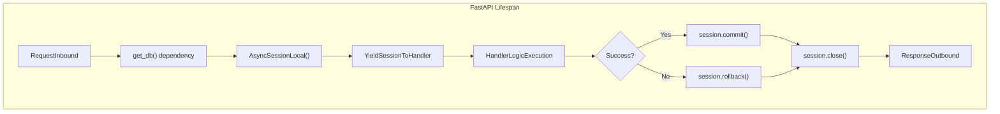
Sources: `[app/core/database.py:56-66]()`

---

## Per-Module Migration System

Unlike monolithic applications with a single migration history, NetSanctum treats each module as an independent entity with its own `version_table` and migration directory. This is orchestrated by `[app/core/migrations.py]()`.

### MigrationSpec and Ownership
Each module defines a `MigrationSpec` `[app/core/migrations.py:43]()` within its `ModuleSpec`. This specification declares:
*   **owned_tables**: A list of tables exclusively managed by this module `[app/core/migrations.py:119]()`.
*   **legacy_tables**: Tables that may already exist from older versions of the system `[app/core/migrations.py:161]()`.
*   **baseline_revision**: The revision ID to "stamp" if legacy tables are detected `[app/core/migrations.py:173]()`.

To prevent schema conflicts, the system maintains a `netsanctum_migration_ownership` table `[app/core/migrations.py:35]()`. During startup, the `_register_table_ownership` function verifies that no two modules claim the same table `[app/core/migrations.py:125-148]()`.

### Code Entity Mapping: Migration Components
This diagram maps the natural language concept of "Module Migration" to the specific code entities in the framework.

```mermaid
classDiagram
    class ModuleMigration {
        +module_id: str
        +package: str
        +versions_path: Path
        +version_table: str
    }
    class MigrationSpec {
        +path: str
        +owned_tables: list[str]
        +legacy_tables: list[str]
        +baseline_revision: str
    }
    class ModuleRegistry {
        +installed_records()
        +declared_records()
    }

    ModuleMigration --> MigrationSpec : "wraps"
    ModuleRegistry ..> ModuleMigration : "discovered by installed_migrations()"
    ModuleMigration ..> "netsanctum_migration_ownership" : "registers tables in"
```
Sources: `[app/core/migrations.py:38-70]()`, `[app/core/migrations.py:125-133]()`

---

## Migration Execution Flow

NetSanctum uses a specialized `module_env` `[app/core/migrations.py:32]()` for Alembic. When running migrations for a specific module, the environment is configured to only "see" the tables owned by that module using an `include_object` filter `[alembic/module_env/env.py:11-13]()`.

### Legacy Adoption Logic
The `_adopt_or_upgrade` function handles the transition from the old monolithic schema to the modular system:
1.  **Detection**: Checks if the module's specific `version_table` (e.g., `alembic_version_music`) exists `[app/core/migrations.py:158]()`.
2.  **Legacy Check**: If the table is missing but `legacy_tables` are present, it assumes a legacy installation `[app/core/migrations.py:160-162]()`.
3.  **Stamping**: It calls `command.stamp` with the `baseline_revision` to mark the legacy state as migrated `[app/core/migrations.py:173]()`.
4.  **Upgrade**: Executes `command.upgrade(config, "head")` to bring the schema to the latest version `[app/core/migrations.py:174]()`.

Sources: `[app/core/migrations.py:150-178]()`, `[alembic/module_env/env.py:1-35]()`

---

## CLI Commands and Management

The migration system is controlled via `[app/core/migrations.py]()` functions, which wrap standard Alembic commands:

*   **`upgrade_database(engine, registry)`**: The primary entry point. It iterates through all installed modules and applies pending migrations within an advisory lock `[app/core/migrations.py]()`.
*   **`revision_module(module_id, message)`**: Generates a new migration script in the module's specific `versions` directory `[app/core/migrations.py]()`.
*   **`downgrade_module(module_id, revision)`**: Reverts a specific module's schema `[app/core/migrations.py]()`.
*   **`check_migrations(engine, registry)`**: Validates that the current database schema matches the migration heads for all modules `[app/core/migrations.py]()`.

### Transactional Integrity
Postgres-based deployments use `pg_advisory_xact_lock` with a hardcoded `MIGRATION_LOCK_ID` `[app/core/migrations.py:34]()` to ensure that only one instance (e.g., in a scaled Docker environment) performs migrations at a time `[app/core/migrations.py]()`.

Sources: `[app/core/migrations.py:1-322]()`, `[app/modules/alllib/migrations/versions/alllib_0001_initial.py:1-54]()`

---

<<< SECTION: Integrations, Contracts and Packages [2.6-integrations,-contracts-and-packages] >>>

# Page: Integrations, Contracts and Packages

# Integrations, Contracts and Packages

<details>
<summary>Relevant source files</summary>

The following files were used as context for generating this wiki page:

- [OFFLINE_PACKAGE_MANIFEST_STANDARD.md](OFFLINE_PACKAGE_MANIFEST_STANDARD.md)
- [app/contracts/library_viewer_v1.py](app/contracts/library_viewer_v1.py)
- [app/contracts/video_source_catalog_v1.py](app/contracts/video_source_catalog_v1.py)
- [app/core/packages_router.py](app/core/packages_router.py)
- [app/modules/alllib/share.py](app/modules/alllib/share.py)
- [app/modules/music/share.py](app/modules/music/share.py)
- [app/modules/vault/integrations.py](app/modules/vault/integrations.py)
- [app/modules/video_archiver/capabilities.py](app/modules/video_archiver/capabilities.py)
- [app/modules/video_archiver/integrations.py](app/modules/video_archiver/integrations.py)
- [app/modules/video_archiver/share.py](app/modules/video_archiver/share.py)
- [tests/test_package_contracts.py](tests/test_package_contracts.py)

</details>


NetSanctum employs a decoupled architecture where modules interact through formal contracts rather than direct imports. This section covers the **Integration System** for cross-module communication and UI extensibility, the **Versioned Contracts** defined in `app/contracts/`, and the **Offline Package System** facilitating content distribution via the NetSanctum Package (NSP) format.

Sources: [app/core/integrations_router.py:1-75](), [app/core/packages_router.py:1-161](), [OFFLINE_PACKAGE_MANIFEST_STANDARD.md:1-63]()

---

## 1. Cross-Module Integration System

The integration system allows modules to expose versioned functional interfaces to other modules and the frontend without creating hard code dependencies.

### Integration Specs and Handlers
Modules declare capabilities using `IntegrationSpec` within their `ModuleSpec` [app/core/module_types.py:22-37](). An integration consists of:
*   **ID**: A versioned identifier (e.g., `music.import-audio.v1`) [app/core/module_types.py:26]().
*   **Handler**: A string path to the Python function implementing the logic [app/core/module_types.py:27]().
*   **Request/Result Models**: Pydantic models used for automated validation and JSON schema generation [app/core/module_types.py:28-29]().

### UI Actions and Slots
UI Actions (`UiActionSpec`) allow modules to inject buttons or menus into the user interface of *other* modules [app/core/module_types.py:39-60](). These actions are tied to specific layout slots (e.g., `entity.actions`) and target specific `entity_types` [app/core/module_types.py:44-48]().

### Data Flow: Invoking an Integration
When a UI action is triggered or an API call hits `/api/integrations/{integration_id}`, requests pass through `app/core/integrations_router.py` to `ModuleRegistry.invoke_integration()` [app/core/integrations_router.py:52-65]().

Title: Integration Execution Flow
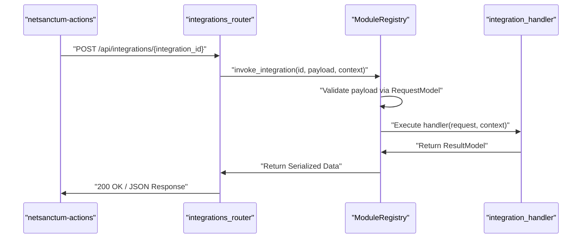
Sources: [app/core/integrations_router.py:52-65](), [app/core/module_types.py:22-60]()

---

## 2. Versioned Contracts (`app/contracts/`)

To prevent circular dependencies between product modules (e.g., `video_archiver` and `vault`), stable contracts are extracted into the shared `app/contracts/` package. These modules define strict data types and request/response interfaces:

*   `video_archive_v1`: Defines `ArchiveVideoRequest` and `ArchiveVideoResult` for sending external media URLs to be ingested and stored [app/contracts/video_archive_v1.py:1-16]() (implied by [app/modules/video_archiver/integrations.py:12-126]()).
*   `library_viewer_v1`: Exposes library catalog schemas (`LibraryItem`, `LibraryRequest`, `LibraryResult`) allowing cross-module content indexing [app/contracts/library_viewer_v1.py:1-79]().
*   `video_source_catalog_v1`: Exposes `VideoSourceItem`, `VideoSourceRequest`, and `VideoSourceResult` schemas for resolving streaming media sources [app/contracts/video_source_catalog_v1.py:1-84]().
*   `vault_capture_v1`: Defines `VaultCaptureRequest` and `VaultCaptureResult` for capturing notes and bookmarks into the Vault module [app/contracts/vault_capture_v1.py:1-55]().

Sources: [app/contracts/library_viewer_v1.py:1-79](), [app/contracts/video_archive_v1.py:1-16](), [app/contracts/video_source_catalog_v1.py:1-84](), [app/contracts/vault_capture_v1.py:1-55]()

---

## 3. Offline Package System and NSP Manifests

The package system powers the "Outpost" offline capability, allowing users to bundle module data, metadata, and media into redistributable packages defined by the NetSanctum Package (NSP) manifest standard [OFFLINE_PACKAGE_MANIFEST_STANDARD.md:1-63]().

### NSP Container Format and Resource Partitioning
Resources are partitioned into packable and standalone categories within `app/core/packages_router.py`:
*   **Packable Resource Types (`PACKABLE_RESOURCE_TYPES`)**: `container`, `css`, `html`, `image`, `js`, `json`, `text` [app/core/packages_router.py:31]() — packed into the NSP container.
*   **Standalone Resource Types (`STANDALONE_RESOURCE_TYPES`)**: `binary`, `sealed` [app/core/packages_router.py:32]() — maintained as individual content-addressed assets to prevent heavy media or sensitive encrypted bytes from sitting inside shared plaintext containers.

### Package Generation Pipeline
Package generation is handled by `generate_nsp` in `app/core/packages_router.py`, using an `asyncio.Semaphore` to limit concurrent internal requests [app/core/packages_router.py:104-174]().

1.  **Resource Resolution**: The `package_resolver` declared in `ModuleSpec` queries the database for all assets associated with a `package_id` [app/core/packages_router.py:111-130](). For example, the `video_archiver` module declares `app.modules.video_archiver.capabilities:resolve_package_resources` as its resolver [app/modules/video_archiver/capabilities.py:16-43]().
2.  **Manifest Creation**: `make_package_manifest` builds a versioned contract containing module metadata and resource paths [app/core/packages_router.py:73-108](). It validates resource URLs against local absolute paths and deduplicates entries [app/core/packages_router.py:45-70]().
3.  **Hybrid Transformation**: `make_hybrid_manifest` separates large binary files from layout assets, pointing binary requests directly to local URIs while encapsulating markup and styles into an `.nsp` container endpoint [tests/test_package_contracts.py:45-65]().

Title: Package System Entity Map
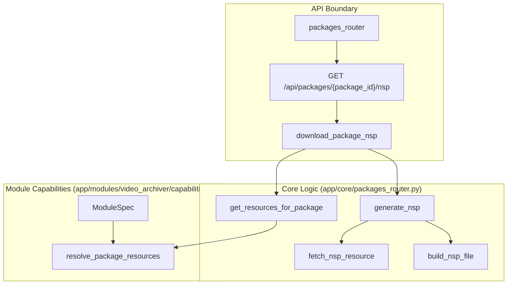
Sources: [app/core/packages_router.py:1-161](), [app/modules/video_archiver/capabilities.py:16-43](), [tests/test_package_contracts.py:45-65]()

---

## 4. Frontend Integration and UI Components

### netsanctum-actions Web Component
The frontend utilizes a custom Web Component (`netsanctum-actions`) that communicates with `integrations_router` to discover and execute contextual UI actions.

### Package Context Injection
During HTMX navigations, the runtime monitors the `active_package_id` session parameter. When viewing content inside an offline package context, subsequent resource fetching and integration calls are scoped to that package. The `base.html` template includes JavaScript logic to handle package downloads, manage `active_package_id` in `sessionStorage`, and display read-only banners for offline packages [tests/test_package_contracts.py:66-78]().

Sources: [app/core/integrations_router.py:35-50](), [tests/test_package_contracts.py:66-78]()

---

<<< SECTION: Observability and Control Center [2.7-observability-and-control-center] >>>

# Page: Observability and Control Center

# Observability and Control Center

<details>
<summary>Relevant source files</summary>

The following files were used as context for generating this wiki page:

- [app/core/state_store.py](app/core/state_store.py)
- [app/core/templates/dashboard.html](app/core/templates/dashboard.html)
- [app/modules/auth/__init__.py](app/modules/auth/__init__.py)
- [tests/test_control_center.py](tests/test_control_center.py)
- [tests/test_state_store.py](tests/test_state_store.py)

</details>


NetSanctum provides a centralized observability layer, an isolated ephemeral state store, and a control interface (`/dashboard`) for managing runtime state, background tasks, module control states, and system health overviews.

---

## Redis-Backed Log Aggregation and Redaction

The observability system uses a non-blocking, asynchronous logging architecture to collect logs from both FastAPI web processes and Celery worker processes into a unified Redis stream.

### Architecture and Data Flow

1. **Queue-Based Injection**: When `configure_observability` is called, it attaches a `logging.handlers.QueueHandler` to the target logger [tests/test_control_center.py:90-97](). This ensures that the main application threads (web or worker) are never blocked by logging I/O.
2. **Background Listener**: A `logging.handlers.QueueListener` runs in a separate thread, consuming records from the queue and passing them to the configured log handlers [tests/test_control_center.py:90-97]().
3. **Redis Storage**: Log records are serialized and pushed to Redis, maintaining bounded buffers and TTL settings to prevent excessive memory usage.

### Security and Redaction
Before logs are persisted, the `redact_log_message` function scans log strings for sensitive tokens, passwords, and authorization headers using regular expressions [tests/test_control_center.py:65-81]().
* **Bearer Tokens**: `Authorization: Bearer ...` headers are scrubbed [tests/test_control_center.py:68-75]().
* **Credentials**: Fields like passwords and access tokens are replaced [tests/test_control_center.py:66-77]().
* **JWTs**: Three-part JSON Web Tokens are identified and masked [tests/test_control_center.py:70-80]().

Sources: [app/core/control_center.py:1-272](), [tests/test_control_center.py:65-98]()

---

## Ephemeral State Store and Persistence Auditing (`state_store.py`)

Vault unlock sessions, download handoffs, and passphrase throttling require Redis storage. However, because unlock sessions hold sensitive vault data keys, they must never be written to disk. The `app/core/state_store.py` module isolates ephemeral state by connecting to a dedicated Redis instance configured with `--save ""` and `--appendonly no` [app/core/state_store.py:1-22]().

### Key Functions and Data Flow
* `state_redis_url()`: Resolves the target Redis URL, falling back to `REDIS_URL` if `VAULT_STATE_REDIS_URL` is unset [app/core/state_store.py:55-58]().
* `redact(url: str)`: Strips embedded passwords from Redis connection strings before writing them to logs or reports [app/core/state_store.py:34-53](), [tests/test_state_store.py:39-60]().
* `audit_state_redis(url)`: Queries the Redis instance configuration using `CONFIG GET appendonly` and `CONFIG GET save` to verify persistence settings [app/core/state_store.py:82-117](). Handles unmanaged proxies or managed Redis instances gracefully [app/core/state_store.py:94-107]().
* `require_ephemeral_state_store()`: Enforces runtime startup checks when `VAULT_STATE_REQUIRE_EPHEMERAL` is enabled, raising a `RuntimeError` if persistence is active [app/core/state_store.py:120-186](), [tests/test_state_store.py:99-103]().

### State Store Persistence Verification

```mermaid
graph TD
    subgraph "Initialization Space"
        START["require_ephemeral_state_store()"]
        SETTING["VAULT_STATE_REQUIRE_EPHEMERAL"]
    end

    subgraph "Code Entity Space"
        AUDIT["audit_state_redis()"]
        CLIENT["_client_for()"]
        REDACT["redact()"]
        CONFIG["client.config_get()"]
    end

    subgraph "Infrastructure"
        REDIS_STATE[("Redis State Store")]
    end

    START --> SETTING
    SETTING -->|Enabled| AUDIT
    AUDIT --> CLIENT
    CLIENT --> REDIS_STATE
    REDIS_STATE --> CONFIG
    CONFIG -->|Returns appendonly/save| AUDIT
    AUDIT -->|Logs or Masks URL| REDDACT[redact]
```

Sources: [app/core/state_store.py:1-186](), [tests/test_state_store.py:1-269]()

---

## Control Center UI and Runtime Overview

The Control Center is a server-rendered dashboard located at `/dashboard` (managed via settings templates), utilizing HTMX for real-time updates and partial page swaps. The main template `control_center.html` [app/core/templates/dashboard.html:1-37]() defines the container and uses HTMX (`hx-get="/settings/ui/control-center"`) to load content dynamically.

### Overview Panel (`runtime_overview`)
The `runtime_overview` function compiles a JSON payload reporting infrastructure health [app/core/control_center.py:86-108]().
* **PostgreSQL**: Executes a lightweight `SELECT 1` probe to check connectivity and measure latency in milliseconds [app/core/control_center.py:38-46]().
* **Redis**: Runs a `ping()` check, inspects memory utilization via `client.info("memory")`, and reports total key counts and round-trip latency [app/core/control_center.py:48-64]().
* **Celery**: Uses `celery_app.control.ping()` and inspects active/reserved task queues to report worker health and queue lengths [app/core/control_center.py:66-84]().
* **Modules & Runtime**: Summarizes active, installed, and failed module counts alongside application version, Python version, platform, and process uptime [app/core/control_center.py:86-108]().

### Module Control State
The `module_control_state` helper inspects desired versus actual module states [app/core/control_center.py:111-143]().
* **Environment Lock**: Checks whether `ENABLED_MODULES` is enforced via environment variables, locking runtime overrides [app/core/control_center.py:142]().
* **Desired State**: Loads persistent module preferences via `load_enabled_module_ids` [app/core/control_center.py:112]().
* **Restart Tracking**: Determines if changes require an application restart (`restart_required`) [app/core/control_center.py:114]().

### Observability Entities and UI Mapping
Natural Language Space to Code Entity Space mapping for the Control Center:

```mermaid
graph TD
    subgraph "Frontend Space (HTML/HTMX)"
        UI["/settings/ui/control_center (Control Center)"]
        TAB_OVERVIEW["control_overview.html"]
        TAB_MODULES["control_modules.html"]
        TAB_TASKS["control_tasks.html"]
        TAB_LOGS["control_logs.html"]
    end

    subgraph "Backend Router and Service Space"
        CC_ROUTER["app/modules/system/settings/router.py"]
        GET_OVERVIEW["GET /settings/ui/overview"]
        GET_MODULES["GET /settings/ui/modules"]
        GET_TASKS["GET /settings/ui/tasks"]
        DEL_TASK["DELETE /settings/ui/tasks/{task_id}"]

        CC_SNAP["runtime_overview()"]
        MOD_STATE["module_control_state()"]
        TASK_LIST["tracked_tasks()"]
        TASK_CANCEL["cancel_tracked_task()"]
    end

    subgraph "Infrastructure Space"
        REDIS_TRACKERS[("Redis: Task Progress Keys")]
        REDIS_LOGS[("Redis: Log Stream")]
        CELERY["celery_app.control"]
        DB[("PostgreSQL DB")]
        MODULE_REGISTRY["ModuleRegistry"]
    end

    UI --> TAB_OVERVIEW & TAB_MODULES & TAB_TASKS & TAB_LOGS

    TAB_OVERVIEW -- "hx-get /settings/ui/overview" --> GET_OVERVIEW
    GET_OVERVIEW --> CC_SNAP
    CC_SNAP -- "queries" --> DB & REDIS_TRACKERS & CELERY & MODULE_REGISTRY

    TAB_MODULES -- "hx-get /settings/ui/modules" --> GET_MODULES
    GET_MODULES --> MOD_STATE
    MOD_STATE -- "reads" --> MODULE_REGISTRY

    TAB_TASKS -- "hx-get /settings/ui/tasks" --> GET_TASKS
    GET_TASKS --> TASK_LIST
    TASK_LIST -- "scans" --> REDIS_TRACKERS
    TAB_TASKS -- "hx-delete /settings/ui/tasks/{task_id}" --> DEL_TASK
    DEL_TASK --> TASK_CANCEL
    TASK_CANCEL -- "revokes" --> CELERY
```

Sources: [app/core/control_center.py:38-143](), [app/core/templates/dashboard.html:1-37](), [tests/test_control_center.py:32-64]()

---

## Task Tracking, Progress, and Cancellation

Background tasks are dispatched with robust tracking guarantees to prevent orphaned jobs and provide real-time status in the Control Center.

### Tracker-Before-Broker Ordering
Tasks dispatched via `dispatch_tracked_async` or `dispatch_tracked_sync` guarantee that a Redis progress key is established *before* the message is pushed to the broker [app/core/task_dispatch.py:27-64](). If broker dispatch fails, the Redis tracker is rolled back [app/core/task_dispatch.py:40-44]().

### Terminal State Filtering and Cancellation
* **Terminal States**: `is_terminal_task_payload` evaluates task state dictionaries to filter out completed, failed, or cancelled tasks from active monitoring [app/core/task_dispatch.py:10-20](), [tests/test_control_center.py:116-125]().
* **Task Revocation**: `cancel_tracked_task` validates `task_id` strings against strict alphanumeric patterns (`TASK_ID_PATTERN`) before calling Celery's revocation control, preventing command injection [app/core/control_center.py:22](), [tests/test_control_center.py:82-84]().
* **Module Safety**: `tasks_blocking_module_change` checks active tasks against modules targeted for disabling, preventing unsafe shutdowns [app/core/control_center.py:182-190](), [tests/test_control_center.py:101-114]().

### Task Lifecycle Flow

```mermaid
sequenceDiagram
    participant M as "Module Router"
    participant TD as "dispatch_tracked_async()"
    participant R as "Redis Progress Trackers"
    participant C as "Celery Broker"
    participant W as "Celery Worker"
    participant CC as "Control Center UI"

    M->>TD: "Dispatch Task Payload"
    TD->>R: "SETEX key_prefix:task_id (Queued)"
    TD->>C: "apply_async(task_id=task_id)"
    Note over TD,C: "Rollback Redis key if apply_async fails"
    C->>W: "Execute Background Task"
    W->>R: "Update JSON Payload Progress"
    CC->>R: "SCAN progress_key_patterns & GET"
    CC->>CC: "is_terminal_task_payload() filtering"
    CC->>TD: "cancel_tracked_task(task_id)"
    TD->>C: "celery_app.control.revoke(task_id, terminate=True)"
    W->>W: "Terminate Execution"
```

Sources: [app/core/control_center.py:146-190](), [app/core/task_dispatch.py:1-64](), [tests/test_control_center.py:82-157]()

---

## Celery Worker Health and Module Control State

The observability engine constantly monitors Celery worker topology and module states to maintain system integrity.

| Function / Component | Target Infrastructure | Purpose |
| :--- | :--- | :--- |
| `_inspect_celery()` | Celery Workers via `celery_app.control` | Pings workers and aggregates active/reserved task lists [app/core/control_center.py:66-84]() |
| `runtime_overview()` | DB, Redis, Celery, Registry | Aggregates health telemetry across all core subsystems [app/core/control_center.py:86-108]() |
| `module_control_state()` | `module_registry` & Config files | Reports desired vs actual module status and restart requirements [app/core/control_center.py:111-143]() |
| `tracked_tasks()` | Redis progress keys | Scans module-declared progress key patterns for active operations [app/core/control_center.py:146-180]() |
| `audit_state_redis()` | State Store Redis | Asserts and audits persistence settings for ephemeral vault keys [app/core/state_store.py:82-117]() |

Sources: [app/core/control_center.py:66-180](), [app/core/state_store.py:82-117](), [tests/test_control_center.py:100-157]()

---

<<< SECTION: Browser Runtime and Remote Fetch [2.8-browser-runtime-and-remote-fetch] >>>

# Page: Browser Runtime and Remote Fetch

# Browser Runtime and Remote Fetch

<details>
<summary>Relevant source files</summary>

The following files were used as context for generating this wiki page:

- [app/core/browser_runtime.py](app/core/browser_runtime.py)
- [app/core/browser_snapshots.py](app/core/browser_snapshots.py)
- [app/core/remote_fetch.py](app/core/remote_fetch.py)
- [app/modules/miku/deep_link.py](app/modules/miku/deep_link.py)
- [static/browser-runtime.js](static/browser-runtime.js)
- [static/miku-assistant.js](static/miku-assistant.js)
- [tailwind.config.js](tailwind.config.js)
- [tests/test_browser_runtime.py](tests/test_browser_runtime.py)

</details>


This page covers the isolated Chromium sidecar subsystem, remote fetching infrastructure, and media ingestion pipelines in NetSanctum. This subsystem enables secure, containerized browser automation for authenticated site logins (such as YouTube account linking) and headless content cataloging, supported by strict egress filtering, seccomp profiles, encrypted browser snapshots, SSRF-safe remote fetching, and the robust `ytdlp_pipeline` wrapper.

Sources: `[app/core/browser_runtime.py]()`, `[app/core/browser_snapshots.py]()`, `[app/core/remote_fetch.py]()`, `[app/core/ytdlp_pipeline.py]()`

---

## 1. Browser Runtime and Sidecar Architecture

The browser subsystem isolates Chromium execution inside a dedicated sidecar container communicating via an internal HTTP API.

- **`BrowserRuntime`**: Defined in `[app/core/browser_runtime.py:32-176]()`, this class manages Playwright-driven Chromium browser sessions, ephemeral Xvfb virtual displays (`Xvfb`) for interactive GUI streaming, context network routing rules, and automation detection evasion (`navigator.webdriver` masking).
- **`BrowserSession`**: Defined in `[app/core/browser_runtime.py:16-30]()`, tracking session lifecycle state, page context, locks, and activity timeouts.
- **`BrowserRuntimeClient`**: Acts as the bridge inside the main web application, forwarding high-level automation commands (navigation, clicking, typing, querying selectors, and capturing frame snapshots) to the browser sidecar container.

### Architecture & Code Entity Mapping

```mermaid
graph TD
    subgraph "FastAPI Application Space"
        R["browser_router.py"] --> C["BrowserRuntimeClient"]
        S["BrowserSnapshotStore <br/> app/core/browser_snapshots.py"] --> C
    end

    subgraph "Chromium Sidecar Space"
        C -->|HTTP Request| BR["BrowserRuntime <br/> app/core/browser_runtime.py"]
        BR --> BS["BrowserSession <br/> app/core/browser_runtime.py"]
        BS --> PW["Playwright Chromium"]
        BS --> XVFB["Xvfb Virtual Display"]
    end

    subgraph "Network Security"
        PW -->|CONNECT Proxy| EP["handle_proxy <br/> app/core/browser_egress_proxy.py"]
        EP -->|Allowlist Check| EXT["External Web Services"]
    end

    style R fill:#fff,stroke:#000,stroke-width:1px
    style C fill:#fff,stroke:#000,stroke-width:1px
    style BR fill:#fff,stroke:#000,stroke-width:1px
    style EP fill:#fff,stroke:#000,stroke-width:1px
```
Sources: `[app/core/browser_runtime.py:16-176]()`, `[app/core/browser_snapshots.py:17-64]()`, `[app/core/browser_egress_proxy.py:47-106]()`

---

## 2. Browser Snapshots and Cookie Capture

To maintain user sessions (such as logged-in YouTube or Lib Network accounts) across container restarts, browser states are persisted via `BrowserSnapshotStore`.

- **Storage & Encryption**: `[app/core/browser_snapshots.py:17-64]()` implements `BrowserSnapshotStore`, which saves Playwright storage states (cookies and local storage origins) into local storage (`config/browser-snapshots/`). Payloads are encrypted at rest using AES-256-GCM through `encrypt_secret_value` from `[app/core/secret_values.py]()`.
- **Policy Filtering**: `_filter_state` (`[app/core/browser_snapshots.py:66-89]()`) strips cookies and origins that do not match the module's declared `BrowserPolicySpec.allowed_hosts`, un-persisted cookie names, or expired time-to-live attributes.
- **Netscape Cookie Export**: `_cookies_netscape` (`[app/core/browser_snapshots.py:134-161]()` & `cookies_netscape`) serializes captured cookies into the standard Netscape cookie file format. This allows external tools like `yt-dlp` to inherit authenticated cookies securely without exposing them in command-line arguments.

Sources: `[app/core/browser_snapshots.py:17-174]()`, `[app/core/secret_values.py]()`

---

## 3. Egress Proxy and Security Hardening

Browser network traffic is strictly policed to prevent Server-Side Request Forgery (SSRF) and data exfiltration.

- **Domain Allowlisting**: `BrowserRuntime._allowed_url` (`[app/core/browser_runtime.py:38-45]()`) inspects outgoing requests inside Playwright context routing, aborting any URL whose hostname does not match the active `BrowserPolicySpec.allowed_hosts`.
- **Egress Proxy**: Implements an async HTTP CONNECT proxy server listening on port `8888` (`[app/core/browser_egress_proxy.py:47-106]()`).
  - **Host Check**: `_host_allowed` validates destination hosts against the `BROWSER_EGRESS_HOSTS` environment variable (`[app/core/browser_egress_proxy.py:15-16]()`). This variable is configured in `[docker-compose.yml:129]()` and `[.env.example:38]()` to include domains like `google.com`, `youtube.com`, etc.
  - **Public IP Verification**: `_public_addresses` (`[app/core/browser_egress_proxy.py:19-27]()` using `ipaddress.ip_address`) ensures resolved target addresses are strictly global public IPs, blocking private/loopback network access.
- **Seccomp Profile**: The browser container runs with a custom security profile defined in `[docker/browser-seccomp.json]()`, restricting system calls to minimize the kernel attack surface. This is configured in `[docker-compose.yml:92]()`.

Sources: `[app/core/browser_runtime.py:38-45]()`, `[app/core/browser_egress_proxy.py:15-106]()`, `[docker/browser-seccomp.json]()`, `[docker-compose.yml:92]()`, `[docker-compose.yml:129]()`, `[.env.example:38]()`

---

## 4. SSRF-Safe Remote Fetching (`remote_fetch.py`)

External metadata scraping and asset previews are managed via `[app/core/remote_fetch.py]()`, protecting the application from Server-Side Request Forgery and unauthorized internal resource access.

- **URL Validation**: `validate_remote_url` (`[app/core/remote_fetch.py:34-55]()`) enforces HTTPS-only requests, strips username/password credentials from parsed URLs, validates host allowlists via `host_in_allowlist` (`[app/core/remote_fetch.py:18-20]()`), and verifies that the destination resolves to global public IP addresses through `_public_addresses` (`[app/core/remote_fetch.py:23-31]()`).
- **Checked Byte Fetching**: `fetch_bytes_checked` (`[app/core/remote_fetch.py:58-178]()`) executes safe HTTP GET requests with redirect limits, content-type prefix restrictions (e.g. `image/`), maximum payload size limits (`max_bytes`), and cookie/authorization forwarding controls across redirects.

### Remote Fetch Validation Flow

```mermaid
graph TD
    Start["validate_remote_url <br/> app/core/remote_fetch.py"] --> CheckScheme["Check HTTPS Scheme & No Credentials"]
    CheckScheme --> CheckHost["host_in_allowlist <br/> app/core/remote_fetch.py"]
    CheckHost --> ResolveIP["_public_addresses <br/> app/core/remote_fetch.py"]
    ResolveIP -->|Global IP Validated| Fetch["fetch_bytes_checked <br/> app/core/remote_fetch.py"]
    ResolveIP -->|Private / Loopback IP| Reject["Raise RemoteFetchError"]

    style Start fill:#fff,stroke:#000,stroke-width:1px
    style ResolveIP fill:#fff,stroke:#000,stroke-width:1px
    style Fetch fill:#fff,stroke:#000,stroke-width:1px
    style Reject fill:#fff,stroke:#000,stroke-width:1px
```
Sources: `[app/core/remote_fetch.py:18-178]()`

---

## 5. The `ytdlp_pipeline` Wrapper

Media ingestion across the YouTube, Music, and Video Archiver modules relies on `[app/core/ytdlp_pipeline.py]()`, a resilient wrapper around `yt-dlp`.

- **`extract_info`**: The primary entry point that executes media metadata extraction and downloads with automated error classification and rate limiting.
- **Redis Rate-Limiting Gate**: `_GATE_SCRIPT` (`[app/core/ytdlp_pipeline.py:16-31]()`) uses an atomic Redis Lua script to enforce request intervals (`YOUTUBE_YTDLP_REQUEST_INTERVAL_SECONDS`) and automatic cooldowns upon encountering rate limits.
- **Error Classification**: `classify_ytdlp_error` (`[app/core/ytdlp_pipeline.py:98-174]()`) scans exception messages and maps them to `YtDlpErrorKind` enum values (`[app/core/ytdlp_pipeline.py:34-43]()`):
  - `RATE_LIMITED` (HTTP 429 / 403 / 400)
  - `AUTH_REQUIRED` (Private video / Sign-in required)
  - `PO_TOKEN_REQUIRED` (Proof of Origin / Data Sync ID needed)
  - `GEO_BLOCKED`, `UNAVAILABLE`, `NETWORK`, `UNSUPPORTED`, `UNKNOWN`
- **Fallback & Cookie Management**: If an unauthenticated extraction hits an authentication barrier, the pipeline automatically retries once using a temporary Netscape cookie file derived from `BrowserSnapshotStore`. This behavior is tested in `[tests/test_ytdlp_pipeline.py:93-107]()`.

### Pipeline Execution & Error Flow

```mermaid
graph TD
    Start["extract_info <br/> app/core/ytdlp_pipeline.py"] --> CheckCache["Redis Gate Script <br/> _GATE_SCRIPT"]
    CheckCache -->|Cooldown Active| RaiseRateLimit["YtDlpPipelineError: RATE_LIMITED"]
    CheckCache -->|Ready| RunYDL["YoutubeDL.extract_info"]

    RunYDL -->|Success| ReturnInfo["Return Media Metadata Dict"]
    RunYDL -->|Exception| Classify["classify_ytdlp_error <br/> app/core/ytdlp_pipeline.py"]

    Classify -->|Auth Required / Bot Challenge| CheckCookies{"Cookies Available?"}
    CheckCookies -->|Yes| RetryWithCookies["Retry with Temp Cookiefile"]
    CheckCookies -->|No| RaiseAuth["YtDlpPipelineError: AUTH_REQUIRED"]

    RetryWithCookies -->|Success| ReturnInfo
    RetryWithCookies -->|Failure| SetCooldown["Open Redis Cooldown Window"]

    style Start fill:#fff,stroke:#000,stroke-width:1px
    style RunYDL fill:#fff,stroke:#000,stroke-width:1px
    style Classify fill:#fff,stroke:#000,stroke-width:1px
    style CheckCookies fill:#fff,stroke:#000,stroke-width:1px
```
Sources: `[app/core/ytdlp_pipeline.py:16-174]()`, `[tests/test_ytdlp_pipeline.py:93-107]()`

---

## 6. Frontend Integration and Web Component

Browser session interactions are surfaced in user dashboards through a custom Web Component (`<netsanctum-browser>`).

- **Component Definition**: Implemented in `[static/browser-runtime.js]()`, the `<netsanctum-browser>` element provides a terminal-styled interactive window inside module templates (e.g., YouTube account linking).
- **Template Integration**: As seen in `[app/modules/youtube/templates/youtube_dashboard.html:15-23]()`, the component binds to policy identifiers (`data-policy-id="youtube.account"`), handles user click/type events, and renders live JPEG streams from `/api/browser-runtime/sessions/{session_id}/frame`. The `youtube_watch.html` template also uses a similar structure for player settings `[app/modules/youtube/templates/youtube_watch.html:51-56]()`.

Sources: `[static/browser-runtime.js]()`, `[app/modules/youtube/templates/youtube_dashboard.html:15-23]()`, `[app/modules/youtube/templates/youtube_watch.html:51-56]()`

---

<<< SECTION: Settings Service [2.9-settings-service] >>>

# Page: Settings Service

# Settings Service

<details>
<summary>Relevant source files</summary>

The following files were used as context for generating this wiki page:

- [app/core/config.py](app/core/config.py)
- [app/core/secret_values.py](app/core/secret_values.py)
- [app/core/storage.py](app/core/storage.py)
- [app/modules/system/storage/router.py](app/modules/system/storage/router.py)
- [scripts/vault_verify_media.py](scripts/vault_verify_media.py)
- [tests/fixtures/seekable_v2_legacy_aad.bin](tests/fixtures/seekable_v2_legacy_aad.bin)
- [tests/fixtures/seekable_v2_legacy_aad.sha256](tests/fixtures/seekable_v2_legacy_aad.sha256)
- [tests/test_storage_seekable.py](tests/test_storage_seekable.py)

</details>


The `settings` module (`app/modules/system/settings/`) provides a centralized, hierarchical key-value configuration system for NetSanctum. It supports application-wide global settings, per-module configurations, and per-user overrides, complete with AES-256-GCM secret encryption via `app/core/secret_values.py`, typed value serialization, a FastAPI HTTP API, and HTMX-driven dashboard components. As a core infrastructure module, it is marked as required and loaded during application startup.

---

## 1. Data Model and Scoping Architecture

Settings are managed through the `Setting` SQLAlchemy model, which implements hierarchical scoping. The model allows the exact same configuration key to exist at multiple levels simultaneously without collision by enforcing unique constraints via conditional partial indexes.

```mermaid
graph TD
    sub5["Database Table: settings"]
    sub5 --> model["Setting app/modules/system/settings/models.py:28-120"]
    model --> scope["scope String(16) global|module|user"]
    model --> modname["module_name String(128)"]
    model --> usrid["user_id Integer"]
    model --> keyval["key String(255) & value Text"]

    scope --> idx1["uq_settings_global_key app/modules/system/settings/models.py:34-40"]
    scope --> idx2["uq_settings_module_key app/modules/system/settings/models.py:41-48"]
    scope --> idx3["uq_settings_user_key app/modules/system/settings/models.py:49-56"]
```
*Figure 1: Settings Database Model and Partial Indexes Architecture.*

Sources: `[app/modules/system/settings/models.py:28-120]()`

The three hierarchical scope levels are:
- `global`: Application-wide defaults where `module_name` and `user_id` are `NULL`. Enforced by `uq_settings_global_key` [app/modules/system/settings/models.py:34-40]().
- `module`: Per-module configuration where `module_name` is populated and `user_id` is `NULL`. Enforced by `uq_settings_module_key` [app/modules/system/settings/models.py:41-48]().
- `user`: Per-user overrides where `user_id` is populated and `module_name` is `NULL`. Enforced by `uq_settings_user_key` [app/modules/system/settings/models.py:49-56]().

Value type hints (`value_type`) are stored as metadata strings (`string`, `integer`, `float`, `boolean`, `json`), allowing the application to deserialize raw text into Python objects [app/modules/system/settings/service.py:20-32](). Secrets are flagged via `is_secret` [app/modules/system/settings/models.py:102-102]() and encrypted at rest using `encrypt_secret_value` [app/core/secret_values.py:19-24]().

Sources: `[app/modules/system/settings/models.py:1-120]()`, `[app/modules/system/settings/service.py:20-32]()`, `[app/core/secret_values.py:19-24]()`

---

## 2. Business Logic and Service Layer (`service.py`)

The service module `app/modules/system/settings/service.py` handles database transactions, persistence, serialization, type casting, and encryption integration.

### Type Casting and Serialization
- `cast_value(raw: str, value_type: str)` deserializes stored strings into Python `int`, `float`, `bool`, JSON dictionaries/lists, or raw strings [app/modules/system/settings/service.py:20-32]().
- `serialize_value(value: Any)` converts Python values back into storage-safe strings using JSON dumping for structures [app/modules/system/settings/service.py:35-39]().

### CRUD Operations
- `upsert_setting(...)`: Creates or updates a setting matching the target `(scope, module_name, user_id, key)` tuple [app/modules/system/settings/service.py:43-106](). If `is_secret` is `True`, it encrypts the input via `encrypt_secret_value` [app/core/secret_values.py:19-24](). Handles concurrent insertion races using nested transaction savepoints and `IntegrityError` catches [app/modules/system/settings/service.py:90-104]().
- `ensure_setting(...)`: Creates a global default configuration key only if it does not already exist [app/modules/system/settings/service.py:109-143]().
- `bulk_upsert(...)`: Batch-processes a list of setting dictionaries inside a transaction [app/modules/system/settings/service.py:145-165]().
- `list_settings(...)`: Queries settings with filtering by `scope`, `module_name`, `user_id`, or `key_prefix`, returning paginated items and total counts [app/modules/system/settings/service.py:174-212]().

```mermaid
graph TD
    sub6["Service Operations app/modules/system/settings/service.py"]
    sub6 --> upsert["upsert_setting()"]
    sub6 --> ensure["ensure_setting()"]
    sub6 --> bulk["bulk_upsert()"]
    sub6 --> listst["list_settings()"]

    upsert --> enc["encrypt_secret_value app/core/secret_values.py"]
    upsert --> dbflush["AsyncSession db.flush() & refresh()"]
    ensure --> dbflush
    bulk --> upsert
    listst --> count["func.count(Setting.id)"]
```
*Figure 2: Service Layer Call Flow for Mutations and Queries.*

Sources: `[app/modules/system/settings/service.py:1-215]()`, `[app/core/secret_values.py:19-24]()`

---

## 3. FastAPI Router and HTTP Interface (`router.py`)

The settings router (`app/modules/system/settings/router.py`) exposes endpoints for managing configuration records and rendering UI components. All endpoints require authentication via `get_current_user` [app/modules/system/settings/router.py:37-66]().

### Endpoint Catalog

| Method | Path | Description | Access Control |
| :--- | :--- | :--- | :--- |
| `GET` | `/settings/` | List settings with optional pagination and filtering | Authenticated (non-superusers see only user scope) [app/modules/system/settings/router.py:58-83]() |
| `POST` | `/settings/` | Create or upsert a setting record | Superuser required for `global` / `module` scope [app/modules/system/settings/router.py:86-108]() |
| `POST` | `/settings/bulk` | Bulk upsert multiple settings | Superuser required for `global` / `module` scope [app/modules/system/settings/router.py:110-134]() |
| `GET` | `/settings/resolve` | Resolve a setting key through the scope hierarchy | Authenticated [app/modules/system/settings/router.py:136-159]() |
| `GET` | `/settings/{setting_id}` | Fetch a single setting by primary key ID | Authenticated (ownership check for user scope) [app/modules/system/settings/router.py:161-174]() |
| `PATCH` | `/settings/{setting_id}` | Update an existing setting record | Superuser for global/module; owner for user [app/modules/system/settings/router.py:176-190]() |
| `DELETE` | `/settings/{setting_id}` | Delete a setting record by ID | Superuser or owner [app/modules/system/settings/router.py:192-205]() |
| `GET` | `/settings/ui/panel` | HTMX fragment: settings panel | Authenticated [app/modules/system/settings/router.py:290-309]() |
| `POST` | `/settings/ui/add` | HTMX: add a setting from dashboard | Authenticated [app/modules/system/settings/router.py:312-337]() |
| `DELETE` | `/settings/ui/settings/{id}` | HTMX: delete a setting from dashboard | Authenticated [app/modules/system/settings/router.py:340-356]() |

### Secret Masking
To prevent secret leakage over the API, the helper function `_mask(resp: SettingResponse)` inspects the `is_secret` flag and replaces confidential values with `••••••••` before returning responses [app/modules/system/settings/router.py:52-55]().

Sources: `[app/modules/system/settings/router.py:1-438]()`

---

## 4. User Interface (`templates/control_settings.html`)

The settings module provides an HTMX-driven UI component for managing settings, primarily used within the Control Center dashboard. The `control_settings.html` template [app/modules/system/settings/templates/control_settings.html:1-32]() allows users to view, add, and delete settings.

```mermaid
graph TD
    A[User Browser] -- "GET /settings/ui/panel" --> B(FastAPI Router)
    B --> C{Render control_settings.html}
    C --> D[Display Settings Form & List]

    D -- "POST /settings/ui/add (HTMX)" --> B
    D -- "DELETE /settings/ui/settings/{id} (HTMX)" --> B

    B --> E(Settings Service)
    E --> F(Database)
```
*Figure 3: Settings UI Interaction Flow.*

Sources: `[app/modules/system/settings/router.py:290-356]()`, `[app/modules/system/settings/templates/control_settings.html:1-32]()`

The UI features include:
- A form to add new settings, specifying `key`, `value`, `scope` (`USER`, `GLOBAL`, `MODULE`), `module_name`, `value_type`, `is_secret`, and `description` [app/modules/system/settings/templates/control_settings.html:6-20]().
- A paginated list of existing settings, with secret values masked [app/modules/system/settings/templates/control_settings.html:22-31]().
- Delete buttons for each setting, triggering an HTMX `DELETE` request [app/modules/system/settings/templates/control_settings.html:28-28]().

Sources: `[app/modules/system/settings/templates/control_settings.html:1-32]()`

---

## 5. Module Specification and Registration (`module.py`)

The settings module registers itself with the core NetSanctum module loader via `ModuleSpec` in `app/modules/system/settings/module.py`.

```python
MODULE = ModuleSpec(
    id="settings",
    version="0.1.0",
    title_en="Settings",
    title_ru="Настройки",
    router="app.modules.system.settings.router:router",
    models="app.modules.system.settings.models",
    migrations=MigrationSpec(
        path="migrations",
        baseline_revision="settings_0001",
        tables=("settings",),
        legacy_tables=("settings",),
    ),
    templates="templates",
    i18n="app.modules.system.settings.i18n",
    required=True,
)
```
*Module specification configuration in `app/modules/system/settings/module.py`.*

Because `required=True` [app/modules/system/settings/module.py:18-18](), the settings service cannot be disabled by users or via environment configuration, ensuring critical application configuration and secret management remain operational at all times.

Sources: `[app/modules/system/settings/module.py:1-19]()`

---

<<< SECTION: Frontend Architecture [3-frontend-architecture] >>>

# Page: Frontend Architecture

# Frontend Architecture

<details>
<summary>Relevant source files</summary>

The following files were used as context for generating this wiki page:

- [app/core/templates/base.html](app/core/templates/base.html)
- [app/modules/music/router.py](app/modules/music/router.py)
- [app/modules/video_archiver/router.py](app/modules/video_archiver/router.py)
- [app/modules/video_archiver/templates/video_dashboard.html](app/modules/video_archiver/templates/video_dashboard.html)
- [static/tailwind.css](static/tailwind.css)
- [tests/test_navigation_contracts.py](tests/test_navigation_contracts.py)

</details>


The Frontend Architecture page provides a high-level overview of the server-rendered NetSanctum frontend, which combines FastAPI and Jinja2 templates with HTMX for partial DOM updates, a Tailwind CSS design system, and shared media player runtimes.

As a parent page, this section introduces the core frontend layers and links to specialized child pages for deep technical details.

---

### Core Technologies

| Technology | Role | Implementation Detail |
|:---|:---|:---|
| **Jinja2** | Templating | Server-side rendering of HTML with access to active module contexts and user sessions [app/core/templates/base.html:1-133](). |
| **HTMX** | Interactivity | Handles partial updates, form submissions, and long-polling for task progress [app/core/templates/base.html:19](). |
| **Tailwind CSS** | Styling | Utility-first CSS compiled into local stylesheets for offline/self-hosted environments [static/tailwind.css:1](). |
| **Web Components** | Logic | Custom elements and client-side scripting for complex UI behaviors that span modules [app/core/templates/base.html:138-189](). |

Sources: [app/core/templates/base.html:1-189](), [static/tailwind.css:1]()

---

### Component Interaction Overview

The frontend architecture bridges Python-based backend logic with interactive UI components through a shared global shell (`base.html`).

**Frontend Shell and Rendering Pipeline**
```mermaid
graph TD
    Browser["Browser"] -- "GET /video-archiver/dashboard" --> FastAPI["router.py"]
    FastAPI -- "get_current_user" --> Auth["security.py"]
    FastAPI -- "TemplateResponse" --> Jinja["templates.TemplateResponse"]
    Jinja -- "extends" --> BaseHtml["base.html"]
    BaseHtml -- "include" --> MediaPlayer["media_player_script.html"]
    BaseHtml -- "load" --> TailwindCSS["tailwind.css"]
```
Sources: [app/core/templates/base.html:1-133](), [app/modules/video_archiver/router.py:84-104]()

---

### Base Template and Global UI Shell

The `base.html` file serves as the persistent container for the entire application, defining global navigation, persistent media player hosts, and HTMX request configurations [app/core/templates/base.html:1-133]().

Key responsibilities of the shell include:
*   **Navigation Rendering**: Dynamically generates the module switcher by querying active modules and evaluating package context [app/core/templates/base.html:1-133]().
*   **Package Context**: Automatically injects offline package parameters into requests to maintain state.
*   **Bridge Detection**: Styles elements conditionally based on the presence of the NetOutpost Bridge [app/core/templates/base.html:65-81]().
*   **Global Players**: Hosts persistent video and audio player interfaces across page transitions [app/core/templates/base.html:91-127]().

For implementation details on the persistent shell, navigation rendering, and web components, see **[Base Template and Global UI Shell](#3.1)**.

Sources: [app/core/templates/base.html:1-133](), [tests/test_navigation_contracts.py:7-30]()

---

### Tailwind CSS Design System

NetSanctum utilizes a tailored Tailwind CSS design system emphasizing a high-contrast stark aesthetic (black, zinc, and teal) suitable for local and offline deployments [static/tailwind.css:1]().

*   **Content Scanning**: Scans template and source files to extract utility classes during build workflows.
*   **Safelist Strategy**: Maintains an explicit safelist to protect dynamically generated classes from being purged.
*   **Typography**: Integrates `Inter` for standard UI text and `JetBrains Mono` for code and telemetry views [app/core/templates/base.html:24-32]().

For color tokens, custom animations, and the build workflow, see **[Tailwind CSS Design System](#3.2)**.

Sources: [app/core/templates/base.html:24-50](), [static/tailwind.css:1]()

---

### NetSanctumMediaPlayer and Shared Player Scripts

Audio and video playback across modules (such as the music module and video archiver) is coordinated through shared client-side player scripts. These scripts manage Media Session integration, keyboard shortcuts, touch gestures, and Picture-in-Picture/theater modes. The `media_player_script.html` partial is included in the base template to provide this functionality [app/core/templates/base.html:21]().

For details on the player bind lifecycle, event handling, and contract tests, see **[NetSanctumMediaPlayer and Shared Player Scripts](#3.3)**.

Sources: [app/core/templates/base.html:21]()

---

### Internationalization (i18n)

Templates support multi-language localization (such as English and Russian) via translation catalogs embedded within modules. The core i18n helper resolves locale strings dynamically during template rendering, as seen in the translation function calls within dashboard templates [app/modules/video_archiver/templates/video_dashboard.html:3](). The `lang` variable in `base.html` determines the active language [app/core/templates/base.html:2]().

For details on catalog structures and locale resolution, see **[Internationalization (i18n)](#3.4)**.

Sources: [app/core/templates/base.html:2](), [app/modules/video_archiver/templates/video_dashboard.html:3]()

---

### UI/Code Entity Mapping

This diagram illustrates how specific code identifiers in the Python backend map to structural elements in the frontend templates and DOM nodes.

**Code-to-UI Component Mapping**
```mermaid
graph LR
    subgraph "BackendLogic"
        ModuleRegistry["module_registry"] -- "active_modules" --> NavMapping["Navigation Links"]
        GetLang["_get_lang"] -- "cookie resolution" --> LangContext["lang parameter"]
    end

    subgraph "TemplateLayer"
        NavMapping -- "mod.dashboard_url" --> BaseNav["base.html Nav"]
        LangContext -- "html lang" --> BaseRoot["html tag"]
    end

    subgraph "DOMOutput"
        BaseNav --> DOMNav["div#desktop-module-switcher"]
        BaseRoot --> DOMLang["html[lang]"]
    end
```
Sources: [app/core/templates/base.html:1-133](), [app/modules/video_archiver/router.py:76-104]()

---

<<< SECTION: Base Template and Global UI Shell [3.1-base-template-and-global-ui-shell] >>>

# Page: Base Template and Global UI Shell

# Base Template and Global UI Shell

<details>
<summary>Relevant source files</summary>

The following files were used as context for generating this wiki page:

- [app/core/http_security.py](app/core/http_security.py)
- [app/core/templates.py](app/core/templates.py)
- [app/core/templates/base.html](app/core/templates/base.html)
- [scripts/render_load_check.py](scripts/render_load_check.py)
- [tests/test_dashboard_csp_migration.py](tests/test_dashboard_csp_migration.py)
- [tests/test_navigation_contracts.py](tests/test_navigation_contracts.py)
- [tests/test_render_load_check.py](tests/test_render_load_check.py)
- [tests/test_vault_dispatch.py](tests/test_vault_dispatch.py)

</details>


The `app/core/templates/base.html` template serves as the persistent root layout for the NetSanctum frontend. It implements a modular monolith shell that provides global navigation, consistent Tailwind CSS styling, asynchronous request interception via HTMX, persistent media players (audio and video), Content Security Policy (CSP) nonces with delegated action dispatch, and cross-module UI integration primitives [app/core/templates/base.html:1-189](), [app/core/templates.py:16-70]().

---

## Persistent Shell Architecture

The shell layout remains static while content within the main content container updates dynamically. This ensures that persistent elements like the global audio engine, the persistent video player host, and NetOutpost integration bridges maintain their execution state across user interactions [app/core/templates/base.html:91-112]().

### Navigation Module Rendering
The top navigation bar dynamically evaluates active modules via registry helpers [app/core/templates/base.html:134]().
- **Desktop View**: Renders horizontal module tabs. To maintain clean application state and avoid partial-swap state leaks, the desktop module switcher uses full-page navigation rather than HTMX partial swaps [tests/test_navigation_contracts.py:8-16]().
- **Mobile View**: Renders a compact `<select>` dropdown that triggers navigation routines [app/core/templates/base.html:170-178]().

### UI Shell Layout Structure

| Component | Selector / ID | Purpose |
| :--- | :--- | :--- |
| **Top Navigation Bar** | `nav` | Logo, module switcher, mobile dropdown, configuration link [app/core/templates/base.html:137-164]() |
| **Content Area** | `#main-content` | Target container for HTMX history-enabled partial swaps (`hx-history-elt`) [app/core/templates/base.html:133](), [tests/test_navigation_contracts.py:23]() |
| **Global Video Player** | `#global-video-player` | Floating, persistent video host container (`#persistent-video-host`) for background playback [app/core/templates/base.html:91-106]() |
| **Action Dispatcher** | `window.netSanctumActions` | Delegated event registry for CSP-compliant inline action dispatch [app/core/templates/base.html:158-189]() |
| **Global Loading Indicator** | `.htmx-indicator` | Spinner activated during active HTMX request cycles [app/core/templates/base.html:53-63]() |

```mermaid
graph TD
    subgraph "NaturalLanguageSpace"
        A["PersistentShell"]
        B["MainContentArea"]
    end

    subgraph "CodeEntitySpace"
        C["base.html"]
        D["#main-content"]
        E["#global-video-player"]
        F["active_modules()"]
    end

    A --- C
    C -- "renders modules via" --> F
    C -- "hosts container" --> D
    C -- "hosts floating player" --> E
    B --- D
```
Sources: [app/core/templates/base.html:1-189](), [tests/test_navigation_contracts.py:8-34]()

---

## SPA-Style Navigation Interception and Whitelisting

NetSanctum combines server-rendered Jinja2 templates with HTMX partial updates. However, complex media pages (such as the YouTube watch interface) require special handling to prevent DOM destruction of active video decoders.

### Whitelisted Navigation Delegation
The shell registers a global click listener that intercepts navigation events and delegates whitelisted routes (like `/youtube/watch/*`) to custom SPA navigation handlers [tests/test_navigation_contracts.py:18-31]().
- Before swapping content, `preserveActiveVideo()` is invoked to detach and safeguard active media elements [tests/test_navigation_contracts.py:24-25]().
- Requests are executed via `htmx.ajax('GET', url.pathname + url.search, ...)` ensuring that target content and select selectors are cleanly updated [tests/test_navigation_contracts.py:26-28]().
- History management uses explicit `history.pushState` calls following successful swaps rather than relying on dropped `push` options in `htmx.ajax()` [tests/test_navigation_contracts.py:32-53]().

Sources: [app/core/templates/base.html:18-34](), [tests/test_navigation_contracts.py:18-83]()

---

## Persistent Video Player and Global Music Player

To support uninterrupted media consumption while browsing other modules, the UI shell embeds two persistent playback subsystems.

### Persistent Video Player (`#global-video-player`)
Located at the root level of `base.html`, the persistent video container (`#global-video-player`) remains anchored to the viewport corner [app/core/templates/base.html:91-106](). When navigating to watch pages, template components reclaim the active video element rather than instantiating a new DOM node [app/modules/youtube/templates/youtube_watch.html:12](), [tests/test_youtube_navigation_templates.py:8-13]().

### Global Music Player (`window.musicPlayer`)
Initialized via `media_player_script.html` [app/core/templates/base.html:21](), the audio engine runs as a global singleton (`window.musicPlayer`). It harvests song metadata from DOM elements using `collectSongsFromDOM()` across playlist and library views, ensuring continuous audio playback during HTMX swaps.

```mermaid
graph TD
    subgraph "NaturalLanguageSpace"
        A["GlobalMusicPlayer"]
        B["PersistentVideoPlayer"]
    end

    subgraph "CodeEntitySpace"
        C["window.musicPlayer"]
        D["window.persistentVideoPlayer"]
        E["#global-video-player"]
        F["media_player_script.html"]
    end

    A --- C
    C -- "initialized by" --> F
    B --- D
    D -- "renders inside" --> E
```
Sources: [app/core/templates/base.html:18-22](), [app/modules/youtube/templates/youtube_watch.html:1-15](), [tests/test_youtube_navigation_templates.py:8-15]()

---

## NetOutpost Bridge and UI Actions

### NetOutpost Bridge Detection
The shell detects whether it is running inside the desktop NetOutpost Electron wrapper by checking for the presence of `window.NetOutpost`. When detected, it appends the `has-outpost-bridge` class to the `<body>` element, unlocking elements tagged with the `.outpost-only` utility class [app/core/templates/base.html:65-81]().

### Cross-Module Action Dispatch
Inline `onclick` attributes are restricted under strict Content Security Policies. To circumvent this safely without inline execution holes, NetSanctum uses a delegated action pattern in `base.html` [app/core/templates/base.html:138-189](). Elements declare actions using `data-net-action` and JSON arguments in `data-net-args` [tests/test_vault_dispatch.py:65-71]().

The global dispatcher (`netRunAction`) looks up functions in `window.netSanctumActions` [app/core/templates/base.html:158-189](). Sentinels such as `$el`, `$event`, and `$currentCollection` are resolved dynamically at click time via `netArg()` [app/core/templates/base.html:171-183](). Late-bound declarations are supported via `netLazy()` to avoid initialization ordering bugs [app/core/templates/base.html:167-169]().

```mermaid
graph LR
    subgraph "NaturalLanguageSpace"
        A["DesktopWrapper"]
        B["UIActionTrigger"]
    end

    subgraph "CodeEntitySpace"
        C["window.NetOutpost"]
        D[".has-outpost-bridge"]
        E["netRunAction"]
        F["window.netSanctumActions"]
    end

    A --- C
    C -- "toggles" --> D
    B --- E
    E -- "dispatches to" --> F
```
Sources: [app/core/templates/base.html:65-81](), [app/core/templates/base.html:138-189](), [tests/test_vault_dispatch.py:60-91]()

---

## CSP Nonces and Action Dispatch

To maintain robust security policies (especially on sensitive pages like `/vault/dashboard`), script execution blocks require a per-request cryptographically secure nonce generated via `csp_nonce()` [app/core/http_security.py:134-147]().

The Jinja environment automatically registers `csp_nonce` and the i18n translation function `_` as global template variables [app/core/templates.py:35-40](). Automated checks in tests ensure that every inline `<script>` block carries a valid nonce and that zero raw inline handlers remain in layout templates [tests/test_dashboard_csp_migration.py:96-106]().

Sources: [app/core/http_security.py:130-148](), [app/core/templates.py:28-41](), [tests/test_dashboard_csp_migration.py:96-145]()

---

## Package Context Injection

The `base.html` template supports a `package_id` query parameter [app/core/templates/base.html:20](), indicating that the current page is being viewed as part of an offline package. When `package_id` is present, components like `browser-runtime.js` are conditionally excluded [app/core/templates/base.html:20]() to optimize for standalone offline environments.

```mermaid
graph TD
    subgraph "NaturalLanguageSpace"
        A["OfflinePackageView"]
        B["ConditionalScriptLoading"]
    end

    subgraph "CodeEntitySpace"
        C["base.html"]
        D["request.query_params.get('package_id')"]
        E["browser-runtime.js"]
        F["OFFLINE_PACKAGE_MANIFEST_STANDARD.md"]
    end

    A -- "indicated by" --> D
    D -- "controls inclusion of" --> E
    C -- "uses" --> D
    A -- "defined by" --> F
```
Sources: [app/core/templates/base.html:20](), [OFFLINE_PACKAGE_MANIFEST_STANDARD.md:1-185]()

---

## Miku Assistant Mount

The Miku AI assistant UI is mounted within the layout framework when enabled, establishing a persistent conversational interface that communicates across NetSanctum modules [static/miku-assistant.js:1-166](). The assistant script manages conversation state, transcript caches across navigation events, and handles voice input/output integrations [static/miku-assistant.js:35-82]().

Sources: [app/core/templates/base.html:1-189](), [static/miku-assistant.js:1-166]()

---

<<< SECTION: Tailwind CSS Design System [3.2-tailwind-css-design-system] >>>

# Page: Tailwind CSS Design System

# Tailwind CSS Design System

<details>
<summary>Relevant source files</summary>

The following files were used as context for generating this wiki page:

- [app/modules/music/router.py](app/modules/music/router.py)
- [app/modules/planner/ARCHITECTURE.md](app/modules/planner/ARCHITECTURE.md)
- [app/modules/planner/router.py](app/modules/planner/router.py)
- [app/modules/planner/schemas.py](app/modules/planner/schemas.py)
- [app/modules/planner/services.py](app/modules/planner/services.py)
- [app/modules/planner/templates/planner_dashboard.html](app/modules/planner/templates/planner_dashboard.html)
- [app/modules/video_archiver/router.py](app/modules/video_archiver/router.py)
- [app/modules/video_archiver/templates/video_dashboard.html](app/modules/video_archiver/templates/video_dashboard.html)
- [static/netsanctum-calendar.js](static/netsanctum-calendar.js)
- [static/tailwind.css](static/tailwind.css)
- [static/tailwind.input.css](static/tailwind.input.css)
- [tests/test_static_css.py](tests/test_static_css.py)

</details>


The NetSanctum design system is built upon **Tailwind CSS v3.4.17**, utilizing a server-side build workflow to generate a highly optimized, purged CSS bundle. The system supports a dark-themed, data-dense interface suitable for media management, dashboards, and operational tools, leveraging custom font tokens, form overrides, and a strict color palette.

Sources: [tests/test_static_css.py:10-25](), [static/tailwind.css:1]()

## Build Workflow and Content Scanning

NetSanctum employs a custom content discovery strategy for Tailwind's Just-In-Time (JIT) compiler. Instead of standard glob patterns, the build configuration uses `git ls-files` to identify source files, ensuring that only tracked files (or specific untracked files) across the `app` directory contribute to the compiled CSS bundle.

### CSS Compilation Process
The workflow transforms `static/tailwind.input.css` into the final `static/tailwind.css` asset.

1.  **Input**: `static/tailwind.input.css` defines the standard Tailwind layers (`base`, `components`, `utilities`) and custom base overrides for form elements like `select` and `option` [static/tailwind.input.css:1-25]().
2.  **Scanning**: The JIT compiler discovers classes from `.html` and `.py` files within the `app` directory as well as standalone frontend scripts [tests/test_static_css.py:26-34]().
3.  **Purging & Safelisting**: Classes are extracted and evaluated against a safelist to prevent purging classes generated dynamically by backend templates or modules.
4.  **Minification & Output**: Compilation produces a precompiled asset containing responsive utilities (e.g., `.md:hidden`, `.md:flex`, `.lg:grid-cols-4`) and vendor-specific rules [tests/test_static_css.py:18-24]().

### Data Flow: Content Discovery and Build
"This diagram illustrates how the build system identifies CSS classes across templates and scripts to compile the final static asset."

```mermaid
graph TD
    subgraph "Source Space"
        A["app/**/*.html (Jinja2 Templates)"]
        B["app/**/*.py (Python Code)"]
        C["static/*.js (Frontend Scripts)"]
    end

    subgraph "Build Entity Space"
        D["tailwind.config.js (git ls-files)"]
        E["Tailwind JIT Compiler"]
        F["static/tailwind.input.css"]
    end

    subgraph "Output Space"
        G["static/tailwind.css"]
    end

    A --> D
    B --> D
    C --> D
    D -- "Tracked Files" --> E
    F -- "Input Layers" --> E
    E -- "Purged & Minified" --> G
```
Sources: [tests/test_static_css.py:26-34](), [static/tailwind.input.css:1-25]()

## Configuration, Tokens, and Safelist Strategy

### Typography
The design system standardizes on two primary font stacks:

| Token | Font Stack | Usage |
| :--- | :--- | :--- |
| `font-sans` | `"Inter"`, `system-ui`, `sans-serif` | Primary UI text, labels, and navigation [static/tailwind.css:1](). |
| `font-mono` | `"JetBrains Mono"`, `"Fira Code"`, `monospace` | Code blocks, logs, technical data, and calendar views [static/tailwind.css:1](). |

### Color Palette & Safelist Strategy
NetSanctum uses a specific subset of the Tailwind color palette to maintain visual consistency across modules. Because modules often return HTML fragments or class names dynamically from Python code (e.g., via HTMX partials or status badges), a strict safelist is maintained in the Tailwind configuration to preserve essential utility classes.

*   **Primary Neutrals**: `zinc` (`bg-zinc-950`, `bg-zinc-900`, `border-zinc-800`, `text-zinc-400`, `text-zinc-500`) [static/tailwind.css:1]().
*   **Success/Active**: `teal` and `emerald` (`teal-400`, `teal-950/40`, `emerald-400`) [app/modules/video_archiver/templates/video_dashboard.html:12](), [app/modules/planner/templates/planner_dashboard.html:12]().
*   **Warning/Pending**: `amber` (`amber-400`).
*   **Error/Critical**: `red` and `rose` (`red-400`, `red-500`, `red-950/40`, `rose-500`) [tests/test_static_css.py:41]().

Sources: [static/tailwind.css:1](), [app/modules/video_archiver/templates/video_dashboard.html:10-37](), [tests/test_static_css.py:41]()

## Implementation Details and Base Layer Overrides

The compiled `static/tailwind.css` file extends the Tailwind `base` layer to enforce a global dark color scheme and style native form elements to match the application aesthetic [static/tailwind.input.css:5-25]().

*   **Dark Scheme**: `color-scheme: dark` is applied globally to the `html` and `select` elements [static/tailwind.input.css:6-13]().
*   **Custom Selects**: Browser native appearance is disabled (`-webkit-appearance: none; appearance: none;`) and augmented with padding and an embedded SVG chevron data URI [static/tailwind.input.css:10-18]().
*   **Option Styling**: Dropdown option elements are explicitly styled with background `#09090b` and text color `#d4d4d8` to ensure consistent dark-mode rendering [static/tailwind.input.css:21-24]().

### Visual Mapping: Design Tokens to Compiled CSS
"This diagram maps configuration tokens and base overrides to their representation in the compiled stylesheet."

```mermaid
graph LR
    subgraph "Input Space"
        I1["@tailwind base;"]
        I2["select appearance: none"]
        I3["option background: #09090b"]
    end

    subgraph "Compiled Output (static/tailwind.css)"
        C1["color-scheme: dark"]
        C2["-webkit-appearance: none; appearance: none;"]
        C3["background-color: #09090b; color: #d4d4d8;"]
        C4["font-family: Inter, system-ui, sans-serif"]
    end

    I1 -- "static/tailwind.input.css:1" --> C1
    I2 -- "static/tailwind.input.css:10" --> C2
    I3 -- "static/tailwind.input.css:21" --> C3
    I1 -- "static/tailwind.input.css:1" --> C4
```
Sources: [static/tailwind.input.css:1-25](), [static/tailwind.css:1]()

## Testing, Verification, and Coverage Checks

NetSanctum includes contract tests in `tests/test_static_css.py` to ensure the integrity of the design system and prevent regressions or accidental inclusion of runtime Tailwind dependencies [tests/test_static_css.py:10-43]().

*   **Precompiled Reference Check**: `test_base_uses_precompiled_tailwind` verifies that `app/core/templates/base.html` links directly to `/static/tailwind.css?v=` and lacks references to runtime CDN scripts or configuration scripts [tests/test_static_css.py:11-17]().
*   **Compiled Rule Verification**: `test_compiled_css_contains_responsive_and_webkit_rules` inspects `static/tailwind.css` to confirm the presence of responsive utility classes (`.md\:hidden`, `.md\:flex`, `.lg\:grid-cols-4`) and vendor prefixes (`-webkit-appearance:none`) [tests/test_static_css.py:18-25]().
*   **Runtime Isolation Scan**: `test_runtime_tailwind_is_not_referenced_by_application` scans `.py` and `.html` files across the `app` directory to guarantee that no uncompiled runtime Tailwind scripts are loaded [tests/test_static_css.py:26-34]().

Sources: [tests/test_static_css.py:10-43]()

---

<<< SECTION: NetSanctumMediaPlayer and Shared Player Scripts [3.3-netsanctummediaplayer-and-shared-player-scripts] >>>

# Page: NetSanctumMediaPlayer and Shared Player Scripts

# NetSanctumMediaPlayer and Shared Player Scripts

<details>
<summary>Relevant source files</summary>

The following files were used as context for generating this wiki page:

- [app/core/templates/media_player_script.html](app/core/templates/media_player_script.html)
- [static/htmx.min.js](static/htmx.min.js)
- [tests/test_media_player_contracts.py](tests/test_media_player_contracts.py)

</details>


## Purpose and Scope

The shared client-side media infrastructure is centered around `app/core/templates/media_player_script.html` [app/core/templates/media_player_script.html:1-324]. This script defines the global `NetSanctumMediaPlayer` binding lifecycle, W3C Media Session API integration, persistent autoplay configurations, desktop keyboard navigation shortcuts, touch-friendly gesture handlers, Picture-in-Picture (PiP) and theater mode controls, and automated HTMX cleanup hooks. It is injected globally into both primary application shells and public share shells (`base.html` and `shared_base.html`), serving as the unified engine for video archiving, music playback, YouTube streaming, and anime/reader video feeds.

---

## 1. Architecture and Lifecycle of `media_player_script.html`

The script is encapsulated in an IIFE (`(() => { ... })()`) to avoid polluting the global namespace while exposing necessary hooks onto `window` and handling DOM event delegation [app/core/templates/media_player_script.html:1-324].

```mermaid
graph TD
    sub5["Template Inclusion"]
    sub5 --> base["app/core/templates/base.html"]
    sub5 --> shared["app/modules/system/sharing/templates/shared_base.html"]
    base --> script["app/core/templates/media_player_script.html"]
    shared --> script

    subgraph "Core Script Entities (media_player_script.html)"
        script --> bms["bindMediaSession(media, options, seek, signal)"]
        script --> pma["performMediaAction(action, details)"]
        script --> dks["syncDesktopActions(root)"]
        script --> atp["autoplayEnabled(key, defaultValue)"]
    end
```
Sources: `[app/core/templates/media_player_script.html:1-323]()`, `[tests/test_media_player_contracts.py:13-14]()`

---

## 2. Media Session Integration and Metadata Sync

The `bindMediaSession` function associates any HTML `<audio>` or `<video>` element with the browser's native `navigator.mediaSession` framework [app/core/templates/media_player_script.html:35-72]. It dynamically constructs metadata using `mediaSessionMetadata`, checking element dataset attributes (`dataset.artwork`, `dataset.title`, `dataset.persistentTitle`, `dataset.artist`, etc.) or custom option resolvers [app/core/templates/media_player_script.html:7-17].

```mermaid
sequenceDiagram
    participant DOM as "HTMLMediaElement"
    participant CMS as "bindMediaSession"
    participant MS as "navigator.mediaSession"

    DOM->>CMS: "play / loadedmetadata / durationchange"
    Note over CMS: "Evaluate controller.active()"
    CMS->>MS: "new MediaMetadata(mediaSessionMetadata)"
    CMS->>MS: "playbackState = playing / paused"
    CMS->>DOM: "Dispatch customEvent netsanctum:mediachange"

    rect rgb(240, 240, 240)
        Note right of MS: "Global Action Handlers"
        MS->>CMS: "setActionHandler('play', handler)"
        CMS->>DOM: "media.play()"
    end
```
The script registers global action handlers for `play`, `pause`, `nexttrack`, `previoustrack`, `seekbackward`, `seekforward`, and `seekto` through `performMediaAction`, allowing hardware media keys on keyboards, headsets, and mobile lock screens to control active NetSanctum streams [app/core/templates/media_player_script.html:77-90]. It also exposes `window.__NETSANCTUM_MEDIA_ACTION__` for programmatic cross-frame or cross-component control [app/core/templates/media_player_script.html:74-76].

Sources: `[app/core/templates/media_player_script.html:7-90]()`

---

## 3. Autoplay Persistence and State Management

Autoplay settings are segregated per module/feature using namespaced keys prefixed by `netsanctum:player:autoplay:` stored within browser `localStorage` [app/core/templates/media_player_script.html:3-4]:
* `autoplayEnabled(key, defaultValue)` queries `localStorage` for keys like `netsanctum:player:autoplay:youtube`, `netsanctum:player:autoplay:video-archive`, or `netsanctum:player:autoplay:alllib-anime` [app/core/templates/media_player_script.html:104-108].
* `syncAutoplayControls(key, defaultValue)` automatically synchronizes all input elements matching `[data-player-autoplay="${CSS.escape(key)}"]` across the DOM when state shifts [app/core/templates/media_player_script.html:109-115].
* `setAutoplay(key, enabled)` commits the preference and updates the UI controls atomically [app/core/templates/media_player_script.html:117-120].

Sources: `[app/core/templates/media_player_script.html:3-4]()`, `[app/core/templates/media_player_script.html:104-120]()`

---

## 4. Desktop Keyboard Shortcuts and Touch Gestures

The script distinguishes between fine-pointer desktop environments (`isDesktop()` matching `(min-width: 769px) and (hover: hover) and (pointer: fine)`) and coarse touch/mobile viewports [app/core/templates/media_player_script.html:92-94].

### Keyboard Shortcuts
When focus is outside editable input fields (`isEditableTarget()`) [app/core/templates/media_player_script.html:100-102], global keydown listeners manage standard media navigation:
* **Space / KeyK**: Toggle playback (`togglePlayback`) [app/core/templates/media_player_script.html:122-125].
* **KeyJ / KeyL**: Seek backward or forward by 10 seconds.
* **KeyM**: Toggle audio mute state.
* **KeyF**: Toggle fullscreen mode (`toggleFullscreen`) [app/core/templates/media_player_script.html:137-145].
* **KeyI**: Toggle Picture-in-Picture (`togglePiP`) [app/core/templates/media_player_script.html:127-135].
* **KeyT**: Toggle theater mode layouts.

### Touch Gestures
For mobile and touch devices, the script binds double-tap-to-seek zones, swipe gestures for volume and brightness, and responsive control visibility timers that hide overlay buttons during active playback to prevent visual obstruction.

Sources: `[app/core/templates/media_player_script.html:92-145]()`

---

## 5. PiP, Theater Modes, and HTMX Lifecycle Cleanup

To prevent memory leaks and dangling DOM event listeners during HTMX partial swaps and Single Page Application (SPA) navigation, media bindings integrate with HTMX cleanup lifecycles:
* Elements use `AbortController` signals (e.g., `signal: playerSignal` or `_netSanctumPlayerBindings`) to tear down event listeners when elements are removed [tests/test_media_player_contracts.py:69-79]().
* The `htmx:beforeCleanupElement` event triggers controller deactivation and unlinks media sessions [app/core/templates/media_player_script.html:21]().
* Persistent video hosts (`#persistent-video-host`) and global audio players preserve active background streams when navigating away from dashboard views [tests/test_media_player_contracts.py:81-95]().

Sources: `[app/core/templates/media_player_script.html:21]()`, `[tests/test_media_player_contracts.py:69-95]()`

---

## 6. Media Player Contract Tests

Contract invariants for the shared player scripts are enforced by `tests/test_media_player_contracts.py` [tests/test_media_player_contracts.py:7-106]. The test suite validates that:
1. Both `base.html` and `shared_base.html` include `media_player_script.html` [tests/test_media_player_contracts.py:8-14].
2. Essential event hooks (`touchstart`, `touchend`, `htmx:beforeCleanupElement`) and keyboard shortcuts (`Space`, `KeyK`, `KeyJ`, `KeyL`, `KeyM`, `KeyF`, `KeyI`, `KeyT`) are present in the controller code [tests/test_media_player_contracts.py:15-26].
3. Modules (`youtube`, `video_archiver`, `alllib`) properly declare autoplay data attributes, integrate `NetSanctumMediaPlayer.bind`, and configure track navigation handlers (`onNext`, `onPrevious`) [tests/test_media_player_contracts.py:27-58].
4. Cleanup routines abort controller signals properly and preserve media session integrity [tests/test_media_player_contracts.py:69-80].

Sources: `[tests/test_media_player_contracts.py:7-106]()`

---

<<< SECTION: Internationalization (i18n) [3.4-internationalization-(i18n)] >>>

# Page: Internationalization (i18n)

# Internationalization (i18n)

<details>
<summary>Relevant source files</summary>

The following files were used as context for generating this wiki page:

- [app/core/database.py](app/core/database.py)
- [app/core/i18n.py](app/core/i18n.py)
- [app/core/scheduler.py](app/core/scheduler.py)
- [app/modules/auth/i18n.py](app/modules/auth/i18n.py)
- [app/modules/music/__init__.py](app/modules/music/__init__.py)
- [app/modules/system/storage/i18n.py](app/modules/system/storage/i18n.py)
- [app/modules/system/storage/templates/storage_content.html](app/modules/system/storage/templates/storage_content.html)
- [app/modules/system/storage/templates/storage_dashboard.html](app/modules/system/storage/templates/storage_dashboard.html)

</details>


## Purpose and Scope

This section covers NetSanctum's modular internationalization (i18n) subsystem. The architecture decouples core translation resolution logic from per-module string catalogs, allowing individual modules (`video_archiver`, `music`, `settings`, `youtube`, `auth`, `storage`, `alllib`) to ship their own isolated localization dictionaries. The core system (`app/core/i18n.py`) handles dynamic discovery, in-memory caching, runtime locale resolution, and Jinja2 environment integration via a global template helper function `_`.

Sources: `[app/core/i18n.py:1-43]()`

---

## Core i18n Architecture and Data Flow

NetSanctum initializes its localization subsystem at application startup. The `module_registry` discovers translation modules declared by active module manifests, and `app/core/i18n.py` imports these modules dynamically, populating an in-memory dictionary cache.

```mermaid
graph TD
    subgraph "Startup Phase"
        A["module_registry.translation_modules()"] --> B["discover_and_load_translations()"]
        B --> C["importlib.import_module()"]
        C --> D["_TRANSLATIONS cache dictionary"]
    end
    subgraph "Runtime Rendering Phase"
        E["Jinja2 Template"] -->|"{{ _('module_name', 'key') }}"| F["translate(context, module, key, **kwargs)"]
        F --> G["_TRANSLATIONS.get(module)"]
        G --> H["Resolve active lang (Context -> Cookie -> 'en')"]
        H --> I["Format & Return String"]
    end
```
Sources: `[app/core/i18n.py:22-42]()`, `[app/core/i18n.py:46-102]()`

The translation cache structure in `app/core/i18n.py` is maintained as a nested dictionary:
```python
# Structure: { "module_name": { "en": { "key": "val" }, "ru": { "key": "val" } } }
```

Sources: `[app/core/i18n.py:17-19]()`, `[app/core/i18n.py:22-42]()`

---

## Template Integration and Context Helper

Template rendering is managed across core systems by registering template directories retrieved via `module_registry.template_dirs()`.

To make localization strings available within templates, template loaders register the `translate` function from `app/core/i18n.py` into the Jinja2 environment globals under the alias `_`.

```mermaid
graph TD
    subgraph "Natural Language Space"
        A["Template Global Function _()"]
    end
    subgraph "Code Entity Space"
        B["translate() [app/core/i18n.py:46-102]"] --> C["Jinja2 Environment Globals"]
        C --> D["Jinja2 Template Engine"]
    end

    A --> B
```
Sources: `[app/core/i18n.py:45-46]()`, `[app/core/i18n.py:46-102]()`

Within any HTML template, strings are resolved using the global helper:
```jinja2
{{ _('storage', 'module_title') }}
```

Sources: `[app/modules/system/storage/templates/storage_content.html:27-28](), [app/core/i18n.py:45-46]()`

---

## Per-Module Translation Catalogs

Each self-contained module defines its localization entries inside an `i18n.py` file exposing a `TRANSLATIONS` dictionary keyed by ISO language codes (`en`, `ru`).

The following diagram bridges the conceptual module names to their physical code entities:

```mermaid
graph TD
    subgraph "Natural Language Space"
        A["Storage Module Translations"]
        B["Auth Module Translations"]
    end
    subgraph "Code Entity Space"
        C["app/modules/system/storage/i18n.py:TRANSLATIONS"]
        D["app/modules/auth/i18n.py:TRANSLATIONS"]
    end

    A --> C
    B --> D
```
Sources: `[app/modules/system/storage/i18n.py:5-64]()`, `[app/modules/auth/i18n.py:5-30]()`

For instance, the storage module defines translation keys for disk usage statistics and file management `[app/modules/system/storage/i18n.py:5-64]()`, while the auth module provides keys for login terminals and token validation `[app/modules/auth/i18n.py:5-30]()`.

Sources: `[app/modules/system/storage/i18n.py:5-64](), [app/modules/auth/i18n.py:5-30]()`

---

## String Resolution and Fallback Mechanisms

When `translate(context, module, key, **kwargs)` is invoked via `[app/core/i18n.py:46-102]()`, it executes a strict multi-tier fallback sequence to determine the active locale and fetch the requested string.

```mermaid
graph TD
    subgraph "Natural Language Space"
        A["Active Locale Resolution"]
    end
    subgraph "Code Entity Space"
        B["translate() [app/core/i18n.py:46]"] --> C["Check context.get('lang')"]
        C -->|Missing| D["Check request.cookies.get('lang')"]
        D -->|Missing| E["Fallback to 'en' [app/core/i18n.py:69]"]
        E --> F["Lookup module_dict = _TRANSLATIONS.get(module)"]
        F --> G["Lookup lang_dict = module_dict.get(lang)"]
        G -->|Language missing| H["Fallback to first available language [app/core/i18n.py:83]"]
        H --> I["Retrieve lang_dict.get(key)"]
        I -->|Key missing| J["Return raw key string [app/core/i18n.py:93]"]
        I -->|Key found| K["Format with kwargs and return [app/core/i18n.py:96]"]
    end

    A --> B
```
Sources: `[app/core/i18n.py:46-102]()`

### Resolution Logic Steps:
1. **Locale Detection**: Checks the Jinja2 rendering `context` for an explicit `lang` variable, then inspects `request.cookies.get("lang")`, defaulting to `"en"` if neither is present `[app/core/i18n.py:61-71]()`.
2. **Module Dictionary Retrieval**: Accesses `_TRANSLATIONS.get(module)`. If the module has no registered translations, it safely returns the raw `key` string `[app/core/i18n.py:74-77]()`.
3. **Language Fallback**: Attempts to fetch the dictionary for the target language. If unavailable, it falls back to the first available language dictionary present in the module's catalog `[app/core/i18n.py:80-88]()`.
4. **Key Lookup & Formatting**: Retrieves the translation string by `key`. If `kwargs` are provided, it formats the string via `.format(**kwargs)`, catching any formatting exceptions to prevent rendering crashes `[app/core/i18n.py:91-102]()`.

Sources: `[app/core/i18n.py:46-102]()`

---

<<< SECTION: AllLib Module [4-alllib-module] >>>

# Page: AllLib Module

# AllLib Module

<details>
<summary>Relevant source files</summary>

The following files were used as context for generating this wiki page:

- [app/main.py](app/main.py)
- [app/modules/alllib/epub_builder.py](app/modules/alllib/epub_builder.py)
- [app/modules/alllib/i18n.py](app/modules/alllib/i18n.py)
- [app/modules/alllib/router.py](app/modules/alllib/router.py)
- [app/modules/alllib/tasks.py](app/modules/alllib/tasks.py)
- [app/modules/alllib/templates/alllib_dashboard.html](app/modules/alllib/templates/alllib_dashboard.html)
- [app/modules/alllib/templates/alllib_detail.html](app/modules/alllib/templates/alllib_detail.html)

</details>


The **AllLib** module serves as NetSanctum's content acquisition and consumption engine for the Lib Network ecosystem (including MangaLib, RanobeLib, AniLib, MangaDex, NovelBin, and RanobeHub) [app/modules/alllib/module.py:10-15](). It handles secure token exchange, automated background downloading via Celery workers, encrypted storage management, and specialized reader interfaces for manga, light novels, and anime [app/modules/alllib/module.py:30-35]().

As a parent page, this section provides a high-level overview of the AllLib module architecture and its components. For detailed technical information, refer to the child pages linked below.

---

## Module Architecture & Specification

The AllLib module is registered via `ModuleSpec` in `app/modules/alllib/module.py`, declaring its database models (`LibMedia`, `LibChapter`), Celery tasks package, internationalization catalogs, storage namespaces (`alllib`), and package prefixes (`manga_`, `novel_`, `anime_`) [app/modules/alllib/module.py:10-35]().

Diagram 1: AllLib Component Mapping (Natural Language Space to Code Entity Space)
```mermaid
graph TD
    subgraph "NaturalLanguageSpace"
        API["FastAPI Router & Endpoints"]
        Tasks["Background Celery Tasks"]
        Storage["Encrypted Media Storage"]
        Readers["Reader Views & UI Templates"]
    end

    subgraph "CodeEntitySpace"
        RouterFile["app/modules/alllib/router.py"]
        TaskFile["app/modules/alllib/tasks.py"]
        StorageCore["app/core/storage.py"]
        DashboardTpl["app/modules/alllib/templates/alllib_dashboard.html"]
        DetailTpl["app/modules/alllib/templates/alllib_detail.html"]
    end

    API --> RouterFile
    Tasks --> TaskFile
    Storage --> StorageCore
    Readers --> DashboardTpl
    Readers --> DetailTpl
```
Sources:
- `app/modules/alllib/module.py:10-35` ()
- `app/modules/alllib/router.py:38-40` ()
- `app/modules/alllib/tasks.py:1-25` ()
- `app/modules/alllib/templates/alllib_dashboard.html:1-10` ()

---

## Sub-Topics and Child Pages Overview

The AllLib module functionality is divided into four dedicated child pages:

1. **[AllLib Router and API](#4.1)** — Covers all endpoints defined in `app/modules/alllib/router.py`: dashboard views, reader views, helper userscript generation, pairing-code token exchange (`ExternalTokenRequest`), download dispatch (`DownloadRequest`), media management, content streaming, and HTMX partials, alongside `LibMedia` and `LibChapter` database models and schemas [app/modules/alllib/router.py:38-75]().
2. **[AllLib Dashboard and Reader Templates](#4.2)** — Details `alllib_dashboard.html` and `alllib_detail.html` UI elements, tab management, iframe Find workflows, download forms, library filtering, active task polling, and reader templates (`reader_manga.html`, `reader_novel.html`, `reader_anime.html`) [app/modules/alllib/templates/alllib_dashboard.html:1-87](), [app/modules/alllib/templates/alllib_detail.html:1-40]().
3. **[AllLib Tasks, EPUB Builder and i18n](#4.3)** — Explores Celery download tasks in `app/modules/alllib/tasks.py` (such as `download_lib_task` and branch selection logic), the `EPUBBuilder` class for robust EPUB 2.0 e-book generation in memory, CBZ export bundling, and the `app/modules/alllib/i18n.py` translation catalogs [app/modules/alllib/epub_builder.py:43-50](), [app/modules/alllib/tasks.py:98-115](), [app/modules/alllib/i18n.py:5-128]().
4. **[AllLib Source Clients: RanobeHub, MangaDex, NovelBin](#4.4)** — Documents alternative source clients (`ranobehub.py`, `mangadex.py`, `novelbin.py`), their respective parsers and schemas, entity resolution via `capabilities.py`, and corresponding integration tests [app/modules/alllib/module.py:60-60]().

Diagram 2: AllLib Data Pipeline Flow
```mermaid
graph LR
    subgraph "External Sources"
        Ext["Lib Network APIs & CDNs"]
    end

    subgraph "Execution Pipeline"
        Client["app/modules/alllib/api.py"]
        Task["app/modules/alllib/tasks.py"]
        Builder["app/modules/alllib/epub_builder.py"]
    end

    subgraph "Storage and Routing"
        Store["app/core/storage.py"]
        Router["app/modules/alllib/router.py"]
    end

    Ext --> Client --> Task
    Task --> Store
    Task --> Builder
    Store --> Router
    Router --> UI["Dashboard & Readers"]
```
Sources:
- `app/modules/alllib/router.py:144-180` ()
- `app/modules/alllib/tasks.py:177-209` ()
- `app/modules/alllib/epub_builder.py:43-54` ()

---
Sources:
- `app/modules/alllib/module.py:10-75` ()
- `app/modules/alllib/router.py:38-75` ()
- `app/modules/alllib/templates/alllib_dashboard.html:1-87` ()
- `app/modules/alllib/templates/alllib_detail.html:1-40` ()
- `app/modules/alllib/epub_builder.py:43-54` ()
- `app/modules/alllib/tasks.py:98-115` ()
- `app/modules/alllib/i18n.py:5-128` ()

---

<<< SECTION: AllLib Router and API [4.1-alllib-router-and-api] >>>

# Page: AllLib Router and API

# AllLib Router and API

<details>
<summary>Relevant source files</summary>

The following files were used as context for generating this wiki page:

- [alembic/env.py](alembic/env.py)
- [alembic/versions/4ee3ae65250e_initial_schema.py](alembic/versions/4ee3ae65250e_initial_schema.py)
- [alembic/versions/8c67bff5bfcb_generalize_lib_models.py](alembic/versions/8c67bff5bfcb_generalize_lib_models.py)
- [alembic/versions/9d01b1a774ff_add_metadata_json_to_lib_media.py](alembic/versions/9d01b1a774ff_add_metadata_json_to_lib_media.py)
- [app/main.py](app/main.py)
- [app/modules/alllib/api.py](app/modules/alllib/api.py)
- [app/modules/alllib/epub_builder.py](app/modules/alllib/epub_builder.py)
- [app/modules/alllib/i18n.py](app/modules/alllib/i18n.py)
- [app/modules/alllib/models.py](app/modules/alllib/models.py)
- [app/modules/alllib/router.py](app/modules/alllib/router.py)
- [app/modules/alllib/schemas.py](app/modules/alllib/schemas.py)
- [app/modules/alllib/tasks.py](app/modules/alllib/tasks.py)
- [app/modules/alllib/templates/alllib_dashboard.html](app/modules/alllib/templates/alllib_dashboard.html)
- [app/modules/alllib/templates/alllib_detail.html](app/modules/alllib/templates/alllib_detail.html)

</details>


The `alllib` module serves as a unified backend for the Lib Network (MangaLib, RanobeLib, AniLib, etc.). The router handles content ingestion via a pairing mechanism, serves the server-rendered reader UI, manages media assets (images, videos, EPUBs), and provides an image proxy to bypass Referer-based hotlink protection.

Sources: [app/modules/alllib/router.py:1-41]()

---

## Core Data Models and Schema

The module uses two primary SQLAlchemy models to represent the library hierarchy: `LibMedia` and `LibChapter`.

| Model | Table Name | Role |
| :--- | :--- | :--- |
| `LibMedia` | `lib_media` | Represents a title (Manga, Novel, or Anime). Stores metadata like `site_id`, `slug`, and `cover_path`. [app/modules/alllib/models.py:13-47]() |
| `LibChapter` | `lib_chapters` | Represents a specific volume/chapter. Contains `content_html` for novels, `pages_list` (JSON) for manga, and `video_path` for anime. [app/modules/alllib/models.py:50-80]() |

### Site Identification Mapping
The `LibAPI` class maps domains to specific `site_id` values used throughout the system:
*   **1**: MangaLib (`mangalib.me`) [app/modules/alllib/api.py:60-61]()
*   **2**: SlashLib (`slashlib.me`) — Sensitive/BL/GL content [app/modules/alllib/api.py:82-83]()
*   **3**: RanobeLib (`ranobelib.me`) [app/modules/alllib/api.py:73-75]()
*   **4**: HentaiLib (`hentailib.org`) — Sensitive/18+ (RX) [app/modules/alllib/api.py:76-79]()
*   **5**: ComixLib (`comixlib.me`) [app/modules/alllib/api.py:84-86]()
*   **6**: AniLib (`anilib.me`) [app/modules/alllib/api.py:87-89]()

### Code Entity Association: AllLib Database Schema
```mermaid
erDiagram
    LibMedia {
        int id PK
        int site_id
        string media_type
        string title
        string rus_name
        string eng_name
        string slug
        text description
        string cover_path
        string source_url
        json metadata_json
        datetime created_at
        string export_sha256
    }
    LibChapter {
        int id PK
        int media_id FK
        string volume
        string number
        int volume_int
        float number_float
        string name
        text content_html
        json pages_list
        string video_path
    }
    LibMedia ||--o{ LibChapter : "chapters"
```
Sources: [app/modules/alllib/models.py:13-80](), [app/modules/alllib/api.py:56-93](), [alembic/versions/4ee3ae65250e_initial_schema.py:58-70](), [alembic/versions/8c67bff5bfcb_generalize_lib_models.py:29-38](), [alembic/versions/9d01b1a774ff_add_metadata_json_to_lib_media.py:22]()

---

## Token Pairing and Userscript Integration

To facilitate easy downloading, NetSanctum provides a Tampermonkey userscript (`get_helper_userscript`) that extracts authentication tokens and media slugs directly from Lib Network sites [app/modules/alllib/router.py:195-197]().

### Security Handshake
The pairing process uses Redis-backed nonces with strict time-to-live settings to securely transfer browser-side authentication tokens.

1.  **Generation**: The `/alllib/helper.user.js` endpoint generates a `pairing_code` via `_create_pairing_code()` stored in Redis with a 300-second TTL (`PAIRING_TTL_SECONDS`) [app/modules/alllib/router.py:42-90](), [app/modules/alllib/router.py:199]().
2.  **Extraction**: The userscript scans `localStorage`, `sessionStorage`, and cookies for JWT patterns (`eyJhbG...` or `eyJ0eX...`) [app/modules/alllib/router.py:228-257]().
3.  **Submission**: The script POSTs the token to `/alllib/api/pair-token` (validated via `ExternalTokenRequest`) [app/modules/alllib/router.py:60-63](). The server verifies the `pairing_code` using `_verify_pairing_code()` before saving the token to the module settings [app/modules/alllib/router.py:93-95](), [app/modules/alllib/router.py:260-276]().

### Code Entity Association: Pairing Flow
```mermaid
sequenceDiagram
    participant Browser as "Userscript (helper.user.js)"
    participant Router as "alllib/router.py"
    participant Redis as "Redis Client"
    participant DB as "SQLAlchemy (Setting)"

    Browser->>Router: GET /alllib/helper.user.js
    Router->>Redis: _create_pairing_code() -> setex()
    Redis-->>Router: pairing_code
    Router-->>Browser: JS with embedded pairingCode

    Note over Browser: Extracts Lib JWT from LocalStorage

    Browser->>Router: POST /alllib/api/pair-token (ExternalTokenRequest)
    Router->>Redis: _verify_pairing_code(pairing_code)
    Redis-->>Router: Valid / Expired
    Router->>DB: Update lib_auth_token in Setting table
    Router-->>Browser: 200 OK
```
Sources: [app/modules/alllib/router.py:42-95](), [app/modules/alllib/router.py:195-276](), [app/modules/alllib/api.py:35-54]()

---

## Media Management, Proxy, and Streaming

### Image Proxy and Localization
Lib Network sites often block image requests without a valid `Referer`. NetSanctum provides two solutions:
1.  **Proxy**: `/alllib/api/proxy-image` takes a URL and site domain, performing the request server-side with valid headers [app/modules/alllib/router.py:519-549]().
2.  **Localization**: During novel downloads, `localize_novel_images` downloads images to local storage and rewrites HTML `` tags to point to local endpoints [app/modules/alllib/tasks.py:177-209]().

### Sensitive Content Handling
For `site_id` 2 (SlashLib) and 4 (HentaiLib), the system implements additional privacy measures:
*   **Path Obfuscation**: Slugs are hashed using SHA-256 before being used as directory names to hide content titles on the filesystem [app/modules/alllib/tasks.py:164-175]().
*   **Encryption**: Media files (pages/covers) are saved using `storage.save_file_encrypted` (AES-256-GCM) [app/modules/alllib/tasks.py:192-195]().

### Content Delivery Endpoints
*   **Covers**: `/alllib/api/cover/{media_id}` serves the title cover, decrypting on-the-fly if necessary [app/modules/alllib/router.py:408-433]().
*   **Manga Pages**: `/alllib/api/page/{chapter_id}/{page_index}` streams specific images from the `pages_list` JSON array [app/modules/alllib/router.py:436-464]().
*   **Video**: `/alllib/api/video/{chapter_id}` provides seekable streaming for anime episodes using range support [app/modules/alllib/router.py:467-485]().

Sources: [app/modules/alllib/router.py:408-549](), [app/modules/alllib/tasks.py:164-209]()

---

## Download Dispatch and Task Tracking

Downloads are initiated via download endpoints [app/modules/alllib/router.py:656-699](). The router uses `dispatch_tracked_async` to offload the process to Celery workers.

### Implementation Logic: `download_lib_task`
The background task performs the following steps:
1.  **API Resolution**: Initializes `LibAPI` and detects the `site_id` from the URL [app/modules/alllib/api.py:27-35]() [app/modules/alllib/tasks.py:18-20]().
2.  **Metadata Fetching**: Retrieves media info and the chapter list.
3.  **Branch Selection**: If multiple translation teams exist, `get_branch_options` or similar selection logic picks the best branch [app/modules/alllib/tasks.py:117-139]().
4.  **Chapter Processing**:
    *   **Manga**: Downloads images and stores paths in `LibChapter.pages_list` [app/modules/alllib/models.py:70-71]().
    *   **Novels**: Parses Prosemirror JSON to HTML and localizes images into `LibChapter.content_html` [app/modules/alllib/models.py:67-68]().
    *   **Anime**: Downloads video files to the storage backend, updating `LibChapter.video_path` [app/modules/alllib/models.py:73-74]().

### Code Entity Association: Download Flow
```mermaid
graph TD
    subgraph "FastAPI Router"
        DR["POST /alllib/api/download"]
        REQ["DownloadRequest (Schema)"]
    end

    subgraph "Celery Worker"
        TASK["download_lib_task (tasks.py)"]
        API["LibAPI (api.py)"]
        STORE["StorageInterface (core/storage.py)"]
    end

    DR -->|Validate| REQ
    DR -->|dispatch_tracked_async| TASK
    TASK -->|Fetch Metadata| API
    TASK -->|Save Assets| STORE
    TASK -->|Commit Records| DB[("PostgreSQL (LibMedia/LibChapter)")]
```
Sources: [app/modules/alllib/router.py:656-699](), [app/modules/alllib/tasks.py](), [app/core/task_dispatch.py]()

---

## UI Endpoints and HTMX Partials

The router provides several endpoints that return `HTMLResponse` or JSON for HTMX-driven partial updates and UI views:

*   **Dashboard**: `/alllib/` renders the main dashboard view alongside search and filtering controls (`alllib_dashboard.html`) [app/modules/alllib/templates/alllib_dashboard.html:1-87]().
*   **Reader Views**:
    *   `/alllib/reader/{media_id}`: Redirects or renders specific manga, novel, or anime readers. [app/modules/alllib/router.py:702-729]()
    *   `/alllib/reader/manga/{chapter_id}`: Renders the vertical scroll or flip-book interface. [app/modules/alllib/router.py:732-770]()
    *   `/alllib/reader/novel/{chapter_id}`: Renders the text reader with font and size controls. [app/modules/alllib/router.py:773-811]()
    *   `/alllib/reader/anime/{chapter_id}`: Renders the anime player. [app/modules/alllib/router.py:814-852]()
*   **Modals**: HTMX confirmation dialogs for media deletion and management. [app/modules/alllib/router.py:1000-1020]()

Sources: [app/modules/alllib/router.py](), [app/modules/alllib/templates/alllib_dashboard.html:1-87]()

---

## EPUB and CBZ Export Subsystem

The export subsystem aggregates downloaded novel chapters into standard packages for offline reading.

*   **EPUB Generation**: The `/alllib/api/export-epub/{media_id}` endpoint utilizes the `EPUBBuilder` utility class to aggregate downloaded chapters, embed localized assets, and build a downloadable `.epub` container [app/modules/alllib/epub_builder.py]().
*   **CBZ Generation**: For manga, the `_build_media_export` function creates a CBZ archive from downloaded image pages. [app/modules/alllib/router.py:157-180]()
*   **Export Artifact Storage**: Generated EPUB/CBZ files can be stored as artifacts, with their SHA256 hash recorded in `LibMedia.export_sha256`. This allows for efficient re-downloading of previously generated exports. [app/modules/alllib/router.py:144-148](), [app/modules/alllib/router.py:183-188]()

Sources: [app/modules/alllib/router.py](), [app/modules/alllib/epub_builder.py]()

---

<<< SECTION: AllLib Dashboard and Reader Templates [4.2-alllib-dashboard-and-reader-templates] >>>

# Page: AllLib Dashboard and Reader Templates

# AllLib Dashboard and Reader Templates

<details>
<summary>Relevant source files</summary>

The following files were used as context for generating this wiki page:

- [app/main.py](app/main.py)
- [app/modules/alllib/capabilities.py](app/modules/alllib/capabilities.py)
- [app/modules/alllib/epub_builder.py](app/modules/alllib/epub_builder.py)
- [app/modules/alllib/i18n.py](app/modules/alllib/i18n.py)
- [app/modules/alllib/router.py](app/modules/alllib/router.py)
- [app/modules/alllib/tasks.py](app/modules/alllib/tasks.py)
- [app/modules/alllib/templates/alllib_dashboard.html](app/modules/alllib/templates/alllib_dashboard.html)
- [app/modules/alllib/templates/alllib_detail.html](app/modules/alllib/templates/alllib_detail.html)
- [app/modules/alllib/templates/reader_anime.html](app/modules/alllib/templates/reader_anime.html)
- [app/modules/alllib/templates/reader_manga.html](app/modules/alllib/templates/reader_manga.html)
- [app/modules/alllib/templates/reader_novel.html](app/modules/alllib/templates/reader_novel.html)
- [static/placeholder.svg](static/placeholder.svg)

</details>


This page details the frontend implementation of the **AllLib** module, focusing on the dashboard, detail views, and specialized readers for manga, novels, and anime. The UI leverages **HTMX** for partial updates, **Tailwind CSS** for styling, and custom JavaScript for tab management, typography tuning, and media playback.

## Dashboard Architecture

The AllLib dashboard serves as the central hub for library management, content discovery, and download orchestration. It utilizes a tabbed interface managed by `alllibSwitchTab`.

### Tab Management and Navigation
The dashboard implements a single-page feel using a custom tab switcher that toggles visibility of content divs and updates button styles.

| Tab | Functionality | Implementation |
| :--- | :--- | :--- |
| **Library** | Displays local media items with filtering. | `hx-get="{{ alllib_library_url }}"` [app/modules/alllib/templates/alllib_dashboard.html:77-84]() |
| **Find** | Iframe-based search for external sites. | `<iframe>` pointing to external Lib sites [app/modules/alllib/templates/alllib_dashboard.html:87-99]() |
| **Download** | Manual URL entry and download configuration. | Form with `hx-post="/alllib/api/download"` [app/modules/alllib/templates/alllib_dashboard.html:102-114]() |
| **Settings** | Module-specific configuration. | Renders settings partial [app/modules/alllib/templates/alllib_dashboard.html:6]() |

### Library Filtering and Polling
The library tab supports real-time filtering and periodic status updates for active tasks.

*   **`alllibApplyFilters()`**: A client-side JavaScript function that scans the `library-items` container, showing or hiding items based on the search input (`#library-search`) and format dropdown (`#library-format`) [app/modules/alllib/templates/alllib_dashboard.html:57-70]().
*   **Active Task Polling**: The dashboard includes automated polling via HTMX or interval requests to update the status of background downloads. The `active-downloads-container` uses `hx-trigger="every 5s"` to refresh its content [app/modules/alllib/templates/alllib_dashboard.html:117-123]().

Sources:
- [app/modules/alllib/templates/alllib_dashboard.html:16-54]()
- [app/modules/alllib/templates/alllib_dashboard.html:56-71]()
- [app/modules/alllib/templates/alllib_dashboard.html:77-84]()
- [app/modules/alllib/templates/alllib_dashboard.html:117-123]()

---

## Media Detail View (`alllib_detail.html`)

When a user selects a media item, the `alllib_detail.html` partial is swapped into the library container. This view provides metadata, chapter lists, and management actions.

### Implementation Details
*   **Hero Banner**: Displays a blurred cover image using a CSS filter and a gradient overlay [app/modules/alllib/templates/alllib_detail.html:12-14](). The `cover_url` is dynamically generated, defaulting to `/alllib/api/cover/{media.id}` [app/modules/alllib/templates/alllib_detail.html:1]().
*   **Type Badges**: Conditional rendering logic displays distinct color-coded badges for Anime (Violet), Manga (Teal), Novel (Amber), Hentai (Rose), and Slash (Purple) based on `media.media_type` or `media.site_id` [app/modules/alllib/templates/alllib_detail.html:27-39]().
*   **Actions**:
    *   **Watch/Read**: Directs users to the appropriate reader interface depending on media type. The `reader_url` is constructed as `/alllib/reader/{media.id}` [app/modules/alllib/templates/alllib_detail.html:3](), and the link is rendered at [app/modules/alllib/templates/alllib_detail.html:100-104]().
    *   **Export**: Provides a link to download the media as an EPUB or CBZ archive. The `export_url` is `/alllib/api/novel/{media.id}/export` [app/modules/alllib/templates/alllib_detail.html:6-9]().

Sources:
- [app/modules/alllib/templates/alllib_detail.html:1-49]()
- [app/modules/alllib/templates/alllib_detail.html:100-104]()

---

## Manga Reader (`reader_manga.html`)

The manga reader is a high-performance image viewer supporting multiple reading modes and "Zen" mode for distraction-free reading.

### Reading Modes
The reader supports distinct layouts:
1.  **Webtoon**: A vertical scroll view where all pages are stacked [app/modules/alllib/templates/reader_manga.html:52-60]().
2.  **Single / Double**: Page-turner views with a toggleable spread offset [app/modules/alllib/templates/reader_manga.html:63-80]().

### UI Controls
*   **Zen Mode**: Hides all UI elements (top and bottom bars) and shows a subtle floating exit button [app/modules/alllib/templates/reader_manga.html:31-46]().
*   **Chapter Navigation**: Jump between chapters seamlessly using `prevChapter()` and `nextChapter()` functions [app/modules/alllib/templates/reader_manga.html:57-58]().

Sources:
- [app/modules/alllib/templates/reader_manga.html:18-36]()
- [app/modules/alllib/templates/reader_manga.html:49-82]()

---

## Novel Reader (`reader_novel.html`)

The novel reader provides a customizable typographic layout optimized for reading text-based literature.

### Implementation Details
*   **Typography Controls**: Switch between serif and sans-serif fonts (`setFont`), adjust font size (`adjSize`), and modify content width (`setWidth`) [app/modules/alllib/templates/reader_novel.html:19-35]().
*   **Theme Switcher**: Instant switching between dark, sepia, and light color profiles using `setTheme()` [app/modules/alllib/templates/reader_novel.html:37-41]().
*   **Zen Mode**: Distraction-free reading toggle with floating exit controls [app/modules/alllib/templates/reader_novel.html:43-58]().

Sources:
- [app/modules/alllib/templates/reader_novel.html:19-48]()
- [app/modules/alllib/templates/reader_novel.html:61-68]()

---

## Anime Reader (`reader_anime.html`)

The anime reader provides a cinematic experience for video playback, integrating an episode switcher and custom video controls.

### Implementation Details
*   **Player Target**: The video is rendered into `#anime-player-target`. The reader uses the shared video player bindings from `media_player_script.html` supporting keyboard shortcuts and media session integration [app/modules/alllib/templates/reader_anime.html:65-67](). The `NetSanctumMediaPlayer.bind` function is used to attach player controls.
*   **Episode Navigation**:
    *   `navigateEp(dir)`: Logic to jump to the previous or next episode [app/modules/alllib/templates/reader_anime.html:20]().
    *   `loadEpisode(id)`: Asynchronously loads the video stream for the selected episode [app/modules/alllib/templates/reader_anime.html:35]().
*   **Mobile and Portrait Optimizations**: Custom CSS rules constrain player proportions in portrait orientation and handle touch interactions [app/modules/alllib/templates/reader_anime.html:121-130]().

Sources:
- [app/modules/alllib/templates/reader_anime.html:19-51]()
- [app/modules/alllib/templates/reader_anime.html:65-67]()
- [app/modules/alllib/templates/reader_anime.html:72-130]()

---

## Data Flow Diagrams

### Natural Language to Code Entity Mapping: Dashboard Actions

This diagram maps user actions in the Dashboard to the underlying HTMX triggers and API endpoints.

```mermaid
graph TD
    subgraph "UserInterface[app/modules/alllib/templates/alllib_dashboard.html]"
        A["ClickLibraryTab"] -- "alllibSwitchTab('library')" --> B["LibraryContainer"]
        C["TypeSearch"] -- "alllibApplyFilters()" --> D["JSFilterLogic"]
        E["ClickDownload"] -- "hx-post" --> F["DownloadForm"]
        G["ActiveDownloadsTab"] -- "hx-get" --> H["ActiveDownloadsContainer"]
    end

    subgraph "BackendAPI[app/modules/alllib/router.py]"
        B -- "GET /alllib/ui/library" --> I["router.get('/ui/library')"]
        F -- "POST /alllib/api/download" --> J["router.post('/api/download')"]
        H -- "GET /alllib/ui/active_downloads" --> K["router.get('/ui/active_downloads')"]
    end

    subgraph "BackendLogic"
        I --> L["LibMediaQuery"]
        J --> M["dispatch_tracked_async"]
        K --> N["CeleryActiveTasks"]
    end

    L --> B
    M --> N
    N --> H
```
Sources:
- [app/modules/alllib/templates/alllib_dashboard.html:16-54]()
- [app/modules/alllib/templates/alllib_dashboard.html:77-84]()
- [app/modules/alllib/templates/alllib_dashboard.html:102-114]()
- [app/modules/alllib/router.py:38-38]()
- [app/modules/alllib/tasks.py:18-18]()

### Natural Language to Code Entity Mapping: Reader Workflows

This diagram maps the reader interaction flows for Manga, Novels, and Anime.

```mermaid
graph LR
    subgraph "ReaderTemplates"
        M["reader_manga.html"] --> M1["setMode"]
        N["reader_novel.html"] --> N1["setFont"]
        A["reader_anime.html"] --> A1["loadEpisode"]
    end

    subgraph "BackendRoutes[app/modules/alllib/router.py]"
        M1 -- "GET page" --> R1["router.get('/ui/chapter/{chapter_id}/page/{page_num}')"]
        N1 -- "GET chapter" --> R2["router.get('/ui/chapter/{chapter_id}')"]
        A1 -- "GET player" --> R3["router.get('/ui/chapter/{chapter_id}/player')"]
    end

    subgraph "DataAccess"
        R1 --> DB1["LibChapter.pages_list"]
        R2 --> DB2["LibChapter.content_html"]
        R3 --> DB3["LibChapter.video_path"]
    end

    DB1 --> M
    DB2 --> N
    DB3 --> A
```
Sources:
- [app/modules/alllib/templates/reader_manga.html:20]()
- [app/modules/alllib/templates/reader_novel.html:21]()
- [app/modules/alllib/templates/reader_anime.html:35]()
- [app/modules/alllib/router.py:38-38]()
- [app/modules/alllib/models.py:85]()

## Key JavaScript Functions

| Function | File | Description |
| :--- | :--- | :--- |
| `alllibSwitchTab(tabId)` | `alllib_dashboard.html` | Manages CSS classes and button highlight states for dashboard tabs. [app/modules/alllib/templates/alllib_dashboard.html:16-54]() |
| `alllibApplyFilters()` | `alllib_dashboard.html` | Performs client-side filtering of the media grid based on search and format. [app/modules/alllib/templates/alllib_dashboard.html:58]() |
| `setMode(mode)` | `reader_manga.html` | Switches between `webtoon`, `single`, and `double` page layouts. [app/modules/alllib/templates/reader_manga.html:20-22]() |
| `setFont(font)` / `setTheme(theme)` | `reader_novel.html` | Customizes novel typography and color scheme. `setFont` is called at [app/modules/alllib/templates/reader_novel.html:21](), `setTheme` at [app/modules/alllib/templates/reader_novel.html:39](). |
| `loadEpisode(id)` | `reader_anime.html` | Fetches the video stream and updates the player DOM for anime. Called at [app/modules/alllib/templates/reader_anime.html:35](). |

Sources:
- [app/modules/alllib/templates/alllib_dashboard.html:16-54]()
- [app/modules/alllib/templates/alllib_dashboard.html:58]()
- [app/modules/alllib/templates/reader_manga.html:20-22]()
- [app/modules/alllib/templates/reader_novel.html:21]()
- [app/modules/alllib/templates/reader_novel.html:39]()
- [app/modules/alllib/templates/reader_anime.html:35]()

---

<<< SECTION: AllLib Tasks, EPUB Builder and i18n [4.3-alllib-tasks,-epub-builder-and-i18n] >>>

# Page: AllLib Tasks, EPUB Builder and i18n

# AllLib Tasks, EPUB Builder and i18n

<details>
<summary>Relevant source files</summary>

The following files were used as context for generating this wiki page:

- [app/contracts/miku_memory_v1.py](app/contracts/miku_memory_v1.py)
- [app/contracts/search_documents_v1.py](app/contracts/search_documents_v1.py)
- [app/contracts/undo_v1.py](app/contracts/undo_v1.py)
- [app/main.py](app/main.py)
- [app/modules/alllib/epub_builder.py](app/modules/alllib/epub_builder.py)
- [app/modules/alllib/i18n.py](app/modules/alllib/i18n.py)
- [app/modules/alllib/integrations.py](app/modules/alllib/integrations.py)
- [app/modules/alllib/router.py](app/modules/alllib/router.py)
- [app/modules/alllib/search.py](app/modules/alllib/search.py)
- [app/modules/alllib/tasks.py](app/modules/alllib/tasks.py)
- [app/modules/alllib/templates/alllib_dashboard.html](app/modules/alllib/templates/alllib_dashboard.html)
- [app/modules/alllib/templates/alllib_detail.html](app/modules/alllib/templates/alllib_detail.html)
- [app/modules/miku/migrations/versions/miku_0002_memory.py](app/modules/miku/migrations/versions/miku_0002_memory.py)
- [app/modules/miku/migrations/versions/miku_0003_cascade.py](app/modules/miku/migrations/versions/miku_0003_cascade.py)

</details>


## Purpose and Scope
This section covers the core background execution logic, export tools, search integrations, and localization catalogs of the `alllib` module. It details the asynchronous Celery download tasks implemented in `app/modules/alllib/tasks.py`, the in-memory `EPUBBuilder` for e-book generation (`app/modules/alllib/epub_builder.py`), archive export mechanisms, contract-based integrations (`app/modules/alllib/integrations.py` and `app/modules/alllib/search.py`), and the multi-language string catalog (`app/modules/alllib/i18n.py`).

---

## 1. Celery Download Tasks (`app/modules/alllib/tasks.py`)

Background synchronization, parsing, and media ingestion for Lib Network sources are driven by asynchronous Celery tasks configured under the scheduler subsystem [app/core/scheduler.py](). The module defines constants, host allowlists, and helper utilities to process chapters, branches, and remote assets safely.

### Key Components and Allowlists
*   **Host Allowlists**: `ALLLIB_COVER_HOSTS` defines trusted domains for fetching cover art and images [app/modules/alllib/tasks.py:26-43](), while `ALLLIB_AUTH_HOSTS` identifies domains requiring authenticated requests [app/modules/alllib/tasks.py:44-55](). `TRUSTED_NOVEL_IMAGE_HOSTS` is specifically used for localizing novel images [app/modules/alllib/tasks.py:58-71]().
*   **Parsing Utilities**: Functions such as `parse_float` and `parse_int` sanitize incoming string data from external APIs into reliable numeric representations [app/modules/alllib/tasks.py:81-96](). Range strings (e.g., chapter ranges like `'1-12, 14'`) are parsed into sets of floats via `parse_range_string` [app/modules/alllib/tasks.py:142-161]().
*   **Branch Management**: `select_best_branch` analyzes chapter translation lists to identify the branch with the maximum chapter count [app/modules/alllib/tasks.py:98-114](), and `get_branch_options` builds structured choice lists with translation team labels and counts [app/modules/alllib/tasks.py:117-140]().

### Storage Isolation and Image Localization
For sensitive adult content (sites with `site_id` values `2` or `4`), `_make_storage_key` generates a salted SHA-256 hash of the content slug truncated to 24 characters [app/modules/alllib/tasks.py:164-175](). This ensures sensitive titles do not reveal identifying slugs on disk.

The `localize_novel_images` function scans HTML chapter content for external image references, downloads them securely using checked fetching utilities, and rewrites their sources to local storage paths [app/modules/alllib/tasks.py:177-209]().

```mermaid
graph TD
    subgraph "Natural_Language_Space"
        NL_TASK["Async Download Task"]
        NL_STORAGE["Sensitive Content Storage"]
        NL_PARSER["Branch and Range Parsing"]
        NL_IMAGE_LOCALIZATION["Novel Image Localization"]
    end

    subgraph "Code_Entity_Space"
        CELERY["celery_app"] --> TASK_PY["app/modules/alllib/tasks.py"]
        TASK_PY --> HASH_KEY["_make_storage_key()"]
        TASK_PY --> LOC_IMG["localize_novel_images()"]
        TASK_PY --> PARSE_RANGE["parse_range_string()"]
        TASK_PY --> BEST_BRANCH["select_best_branch()"]
        TASK_PY --> GET_BRANCH_OPTIONS["get_branch_options()"]
    end

    NL_TASK --> CELERY
    NL_STORAGE --> HASH_KEY
    NL_PARSER --> PARSE_RANGE
    NL_PARSER --> BEST_BRANCH
    NL_PARSER --> GET_BRANCH_OPTIONS
    NL_IMAGE_LOCALIZATION --> LOC_IMG
```
Sources: [app/modules/alllib/tasks.py:1-209](), [app/core/scheduler.py]()

---

## 2. EPUBBuilder and Archive Export (`app/modules/alllib/epub_builder.py`)

The `EPUBBuilder` class provides in-memory compilation of novels into valid EPUB 2.0 e-book archives [app/modules/alllib/epub_builder.py:45-46](). The `alllib` module also supports CBZ export for manga.

### Implementation Mechanics
*   **In-Memory ZIP Assembly**: Uses `io.BytesIO` and `zipfile.ZipFile` with `zipfile.ZIP_DEFLATED` to generate the archive without touching local temporary storage [app/modules/alllib/epub_builder.py:50-54](). The `ZIP_TIMESTAMP` constant ensures reproducible archive creation [app/modules/alllib/epub_builder.py:13]().
*   **Container and Mimetype**: Writes an uncompressed `mimetype` file (`application/epub+zip`) and a `META-INF/container.xml` pointing to `OEBPS/content.opf` [app/modules/alllib/epub_builder.py:55-65]().
*   **Asset Type Mapping**: `_image_type_from_path` inspects file extensions (handling encrypted `.enc` suffixes) to map formats like AVIF, WebP, and JPEG to standard MIME types [app/modules/alllib/epub_builder.py:36-41]().
*   **Chapter and Image Embedding**: Scans chapter HTML content for local image paths, retrieves decrypted or raw image bytes from storage via `get_storage()`, embeds them under `OEBPS/images/`, and updates the OPF manifest and spine dynamically [app/modules/alllib/epub_builder.py:138-167]().
*   **CBZ Export**: For manga, the `_build_media_export` function in `app/modules/alllib/router.py` creates a CBZ archive. It iterates through chapter pages, fetches content from storage (handling encrypted files), and writes them into a zip buffer [app/modules/alllib/router.py:162-180](). The `_write_cbz_entry` helper ensures consistent metadata for each entry [app/modules/alllib/router.py:150-154]().

```mermaid
graph TD
    subgraph "EPUB_Builder_Process"
        BUILDER_EPUB["EPUBBuilder.build_epub()"] --> ZIP_EPUB["zipfile.ZipFile"]
        ZIP_EPUB --> MIME_EPUB["mimetype"]
        ZIP_EPUB --> CONTAINER_EPUB["META-INF/container.xml"]
        ZIP_EPUB --> TITLE_EPUB["OEBPS/title.xhtml"]
        ZIP_EPUB --> CHAPTERS_EPUB["OEBPS/chapter_n.xhtml"]
        CHAPTERS_EPUB --> IMG_TYPE_EPUB["_image_type_from_path()"]
        IMG_TYPE_EPUB --> STORAGE_EPUB["get_storage()"]
        STORAGE_EPUB --> BUNDLE_EPUB["OEBPS/images/img_n.ext"]
    end

    subgraph "CBZ_Export_Process"
        ROUTER_CBZ["_build_media_export()"] --> ZIP_CBZ["zipfile.ZipFile"]
        ZIP_CBZ --> STORAGE_CBZ["get_storage()"]
        STORAGE_CBZ --> PAGE_CONTENT["Page Content"]
        ZIP_CBZ --> WRITE_CBZ_ENTRY["_write_cbz_entry()"]
    end

    BUILDER_EPUB --> ROUTER_CBZ
```
Sources: [app/modules/alllib/epub_builder.py:1-167](), [app/modules/alllib/router.py:150-180]()

---

## 3. Integrations and Search (`app/modules/alllib/integrations.py`, `app/modules/alllib/search.py`)

The `alllib` module provides robust integrations for the `library_viewer_v1` and `search.documents.v1` contracts, allowing other modules (like Miku and Search) to browse, index, and access its content.

### Library Viewer Integration
The `library_viewer` asynchronous function handles `catalog`, `search`, and `detail` operations for `LibMedia` items [app/modules/alllib/integrations.py:75-121]().
*   **Catalog/Search**: Queries `LibMedia` based on title, Russian name, or English name, returning a paginated list of `LibraryItem` objects [app/modules/alllib/integrations.py:78-99]().
*   **Detail**: Retrieves a specific `LibMedia` item and its associated `LibChapter` objects, serializing them into a `LibraryItem` with nested children [app/modules/alllib/integrations.py:109-118]().
*   **Serialization**: `_serialize_media` converts a `LibMedia` object into a `LibraryItem` [app/modules/alllib/integrations.py:49-58](), and `_serialize_chapter` converts a `LibChapter` into a child `LibraryItem` [app/modules/alllib/integrations.py:61-71]().

### Resource Resolution
The `resolve_library_resource` function provides access to the actual content of chapters [app/modules/alllib/integrations.py:124-160]().
*   **Novel Content**: For novels, it extracts plain text from `content_html` using the `_PlainTextParser` [app/modules/alllib/integrations.py:143-146]().
*   **Manga Pages**: For manga, it returns the `storage_path` of a specific page within a chapter's `pages_list` [app/modules/alllib/integrations.py:147-157]().
*   **Anime Video**: For anime, it returns the `storage_path` of the chapter's `video_path` [app/modules/alllib/integrations.py:158-159]().

### Search Document Indexing (`search.py`)
The `search_documents` function exposes media and chapters to the cross-module search engine [app/modules/alllib/search.py:79-151](). It uses phonetic/transliteration normalization helpers like `_cyrillic_alias` and keyword generators like `_media_keywords` to build rich `SearchDocument` items complete with metadata keywords and absolute local `open_path` routes [app/modules/alllib/search.py:31-109]().

```mermaid
graph TD
    subgraph "Natural_Language_Space"
        NL_SEARCH["Cross-Module Document Search"]
        NL_VIEWER["Library Catalog Viewer"]
    end

    subgraph "Code_Entity_Space"
        SEARCH_PY["app/modules/alllib/search.py"] --> SEARCH_DOCS["search_documents()"]
        INTEGRATIONS_PY["app/modules/alllib/integrations.py"] --> LIB_VIEWER["library_viewer()"]
        INTEGRATIONS_PY --> RESOLVE_RES["resolve_library_resource()"]
    end

    NL_SEARCH --> SEARCH_DOCS
    NL_VIEWER --> LIB_VIEWER
```
Sources: [app/modules/alllib/integrations.py:1-160](), [app/modules/alllib/search.py:1-151]()

---

## 4. Internationalization Catalog (`app/modules/alllib/i18n.py`)

The `alllib` localization system is centralized in `app/modules/alllib/i18n.py`, providing string catalogs for Russian (`ru`) and English (`en`) locales [app/modules/alllib/i18n.py:5-128]().

### Catalog Structure
The `TRANSLATIONS` dictionary maps language codes to UI terminology used across dashboards, tabs, readers, and format filters [app/modules/alllib/i18n.py:5-128]().

| Category | Translation Keys | Example (`ru` / `en`) |
| :--- | :--- | :--- |
| **Module Metadata** | `module_title`, `module_subtitle` | `Lib Сеть` / `Lib Network` |
| **Navigation Tabs** | `tab_library`, `tab_find`, `tab_download` | `Библиотека` / `Library` |
| **Content Types** | `type_novel`, `type_manga`, `type_hentai` | `Ранобэ` / `Light Novel` |
| **Reader Controls** | `mode_webtoon`, `zen_mode`, `size_compact` | `Вебтун` / `Webtoon` |

```mermaid
graph TD
    subgraph "Code_Entity_Space"
        I18nDict["TRANSLATIONS"] --> RU["ru"]
        I18nDict --> EN["en"]
        RU --> MetaRU["Module Title, Tabs, Reader Controls"]
        EN --> MetaEN["Module Title, Tabs, Reader Controls"]
    end
```
Sources: [app/modules/alllib/i18n.py:5-128]()

---

<<< SECTION: AllLib Source Clients: RanobeHub, MangaDex, NovelBin [4.4-alllib-source-clients:-ranobehub,-mangadex,-novelbin] >>>

# Page: AllLib Source Clients: RanobeHub, MangaDex, NovelBin

# AllLib Source Clients: RanobeHub, MangaDex, NovelBin

<details>
<summary>Relevant source files</summary>

The following files were used as context for generating this wiki page:

- [app/modules/alllib/mangadex.py](app/modules/alllib/mangadex.py)
- [app/modules/alllib/novelbin.py](app/modules/alllib/novelbin.py)
- [app/modules/alllib/ranobehub.py](app/modules/alllib/ranobehub.py)
- [tests/test_mangadex.py](tests/test_mangadex.py)
- [tests/test_novelbin.py](tests/test_novelbin.py)
- [tests/test_ranobehub.py](tests/test_ranobehub.py)

</details>


## Purpose and Scope
This page details the alternative source clients implemented within the AllLib module (`ranobehub.py`, `mangadex.py`, and `novelbin.py`), their custom HTML parsers, sanitization pipelines, API integration layers, entity resolution logic via `capabilities.py`, and corresponding test coverage. These clients act as adapters that normalize heterogeneous external content providers (`ranobehub.org`, `mangadex.org`, `novel-bin.net`) into a unified internal data model consumable by AllLib download tasks and EPUB/CBZ export pipelines.

---

## 1. RanobeHub Source Client (`ranobehub.py`)

The RanobeHub adapter (`RanobeHubAPI`) connects to RanobeHub's public REST API and server-rendered pages (`[app/modules/alllib/ranobehub.py:16-194]()`). It resolves novel metadata, fetches paginated chapter lists, and handles chapter content extraction with robust HTML sanitization.

### Key Components
- **`is_ranobehub_url(url: str)`**: Inspects a given URL hostname against `RANOBEHUB_HOSTS` (`ranobehub.org`, `ranobe.space`) to determine client compatibility `[app/modules/alllib/ranobehub.py:49-52]()`.
- **`_BookPageParser`**: A subclass of `HTMLParser` that extracts OpenGraph (`og:title`, `og:description`) meta tags and `<h1>` headings from book landing pages when API metadata is incomplete `[app/modules/alllib/ranobehub.py:54-85]()`.
- **`_ChapterHTMLSanitizer`**: A secure HTML parser that enforces strict allowlists (`_ALLOWED_CONTENT_TAGS`), drops blocked tags (`_BLOCKED_CONTENT_TAGS` like `script`, `iframe`, `style`), and rewrites relative or malicious image sources `[app/modules/alllib/ranobehub.py:86-164]()`.
- **`RanobeHubAPI`**: Manages HTTP sessions, request headers `[app/modules/alllib/ranobehub.py:186-194]()`, slug extraction `[app/modules/alllib/ranobehub.py:179-185]()`, and translation branch options.

```mermaid
graph TD
  A["IncomingRanobeURL"] --> B["is_ranobehub_url"]
  B --> C["RanobeHubAPI"]
  C --> D["_BookPageParser"]
  C --> E["ChapterAPIEndpoint"]
  E --> F["sanitize_chapter_html"]
  F --> G["_ChapterHTMLSanitizer"]
  G --> H["CleanHTMLOutput"]

  style A fill:#fff,stroke:#333,stroke-width:2px
  style C fill:#fff,stroke:#333,stroke-width:2px
  style F fill:#fff,stroke:#333,stroke-width:2px
```
*Diagram 1: RanobeHub Data Flow and Sanitization Pipeline*

Sources: `[app/modules/alllib/ranobehub.py:1-194]()`

---

## 2. MangaDex Source Client (`mangadex.py`)

The MangaDex adapter (`MangaDexAPI`) interfaces with the official MangaDex REST API (`https://api.mangadex.org`) to fetch manga details, scanlation group feeds, and chapter image pages via the MangaDex@Home network `[app/modules/alllib/mangadex.py:59-172]()`.

### Key Mechanisms
- **Rate-Limiting & Retries**: Implements sliding window rate limiters (`_wait_for_rate_limit` and `_wait_for_at_home_limit`) to respect MangaDex API quotas (5 requests/sec and 40 requests/min for At-Home servers) with exponential backoff on HTTP `429` responses `[app/modules/alllib/mangadex.py:84-138]()`.
- **Localization**: Uses `_localized_value` to resolve titles and descriptions preferring user-configured languages with fallbacks to English or original language metadata `[app/modules/alllib/mangadex.py:48-57]()`.
- **Direct Image URLs**: Exposes `direct_image_urls = True` and constructs secure image payloads from MangaDex@Home response hashes `[app/modules/alllib/mangadex.py:59-71]()`.

Sources: `[app/modules/alllib/mangadex.py:1-172]()`

---

## 3. NovelBin Source Client (`novelbin.py`)

The NovelBin adapter (`NovelBinAPI`) scrapes server-rendered HTML pages from NovelBin domains (`novel-bin.net`, `novel-bin.com`) using custom HTML parser subclasses `[app/modules/alllib/novelbin.py:180-330]()`.

### Parsing Subsystem
- **`_NovelPageParser`**: Parses metadata fields from `<meta>` tags (OpenGraph properties) and extracts chapter links matching expected slug patterns `[app/modules/alllib/novelbin.py:54-98]()`.
- **`_ChapterContentParser`**: Scopes parsing specifically to the `<div id="chr-content">` container, sanitizing interior nodes against allowed tag lists while stripping event handlers and unauthorized script tags `[app/modules/alllib/novelbin.py:100-178]()`.

Sources: `[app/modules/alllib/novelbin.py:1-330]()`

---

## 4. Entity Resolution and Source Selection

To bridge natural language or arbitrary URLs to the correct concrete Python API client, AllLib utilizes URL inspection functions and factory routers.

```mermaid
graph TD
  ClientRequest["Client Download Request URL"] --> RouterSelector{"URL Pattern Matcher"}
  RouterSelector -->|"is_ranobehub_url"| RanobeClient["RanobeHubAPI app/modules/alllib/ranobehub.py"]
  RouterSelector -->|"is_mangadex_url"| MangaClient["MangaDexAPI app/modules/alllib/mangadex.py"]
  RouterSelector -->|"is_novelbin_url"| NovelClient["NovelBinAPI app/modules/alllib/novelbin.py"]

  RanobeClient --> TaskDispatcher["Celery Download Task app/modules/alllib/tasks.py"]
  MangaClient --> TaskDispatcher
  NovelClient --> TaskDispatcher

  style ClientRequest fill:#fff,stroke:#333,stroke-width:2px
  style RouterSelector fill:#fff,stroke:#333,stroke-width:2px
  style TaskDispatcher fill:#fff,stroke:#333,stroke-width:2px
```
*Diagram 2: Entity Resolution and Source Client Dispatch Mapping*

The capability resolution subsystem bridges data entities and package exports.
- **`resolve_package_resources(package_id: str, db: AsyncSession)`**: This asynchronous function takes a `package_id` (e.g., `media_type_media_id`) and an `AsyncSession` database object. It extracts the `media_id` from the `package_id`, retrieves the corresponding `LibMedia` object from the database, and then builds a sync manifest containing the resources for that media item. This is used for exporting or sharing media packages `[app/modules/alllib/capabilities.py:6-27]()`.
- **`resolve_entity(db: AsyncSession, entity_type: str, entity_id: str)`**: This function resolves a specific entity (currently `LibMedia`) by its type and ID. It fetches the `LibMedia` object and returns a dictionary containing its type, title, URL, and a thumbnail URL if a cover path exists. This is used for displaying rich previews of shared AllLib entities `[app/modules/alllib/capabilities.py:29-38]()`.

Sources:
- `[app/modules/alllib/ranobehub.py:49-52]()`
- `[app/modules/alllib/mangadex.py:43-46]()`
- `[app/modules/alllib/novelbin.py:49-52]()`
- `[app/modules/alllib/capabilities.py:6-27]()`
- `[app/modules/alllib/capabilities.py:29-38]()`

---

## 5. Testing Suite

Comprehensive unit tests validate the parsing, slug extraction, rate-limiting, and HTML sanitization behaviors of each source client:
- **`tests/test_ranobehub.py`**: Validates `RanobeHubAPI` slug extraction, metadata mapping, script tag stripping in `sanitize_chapter_html`, and WebP cover type preservation in `EPUBBuilder` `[tests/test_ranobehub.py:1-179]()`.
- **`tests/test_mangadex.py`**: Tests `MangaDexAPI` mock JSON responses, feed parsing, translation branch mapping, and official MangaDex@Home host allowlisting `[tests/test_mangadex.py:1-167]()`.
- **`tests/test_novelbin.py`**: Asserts correct slug extraction, metadata parsing, and strict XSS sanitization on scraped chapter content via `NovelBinAPI` `[tests/test_novelbin.py:1-86]()`.

Sources:
- `[tests/test_ranobehub.py:1-179]()`
- `[tests/test_mangadex.py:1-167]()`
- `[tests/test_novelbin.py:1-86]()`

---

<<< SECTION: Video Archiver Module [5-video-archiver-module] >>>

# Page: Video Archiver Module

# Video Archiver Module

<details>
<summary>Relevant source files</summary>

The following files were used as context for generating this wiki page:

- [app/modules/music/router.py](app/modules/music/router.py)
- [app/modules/video_archiver/router.py](app/modules/video_archiver/router.py)
- [app/modules/video_archiver/templates/video_dashboard.html](app/modules/video_archiver/templates/video_dashboard.html)
- [static/tailwind.css](static/tailwind.css)

</details>


The **Video Archiver** module provides a comprehensive backend and dashboard for downloading, storing, and streaming video content from YouTube and other supported platforms. It handles long-running download tasks via Celery, provides seekable video streaming with range support, manages platform cookies, and supports offline synchronization.

The module is defined by its `ModuleSpec` in `app/modules/video_archiver/module.py` (referenced via `app/modules/video_archiver/__init__.py`), which configures database migrations, storage namespaces, and background task registrations.

### System Overview

The Video Archiver uses a provider-based architecture to handle multiple video hosting platforms, delegating extraction to `yt-dlp` and specialized platform providers. It provides robust integration with the core application through FastAPI routers, Celery background tasks, and shared storage systems.

#### Code-to-Entity Component Mapping
The following diagram bridges natural language system concepts to their concrete code entities within the module.

**Video Archiver Component Mapping**
```mermaid
graph TD
    subgraph "Natural Language Space"
        UI["Dashboard UI"]
        DL["Download Dispatcher"]
        STR["Streaming Engine"]
        SYNC["Metadata Sync Tasks"]
    end

    subgraph "Code Entity Space"
        UI --> |"renders"| DASH["video_dashboard.html"]
        DL --> |"invokes"| ROUTE_DL["/api/video-archiver/download"]
        ROUTE_DL --> |"dispatches"| TASK_DL["process_video_url_task"]
        STR --> |"serves"| ROUTE_STR["router.py"]
        SYNC --> |"executes"| TASK_SYNC["sync_video_metadata_task"]

        TASK_DL --> |"uses"| REG["PlatformRegistry"]
        ROUTE_STR --> |"reads"| STOR["LocalStorage / S3Storage"]
    end

    [app/modules/video_archiver/router.py:51-154]()
    [app/modules/video_archiver/tasks.py:1-50]()
    [app/modules/video_archiver/providers.py:1-30]()
```
Sources: [app/modules/video_archiver/router.py:51-154](), [app/modules/video_archiver/tasks.py:1-50](), [app/modules/video_archiver/providers.py:1-30]()

---

### Core Components and Child Pages

The module functionality is partitioned into specialized child pages:

#### 1. Router and API
Exposes all FastAPI endpoints for download dispatch, file uploads (`upload_video` [app/modules/video_archiver/router.py:163-185]()), listing and filtering, deletions, synchronization, streaming with range support, FFmpeg audio piping, subtitle/thumbnail management, and offline sync manifests.
*   For details, see [Video Archiver Router and API](#5.1).

#### 2. Background Tasks and Providers
Manages Celery tasks (`process_video_url_task`, `download_video_task`, `fetch_video_comments_task`, `sync_video_metadata_task`, `sync_all_videos_task`) [app/modules/video_archiver/router.py:49-55] alongside the `PlatformRegistry` provider detection system, cookie extraction, and `yt-dlp` configuration.
*   For details, see [Video Archiver Background Tasks and Providers](#5.2).

#### 3. Dashboard UI
Implements the frontend interface in `video_dashboard.html` [app/modules/video_archiver/templates/video_dashboard.html:1-98](), featuring a unified download/sync form, platform cookie status bars, custom video player with theater mode and subtitle customization, channel filtering, and player state restoration.
*   For details, see [Video Archiver Dashboard UI](#5.3).

#### 4. Data Layer and Module Contract
Defines SQLAlchemy models (`ArchivedVideo`, `VideoChannel`, `VideoPlaylist`) [app/modules/video_archiver/models.py:31-36], Pydantic schemas [app/modules/video_archiver/schemas.py:1-43], business logic services (`VideoService`, `PlaylistService`, `ChannelService`) [app/modules/video_archiver/services.py:45-48], and the module specification contract.
*   For details, see [Video Archiver Data Layer and Module Contract](#5.4).

---

### Storage and Architecture

The module interacts with the core storage abstraction layer to manage video binaries, thumbnails, and subtitles within a dedicated storage namespace (`video_archiver`). The `get_storage` function [app/modules/video_archiver/router.py:22-22]() and file utilities manage storage interactions.

**Storage Architecture Mapping**
```mermaid
graph LR
    subgraph "Storage Layer"
        SI["StorageInterface"]
        LS["LocalStorage"]
        S3["S3Storage"]
    end

    subgraph "Video Archiver Logic"
        UP["upload_video"]
        STOR["get_storage()"]
    end

    UP --> |"saves file"| STOR
    STOR --> SI
    SI -.-> LS
    SI -.-> S3

    UP --> |"Namespace: video_archiver/"| SI
```
Sources: [app/modules/video_archiver/router.py:22-22](), [app/modules/video_archiver/router.py:163-185]()

---

<<< SECTION: Video Archiver Router and API [5.1-video-archiver-router-and-api] >>>

# Page: Video Archiver Router and API

# Video Archiver Router and API

<details>
<summary>Relevant source files</summary>

The following files were used as context for generating this wiki page:

- [app/core/packages_router.py](app/core/packages_router.py)
- [app/modules/alllib/share.py](app/modules/alllib/share.py)
- [app/modules/music/router.py](app/modules/music/router.py)
- [app/modules/music/share.py](app/modules/music/share.py)
- [app/modules/video_archiver/capabilities.py](app/modules/video_archiver/capabilities.py)
- [app/modules/video_archiver/router.py](app/modules/video_archiver/router.py)
- [app/modules/video_archiver/share.py](app/modules/video_archiver/share.py)
- [app/modules/video_archiver/templates/video_dashboard.html](app/modules/video_archiver/templates/video_dashboard.html)
- [static/tailwind.css](static/tailwind.css)
- [tests/test_package_contracts.py](tests/test_package_contracts.py)

</details>


The Video Archiver Router handles all HTTP interactions for the Video Archiver module, providing a robust interface for media ingestion, metadata management, seekable streaming, cookie management, playlists, and offline synchronization. It bridges the frontend dashboard (`video_dashboard.html`) with background Celery tasks, database operations, and the underlying storage abstraction.

## Core API Operations

The router defines several high-level categories of endpoints to manage the lifecycle of archived content, including download dispatch, file uploads, listing and filtering, deletion, metadata synchronization, and bulk sync dates.

### Media Ingestion, Uploads, and Listing
The primary entry point for new content is `trigger_download` [app/modules/video_archiver/router.py:110-160](). This endpoint uses `PlatformRegistry.require_supported_url` [app/modules/video_archiver/router.py:131]() to identify the platform source and dispatches a `process_video_url_task` via `dispatch_tracked_async` [app/modules/video_archiver/router.py:135-158]().

If a user provides `cookies_text` during the request, the router automatically revokes existing browser credentials via `revoke_browser_credentials` [app/modules/video_archiver/router.py:14|119]() and upserts these into the settings database as a secret for the specific platform [app/modules/video_archiver/router.py:120-127]().

Another core ingestion endpoint is `upload_video` [app/modules/video_archiver/router.py:163-184](), which allows users to upload local video files (`.mp4`, `.mkv`, `.mov`, `.webm`, `.m4v`) along with a title, description, and optional playlist association, calculating file size and SHA-256 hashes using `stream_size_sha256` [app/modules/video_archiver/router.py:183]().

**Key Functions:**
*   `video_dashboard`: Renders the main dashboard UI view [app/modules/video_archiver/router.py:84-103]().
*   `trigger_download`: Dispatches tracked asynchronous download tasks [app/modules/video_archiver/router.py:110-160]().
*   `upload_video`: Handles direct local video file uploads [app/modules/video_archiver/router.py:163-184]().

### Data Flow: Download Trigger
The following diagram illustrates the flow from an API request to task dispatching.

**Natural Language to Code Entity Space: Download Flow**
```mermaid
graph TD
    User["User/Frontend"] -- "POST /api/video-archiver/download" --> R["app/modules/video_archiver/router.py:trigger_download"]
    R -- "PlatformRegistry.require_supported_url" --> PR["app/modules/video_archiver/providers.py:PlatformRegistry"]
    R -- "upsert_setting(is_secret=True)" --> SS["app/modules/system/settings/service.py"]
    R -- "dispatch_tracked_async" --> TD["app/core/task_dispatch.py:dispatch_tracked_async"]
    TD -- "delay" --> PVT["app/modules/video_archiver/tasks.py:process_video_url_task"]
    PVT -- "updates progress" --> Redis["redis.asyncio.Redis"]
```
Sources: [app/modules/video_archiver/router.py:110-160](), [app/core/task_dispatch.py:23-24]()

## Media Streaming and Delivery

The router provides specialized endpoints for streaming media that support range requests (seeking) and real-time transcoding for audio extraction, alongside serving auxiliary assets like thumbnails, avatars, and subtitles.

### Seekable Video Streaming
The video streaming endpoints utilize the `StorageInterface` to retrieve a decrypted file stream. They support the `Range` header, allowing video players to seek through large files without downloading them entirely. If the storage backend is local, it calculates byte offsets and returns a `StreamingResponse` with a `206 Partial Content` status. The `serve_media_stream` function handles `Range` header parsing and uses range storage generators to stream the requested byte range.

### Audio Extraction Pipe
The audio streaming endpoints allow users to listen to video content as audio by creating an asynchronous subprocess pipeline using `ffmpeg` to extract the audio stream on-the-fly, piping the output directly to a `StreamingResponse`. This is handled by a streaming audio handler, which executes an `ffmpeg` command to convert the video stream and streams the resulting audio payload.

**Streaming Logic Association**
```mermaid
graph LR
    subgraph "Code Entity Space"
        SV["router.py:stream_video"]
        SA["router.py:stream_audio"]
        SMS["app.core.responses:serve_media_stream"]
        RSG["app.core.responses:range_storage_generator"]
        SI["app.core.storage:StorageInterface"]
        FF["FFmpeg Subprocess"]
    end

    SV -- "calls" --> SMS
    SMS -- "uses" --> RSG
    RSG -- "accesses" --> SI
    SA -- "get_file_stream_decrypted" --> SI
    SA -- "pipe to" --> FF
    FF -- "Audio Stream" --> Client["HTTP Client"]
```
Sources: [app/modules/video_archiver/router.py:490-529](), [app/core/responses.py:94-148]()

## Thumbnails, Avatars, Subtitles, and Cookie Management

The Video Archiver router manages several auxiliary resources required by the frontend player and capabilities system:
*   **Thumbnails:** Served via dedicated endpoints that stream video poster images from storage [app/modules/video_archiver/capabilities.py:58]().
*   **Channel Avatars:** Extracted or resolved dynamically per channel record.
*   **Subtitles:** Parsed and served in standard WebVTT or SRT formats to support custom overlay renderers in `video_dashboard.html`.
*   **Cookie Management:** Ingestion requests accept raw cookies and platform targets, securely persisting them using the settings service encryption mechanisms [app/modules/video_archiver/router.py:117-128]().

Sources: [app/modules/video_archiver/router.py:117-128](), [app/modules/video_archiver/capabilities.py:58]()

## Playlists and Offline Sync Manifests

The Video Archiver supports the NetSanctum "Package" system for offline viewing via NetOutpost and local sidecars.

### Sync Manifest Generation
The router provides manifest endpoints to generate sync packages for single videos and entire playlists, aggregating resources including metadata, binary streams, thumbnails, and subtitles. These manifests include specific `package_id` prefixes (`video_` or `video_playlist_`) to ensure correct routing in the offline environment [app/modules/video_archiver/router.py:62-73](). Endpoints like `get_video_sync_manifest` and `get_playlist_sync_manifest` construct these manifests by leveraging `make_package_manifest` [app/core/packages_router.py:73-108]() from the core `packages_router` to build the standardized package structure.

### Capabilities and Resource Resolution
The `_video_package_scope` helper function [app/modules/video_archiver/router.py:62-73]() resolves package IDs to their corresponding video or playlist entities. This allows `resolve_package_resources` [app/modules/video_archiver/capabilities.py:16-42]() to correctly identify and retrieve resources for a given package through `module_registry` integration.

Sources: [app/modules/video_archiver/router.py:62-73](), [app/modules/video_archiver/capabilities.py:16-42](), [app/core/packages_router.py:73-108]()

---

<<< SECTION: Video Archiver Background Tasks and Providers [5.2-video-archiver-background-tasks-and-providers] >>>

# Page: Video Archiver Background Tasks and Providers

# Video Archiver Background shadowed Tasks and Providers

<details>
<summary>Relevant source files</summary>

The following files were used as context for generating this wiki page:

- [app/modules/music/i18n.py](app/modules/music/i18n.py)
- [app/modules/music/models.py](app/modules/music/models.py)
- [app/modules/music/tasks.py](app/modules/music/tasks.py)
- [app/modules/video_archiver/i18n.py](app/modules/video_archiver/i18n.py)
- [app/modules/video_archiver/models.py](app/modules/video_archiver/models.py)
- [app/modules/video_archiver/providers.py](app/modules/video_archiver/providers.py)
- [app/modules/video_archiver/schemas.py](app/modules/video_archiver/schemas.py)
- [app/modules/video_archiver/services.py](app/modules/video_archiver/services.py)
- [app/modules/video_archiver/tasks.py](app/modules/video_archiver/tasks.py)

</details>


The purpose of this page is to detail the background processing system and provider framework within the Video Archiver module. This subsystem relies on Celery tasks (such as `process_video_url_task`, `download_video_task`, comment scraping, metadata synchronization, and video compression) paired with the `PlatformDetector` / `PlatformRegistry` provider pattern, cookie extraction logic, and `yt-dlp` configuration.

---

## Platform Provider Strategy and Registry

The module implements a **Strategy Pattern** via `BasePlatformProvider` and `PlatformRegistry` (`PlatformDetector`) to encapsulate platform-specific rules for video services (YouTube, VK, Telegram, Boosty) without cluttered conditional statement blocks [app/modules/video_archiver/providers.py:12-122](), [app/modules/video_archiver/services.py:21-21]().

### Platform Registry and Detection
The `PlatformRegistry` serves as the central directory for identifying platforms based on submitted URLs or `yt-dlp` extractor names. When a user submits a URL, the system invokes matching functions to select the appropriate provider subclass [app/modules/video_archiver/providers.py:20-33]().

### Provider Responsibilities
Each provider inherits from `BasePlatformProvider` [app/modules/video_archiver/providers.py:12-12]() and implements:
*   **`get_ydl_opts()`**: Returns platform-specific `yt-dlp` configuration dictionaries, such as custom extractor arguments [app/modules/video_archiver/providers.py:113-115]().
*   **`validate_cookies()`**: Evaluates Netscape-formatted cookie text for expiration status and mandatory platform authentication keys (e.g., `SID` for YouTube, `remixsid` for VK, `stel_token` for Telegram) [app/modules/video_archiver/providers.py:34-111]().
*   **`build_video_url()`**: Reconstructs valid source URLs from internal video identifiers [app/modules/video_archiver/providers.py:117-120]().

Title: Video Archiver Entity Mapping
```mermaid
graph TD
    subgraph "Natural Language Space"
        A["User submits target URL"]
        B["System detects platform"]
        C["Retrieve platform provider"]
    end

    subgraph "Code Entity Space"
        A --> D["process_video_url_task (tasks.py)"]
        D --> E["PlatformRegistry.require_supported_url (providers.py)"]
        E --> F["YouTubeProvider / VKProvider (providers.py)"]
        F --> G["get_ydl_opts() (providers.py)"]
    end
```
Sources: [app/modules/video_archiver/providers.py:12-122](), [app/modules/video_archiver/services.py:21-21](), [app/modules/video_archiver/tasks.py:141-193]()

---

## Cookie Extraction and yt-dlp Configuration

Platform ingestion often requires authenticated sessions to fetch private or restricted content.

### Cookie Resolution
The helper function `_get_platform_cookies()` retrieves stored authentication credentials [app/modules/video_archiver/tasks.py:86-110](). It first checks the isolated browser snapshot store (`browser_snapshot_store`) for active session cookies [app/modules/video_archiver/tasks.py:88-90](). If unavailable, it queries the database for encrypted global or module-scoped settings entries (e.g., `{platform_id}_cookies`), decrypting them via `decrypt_secret_value()` prior to writing them to temporary Netscape-formatted files for `yt-dlp` [app/modules/video_archiver/tasks.py:91-110]().

### yt-dlp Integration and Quality Selectors
Configurations are built dynamically. For instance, `YouTubeProvider` overrides options to disable `mark_watched`, whereas `VKProvider` injects extractor arguments for high-definition downloading [app/modules/video_archiver/providers.py:130-135](), [app/modules/video_archiver/providers.py:147-154](). Video quality formatting is handled by `_quality_format()` which builds the `yt-dlp` format selector capping video height appropriately [app/modules/video_archiver/tasks.py:113-125]().

Sources: [app/modules/video_archiver/tasks.py:86-125](), [app/modules/video_archiver/providers.py:130-154]()

---

## Background Tasks Implementation

All intensive operations are structured as Celery tasks in `app/modules/video_archiver/tasks.py` and communicate state via Redis keys (`video_dl:{task_id}`) [app/modules/video_archiver/tasks.py:1-65]().

### Task Catalog

| Task Function | Role and Execution Flow |
| :--- | :--- |
| `process_video_url_task` | Validates URLs against the `PlatformRegistry`, parses playlists or single videos, and dispatches downstream worker tasks [app/modules/video_archiver/tasks.py:141-203](). |
| `compress_all_videos_task` | Optimizes eligible archived videos one at a time under a global Redis lock [app/modules/video_archiver/tasks.py:61-64](). |

Title: Task Execution Mapping
```mermaid
graph TD
    subgraph "Natural Language Space"
        A["Dispatch URL processing"]
        B["Execute media compression batch"]
    end

    subgraph "Code Entity Space"
        A --> E["process_video_url_task (tasks.py)"]
        E --> F["PlatformRegistry.get_provider (providers.py)"]
        B --> J["compress_all_videos_task (tasks.py)"]
        J --> K["run_compression_batch (compression.py)"]
    end
```
Sources: [app/modules/video_archiver/tasks.py:61-65](), [app/modules/video_archiver/tasks.py:141-203](), [app/modules/video_archiver/providers.py:12-33]()

---

## Data Flow: Archival Pipeline

The end-to-end execution of a video ingestion request moves from user submission to persistent local storage through the Celery worker network.

Title: Archival Data Flow
```mermaid
sequenceDiagram
    participant U as User / API
    participant T as process_video_url_task
    participant P as PlatformProvider
    participant D as download_video_task
    participant Y as yt-dlp Pipeline
    participant S as StorageInterface

    U->>T: Submit URL & parameters
    T->>P: require_supported_url()
    T->>Y: extract_info() (flat playlist check)
    T->>D: dispatch_tracked_sync(download_video_task)
    D->>Y: Download media, thumbnails, subtitles
    D->>S: save_file() / save_file_encrypted()
    D->>D: Commit state to ArchivedVideo model
```

### Key Technical Mechanisms
1.  **Progress Tracking**: Tasks update Redis progress keys using custom hooks to report real-time status percentages to the UI control center [app/modules/video_archiver/tasks.py:171-180]().
2.  **Playlist Cover Regeneration**: Helper function `_regenerate_playlist_cover()` automatically updates playlist cover images when new videos are linked or unlinked [app/modules/video_archiver/tasks.py:67-84]().

Sources: [app/modules/video_archiver/tasks.py:67-180](), [app/modules/video_archiver/providers.py:12-33]()

---

<<< SECTION: Video Archiver Dashboard UI [5.3-video-archiver-dashboard-ui] >>>

# Page: Video Archiver Dashboard UI

# Video Archiver Dashboard UI

<details>
<summary>Relevant source files</summary>

The following files were used as context for generating this wiki page:

- [app/core/templates/media_player_script.html](app/core/templates/media_player_script.html)
- [app/modules/music/router.py](app/modules/music/router.py)
- [app/modules/video_archiver/router.py](app/modules/video_archiver/router.py)
- [app/modules/video_archiver/templates/video_dashboard.html](app/modules/video_archiver/templates/video_dashboard.html)
- [static/tailwind.css](static/tailwind.css)
- [tests/test_media_player_contracts.py](tests/test_media_player_contracts.py)

</details>


The Video Archiver Dashboard (`[app/modules/video_archiver/templates/video_dashboard.html:1-3137]()`) is a server-rendered, SPA-like frontend built using Jinja2 templates, HTMX partials, and the Tailwind CSS design system. It provides an integrated environment for managing archived videos, dispatching downloads, configuring platform cookies, running playlist split-views, monitoring global sync progress, and interacting with custom media player controls.

## Unified Download and Sync Form

The dashboard features a centralized form interface that handles both one-off single-video downloads and recurring synchronization schedules for entire channels or playlists. The UI dynamically adjusts based on the supplied URL and queries backend platform detectors to display authentication states.

### Implementation Details
*   **Download vs. Sync Modes**: The form interface allows switching between standalone video downloads and automated synchronization binding `[app/modules/video_archiver/templates/video_dashboard.html:150-165]()`.
*   **Platform Cookie Status Bar**: A real-time visual indicator reports whether valid authentication cookies are loaded for target platforms (such as YouTube), which is necessary for handling age-restricted or private media `[app/modules/video_archiver/templates/video_dashboard.html:136-148]()`.
*   **Submission Workflow**: Form input is bound to asynchronous task dispatch handlers defined in `[app/modules/video_archiver/router.py:110-160]()`, which coordinate with `PlatformRegistry` (`[app/modules/video_archiver/providers.py]()`) and celery task dispatchers (`[app/core/task_dispatch.py]()`).

Sources:
* `[app/modules/video_archiver/templates/video_dashboard.html:136-165]()`
* `[app/modules/video_archiver/router.py:110-160]()`

## Custom Video Player and State Restoration

The dashboard integrates the shared `NetSanctumMediaPlayer` script (`[app/core/templates/media_player_script.html:1-323]()`) designed for "Theater Mode" playback and media session management.

### Key Features
*   **Theater Mode**: Expands the video element across the viewport width while preserving content aspect ratios `[app/modules/video_archiver/templates/video_dashboard.html:1120-1135]()`.
*   **Subtitle Customization**: Provides controls for enabling, disabling, and adjusting subtitle font scales and background opacities `[app/modules/video_archiver/templates/video_dashboard.html:1200-1225]()`.
*   **Volume and State Persistence**: Audio volume levels and playback positions are persisted via browser `localStorage` across viewing sessions `[app/core/templates/media_player_script.html:104-120]()`.
*   **State Restoration**: Functions like `restorePersistentArchivePlayer()` restore active archive viewing states when navigating between modules `[tests/test_media_player_contracts.py:92-94]()`.

### Player State Mapping
| Entity | Code Identifier | Description |
| :--- | :--- | :--- |
| **Player Container** | `global-video-player` | Persistent shell container in `base.html` (`[tests/test_media_player_contracts.py:85]()`). |
| **Control Overlay** | `custom-controls` | Interactive UI layer housing timelines, volume sliders, and mode toggles. |
| **Autoplay Key** | `video-archive` | LocalStorage autoplay preference key (`[tests/test_media_player_contracts.py:48]()`). |

Sources:
* `[app/core/templates/media_player_script.html:1-323]()`
* `[tests/test_media_player_contracts.py:81-95]()`

## Library, Channel Filtering and Playlist Split-View

Content organization relies on a dual-view approach featuring a reactive media grid and a split-view playlist interface.

### Channel Filtering and Navigation
When users filter the media library by a specific creator, a `channel-banner` element renders at the top of the interface (`[app/modules/video_archiver/templates/video_dashboard.html:77-94]()`). This element exposes creator metadata, video counts, and a clear action to reset the filter (`clearChannelFilter()`).

### Playlist Split-View
The playlist tab divides the viewport into two primary columns:
1.  **Playlist Sidebar**: Lists user-defined playlists and collections (`[app/modules/video_archiver/templates/video_dashboard.html:245-260]()`).
2.  **Content Area**: Renders items inside the active playlist, supporting sorting, reordering, and removal operations (`[app/modules/video_archiver/templates/video_dashboard.html:270-290]()`).

Sources:
* `[app/modules/video_archiver/templates/video_dashboard.html:77-94]()`
* `[app/modules/video_archiver/templates/video_dashboard.html:245-290]()`

## Global Sync and Progress Tracking

Long-running batch operations (such as multi-video metadata syncing or background compression) are tracked via a persistent floating container.

### Progress Visuals
The `global-sync-progress` container provides real-time telemetry:
*   **Success Indicator**: A teal progress bar tracking successfully handled targets (`[app/modules/video_archiver/templates/video_dashboard.html:65]()`).
*   **Failure Indicator**: A red segment reflecting errors or unavailable source links (`[app/modules/video_archiver/templates/video_dashboard.html:66]()`).
*   **Status Counters**: Text elements updating processed count totals in real time (`[app/modules/video_archiver/templates/video_dashboard.html:69-70]()`).

Sources:
* `[app/modules/video_archiver/templates/video_dashboard.html:59-72]()`

## Component Mappings

### Natural Language to Code Entity Mapping (Dashboard UI Architecture)
```mermaid
graph TD
    subgraph "FrontendShell"
        BASE["base.html"]
        DASH["video_dashboard.html"]
    end

    subgraph "RouterHandlers"
        GET_DASH["video_dashboard()"]
        TRIGGER_DL["trigger_download()"]
    end

    subgraph "FrontendFunctions"
        SWITCH_TAB["switchTab()"]
        LOAD_LIB["loadLibrary()"]
        RESTORE["restorePersistentArchivePlayer()"]
    end

    BASE --> DASH
    DASH --> GET_DASH
    DASH --> SWITCH_TAB
    DASH --> LOAD_LIB
    DASH --> RESTORE
    TRIGGER_DL --> DASH
```
Sources:
* `[app/modules/video_archiver/router.py:84-160]()`
* `[app/modules/video_archiver/templates/video_dashboard.html:1-98]()`

### Natural Language to Code Entity Mapping (Media Player & Sync Tasks)
```mermaid
graph LR
    subgraph "PlayerSubsystem"
        SCRIPT["media_player_script.html"]
        BIND["NetSanctumMediaPlayer"]
    end

    subgraph "UIElements"
        PLAYER_HOST["persistent-video-host"]
        SYNC_PROG["global-sync-progress"]
    end

    subgraph "BackgroundTasks"
        SYNC_TASK["sync_all_videos_task()"]
        PROCESS_TASK["process_video_url_task()"]
    end

    SCRIPT --> BIND
    BIND --> PLAYER_HOST
    SYNC_PROG --> SYNC_TASK
    PROCESS_TASK --> SYNC_PROG
```
Sources:
* `[app/core/templates/media_player_script.html:1-72]()`
* `[app/modules/video_archiver/tasks.py:50-54]()`

---

<<< SECTION: Video Archiver Data Layer and Module Contract [5.4-video-archiver-data-layer-and-module-contract] >>>

# Page: Video Archiver Data Layer and Module Contract

# Video Archiver Data Layer and Module Contract

<details>
<summary>Relevant source files</summary>

The following files were used as context for generating this wiki page:

- [app/contracts/library_viewer_v1.py](app/contracts/library_viewer_v1.py)
- [app/contracts/video_source_catalog_v1.py](app/contracts/video_source_catalog_v1.py)
- [app/core/integrations_router.py](app/core/integrations_router.py)
- [app/core/module_types.py](app/core/module_types.py)
- [app/core/modules.py](app/core/modules.py)
- [app/modules/alllib/module.py](app/modules/alllib/module.py)
- [app/modules/music/cleanup.py](app/modules/music/cleanup.py)
- [app/modules/music/covers.py](app/modules/music/covers.py)
- [app/modules/music/integrations.py](app/modules/music/integrations.py)
- [app/modules/music/migrations/versions/music_0002_add_playlist_source_url.py](app/modules/music/migrations/versions/music_0002_add_playlist_source_url.py)
- [app/modules/music/migrations/versions/music_0003_add_playlist_cover_path.py](app/modules/music/migrations/versions/music_0003_add_playlist_cover_path.py)
- [app/modules/music/module.py](app/modules/music/module.py)
- [app/modules/video_archiver/cleanup.py](app/modules/video_archiver/cleanup.py)
- [app/modules/video_archiver/covers.py](app/modules/video_archiver/covers.py)
- [app/modules/video_archiver/integrations.py](app/modules/video_archiver/integrations.py)
- [app/modules/video_archiver/migrations/versions/video_0003_add_playlist_source_url.py](app/modules/video_archiver/migrations/versions/video_0003_add_playlist_source_url.py)
- [app/modules/video_archiver/migrations/versions/video_0004_add_playlist_cover_path.py](app/modules/video_archiver/migrations/versions/video_0004_add_playlist_cover_path.py)
- [app/modules/video_archiver/module.py](app/modules/video_archiver/module.py)
- [app/modules/youtube/module.py](app/modules/youtube/module.py)
- [tests/test_integration_contracts.py](tests/test_integration_contracts.py)

</details>


## Purpose and Scope

This page covers the data layer, validation schemas, business logic service classes, lifecycle handlers, capability hooks, and the `ModuleSpec` contract for the Video Archiver module (`video_archiver`). It establishes how video metadata, channels, and playlists are structured in the database, validated at API boundaries, manipulated via service boundaries, and integrated into the broader NetSanctum modular monolith.

Sources: `[app/modules/video_archiver/module.py:1-141]`, `[app/modules/video_archiver/models.py:1-90]`, `[app/modules/video_archiver/schemas.py:1-80]`, `[app/modules/video_archiver/services.py:1-257]`, `[app/modules/video_archiver/capabilities.py:1-38]`

---

## 1. Relational Data Models

The persistence layer for the video archiver uses SQLAlchemy `AsyncSession` models. It manages three core entities plus a many-to-many association table.

### Entities and Relationships
* **`VideoChannel`**: Represents an upstream author/channel from platforms like YouTube, Boosty, or Telegram. Primary key `id` is a string matching the platform channel identifier.
* **`ArchivedVideo`**: Stores downloaded media records, video states (`pending`, `downloading`, `completed`, `failed`), local file paths, thumbnail paths, subtitle mappings, and JSON-serialized comments. It also includes fields for file size, SHA256 hash, compression status, and original publish date.
* **`VideoPlaylist`**: Custom or synchronized local playlist containers holding user-managed groupings of archived videos. This model includes a `source_url` field for tracking the origin of synced playlists.
* **`video_playlist_association`**: A many-to-many join table linking `ArchivedVideo` and `VideoPlaylist` with cascade delete behavior.

```mermaid
title "Video Archiver Domain Models to Code Mapping"
classDiagram
    direction TB
    class VideoChannel {
        +String id
        +String name
        +String platform
        +String custom_url
        +String description
        +String avatar_path
        +DateTime created_at
        +DateTime updated_at
    }
    class ArchivedVideo {
        +String id
        +String title
        +String description
        +String platform
        +String channel_id
        +String channel_name
        +Integer duration
        +String resolution
        +String file_path
        +BigInteger file_size
        +String sha256
        +String compression_status
        +String compression_profile
        +DateTime compressed_at
        +String compression_error
        +String thumbnail_path
        +String status
        +JSON comments
        +JSON subtitles
        +Integer like_count
        +Integer view_count
        +JSON tags
        +DateTime archived_at
        +DateTime updated_at
        +DateTime original_publish_date
        +Boolean auto_update
        +Boolean is_deleted_on_youtube
    }
    class VideoPlaylist {
        +Integer id
        +String name
        +String description
        +String source_url
        +String cover_path
        +DateTime created_at
    }
    class video_playlist_association {
        +String video_id
        +Integer playlist_id
    }

    VideoChannel "1" --> "*" ArchivedVideo : "videos"
    ArchivedVideo "*" -- "*" VideoPlaylist : "playlists"
    ArchivedVideo "*" --> "1" video_playlist_association : "video_id"
    VideoPlaylist "1" --> "*" video_playlist_association : "playlist_id"
```

Sources: `[app/modules/video_archiver/models.py:1-90]`

---

## 2. Pydantic Request and Response Schemas

Validation and serialization for incoming API payloads and database responses are defined in schemas.

* **`DownloadRequest`**: Captures target URL, quality preset, comment scraping toggles, sub-threading limits, auto-update flags, cookie payloads, and compression options.
* **`PlaylistCreate` / `PlaylistSourceRequest`**: Define metadata and source link requirements for custom or synced playlist creation.
* **`SyncAllRequest`**: Used for synchronizing all library metadata, optionally specifying dates.
* **`CommentSchema`**: Nested recursive schema for video comment threads, including authors, text, like counts, timestamps, and replies.
* **`VideoResponse` / `PlaylistResponse`**: ORM-serializable output contracts using `from_attributes = True`. `VideoResponse` includes `file_size`, `sha256`, `compression_status`, `compression_profile`, `compressed_at`, and `compression_error`.

Sources: `[app/modules/video_archiver/schemas.py:1-80]`

---

## 3. Service Layer Architecture

Business logic is encapsulated in static methods across three service classes inside `app/modules/video_archiver/services.py`:

```mermaid
title "Video Archiver Service Layer Flow"
flowchart TD
    subgraph API["Router / Integration Layer"]
        R1["Video Endpoints"]
        R2["Channel Endpoints"]
        R3["Playlist Endpoints"]
    end

    subgraph Services["app/modules/video_archiver/services.py"]
        VS["VideoService"]
        CS["ChannelService"]
        PS["PlaylistService"]
    end

    subgraph Persistence["Storage & Database"]
        DB[(AsyncSession)]
        ST["LocalStorage / S3Storage"]
    end

    R1 -->|list_videos, get_video, delete_video| VS
    R2 -->|list_channels, get_channel| CS
    R3 -->|list_playlists, create_playlist, delete_playlist, add_video_to_playlist, remove_video_from_playlist, get_playlist_videos, get_playlist| PS

    VS -->|Query & Commit| DB
    VS -->|delete_file| ST
    CS -->|Query aggregates| DB
    PS -->|Association joins| DB
    PS -->|delete_file| ST
```

### `VideoService`
* **`list_videos`**: Supports complex filtering by search query substring, channel identifier, platform, download status, deletion state, and sorting criteria.
* **`get_video`**: Fetches an `ArchivedVideo` by ID or raises an `HTTPException(404)`.
* **`delete_video`**: Removes video records from the database, purges associated binary storage assets (video file, thumbnail, channel avatar, subtitle streams), and triggers playlist cover regeneration when videos are unlinked.

### `ChannelService`
* **`list_channels`**: Returns channel aggregation metrics, counting attached archived videos grouped by channel and filtered by platform.
* **`get_channel`**: Retrieves specific channel records or throws a 404.

### `PlaylistService`
* **`list_playlists`** / **`get_playlist_videos`**: Manages playlist collection retrieval and queries join associations for member videos.
* **`create_playlist`** / **`delete_playlist`**: Handles playlist persistence, cleanup, and cover file removal.
* **`get_playlist`**: Fetches a specific playlist by ID.
* **`add_video_to_playlist`**: Links an `ArchivedVideo` to a `VideoPlaylist`.
* **`remove_video_from_playlist`**: Unlinks an `ArchivedVideo` from a `VideoPlaylist`.
* **`_regenerate_cover`**: Internal helper to update playlist cover images.

Sources: `[app/modules/video_archiver/services.py:1-257]`

---

## 4. Capabilities and Resource Resolution

Cross-module interaction relies on the capabilities contract implemented in `[app/modules/video_archiver/capabilities.py:1-38]`:

* **`resolve_package_resources`**: Inspects package IDs prefixed with `video_playlist_` or `video_` to build synchronization manifests for offline bundling (`[app/modules/video_archiver/capabilities.py:7-18]()`).
* **`resolve_entity`**: Exposes archived videos to other modules (such as the music module for audio extraction) by mapping internal entities to standard capability descriptors containing storage paths, preview thumbnails, and source URLs (`[app/modules/video_archiver/capabilities.py:21-38]()`).

Sources: `[app/modules/video_archiver/capabilities.py:1-38]`

---

## 5. Cleanup, Cover Generation, and Migrations

* **Cleanup Handlers**: Located in `cleanup.py`, providing file-level pruning (`cleanup_file`) and cascading module-level entity purge routines (`cleanup_module`) referenced in `[app/modules/video_archiver/module.py:42-43]()`.
* **Cover Generation**: Handled by `covers.py`, managing thumbnail resampling and dynamic grid rendering for playlists.
* **Database Migrations**: Alembic migrations reside under `app/modules/video_archiver/migrations/`. Revisions like `video_0003_add_playlist_source_url.py` (`[app/modules/video_archiver/migrations/versions/video_0003_add_playlist_source_url.py:1-26]()`) safely apply incremental schema changes against the database engine. The `MigrationSpec` in `module.py` defines the migration path, baseline revision, and tables managed by the module (`[app/modules/video_archiver/module.py:23-37]()`).

Sources: `[app/modules/video_archiver/module.py:23-37]`, `[app/modules/video_archiver/module.py:42-43]`, `[app/modules/video_archiver/migrations/versions/video_0003_add_playlist_source_url.py:1-26]`

---

## 6. Module Specification Contract

The module registration contract is defined in `[app/modules/video_archiver/module.py:1-141]()`. It wires routers, model metadata, alembic migrations, background task modules, storage namespaces, and inter-module integrations.

```mermaid
title "Video Archiver ModuleSpec Declaration"
graph TD
    A[ModuleSpec "video_archiver"] --> B{Metadata}
    B --> B1[id: "video_archiver"]
    B --> B2[version: "0.1.0"]
    B --> B3[title_en: "Video Archive"]
    B --> B4[dashboard_url: "/video-archiver/dashboard"]
    B --> B5[order: 20]

    A --> C{Core Components}
    C --> C1[router: "app.modules.video_archiver.router:router"]
    C --> C2[models: "app.modules.video_archiver.models"]
    C --> C3[migrations: MigrationSpec]
    C3 --> C3a[path: "migrations"]
    C3 --> C3b[baseline_revision: "video_0001"]
    C3 --> C3c[tables: "video_channels", "archived_videos", "video_playlists", "video_playlist_association"]
    C --> C4[tasks: "app.modules.video_archiver.tasks"]
    C --> C5[templates: "templates"]
    C --> C6[i18n: "app.modules.video_archiver.i18n"]

    A --> D{Lifecycle & Storage}
    D --> D1[file_cleanup: "app.modules.video_archiver.cleanup:cleanup_file"]
    D --> D2[module_cleanup: "app.modules.video_archiver.cleanup:cleanup_module"]
    D --> D3[storage_namespaces: ("video_archiver",)]
    D --> D4[package_prefixes: ("video_playlist_", "video_")]
    D --> D5[package_resolver: "app.modules.video_archiver.capabilities:resolve_package_resources"]
    D --> D6[progress_key_patterns: ("video_dl:*", "video_oauth:*", "video_compress:*")]
    D --> D7[dependency_extra: "video_archiver"]
    D --> D8[system_packages: ("deno", "ffmpeg")]

    A --> E{Sharing}
    E --> E1[share: ShareSpec]
    E1 --> E1a[provider: "app.modules.video_archiver.share:PROVIDER"]
    E1 --> E1b[selector_key: "video_ids"]
    E1 --> E1c[selection_types: "video_ids", "playlist_ids"]
    E1 --> E1d[dashboard_template: "video_dashboard.html"]
    E1 --> E1e[api_prefix: "/api/video-archiver"]
    E1 --> E1f[routes: "videos", "video_detail", "playlists", "playlist_detail", "tasks_active", "sync_dates", "cookies", "youtube_oauth_status"]
    E1 --> E1g[assets: "channel_avatar", "video_stream", "video_thumbnail", "video_avatar", "video_subtitle", "video_download"]

    A --> F{Entity Resolution}
    F --> F1[entity_types: ("video",)]
    F --> F2[entity_resolver: "app.modules.video_archiver.capabilities:resolve_entity"]

    A --> G{Integrations}
    G --> G1[IntegrationSpec "video_archiver.library.viewer.v1"]
    G1 --> G1a[contract: "library.viewer.v1"]
    G1 --> G1b[handler: "app.modules.video_archiver.integrations:library_viewer"]
    G1 --> G1c[request_model: "app.contracts.library_viewer_v1:LibraryRequest"]
    G1 --> G1d[result_model: "app.contracts.library_viewer_v1:LibraryResult"]
    G1 --> G1e[description: "Browse, show, or play videos already downloaded..."]
    G1 --> G1f[resource_handler: "app.modules.video_archiver.integrations:resolve_library_resource"]
    G1 --> G1g[effects: READ, idempotent]

    G --> G2[IntegrationSpec "video_archiver.search.documents.v1"]
    G2 --> G2a[contract: "search.documents.v1"]
    G2 --> G2b[handler: "app.modules.video_archiver.search:search_documents"]
    G2 --> G2c[request_model: "app.contracts.search_documents_v1:SearchDocumentsRequest"]
    G2 --> G2d[result_model: "app.contracts.search_documents_v1:SearchDocumentsResult"]
    G2 --> G2e[description: "Publish archived video metadata to the private search index."]
    G2 --> G2f[effects: READ, idempotent]

    G --> G3[IntegrationSpec "media.video.archive.v1"]
    G3 --> G3a[handler: "app.modules.video_archiver.integrations:archive_source_video"]
    G3 --> G3b[request_model: "app.contracts.video_archive_v1:ArchiveVideoRequest"]
    G3 --> G3c[result_model: "app.contracts.video_archive_v1:ArchiveVideoResult"]
    G3 --> G3d[description: "Create a download job for an external source video..."]
    G3 --> G3e[effects: CREATE, external_io]

    A --> H{UI Actions}
    H --> H1[UiActionSpec "video_archiver.archive_source"]
    H1 --> H1a[slot: "entity.actions"]
    H1 --> H1b[integration: "media.video.archive.v1"]
    H1 --> H1c[label_en: "Archive video"]
    H1 --> H1d[entity_types: ("youtube_video",)]
    H1 --> H1e[order: 10]

    A --> I{Used Integrations}
    I --> I1[uses_integrations: ("media.audio.import.v1", "media.audio.playlist.import.v1")]
    I --> I2[uses_integration_contracts: ("video.source.catalog.v1",)]
```

The `ModuleSpec` for `video_archiver` declares:
*   **Basic Metadata**: `id`, `version`, `title_en`, `title_ru`, `dashboard_url`, and `order` (`[app/modules/video_archiver/module.py:15-20]()`).
*   **Core Components**: Pointers to its FastAPI `router`, SQLAlchemy `models`, Alembic `migrations`, Celery `tasks`, Jinja2 `templates`, and `i18n` localization files (`[app/modules/video_archiver/module.py:21-41]()`).
*   **Lifecycle & Storage**: Defines `file_cleanup` and `module_cleanup` functions, `storage_namespaces` for isolated storage, `package_prefixes` and `package_resolver` for offline package generation, `progress_key_patterns` for task tracking, `dependency_extra` for optional dependencies, and `system_packages` required by the module (`[app/modules/video_archiver/module.py:42-46](), [app/modules/video_archiver/module.py:138-140]()`).
*   **Sharing**: A `ShareSpec` detailing how videos and playlists can be shared, including `selector_key`, `selection_types`, `dashboard_template`, `api_prefix`, `routes`, and `assets` (`[app/modules/video_archiver/module.py:47-85]()`).
*   **Entity Resolution**: Declares `entity_types` and an `entity_resolver` for other modules to query video entities (`[app/modules/video_archiver/module.py:86-87]()`).
*   **Integrations**:
    *   `video_archiver.library.viewer.v1`: Implements the `library.viewer.v1` contract, allowing other modules to browse and search archived videos (`[app/modules/video_archiver/module.py:89-103]()`).
    *   `video_archiver.search.documents.v1`: Implements the `search.documents.v1` contract to publish video metadata to the global search index (`[app/modules/video_archiver/module.py:104-112]()`).
    *   `media.video.archive.v1`: Provides an API for other modules to initiate video download jobs (`[app/modules/video_archiver/module.py:113-123]()`).
*   **Used Integrations**: Specifies external integrations consumed by the Video Archiver, such as `media.audio.import.v1` and `media.audio.playlist.import.v1` (from the Music module) for converting videos to audio, and `video.source.catalog.v1` (from the YouTube module) for discovering remote video sources (`[app/modules/video_archiver/module.py:125-126]()`).
*   **UI Actions**: Defines `UiActionSpec` entries, such as `video_archiver.archive_source`, which allows archiving a video from an external source (e.g., YouTube) via a UI button (`[app/modules/video_archiver/module.py:127-136]()`).

Sources: `[app/modules/video_archiver/module.py:1-141]`, `[app/core/module_types.py:55-84]`, `[app/core/module_types.py:87-107]`

---

<<< SECTION: Music Module [6-music-module] >>>

# Page: Music Module

# Music Module

<details>
<summary>Relevant source files</summary>

The following files were used as context for generating this wiki page:

- [app/modules/music/router.py](app/modules/music/router.py)
- [app/modules/music/schemas.py](app/modules/music/schemas.py)
- [app/modules/video_archiver/router.py](app/modules/video_archiver/router.py)
- [app/modules/video_archiver/templates/video_dashboard.html](app/modules/video_archiver/templates/video_dashboard.html)
- [static/tailwind.css](static/tailwind.css)

</details>


The **Music Module** provides a comprehensive subsystem for archiving audio content from YouTube, SoundCloud, and Spotify, managing a personal music library via playlists, and serving a local web-based player. It facilitates the conversion of video and streaming assets into high-quality audio files with AI-enriched metadata and custom cover art.

The module is defined by its `ModuleSpec` in `[app/modules/music/module.py:12-94]()`, which declares its integration parameters, background tasks, storage namespaces, package prefixes, and cross-module UI actions.

---

## Purpose and Scope

This page serves as a high-level overview of the Music Module architecture, data flow, and cross-module capabilities.

For implementation details, refer to the following child pages:
*   **[Music Router and API](#6.1)** — Endpoints for playlist CRUD, song search and editing, download dispatch, active task polling, and audio/cover streaming.
*   **[Music Player UI Templates](#6.2)** — Jinja2 templates (`music.html`, `player.html`, `playlists.html`, `playlist_detail.html`) powering the global music player and DOM song collection.
*   **[Music Ingestion Tasks and Video-to-Audio Conversion](#6.3)** — Celery processing pipelines (`process_youtube_url_task`, `convert_archived_video_task`), FFmpeg extraction, AI `MusicModel` metadata parsing, and playlist cover regeneration.

---

## System Architecture

The Music module follows NetSanctum's modular monolith pattern, isolating backend orchestration, Celery ingestion tasks, SQLAlchemy persistence (`[app/modules/music/module.py:20-25]()`), and Jinja2 templates (`[app/modules/music/module.py:28]()`).

### Code Entity Mapping
The following diagram links high-level functional capabilities to their underlying code entities.

**Music Module Entity Map**
```mermaid
graph TD
    subgraph "Natural Language Space"
        A["Music Dashboard"]
        B["Audio Archiver & Converter"]
        C["Playlist & Song Manager"]
        D["Global Player UI"]
    end

    subgraph "Code Entity Space"
        A --> |"renders"| E["app/modules/music/router.py"]
        B --> |"dispatches"| F["app/modules/music/tasks.py:process_youtube_url_task"]
        B --> |"transforms"| G["app/modules/music/tasks.py:convert_archived_video_task"]
        C --> |"models"| H["app/modules/music/models.py"]
        D --> |"template"| I["app/modules/music/templates/player.html"]
    end

    F --> |"writes"| H
    G --> |"writes"| H
    E --> |"exposes API"| J["app/modules/music/integrations.py"]
```
*Sources: [app/modules/music/module.py:12-34](), [app/modules/music/integrations.py:1-199]()*

---

## Core Components Overview

### 1. Router and API Endpoints
The backend router (`app/modules/music/router.py`) exposes endpoints for playlist maintenance, song updates, cover-position persistence (`cover_offset_x`, `cover_offset_y`), and binary audio streaming via `StorageInterface`. It handles requests for listing playlists (`[app/modules/music/router.py:132-177]()`), setting playlist sources (`[app/modules/music/router.py:179-196]()`), and serving audio files (`[app/modules/music/router.py:790-809]()`). The `_music_package_scope` function (`[app/modules/music/router.py:123-130]()`) is used to parse package IDs for music resources.

For deep technical details, see **[Music Router and API (#6.1)](#)**.
*Sources: [app/modules/music/module.py:19](), [app/modules/music/integrations.py:54-97](), [app/modules/music/router.py:123-130](), [app/modules/music/router.py:132-177](), [app/modules/music/router.py:179-196](), [app/modules/music/router.py:790-809]()*

### 2. UI Templates and Player
The frontend is built on Jinja2 templates and HTMX partials. The shell `music.html` coordinates track searches, dynamic grid layouts for playlists, and integration with the global persistent media player script. The `_get_lang` function (`[app/modules/music/router.py:33-34]()`) resolves the active language for templates.

For deep technical details, see **[Music Player UI Templates (#6.2)](#)**.
*Sources: [app/modules/music/module.py:28](), [app/modules/music/module.py:42](), [app/modules/music/router.py:33-34]()*

### 3. Ingestion Tasks and AI Metadata Enrichment
Background workers handle downloading external URLs via `yt-dlp`, FFmpeg-based audio extraction (`[app/modules/music/module.py:93]()`), and OpenAI-backed metadata structuring via `MusicModel` schemas (`[app/modules/music/schemas.py:13-24]()`). The `process_youtube_url_task` (`[app/modules/music/router.py:29]()`) is dispatched for new downloads. Playlist covers are regenerated by `_regenerate_playlist_cover` (`[app/modules/music/router.py:103-121]()`) and `_ensure_playlist_cover` (`[app/modules/music/router.py:95-101]()`).

For deep technical details, see **[Music Ingestion Tasks and Video-to-Audio Conversion (#6.3)](#)**.
*Sources: [app/modules/music/module.py:27](), [app/modules/music/schemas.py:13-24](), [app/modules/music/router.py:29](), [app/modules/music/router.py:95-101](), [app/modules/music/router.py:103-121]()*

---

## Data Relationships

The music persistence model revolves around three primary database entities: `songs`, `playlists`, and the association table `playlist_songs` (`[app/modules/music/module.py:24]()`). The `_playlist_songs_query` function (`[app/modules/music/router.py:49-55]()`) is used to retrieve songs within a playlist.

**Music Schema Relationships**
```mermaid
erDiagram
    "Song [songs]" {
        int id PK
        string title
        string author
        string original_artist
        string audio_file_id
        string cover_file_id
        float cover_offset_x
        float cover_offset_y
    }
    "Playlist [playlists]" {
        int id PK
        string name
        int cover_song_id FK
    }
    "PlaylistSong [playlist_songs]" {
        int playlist_id PK,FK
        int song_id PK,FK
        int position
    }

    "Playlist [playlists]" ||--o{ "PlaylistSong [playlist_songs]" : contains
    "Song [songs]" ||--o{ "PlaylistSong [playlist_songs]" : member_of
    "Playlist [playlists]" |o--|| "Song [songs]" : "has_cover (optional)"
```
*Sources: [app/modules/music/module.py:21-26](), [app/modules/music/integrations.py:44-51](), [app/modules/music/router.py:49-55]()*

---

## Cross-Module Integration Contracts

The Music Module implements standard NetSanctum contracts to interoperate with sibling modules like `video_archiver`:
*   `media.audio.import.v1` (`[app/modules/music/integrations.py:100-172]()`): Allows external modules (such as video archives) to send an entity or source URL for background audio extraction.
*   `media.audio.playlist.import.v1` (`[app/modules/music/integrations.py:174-199]()`): Queues entire playlists for audio conversion.
*   `music.library.viewer.v1` (`[app/modules/music/integrations.py:54-97]()`): Conforms to the shared `library.viewer.v1` contract, allowing unified catalog rendering and resource resolution across modules.

**Cross-Module Integration Flow**
```mermaid
graph TD
    subgraph "Natural Language Space"
        A["Video Archiver Module"]
        B["Music Module Integration"]
        C["FFmpeg / yt-dlp Worker"]
    end

    subgraph "Code Entity Space"
        A --> |"invokes"| D["app/modules/video_archiver/router.py:trigger_download"]
        D --> |"calls handler"| E["app/modules/music/integrations.py:import_entity_audio"]
        E --> |"dispatches"| F["app/modules/music/tasks.py:convert_archived_video_task"]
        F --> |"extracts"| C
    end
```
*Sources: [app/modules/music/module.py:58-80](), [app/modules/music/integrations.py:100-172](), [app/modules/video_archiver/router.py:110-160]()*

---

<<< SECTION: Music Router and API [6.1-music-router-and-api] >>>

# Page: Music Router and API

# Music Router and API

<details>
<summary>Relevant source files</summary>

The following files were used as context for generating this wiki page:

- [app/modules/music/router.py](app/modules/music/router.py)
- [app/modules/music/schemas.py](app/modules/music/schemas.py)
- [app/modules/video_archiver/router.py](app/modules/video_archiver/router.py)
- [app/modules/video_archiver/templates/video_dashboard.html](app/modules/video_archiver/templates/video_dashboard.html)
- [static/tailwind.css](static/tailwind.css)

</details>


## Purpose and Scope
The Music module router (`app/modules/music/router.py`) and API subsystem provide the backend infrastructure for archiving, managing, and streaming audio assets within NetSanctum. It supports playlist CRUD operations, dynamic cover resolution, song search and editing, download dispatch (`app/modules/music/tasks.py`), cover-position persistence, active download polling via Redis, offline sync manifests, and audio streaming.

Sources: [app/modules/music/router.py:1-44](), [app/modules/music/schemas.py:1-32]()

---

## Data Models and Entity Relationships

The music backend revolves around three main SQLAlchemy models defined in `app/modules/music/models.py`: `Song`, `Playlist`, and the association model `PlaylistSong`.

"Music Domain Entity Mapping"
```mermaid
classDiagram
    class Song {
        +int id
        +str title
        +str author
        +str original_artist
        +str audio_file_id
        +str cover_file_id
        +float cover_offset_x
        +float cover_offset_y
        +int audio_file_size
        +str audio_sha256
    }
    class Playlist {
        +int id
        +str name
        +str source_url
        +str cover_path
        +int cover_song_id
    }
    class PlaylistSong {
        +int playlist_id
        +int song_id
        +int position
    }
    Playlist "1" *-- "many" PlaylistSong : contains
    Song "1" *-- "many" PlaylistSong : member_of
    Playlist "1" -- "1" Song : cover_song_id
```

*   `Song`: Stores track metadata, audio file identifiers (`audio_file_id`), cover art identifiers (`cover_file_id`), and focal offsets (`cover_offset_x`, `cover_offset_y`). It also includes `audio_file_size` and `audio_sha256` for integrity checks and streaming.
*   `Playlist`: Groups audio entities, stores an optional source URL (`source_url`), and caches a composite cover path (`cover_path`). It can also reference a specific `Song` as its `cover_song_id`.
*   `PlaylistSong`: Maintains the relational join between playlists and songs, explicitly ordering tracks via the `position` integer column.

Sources: [app/modules/music/models.py:12-83](), [app/modules/music/router.py:45-63](), [app/modules/music/schemas.py:1-32]()

---

## API Endpoints and Implementation

The FastAPI router initialized in `app/modules/music/router.py` exposes several groups of endpoints for client interaction.

### Playlist Management and Cover Resolution
Playlists are managed via `api_list_playlists` [app/modules/music/router.py:132-176](), `set_playlist_source` [app/modules/music/router.py:179-196](), and `sync_playlist_source` [app/modules/music/router.py:700-725]().

*   **Cover Resolution**: When playlists are fetched via `GET /api/playlists`, the helper `_ensure_playlist_cover` [app/modules/music/router.py:95-100]() checks if a cover path exists. If missing, it calls `_regenerate_playlist_cover` [app/modules/music/router.py:103-122]() which queries up to nine associated song covers ordered by `PlaylistSong.position` and renders a composite or fallback thumbnail via `app.modules.music.covers.regenerate_playlist_cover` [app/modules/music/router.py:103-122]().
*   **Package Scoping**: The helper `_music_package_scope` [app/modules/music/router.py:124-129]() parses package identifiers (e.g. `playlist_{id}` or `song_{id}`) to restrict queries when resolving offline sync packages.
*   **Playlist Synchronization**: `POST /music/api/playlists/{playlist_id}/sync` [app/modules/music/router.py:700-725]() dispatches a tracked asynchronous download task via `dispatch_tracked_async` to fetch missing tracks from an attached `source_url`.

Sources: [app/modules/music/router.py:45-196](), [app/modules/music/router.py:700-725]()

### Song Search and Editing
The API provides endpoints for searching, retrieving, and updating individual song metadata.

*   `GET /music/api/songs`: Retrieves a list of all songs, optionally filtered by a search query. It also performs backfilling of `audio_file_size` and `audio_sha256` if missing [app/modules/music/router.py:200-239]().
*   `GET /music/api/songs/{song_id}`: Fetches details for a specific song [app/modules/music/router.py:242-254]().
*   `PUT /music/api/songs/{song_id}`: Updates song metadata such as title, author, and original artist. It also triggers a playlist cover regeneration if the song is part of any playlist [app/modules/music/router.py:257-290]().
*   `DELETE /music/api/songs/{song_id}`: Deletes a song and its associated audio and cover files from storage. It also updates any playlists the song was part of [app/modules/music/router.py:293-330]().

Sources: [app/modules/music/router.py:200-330]()

### Download Dispatch and Active Download Polling
The `POST /music/api/download` endpoint initiates the download process for a given URL.

*   **Download Request**: The `DownloadRequest` schema [app/modules/music/schemas.py:26-32]() validates incoming parameters like `url`, `use_ai` flag, OpenAI API keys, YouTube cookies, and an optional `playlist_id`.
*   **Task Dispatch**: The request is dispatched as an asynchronous task `process_youtube_url_task` [app/modules/music/router.py:333-364]() using `dispatch_tracked_async`, which allows for real-time progress tracking.
*   **Active Downloads**: `GET /music/api/downloads/active` [app/modules/music/router.py:367-386]() polls Redis for the status of active download tasks, providing progress updates to the frontend.
*   **Cancel All Downloads**: `POST /music/api/downloads/cancel-all` [app/modules/music/router.py:389-406]() revokes all active Celery tasks associated with music downloads.

Sources: [app/modules/music/router.py:333-406](), [app/modules/music/schemas.py:26-32]()

### Cover Position Persistence
The `PUT /music/api/songs/{song_id}/cover-position` endpoint allows users to adjust and persist the focal point of a song's cover art.

*   **Update Cover Offsets**: This endpoint updates `cover_offset_x` and `cover_offset_y` for a given song [app/modules/music/router.py:409-429](). These values are floats representing percentages (0-100) and are used by the frontend to correctly display the cover art.
*   **Playlist Cover Regeneration**: After updating a song's cover position, any playlists containing this song might need their composite covers regenerated. This is handled by calling `_ensure_playlist_cover` for affected playlists [app/modules/music/router.py:422-427]().

Sources: [app/modules/music/router.py:409-429]()

### Audio Streaming and Cover Serving
The module provides endpoints for serving audio files and cover images, supporting range requests for efficient streaming.

*   `GET /music/audio/{song_id}`: Streams the audio file for a given song ID. It leverages `serve_media_stream` from `app.core.responses` to handle HTTP 206 Range requests, allowing browsers to seek within the audio [app/modules/music/router.py:432-447]().
*   `GET /music/covers/{song_id}`: Serves the cover image for a specific song. It uses `serve_storage_file_chunked` for efficient delivery [app/modules/music/router.py:450-461]().
*   `GET /music/playlists/{playlist_id}/cover`: Serves the cover image for a playlist. This endpoint also ensures the cover is generated if it's missing before serving [app/modules/music/router.py:464-479]().

Sources: [app/modules/music/router.py:432-479](), [app/core/responses.py:94-148]()

### Sync Manifests for Offline Packages
The Music module integrates with the NetSanctum Package (NSP) system to provide offline access to music.

*   `GET /api/packages/music/{package_id}/manifest`: Generates a manifest for a given music package (song or playlist). This manifest includes metadata and resource URLs for all associated audio and cover files [app/modules/music/router.py:482-517]().
*   `GET /api/packages/music/{package_id}/resources`: Resolves the actual resources (audio and cover files) for a given package ID, which are then used by the `app.core.packages_router` to build the NSP file [app/modules/music/router.py:520-549]().
*   `_music_package_scope`: A helper function to parse `package_id` strings into their type (`song` or `playlist`) and numerical ID [app/modules/music/router.py:124-129]().

Sources: [app/modules/music/router.py:124-129](), [app/modules/music/router.py:482-549](), [app/core/packages_router.py:104-112]()

### Playlist Song Management
Endpoints for adding, removing, and reordering songs within playlists.

*   `POST /music/api/playlists/{playlist_id}/songs`: Adds a song to a playlist. It handles duplicate entries and ensures the song is added at the correct position [app/modules/music/router.py:552-580]().
*   `DELETE /music/api/playlists/{playlist_id}/songs/{song_id}`: Removes a song from a playlist and reorders the remaining songs [app/modules/music/router.py:583-609]().
*   `PUT /music/api/playlists/{playlist_id}/songs/reorder`: Reorders songs within a playlist based on a provided list of song IDs [app/modules/music/router.py:612-647]().
*   `GET /music/api/playlists/{playlist_id}/songs`: Retrieves all songs within a specific playlist, ordered by their position [app/modules/music/router.py:650-670]().

Sources: [app/modules/music/router.py:552-670]()

### Playlist CRUD Operations
Standard CRUD operations for playlists.

*   `POST /music/api/playlists`: Creates a new playlist [app/modules/music/router.py:673-687]().
*   `DELETE /music/api/playlists/{playlist_id}`: Deletes a playlist and its associated cover file [app/modules/music/router.py:690-697]().

Sources: [app/modules/music/router.py:673-697]()

### Data Flow for Audio Streaming
"Audio Streaming Data Flow"
```mermaid
graph TD
    A["ClientRequestGET/music/audio/{song_id}"] --> B["FastAPIRouter /music/audio/{song_id}"];
    B --> C["get_db Dependency"];
    C --> D["AsyncSession"];
    D --> E["Fetch Song from DB"];
    E --> F["Song.audio_file_id"];
    F --> G["serve_media_stream(request, file_path, media_type)"];
    G --> H["get_storage()"];
    H --> I["StorageInterface.file_exists(file_path)"];
    I --> J["StorageInterface.get_file_size(file_path)"];
    J --> K["Parse Range Header"];
    K --> L["range_storage_generator(storage, file_path, start, end)"];
    L --> M["Stream Chunks to Client"];
    M --> A;
```
The client initiates a GET request for a song's audio. The FastAPI router handles this, retrieves the song's `audio_file_id` from the database, and then uses the `serve_media_stream` utility function. This function interacts with the `StorageInterface` to check file existence, determine its size, and, if a `Range` header is present, streams only the requested byte range using `range_storage_generator`. This ensures efficient streaming and supports seeking within the audio file.

Sources: [app/modules/music/router.py:432-447](), [app/core/responses.py:94-148]()

---

## Download Dispatch and Request Schemas

Client download requests are validated via Pydantic models defined in `app/modules/music/schemas.py`.

"Download and Request Architecture"
```mermaid
sequenceDiagram
    participant Client as "Frontend UI"
    participant Router as "app/modules/music/router.py"
    participant Schema as "app/modules/music/schemas.py (DownloadRequest)"
    participant Redis as "Redis (Task Queue)"
    participant Task as "app/modules/music/tasks.py (process_youtube_url_task)"

    Client->>Router: "POST /music/api/download (url, use_ai, cookies, playlist_id)"
    Router->>Schema: "Validate DownloadRequest"
    Schema-->>Router: "Validated Data"
    Router->>Redis: "dispatch_tracked_async(process_youtube_url_task, ...)"
    Redis-->>Router: "Task ID & Status Key"
    Router-->>Client: "{\"task_id\": \"...\", \"message\": \"Download task dispatched.\"}"

    Client->>Router: "GET /music/api/downloads/active (Poll for status)"
    Router->>Redis: "Retrieve task status by ID"
    Redis-->>Router: "Task Payload (status, progress)"
    Router-->>Client: "{\"task_id\": \"...\", \"status\": \"Processing\", \"progress\": \"50%\"}"
```

*   `DownloadRequest`: Validates incoming download parameters including target `url`, `use_ai` flag, OpenAI overrides, Netscape-formatted `youtube_cookies`, and optional `playlist_id` [app/modules/music/schemas.py:26-32]().
*   `MusicModel`: Defines strict Pydantic parsing rules for AI-assisted song metadata cleanup (separating `title`, `author`, and `original_artist`) [app/modules/music/schemas.py:13-24]().
*   `VideoModel`: Handles raw video description and title containers before AI transformation [app/modules/music/schemas.py:8-11]().

Sources: [app/modules/music/router.py:333-364](), [app/modules/music/router.py:367-386](), [app/modules/music/schemas.py:1-32]()

---

## Module Integrations and Capabilities

The music module registers itself with the global NetSanctum module system, exposing capabilities for asset resolution, cleanup hooks, and remote audio importing.

*   **Storage Cleanup**: Integration with the storage manager ensures that deleting underlying encrypted blobs propagates cleanly to entity tables via `app/modules/music/cleanup.py`.
*   **Package Manifests**: Capabilities resolve package resources to bundle songs and cover art into exportable offline `.nsp` manifests. The `make_package_manifest` function in `app/core/packages_router.py` is used to construct these manifests [app/core/packages_router.py:66-101]().

Sources: [app/modules/music/router.py:124-129](), [app/modules/music/router.py:482-549](), [app/core/packages_router.py:66-101]()

---

<<< SECTION: Music Player UI Templates [6.2-music-player-ui-templates] >>>

# Page: Music Player UI Templates

# Music Player UI Templates

<details>
<summary>Relevant source files</summary>

The following files were used as context for generating this wiki page:

- [app/core/templates/base.html](app/core/templates/base.html)
- [app/modules/music/templates/music.html](app/modules/music/templates/music.html)
- [app/modules/music/templates/player.html](app/modules/music/templates/player.html)
- [app/modules/music/templates/playlist_detail.html](app/modules/music/templates/playlist_detail.html)
- [app/modules/music/templates/playlists.html](app/modules/music/templates/playlists.html)
- [tests/test_navigation_contracts.py](tests/test_navigation_contracts.py)

</details>


The Music module's frontend is a server-rendered interface utilizing Jinja2 templates and HTMX for dynamic content swapping. It features a tabbed dashboard architecture that separates track discovery, playlist management, and detailed tracklist views while maintaining a global playback state via the global music player's DOM collection mechanism.

## Dashboard Shell and Tab Management

The primary entry point for the music module is `app/modules/music/templates/music.html`. This template extends `base.html` and acts as a container for distinct functional areas, toggled via CSS visibility and HTMX triggers or shared-mode clients.

### Template Structure: music.html
The dashboard uses main `div` containers to manage different views without full page reloads:
1.  **Songs Tab (`#content-songs`)**: Automatically loads the track list via `hx-get="/music/ui/player"` [app/modules/music/templates/music.html:10-16]() (or shared dashboard variants).
2.  **Playlists Tab (`#content-playlists`)**: Loads the grid of playlists and listens for events to refresh content [app/modules/music/templates/music.html:19-25]().
3.  **Playlist Detail (`#content-playlist-detail`)**: A container for specific playlist views, populated when a user selects a playlist from the grid [app/modules/music/templates/music.html:27-27]().

Sources:
- [app/modules/music/templates/music.html:1-31]()

---

## Track List and Search Interface

The `app/modules/music/templates/player.html` template provides the interface for searching, browsing, and initiating downloads for individual tracks.

### Search and Filtering
The search bar uses HTMX to perform live filtering. As the user types, an `hx-get` request is sent to `/music/ui/player` with a 300ms delay to prevent excessive server load [app/modules/music/templates/player.html:9-16](). The results are swapped into the `#content-songs` target.

### Download Drawer
A slide-out drawer (`#songs-download-drawer`) contains the form for adding new content. It supports:
*   **URL Input**: Accepts YouTube, Spotify, and SoundCloud links [app/modules/music/templates/player.html:54-60]().
*   **AI Metadata**: A checkbox to enable AI-driven metadata analysis [app/modules/music/templates/player.html:62-68]().
*   **API Key and Base URL Overrides**: Optional fields for custom OpenAI configurations [app/modules/music/templates/player.html:70-82]().
*   **Cookie Management**: A `textarea` for providing Netscape-format cookies to bypass bot detection [app/modules/music/templates/player.html:84-89]().
*   **Active Downloads Poller**: An HTMX-driven list that polls background activity [app/modules/music/templates/player.html:101-105]().

Sources:
- [app/modules/music/templates/player.html:1-101]()

---

## Playlist Management and Grid

Playlist interactions are split between a high-level grid view and a detailed tracklist view.

### Playlist Grid (`playlists.html`)
This template renders a responsive grid of playlist cards. Each card displays:
*   **Playlist Creation Form**: A form posting to `/music/api/playlists` with playlist naming fields [app/modules/music/templates/playlists.html:9-14]().
*   **Cover Art**: The playlist cover or a music fallback gradient [app/modules/music/templates/playlists.html:44-46]().
*   **HTMX Navigation**: Clicking a card triggers `hx-get` to `/music/ui/playlists/{id}`, targeting the `#content-playlist-detail` container [app/modules/music/templates/playlists.html:39-42]().
*   **Inline Actions**: A delete button that uses `hx-delete` to remove the playlist and `hx-swap="outerHTML"` to remove the card from the DOM [app/modules/music/templates/playlists.html:56-58]().

Sources:
- [app/modules/music/templates/playlists.html:1-80]()

---

## Playlist Detail and Global Player Integration

The detail view (`app/modules/music/templates/playlist_detail.html`) is the primary interface used by the global music player script to map playlist songs into the playback queue via DOM attributes.

### Component Mapping

| Component | Logic / Entity |
| :--- | :--- |
| **Track List Container** | `#playlist-tracklist-container` [app/modules/music/templates/playlist_detail.html:77-83]() |
| **Song Data Attributes** | `data-song-id`, `data-song-title`, `data-song-artist`, `data-song-audio`, `data-song-cover`, `data-song-playlist` [app/modules/music/templates/playlist_detail.html:87-95]() |
| **Playback Trigger** | `window.musicPlayer.playSongElement(this)` [app/modules/music/templates/playlist_detail.html:87-87]() |
| **Outpost Sync** | `sendToOutpost('/music/api/playlists/{id}/sync-manifest')` [app/modules/music/templates/playlist_detail.html:15-18]() |

Sources:
- [app/modules/music/templates/playlist_detail.html:1-96]()

---

## UI Entity Mapping Diagrams

### Music UI Navigation Flow
This diagram maps the user actions in the templates to the underlying HTMX routes and target containers.

Title: "Music UI Navigation Flow"
```mermaid
graph TD
    subgraph "music.html"
        MusicShell["music.html"]
        SongsTab["SongsTab"]
        PlaylistsTab["PlaylistsTab"]
        PlaylistDetailTab["PlaylistDetailTab"]
    end

    subgraph "player.html"
        PlayerUI["player.html"]
        SearchInput["SearchInput"]
        DownloadDrawer["DownloadDrawer"]
        SongCard["SongCard"]
    end

    subgraph "playlists.html"
        PlaylistsUI["playlists.html"]
        CreatePlaylistForm["CreatePlaylistForm"]
        PlaylistGridCard["PlaylistGridCard"]
    end

    subgraph "playlist_detail.html"
        PlaylistDetailUI["playlist_detail.html"]
        BackToPlaylistsBtn["BackToPlaylistsBtn"]
        PlaylistSourceURL["PlaylistSourceURL"]
        PlaylistDetailSongCard["PlaylistDetailSongCard"]
        SyncToOutpostBtn["SyncToOutpostBtn"]
    end

    MusicShell --> SongsTab
    MusicShell --> PlaylistsTab
    MusicShell --> PlaylistDetailTab

    SongsTab -- "hx-get /music/ui/player" --> PlayerUI
    PlaylistsTab -- "switchMusicTab('playlists')" --> PlaylistsUI
    PlaylistDetailTab -- "switchMusicTab('playlist-detail')" --> PlaylistDetailUI

    PlayerUI --> SearchInput
    PlayerUI --> DownloadDrawer
    PlayerUI --> SongCard

    PlaylistsUI --> CreatePlaylistForm
    PlaylistsUI --> PlaylistGridCard

    PlaylistDetailUI --> BackToPlaylistsBtn
    PlaylistDetailUI --> PlaylistSourceURL
    PlaylistDetailUI --> PlaylistDetailSongCard
    PlaylistDetailUI --> SyncToOutpostBtn

    SearchInput -- "hx-get /music/ui/player" --> PlayerUI
    DownloadDrawer -- "hx-post /music/ui/download" --> DownloadDrawerFeedback["Download Feedback"]
    SongCard -- "window.musicPlayer.playSongElement(this)" --> GlobalMediaPlayer["NetSanctumMediaPlayer"]

    CreatePlaylistForm -- "hx-post /music/api/playlists" --> PlaylistsUI
    PlaylistGridCard -- "hx-get /music/ui/playlists/{id}" --> PlaylistDetailUI

    BackToPlaylistsBtn -- "switchMusicTab('playlists')" --> PlaylistsUI
    PlaylistDetailSongCard -- "window.musicPlayer.playSongElement(this)" --> GlobalMediaPlayer
    SyncToOutpostBtn -- "sendToOutpost()" --> OutpostAPI["NetOutpost API"]
```
Sources:
- [app/modules/music/templates/music.html:10-27]()
- [app/modules/music/templates/player.html:9-101]()
- [app/modules/music/templates/playlists.html:9-41]()
- [app/modules/music/templates/playlist_detail.html:15-87]()

### Domain Space to Code Entity Space
This diagram connects conceptual UI elements and template structures to their corresponding backend routes and frontend DOM APIs.

Title: "Template to Code Entity Mapping"
```mermaid
graph TD
    subgraph "Natural Language Space"
        ConceptSearch["Live Search & Filtering"]
        ConceptDownload["Download Pipeline Dispatch"]
        ConceptPlaylistMgmt["Playlist Grid & CRUD"]
        ConceptPlayback["Global Audio Playback"]
    end

    subgraph "Code Entity Space"
        RoutePlayer["player.html /music/ui/player"]
        RouteDownload["player.html hx-post /music/ui/download"]
        RoutePlaylists["playlists.html /music/api/playlists"]
        RouteDetail["playlist_detail.html /music/ui/playlists/{id}"]
        DOMCollector["NetSanctumMediaPlayer collectSongsFromDOM"]
    end

    ConceptSearch --> RoutePlayer
    ConceptDownload --> RouteDownload
    ConceptPlaylistMgmt --> RoutePlaylists
    ConceptPlaylistMgmt --> RouteDetail
    ConceptPlayback --> DOMCollector
```
Sources:
- [app/modules/music/templates/player.html:9-52]()
- [app/modules/music/templates/playlists.html:9-42]()
- [app/modules/music/templates/playlist_detail.html:77-95]()

---

<<< SECTION: Music Ingestion Tasks and Video-to-Audio Conversion [6.3-music-ingestion-tasks-and-video-to-audio-conversion] >>>

# Page: Music Ingestion Tasks and Video-to-Audio Conversion

# Music Ingestion Tasks and Video-to-Audio Conversion

<details>
<summary>Relevant source files</summary>

The following files were used as context for generating this wiki page:

- [app/modules/music/cleanup.py](app/modules/music/cleanup.py)
- [app/modules/music/covers.py](app/modules/music/covers.py)
- [app/modules/music/i18n.py](app/modules/music/i18n.py)
- [app/modules/music/migrations/versions/music_0003_add_playlist_cover_path.py](app/modules/music/migrations/versions/music_0003_add_playlist_cover_path.py)
- [app/modules/music/models.py](app/modules/music/models.py)
- [app/modules/music/tasks.py](app/modules/music/tasks.py)
- [app/modules/video_archiver/cleanup.py](app/modules/video_archiver/cleanup.py)
- [app/modules/video_archiver/covers.py](app/modules/video_archiver/covers.py)
- [app/modules/video_archiver/i18n.py](app/modules/video_archiver/i18n.py)
- [app/modules/video_archiver/migrations/versions/video_0004_add_playlist_cover_path.py](app/modules/video_archiver/migrations/versions/video_0004_add_playlist_cover_path.py)
- [app/modules/video_archiver/models.py](app/modules/video_archiver/models.py)
- [app/modules/video_archiver/schemas.py](app/modules/video_archiver/schemas.py)
- [app/modules/video_archiver/services.py](app/modules/video_archiver/services.py)
- [app/modules/video_archiver/tasks.py](app/modules/video_archiver/tasks.py)
- [tests/test_video_music_conversion.py](tests/test_video_music_conversion.py)

</details>


This page details the background task pipelines, audio conversion workflows, AI-driven metadata enrichment, playlist cover generation, and cross-module integrations implemented in the NetSanctum `music` module (`[app/modules/music/module.py]()`) and its interaction with `video_archiver` (`[app/modules/video_archiver/module.py]()`).

---

## 1. Purpose and Scope

The music ingestion subsystem handles importing audio tracks from external platforms (YouTube, SoundCloud, Spotify), converting archived video assets from the video archiver module into high-quality MP3 files, parsing track metadata, building mosaic playlist covers, and publishing integration contracts (`media.audio.import.v1`) for system-wide consumption.

Sources: `[app/modules/music/module.py:1-95]()`, `[app/modules/video_archiver/module.py:1-119]()`.

---

## 2. Ingestion Task Pipelines (`process_youtube_url_task` & `process_song_task`)

Music ingestion is managed through Celery tasks defined in `[app/modules/music/tasks.py]()`. When a user submits a URL or triggers an import, task pipelines validate the source against platform capabilities and security constraints.

```mermaid
graph TD
    UserAction["User Action / URL Submission"] -->|"dispatches"| process_youtube_url_task["process_youtube_url_task"]
    process_youtube_url_task -->|"checks security"| validate_music_url["validate_music_url"]
    validate_music_url -->|"extracts metadata"| extract_info["extract_info (yt-dlp)"]
    extract_info -->|"single track"| process_song_task["process_song_task"]
    extract_info -->|"playlist items"| iterate["Iterate Playlist Entries"]
    iterate --> process_song_task
    process_song_task -->|"downloads & tags"| SongDB["Song (Database Record)"]

    subgraph "Natural Language to Code Entity Space"
        UserAction
        process_youtube_url_task
        validate_music_url
        extract_info
        process_song_task
        SongDB
    end

    classDef default fill:#fff,stroke:#000,stroke-width:1px;
```
*Figure 1: Music Ingestion Task Architecture bridging natural language task dispatch to Celery routines.*

Sources: `[app/modules/music/tasks.py:1-169]()`, `[app/modules/music/security.py:1-28]()`.

---

## 3. FFmpeg Audio Extraction & Video Conversion (`convert_archived_video_task`)

When a user triggers an audio import from an archived video entity via `[app/modules/music/integrations.py]()`, the system invokes `convert_archived_video_task` (`[app/modules/music/tasks.py:177-215]()`).

This pipeline materializes the stored video stream from the object store (`[app/core/storage.py]()`), probes its duration using `ffprobe` if metadata is missing, and invokes an `ffmpeg` subprocess to pipe audio straight into a `libmp3lame` encoder at `192k`.

```mermaid
graph TD
    import_entity_audio["import_entity_audio"] -->|"triggers"| convert_archived_video_task["convert_archived_video_task"]
    convert_archived_video_task -->|"fetches bytes"| get_file_stream["StorageInterface.get_file_stream"]
    get_file_stream -->|"writes temp input"| ffprobe_run["subprocess.run (ffprobe)"]
    ffprobe_run -->|"probes duration"| ffmpeg_popen["subprocess.Popen (ffmpeg libmp3lame)"]
    ffmpeg_popen -->|"parses progress"| _set_conversion_status["_set_conversion_status (Redis)"]
    ffmpeg_popen -->|"saves output"| save_file_from_path["StorageInterface.save_file_from_path"]

    subgraph "Code Entity Space"
        import_entity_audio
        convert_archived_video_task
        get_file_stream
        ffprobe_run
        ffmpeg_popen
        _set_conversion_status
        save_file_from_path
    end

    classDef default fill:#fff,stroke:#000,stroke-width:1px;
```
*Figure 2: Video-to-Audio Conversion Workflow mapping integration triggers to background FFmpeg extraction.*

### Key Extraction Logic
*   **Stream Materialization:** Copies chunks from the storage backend to a local temporary path (`[app/modules/music/tasks.py:102-111]()`).
*   **Progress Tracking:** Parses `out_time_us` or `out_time_ms` output lines from `ffmpeg -progress pipe:1` to compute percentage completion and update Redis status keys (`[app/modules/music/tasks.py:164-168]()`).
*   **Error Handling:** Captures `stderr` via a temporary file buffer, raising `RuntimeError` with the tail of the error output if the return code is non-zero (`[app/modules/music/tasks.py:169-174]()`).

Sources: `[app/modules/music/tasks.py:89-215]`, `[app/core/storage.py]()`.

---

## 4. AI Metadata Parsing & Schemas

During track resolution and ingestion, raw metadata from extractors can be normalized or expanded using structured Pydantic models. `MusicModel` and `VideoModel` (`[app/modules/music/schemas.py:1-32]()`) define schemas that interact with LLM providers when automated tag cleaning or title splitting (Artist - Title) is invoked. The database models `Song` and `Playlist` store these attributes persistently (`[app/modules/music/models.py:26-83]()`).

Sources: `[app/modules/music/schemas.py:1-32]()`, `[app/modules/music/models.py:26-83]()`.

---

## 5. Playlist Cover Regeneration (`_regenerate_playlist_cover`)

Playlists maintain dynamic mosaic covers rendered from their constituent song covers (`[app/modules/music/covers.py:1-41]()`).

```mermaid
graph TD
    Trigger["Song Addition / Removal"] -->|"invokes"| _regenerate_playlist_cover["_regenerate_playlist_cover"]
    _regenerate_playlist_cover -->|"queries songs"| PlaylistSong["PlaylistSong & Song JOIN"]
    PlaylistSong -->|"streams images"| open_image["Image.open"]
    open_image -->|"transforms"| ImageOps["ImageOps.fit & ImageFilter"]
    ImageOps -->|"pastes grid"| WebP["3x3 WebP Mosaic Generation"]
    WebP -->|"persists"| save_file["StorageInterface.save_file"]

    subgraph "Code Entity Space"
        Trigger
        _regenerate_playlist_cover
        PlaylistSong
        open_image
        ImageOps
        WebP
        save_file
    end

    classDef default fill:#fff,stroke:#000,stroke-width:1px;
```
*Figure 3: Playlist Cover Mosaic Generation Pipeline.*

### Implementation Details
*   **Grid Layout:** Music playlists use a `3x3` grid (`GRID_SIZE = 3`, `TILE_SIZE = 160`) resulting in a square WebP image (`[app/modules/music/covers.py:7-41]()`).
*   **Fallback Handling:** Missing or corrupted files are caught and skipped, while empty playlists remove the cover path entirely (`[app/modules/music/covers.py:20-26]()`).

Sources: `[app/modules/music/tasks.py:51-64]()`, `[app/modules/music/covers.py:1-41]()`.

---

## 6. Cross-Module Integration (`media.audio.import.v1`)

The `music` module exposes integration specs that allow other modules (such as `video_archiver`) to send media for audio extraction without tight coupling (`[app/modules/music/integrations.py:1-194]()`).

| Integration ID | Handler Function | Request Model | Description |
| :--- | :--- | :--- | :--- |
| `media.audio.import.v1` | `import_entity_audio` | `ImportEntityAudioRequest` | Converts an active module entity (e.g., archived video) or queues a direct URL download. |
| `media.audio.playlist.import.v1` | `import_playlist_audio` | `ImportPlaylistAudioRequest` | Queue a source playlist URL for audio extraction. |
| `music.library.viewer.v1` | `library_viewer` | `LibraryRequest` | Implements the shared library viewer contract for cross-module content browsing. |

Sources: `[app/modules/music/integrations.py:1-194]()`.

---

<<< SECTION: Vault Module [7-vault-module] >>>

# Page: Vault Module

# Vault Module

<details>
<summary>Relevant source files</summary>

The following files were used as context for generating this wiki page:

- [.gitignore](.gitignore)
- [AGENTS.md](AGENTS.md)
- [app/core/template_globals.py](app/core/template_globals.py)
- [app/modules/vault/module.py](app/modules/vault/module.py)
- [app/modules/vault/node_types.py](app/modules/vault/node_types.py)
- [app/modules/vault/router.py](app/modules/vault/router.py)
- [app/modules/vault/sealing.py](app/modules/vault/sealing.py)
- [app/modules/vault/services.py](app/modules/vault/services.py)
- [app/modules/vault/tasks.py](app/modules/vault/tasks.py)

</details>


The **Vault Module** serves as a personal scrapbook and productivity hub within NetSanctum [app/modules/vault/module.py:20-25](). It manages diverse data types—including notes, bookmarks, spreadsheets, and interactive whiteboards—while providing integrated tracking for media progress [app/modules/vault/node_types.py:30-40](). It acts as a centralized "second brain" where users can organize thoughts into collections and link them to external resources or internal entities. The module also supports "sealed" (encrypted) collections and zero-knowledge models for sensitive information [app/modules/vault/sealing.py:1-13]().

The module is registered via `app.modules.vault.module.py` and manages its own schema across tables such as `vault_collections`, `vault_items`, and `vault_media_upgrades` [app/modules/vault/module.py:1-34]().

As a parent page, this document provides a high-level overview. For implementation details, refer to the child pages:
- **[Vault Router and Services](#7.1)** — VaultItem/VaultCollection CRUD and filtering, OpenGraph metadata scraping with SSRF protection, soft entity resolution, capture endpoint, `share.py`, `spaces.py`, schemas, input bounds, and NetOutpost sync manifests.
- **[Vault Dashboard UI](#7.2)** — `vault_dashboard.html` SPA: dense masonry grid, viewport modes (tiles, editor, sheet, whiteboard, media), auto-save debouncing, custom spreadsheet, canvas whiteboard with zoom/pan, thumbnails, node types, hash routing, and contract tests.
- **[Vault Sealing, Crypto and Zero-Knowledge Model](#7.3)** — Sealed/encrypted collections (`sealing.py`, `crypto.py`, `canary.py`), Argon2id KEK derivation, blind-write inbox keys, unlock tokens and scopes, media epoch invalidation, rekey, sealed_package offline snapshots, and no-plaintext-leak tests.
- **[Vault Media Tasks and Image Pipeline](#7.4)** — `vault tasks.py` video download limits and blind media, `media_upgrade.py`, `images.py`/`paths.py` encrypted image storage, pending/poster/range media handling, and the `vault_image_migrate` / `vault_verify_media` scripts plus vault migrations.

Sources: [app/modules/vault/module.py:1-35](), [app/modules/vault/sealing.py:1-13](), [app/modules/vault/node_types.py:30-40]()

## System Overview

The Vault is architected to handle both structured data (like ratings and statuses) and unstructured content (like canvas drawings and markdown notes). It also provides mechanisms for encrypting entire collections of items.

### Natural Language to Code Entity Mapping

| Concept | Code Entity | Purpose |
|:---|:---|:---|
| **Workspace / Collection** | `VaultCollection` | Logical grouping of items (e.g., "Work", "Watchlist") [app/modules/vault/models.py:1-23]() |
| **Card / Item** | `VaultItem` | The atomic unit of storage; can be a note, link, table, or whiteboard [app/modules/vault/models.py:26-60]() |
| **Scraper** | `fetch_url_metadata` | Utility to extract OpenGraph data for link bookmarks [app/modules/vault/services.py:108-161]() |
| **Sealed Collection** | `is_sealed_collection` | Identifies collections that are encrypted and require an unlock token [app/modules/vault/sealing.py:1-13]() |
| **Capture Endpoint** | `create_captured_item` | Handles incoming data from the browser extension [app/modules/vault/services.py:164-176]() |

Sources: [app/modules/vault/models.py:1-60](), [app/modules/vault/services.py:108-176](), [app/modules/vault/sealing.py:1-13]()

### Vault Data Flow

```mermaid
graph TD
    subgraph "NaturalLanguageSpace"
        UI["VaultDashboardUI"]
        Capture["BrowserExtensionCapture"]
        Sealed["SealedCollection"]
    end

    subgraph "CodeEntitySpace"
        Router["app.modules.vault.router:router"]
        Services["app.modules.vault.services"]
        Sealing["app.modules.vault.sealing"]
        DB[("PostgreSQL: vault_items, vault_collections")]
    end

    UI -- "CRUD Operations" --> Router
    Capture -- "POST /api/vault/capture" --> Router
    Router -- "Calls" --> Services
    Router -- "Handles Encryption/Decryption" --> Sealing
    Services -- "Persists/Retrieves" --> DB
    Sealing -- "Encrypts/Decrypts" --> DB
    Sealed -- "UnlockToken" --> Router
```
Sources: [app/modules/vault/router.py:142-172](), [app/modules/vault/router.py:178-215](), [app/modules/vault/services.py:108-161](), [app/modules/vault/sealing.py:1-13]()

## Functional Components

### 1. Vault Router and Services
The backend logic handles complex filtering, metadata scraping, and entity resolution via FastAPI endpoints and service helpers. It also manages the capture endpoint for external integrations.

*   **Dynamic Filtering**: Supports searching by `entry_type`, `category`, `status`, and `tag` [app/modules/vault/router.py:178-215]().
*   **Metadata Extraction**: Uses `fetch_url_metadata` to automatically populate titles and descriptions from URLs with built-in SSRF checks [app/modules/vault/services.py:108-161]().
*   **Capture Endpoint**: Allows external tools, like the browser extension, to quickly add items to the Vault [app/modules/vault/module.py:56-67]().
*   **Soft Entity Resolution**: Helps link Vault items to entities in other modules [app/modules/vault/services.py:119-119]().

For details, see [Vault Router and Services](#7.1).

Sources: [app/modules/vault/router.py:178-215](), [app/modules/vault/services.py:108-161](), [app/modules/vault/module.py:56-67]()

### 2. Vault Dashboard UI
The frontend is a Single Page Application (SPA) built into templates providing a high-density masonry grid and multiple viewport interfaces.

*   **Viewport Modes**: Switch between `tiles` (grid), `editor` (markdown), `sheet` (spreadsheet), `whiteboard` (canvas), and `media` [app/modules/vault/node_types.py:30-52]().
*   **Interactive Canvas**: A custom HTML5 Canvas implementation for vector drawing and node positioning with zoom/pan functionality [app/modules/vault/node_types.py:38-38]().
*   **Custom Spreadsheet**: A lightweight implementation for tabular data [app/modules/vault/node_types.py:37-37]().
*   **Dense Masonry Grid**: Items are displayed in a responsive layout managed by hash routing and contract verification [app/modules/vault/router.py:142-172]().

For details, see [Vault Dashboard UI](#7.2).

Sources: [app/modules/vault/node_types.py:30-52](), [app/modules/vault/router.py:142-172]()

### 3. Vault Sealing, Crypto and Zero-Knowledge Model
This component handles the zero-knowledge model and encryption of collections using Argon2id KEK derivation, unlock tokens, scopes, and media epoch invalidation [app/modules/vault/sealing.py:1-67]().

*   **Sealed Collections**: Collections can be encrypted using a passphrase, with `sealing.py` and `crypto.py` managing encryption, decryption, and session token state in Redis [app/modules/vault/sealing.py:1-92]().
*   **Blind Writes**: Supports inbox keys and blind-write inbox wrapping for secure item ingestion without revealing keys to the server worker prematurely [app/modules/vault/sealing.py:50-67]().

For details, see [Vault Sealing, Crypto and Zero-Knowledge Model](#7.3).

Sources: [app/modules/vault/sealing.py:1-92]()

### 4. Vault Media Tasks and Image Pipeline
This component manages background media operations, limits, encrypted image storage, and migration scripts.

*   **Media Tasks**: `vault/tasks.py` manages background operations such as video downloads and blind media finalization [app/modules/vault/tasks.py:1-35]().
*   **Image Pipeline**: Encrypted image storage, pending/poster/range media handling, and migration tools (`vault_image_migrate`) [app/modules/vault/images.py:1-35](), [app/modules/vault/module.py:29-34]().

For details, see [Vault Media Tasks and Image Pipeline](#7.4).

Sources: [app/modules/vault/tasks.py:1-35](), [app/modules/vault/module.py:29-34]()

## Integration with Storage

The Vault module utilizes the global storage abstraction to manage media assets, such as whiteboard thumbnails and uploaded attachments. It defines the `vault` storage namespace [app/modules/vault/module.py:52-52](). When items are deleted, cleanup hooks ensure that associated files in the storage backend (Local or S3) are purged [app/modules/vault/module.py:49-49]().

```mermaid
graph LR
    subgraph "NaturalLanguageSpace"
        Item["VaultItem"]
        Cleanup["cleanup_module"]
    end

    subgraph "CodeEntitySpace"
        Registry["app.core.modules:module_registry"]
        Storage["app.core.storage:StorageInterface"]
        Disk[("LocalOrS3Storage")]
    end

    Cleanup --> Registry
    Registry -->|"file_cleanup_hook"| Storage
    Storage -->|"Delete"| Disk
```
Sources: [app/modules/vault/module.py:49-54]()

## Key Files
- `app/modules/vault/module.py`: Module registration and metadata [app/modules/vault/module.py:1-99]()
- `app/modules/vault/router.py`: FastAPI endpoints for UI and REST API [app/modules/vault/router.py:1-135]()
- `app/modules/vault/services.py`: Business logic, filtering, and OG metadata scraping [app/modules/vault/services.py:1-166]()
- `app/modules/vault/schemas.py`: Pydantic models for data validation and serialization [app/modules/vault/schemas.py:1-56]()
- `app/modules/vault/sealing.py`: Logic for encrypting and decrypting Vault collections [app/modules/vault/sealing.py:1-92]()
- `app/modules/vault/images.py`: Image processing and storage utilities [app/modules/vault/images.py:1-35]()
- `app/modules/vault/tasks.py`: Celery tasks for background processing, e.g., video downloads [app/modules/vault/tasks.py:1-64]()
- `app/modules/vault/node_types.py`: Node types and card view mapping [app/modules/vault/node_types.py:1-65]()

Sources: [app/modules/vault/module.py:1-99](), [app/modules/vault/router.py:1-135](), [app/modules/vault/services.py:1-166](), [app/modules/vault/schemas.py:1-56](), [app/modules/vault/sealing.py:1-92](), [app/modules/vault/images.py:1-35](), [app/modules/vault/tasks.py:1-64](), [app/modules/vault/node_types.py:1-65]()

---

<<< SECTION: Vault Router and Services [7.1-vault-router-and-services] >>>

# Page: Vault Router and Services

# Vault Router and Services

<details>
<summary>Relevant source files</summary>

The following files were used as context for generating this wiki page:

- [app/modules/vault/capabilities.py](app/modules/vault/capabilities.py)
- [app/modules/vault/migrations/versions/vault_0007_image_files.py](app/modules/vault/migrations/versions/vault_0007_image_files.py)
- [app/modules/vault/migrations/versions/vault_0010_collection_payload.py](app/modules/vault/migrations/versions/vault_0010_collection_payload.py)
- [app/modules/vault/paths.py](app/modules/vault/paths.py)
- [app/modules/vault/router.py](app/modules/vault/router.py)
- [app/modules/vault/schemas.py](app/modules/vault/schemas.py)
- [app/modules/vault/sealing.py](app/modules/vault/sealing.py)
- [app/modules/vault/search.py](app/modules/vault/search.py)
- [app/modules/vault/services.py](app/modules/vault/services.py)
- [app/modules/vault/share.py](app/modules/vault/share.py)
- [app/modules/vault/spaces.py](app/modules/vault/spaces.py)
- [app/modules/vault/tasks.py](app/modules/vault/tasks.py)
- [scripts/vault_image_migrate.py](scripts/vault_image_migrate.py)
- [tests/test_vault_aggregate_visibility.py](tests/test_vault_aggregate_visibility.py)
- [tests/test_vault_file_keys.py](tests/test_vault_file_keys.py)
- [tests/test_vault_input_bounds.py](tests/test_vault_input_bounds.py)
- [tests/test_vault_merge.py](tests/test_vault_merge.py)

</details>


The Vault module serves as a personal scrapbook, bookmark archive, whiteboard canvas, and media tracker within NetSanctum `[app/modules/vault/router.py:143-152]()`. This page details the backend implementation including item/collection CRUD operations, OpenGraph metadata scraping with SSRF protection, input bounding schemas, zero-knowledge workspace sealing, and integration endpoints (`share.py`, `spaces.py`, `search.py`, `capabilities.py`).

---

## Data Models, Schemas and Input Bounds

The Vault persistence layer relies on two core SQLAlchemy models: `VaultCollection` (workspaces) and `VaultItem` (individual records, notes, and media entries) `[app/modules/vault/models.py:9-110]()`.

### Model Definitions
- **`VaultCollection`**: Groups items into workspaces (`[app/modules/vault/models.py:9-35]()`). Supports zero-knowledge encryption via fields like `is_encrypted`, `key_salt`, `wrapped_key`, `sealed_payload`, and `sealed_wrapped_key` `[app/modules/vault/models.py:22-32]`, `[app/modules/vault/migrations/versions/vault_0010_collection_payload.py:35-42]()`.
- **`VaultItem`**: The primary entity supporting node types like `note`, `table`, `whiteboard`, and `bookmark` `[app/modules/vault/models.py:37-110]()`. It stores OpenGraph attributes (`og_title`, `og_description`, `og_image`), media progress (`progress_current`, `progress_total`), hierarchy via `parent_id`, and encrypted JSON data.

### Schema Constraints and Bounding
Input bounds in `app/modules/vault/schemas.py` enforce weight limits rather than strict truncations that would lose user data during browser captures:
- **`MAX_IMAGE_BYTES`**: Ceiling of `10 * 1024 * 1024` (10 MiB) for embedded pictures and inline uploads `[app/modules/vault/schemas.py:12]()`.
- **`MAX_CANVAS_BYTES`**: Capped at `8 * 1024 * 1024` for whiteboard JSON blobs `[app/modules/vault/schemas.py:32]()`.
- **`_bounded_tags`**: Trims, cleans, and counts tags up to `MAX_TAGS` (200) with per-tag length limits `[app/modules/vault/schemas.py:48-60]()`.
- **`_bounded_site_meta`**: Normalizes site metadata properties captured by extension rules `[app/modules/vault/schemas.py:74-100]()`.

```mermaid
classDiagram
    class VaultCollection {
        +int id
        +str name
        +bool is_encrypted
        +str public_name
        +str sealed_payload
        +str sealed_wrapped_key
    }
    class VaultItem {
        +int id
        +str entry_type
        +str node_type
        +float score
        +int progress_current
        +json tags
        +json canvas_data
        +int parent_id
        +str og_image
        +str sealed_payload
    }
    VaultCollection "1" -- "*" VaultItem : "groups"
    VaultItem "0..1" -- "*" VaultItem : "parent_id"
```
*Figure 1: Entity Relationship Diagram mapping SQLAlchemy models `VaultCollection` and `VaultItem`.*

Sources: `[app/modules/vault/models.py:9-110]`, `[app/modules/vault/schemas.py:1-100]`, `[app/modules/vault/migrations/versions/vault_0010_collection_payload.py:34-43]()`

---

## Natural Language to Code Entity Mapping

To bridge conceptual capabilities to the codebase, the following diagram maps natural language feature descriptions to their precise Python classes, functions, and router endpoints.

```mermaid
graph TD
    subgraph "NaturalLanguageSpace"
        N1["OpenGraphURLScraper"]
        N2["VaultWorkspaceSealing"]
        N3["BrowserExtensionCapture"]
        N4["CrossModuleSharing"]
    end

    subgraph "CodeEntitySpace"
        C1["fetch_url_metadata(url)"]
        C2["unlock_collection(row, passphrase, token, session)"]
        C3["create_captured_item(session, capture_in)"]
        C4["VaultShareProvider"]
    end

    N1 --> C1
    N2 --> C2
    N3 --> C3
    N4 --> C4
```
*Figure 2: Mapping natural language concepts to `app/modules/vault/` code identifiers.*

Sources: `[app/modules/vault/services.py:108-161]`, `[app/modules/vault/router.py:94-123]`, `[app/modules/vault/sealing.py:1-70]`, `[app/modules/vault/share.py:33-63]()`

---

## Vault Services and Metadata Scraping

Business logic in `app/modules/vault/services.py` coordinates item manipulation, database queries, and asynchronous fetching `[app/modules/vault/services.py:1-166]()`.

### OpenGraph Scraping with SSRF Protection
When a URL is added or updated, `fetch_url_metadata(url)` extracts OpenGraph tags (`og:title`, `og:description`, `og:image`) and HTML title fallbacks `[app/modules/vault/services.py:108-161]()`.
- **SSRF Validation**: Before executing outbound requests, `_is_public_http_url` invokes `validate_remote_url` via `asyncio.to_thread` to block private network destinations and malicious address formats `[app/modules/vault/services.py:85-90]()`.
- **Download Restrictions**: `_fetch_public_html` restricts responses to 150 KB max length and accepts only `text/html` or `application/xhtml+xml` content prefixes `[app/modules/vault/services.py:93-105]()`.

### Soft Entity Resolution
The Vault module integrates with external modules through capability helpers `[app/core/modules.py]()`. The function `resolve_soft_entity_info` queries external entity records dynamically using `related_entity_type` and `related_entity_id` attributes `[app/modules/vault/services.py:500-529]()`.

Sources: `[app/modules/vault/services.py:1-166]()`

---

## API Router and Endpoints

The FastAPI router in `app/modules/vault/router.py` exposes REST endpoints for dashboard views, item CRUD, collection management, and sealing operations `[app/modules/vault/router.py:1-125]()`.

### Key REST Endpoints
- **List Items**: `GET /api/vault/items` supports filtering by search query `q`, `entry_type`, `category`, `status`, `tag`, `collection_id`, `parent_id`, `node_type`, `is_pinned`, and `is_archived` with pagination bounds `[app/modules/vault/router.py:178-215]()`.
- **Item Creation & Update**: `POST /api/vault/items` and `PATCH /api/vault/items/{item_id}` handle persistent record mutation `[app/modules/vault/router.py:216-270]()`.
- **Browser Capture**: `POST /api/vault/capture` accepts payloads from the browser extension, validating captures via `create_captured_item` `[app/modules/vault/router.py:223-233]`, `[app/modules/vault/services.py:163-176]()`.
- **Collection Lock/Unlock**: `POST /api/vault/collections/{collection_id}/unlock` verifies passphrases using Argon2id and issues an `X-Vault-Unlock` token header (`UNLOCK_HEADER`) `[app/modules/vault/router.py:130-131, 489-511]()`.

```mermaid
sequenceDiagram
    participant Client as Browser Client
    participant Router as VaultRouter
    participant Service as VaultServices
    participant DB as AsyncSession

    Client->>Router: GET /api/vault/items?collection_id=5 (X-Vault-Unlock token)
    Router->>Service: list_vault_items(session, collection_id=5, ...)
    Service->>DB: select(VaultItem).where(...)
    DB-->>Service: SQLAlchemy Rows
    Service-->>Router: Serialized VaultItemResponse list
    Router-->>Client: HTTP 200 JSON Response
```
*Sequence 1: Item listing data flow through router and service layers.*

Sources: `[app/modules/vault/router.py:1-131, 178-215]`, `[app/modules/vault/services.py:1-166]()`

---

## Module Integrations (`share.py`, `spaces.py`, `search.py`, `capabilities.py`)

Vault exposes standardized integration handlers consumed across the NetSanctum modular monolith.

### Share Provider (`share.py`)
`VaultShareProvider` implements `ShareAsset` and `ShareRoute` protocols to publish tokenized public links for unencrypted Vault items, explicitly excluding sealed collections and encrypted items `[app/modules/vault/share.py:33-63]()`. It validates selection quotas via `MAX_SHARED_ITEMS` (500) `[app/modules/vault/share.py:12-88]()`.

### Spaces Integration (`spaces.py`)
`list_spaces` provides hierarchical workspace and folder paths for other modules (such as Planner) using `_breadcrumb` string assembly, respecting sealed collection public aliases `[app/modules/vault/spaces.py:1-110]()`.

### Search Provider (`search.py`)
`search_documents` indexes non-archived, non-folder Vault items into the cross-module search registry, safely omitting sealed rows to prevent plaintext leaks `[app/modules/vault/search.py:1-52]()`.

### Capabilities Provider (`capabilities.py`)
`resolve_package_resources` retrieves sync resources for NetOutpost manifests, resolving either the default vault package or sealed package containers securely `[app/modules/vault/capabilities.py:1-26]()`.

Sources: `[app/modules/vault/share.py:33-88]`, `[app/modules/vault/spaces.py:1-110]`, `[app/modules/vault/search.py:1-53]`, `[app/modules/vault/capabilities.py:1-26]()`

---

<<< SECTION: Vault Dashboard UI [7.2-vault-dashboard-ui] >>>

# Page: Vault Dashboard UI

# Vault Dashboard UI

<details>
<summary>Relevant source files</summary>

The following files were used as context for generating this wiki page:

- [app/modules/vault/migrations/versions/vault_0009_space_tree_and_card_order.py](app/modules/vault/migrations/versions/vault_0009_space_tree_and_card_order.py)
- [app/modules/vault/templates/vault_dashboard.html](app/modules/vault/templates/vault_dashboard.html)
- [tests/fixtures/vault_sidebar_dom.mjs](tests/fixtures/vault_sidebar_dom.mjs)
- [tests/test_vault_dashboard_contracts.py](tests/test_vault_dashboard_contracts.py)
- [tests/test_vault_node_types.py](tests/test_vault_node_types.py)
- [tests/test_vault_sealing.py](tests/test_vault_sealing.py)
- [tests/test_vault_space_order.py](tests/test_vault_space_order.py)

</details>


The Vault Dashboard UI is a Single Page Application (SPA) built around a dense masonry grid, multiple viewport modes, hash routing, auto-save debouncing, and contract test verification [app/modules/vault/templates/vault_dashboard.html:1-105](), [tests/test_vault_dashboard_contracts.py:1-64](). It operates as the client-side interface for the NetSanctum personal workspace module.

## Viewport Modes and Layout

The dashboard manages four primary viewport modes (`tiles`, `editor`, `sheet`, `whiteboard`, alongside media views) controlled via layout state variables and view-switching routines [app/modules/vault/templates/vault_dashboard.html:1-105](), [tests/fixtures/vault_sidebar_dom.mjs:118]().

| Mode | Identifier | Implementation Details |
| :--- | :--- | :--- |
| **Tiles** | `tiles` | Tetris-dense masonry grid (`grid-auto-flow: row`, dynamic row spans) [app/modules/vault/templates/vault_dashboard.html:46-56](). |
| **Editor** | `editor` | Markdown/text editor view for note and thought node types [tests/test_vault_node_types.py:62-63](). |
| **Sheet** | `sheet` | Custom tabular spreadsheet implementation stored as structured JSON. |
| **Whiteboard** | `whiteboard` | HTML5 Canvas vector drawing surface with pan and zoom transforms. |

### Masonry Grid Logic and Fractional Positioning
The grid layout relies on an 8px row step (`grid-auto-rows: 8px`) [app/modules/vault/templates/vault_dashboard.html:50]() combined with fractional `position` fields on `VaultItem` and `VaultCollection` entities [app/modules/vault/migrations/versions/vault_0009_space_tree_and_card_order.py:8-12](). Reordering cards computes midpoints between adjacent elements to avoid renumbering entire levels [tests/test_vault_space_order.py:1-5]().

**Diagram: Viewport Mode Rendering to DOM State (Code Space Mapping)**
```mermaid
graph TD
    subgraph "UI_Layer"
        Dashboard["app/modules/vault/templates/vault_dashboard.html"]
        ViewSwitch["vault_dashboard.html::openEditorView / openSheetView / openWhiteboardView / openMediaView"]
        ReadingOrder["vault_dashboard.html::__vaultBindReadingOrder"]
    end
    subgraph "Client_State"
        ActiveItem["vault_dashboard.html::vaultActiveItemId"]
        EdgeStrips["vault_dashboard.html::syncEdgeStrips"]
    end
    Dashboard --> ViewSwitch
    ViewSwitch --> ActiveItem
    ViewSwitch --> EdgeStrips
    ReadingOrder --> ActiveItem
```
Sources: [app/modules/vault/templates/vault_dashboard.html:1-105](), [tests/test_vault_dashboard_contracts.py:26-64]()

## Data Synchronization and Auto-Save Debouncing

The dashboard implements debounced background saves to prevent redundant write requests while maintaining persistence across viewports.

### Implementation Workflow
1. **Input Tracking**: DOM event listeners on form fields, spreadsheets, or editors register dirty state changes.
2. **Debounce Timer**: A running timeout is cleared and reset (configured around 1.5 seconds).
3. **API Dispatch**: Upon expiration, updates are serialized and dispatched via `PATCH` requests to item endpoints [tests/test_vault_dashboard_contracts.py:65-104]().

Sources: [app/modules/vault/templates/vault_dashboard.html:1-105](), [tests/test_vault_dashboard_contracts.py:65-104]()

## Custom Spreadsheet and Canvas Whiteboard

The Vault provides native component engines for tabular data and vector canvas interactions without heavy external dependencies.

*   **Custom Spreadsheet**: Tables (`entry_type == 'table'`) use JSON blobs containing `headers` and `rows` arrays, rendered via interactive `<input>` and `<textarea>` elements styled with monospace fonts.
*   **Canvas Whiteboard**: Combines an HTML-based node layout container with an HTML5 canvas overlay for freehand vector tracing, scaling, and panning coordinate tracking.

**Diagram: Workspace Tree and Card Reordering Data Flow (Code Space Mapping)**
```mermaid
graph TD
    subgraph "API_And_Services"
        ReorderCard["app/modules/vault/services.py::reorder_card"]
        ReorderSpace["app/modules/vault/services.py::reorder_space"]
        ListItems["app/modules/vault/services.py::list_vault_items"]
    end
    subgraph "Client_DOM_Handlers"
        CommitReorder["vault_dashboard.html::vaultCommitReorder"]
        SelectWS["vault_dashboard.html::selectWorkspace"]
        RenderSpaces["vault_dashboard.html::renderChildSpaces"]
    end
    CommitReorder --> ReorderCard
    SelectWS --> ListItems
    RenderSpaces --> ReorderSpace
```
Sources: [tests/test_vault_space_order.py:1-45](), [tests/test_vault_dashboard_contracts.py:65-131]()

## Node Types, Thumbnails and Hash Routing

Cards are strongly typed through structural node identifiers that determine their rendering view and layout behaviour [tests/test_vault_node_types.py:1-17]().

*   **Structural Node Types**: `node_type` columns remain unsealed so that locked or encrypted vaults can still calculate grid geometry and render tile skeletons [tests/test_vault_node_types.py:29-43]().
*   **View Mapping**: The global view mapping (`vault_views`) is injected via template context processors rather than router arguments to prevent cross-route desynchronization [tests/test_vault_node_types.py:96-135]().
*   **Hash Routing**: URL hash states mirror the active item and open viewport mode, allowing direct navigation and browser history integration.

Sources: [tests/test_vault_node_types.py:1-145](), [tests/test_vault_dashboard_contracts.py:1-64]()

---

<<< SECTION: Vault Sealing, Crypto and Zero-Knowledge Model [7.3-vault-sealing,-crypto-and-zero-knowledge-model] >>>

# Page: Vault Sealing, Crypto and Zero-Knowledge Model

# Vault Sealing, Crypto and Zero-Knowledge Model

<details>
<summary>Relevant source files</summary>

The following files were used as context for generating this wiki page:

- [app/modules/vault/canary.py](app/modules/vault/canary.py)
- [app/modules/vault/crypto.py](app/modules/vault/crypto.py)
- [app/modules/vault/images.py](app/modules/vault/images.py)
- [app/modules/vault/media_upgrade.py](app/modules/vault/media_upgrade.py)
- [app/modules/vault/migrations/versions/vault_0011_inbox_pub_mac.py](app/modules/vault/migrations/versions/vault_0011_inbox_pub_mac.py)
- [app/modules/vault/migrations/versions/vault_0012_media_upgrades.py](app/modules/vault/migrations/versions/vault_0012_media_upgrades.py)
- [app/modules/vault/migrations/versions/vault_0014_blind_media_key.py](app/modules/vault/migrations/versions/vault_0014_blind_media_key.py)
- [app/modules/vault/migrations/versions/vault_0016_blind_image_key.py](app/modules/vault/migrations/versions/vault_0016_blind_image_key.py)
- [app/modules/vault/models.py](app/modules/vault/models.py)
- [app/modules/vault/sealed_package.py](app/modules/vault/sealed_package.py)
- [scripts/vault_canary_audit.py](scripts/vault_canary_audit.py)
- [scripts/vault_media_migrate.py](scripts/vault_media_migrate.py)
- [tests/test_vault_blind_write.py](tests/test_vault_blind_write.py)
- [tests/test_vault_canary.py](tests/test_vault_canary.py)
- [tests/test_vault_crypto.py](tests/test_vault_crypto.py)
- [tests/test_vault_inbox_envelope.py](tests/test_vault_inbox_envelope.py)
- [tests/test_vault_media_upgrade.py](tests/test_vault_media_upgrade.py)
- [tests/test_vault_no_plaintext_leak.py](tests/test_vault_no_plaintext_leak.py)
- [tests/test_vault_pending_media.py](tests/test_vault_pending_media.py)
- [tests/test_vault_rekey.py](tests/test_vault_rekey.py)
- [tests/test_vault_sealed_visibility.py](tests/test_vault_sealed_visibility.py)
- [tests/test_vault_unlock_scope.py](tests/test_vault_unlock_scope.py)

</details>


This page details the implementation of sealed (encrypted) collections within the Vault module, the zero-knowledge model, cryptographic primitives in `app/modules/vault/crypto.py` and `app/core/crypto`, blind-write inbox keys, per-tab unlock scopes, rekey workflows, offline sealed packages (`sealed_package.py`), and leak verification via canaries (`canary.py`).

## Purpose and Scope

The Vault module provides zero-knowledge sealed collections designed to protect sensitive personal notes, bookmarks, and media against full database dumps and unauthorized storage access [app/modules/vault/models.py:19-26](). The core design guarantees that plaintext content is never stored in the database, encryption keys are derived rather than stored in the clear, and background workers or browser extension captures can write data without holding the collection passphrase (`blind writes`) [app/modules/vault/crypto.py:21-27]().

Sources:
- [app/modules/vault/models.py:19-72]()
- [app/modules/vault/crypto.py:1-27]()

## Argon2id KEK Derivation and Passphrase Policy

Sealed collections maintain a random data-encryption key (DEK) that encrypts the collection contents [app/modules/vault/crypto.py:21-23](). The DEK is wrapped by a key-encryption key (KEK) derived from the owner's passphrase using **Argon2id** [app/modules/vault/crypto.py:21-24](). Only the wrapper (`WrappedKey`), salt, KDF name, and parameters are persisted in `VaultCollection` [app/modules/vault/models.py:22-26]().

Passphrase strength is enforced at creation and change time via `check_passphrase_strength()` in `app/modules/vault/crypto.py`, requiring a minimum length of 14 characters and checking against a common passphrase denylist [app/modules/vault/crypto.py:130-179]().

```mermaid
graph TD
    subgraph "CodeEntitySpace"
        A["check_passphrase_strength"] --> B["WeakPassphraseError"]
        C["derive_kek"] --> D["wrap_data_key"]
        D --> E["unwrap_data_key"]
    end
    subgraph "NaturalLanguageSpace"
        F["User Passphrase"] --> A
        F --> C
        C --> G["Argon2id KEK"]
        G --> E
    end
    style A fill:#f9f,stroke:#333,stroke-width:2px
    style C fill:#bbf,stroke:#333,stroke-width:2px
    style D fill:#bbf,stroke:#333,stroke-width:2px
    style E fill:#bbf,stroke:#333,stroke-width:2px
```
Title: Passphrase Validation and KEK Derivation Flow
Sources:
- [app/modules/vault/crypto.py:114-180]()
- [app/modules/vault/models.py:19-26]()

Sources:
- [app/modules/vault/crypto.py:114-180]()
- [app/modules/vault/models.py:19-26]()

## Blind-Write Inbox Keys and Asymmetric Envelopes

To allow the browser extension or third-party clients to capture content into a sealed vault without holding the passphrase, each sealed collection possesses an **X25519 inbox keypair** [app/modules/vault/models.py:29-35]().
- `inbox_public_key` is stored in the clear in `vault_collections`, allowing clients to encrypt data destined for the inbox [app/modules/vault/models.py:29-31]().
- `inbox_pub_mac` binds the public key to the passphrase to prevent silent substitution attacks where an adversary replaces the public key to divert blind writes [app/modules/vault/models.py:32-35]().
- For blind media and items, an item-specific data key is wrapped under the collection's inbox public key (`wrapped_key`, `image_key_wrap`, `media_key_wrap`), which is later finalized upon the next vault unlock [app/modules/vault/models.py:107-126]().

```mermaid
graph TD
    subgraph "CodeEntitySpace"
        BW["generate_inbox_keypair"] --> PK["inbox_public_key"]
        PK --> SW["seal_for_inbox"]
        SW --> WK["wrapped_key"]
        WK --> OFI["open_from_inbox"]
    end
    subgraph "NaturalLanguageSpace"
        Ext["Browser Extension"] --> SW
        SW --> Storage["VaultItem Stored Payload"]
        Storage --> OFI
        OFI --> Owner["Unlocked Vault Session"]
    end
    style BW fill:#bbf,stroke:#333,stroke-width:2px
    style SW fill:#bbf,stroke:#333,stroke-width:2px
    style OFI fill:#bbf,stroke:#333,stroke-width:2px
```
Title: Blind-Write Asymmetric Inbox Flow
Sources:
- [app/modules/vault/models.py:29-35]()
- [app/modules/vault/crypto.py:70-107]()

Sources:
- [app/modules/vault/models.py:29-35]()
- [app/modules/vault/crypto.py:70-107]()

## Unlock Tokens, Per-Tab Scopes and Redis Sessions

Unlocking a collection does not persist the DEK globally or expose it across browser tabs [tests/test_vault_unlock_scope.py:1-6]().
- `unlock_collection()` validates the passphrase, decrypts the private key, and stores the unwrapped DEK in Redis under a hashed token scoped per tab [tests/test_vault_unlock_scope.py:104-108]().
- Each browser tab receives a distinct `unlock_token`, preventing one tab's lock action or token leakage from compromising other independent sessions [tests/test_vault_unlock_scope.py:122-137]().
- Redis keys use `vault_key:<hashed_token>` with automatic TTL expiration [tests/test_vault_unlock_scope.py:151-158]().

Sources:
- [tests/test_vault_unlock_scope.py:1-179]()

## Sealed Collections, Items, and Rekey Mechanics

Sealed collections serialize sensitive item attributes into a single AEAD encrypted blob stored in `VaultItem.sealed_payload`, while structural columns (such as `id`, `entry_type`, `parent_id`, `position`) remain in the clear for grid layout and tree rendering [app/modules/vault/models.py:73-126]().

When an inbox key is compromised or rotated, `rekey_collection()` generates a new X25519 keypair, re-wraps item keys under the new public key, and updates the collection wrapper without decrypting or rewriting individual payloads [tests/test_vault_rekey.py:1-12]().

Sources:
- [app/modules/vault/models.py:73-126]()
- [tests/test_vault_rekey.py:1-196]()

## Sealed Offline Packages & Snapshots

The module supports offline snapshot generation via `app/modules/vault/sealed_package.py` [app/modules/vault/sealed_package.py:1-18]().
- `sealed_package_resources()` builds manifest resource descriptors for an encrypted collection [app/modules/vault/sealed_package.py:66-101]().
- `build_sealed_items_plaintext()` unseals items in-memory on demand and serializes them into a bounded JSON snapshot (`SEALED_SNAPSHOT_MAX_BYTES`) [app/modules/vault/sealed_package.py:43-149]().
- Media bytes are streamed and re-sealed on-the-fly under unique per-resource transfer keys without committing plaintext to disk [app/modules/vault/sealed_package.py:1-18]().

Sources:
- [app/modules/vault/sealed_package.py:1-160]()

## No-Plaintext Leak Testing and Canary Audits

Integrity and zero-knowledge guarantees are continuously verified by test suites such as `tests/test_vault_no_plaintext_leak.py`, `tests/test_vault_canary.py`, and `app/modules/vault/canary.py` [tests/test_vault_no_plaintext_leak.py:1-12](), [tests/test_vault_canary.py:1-14]().
- **Canary Generation**: `make_canary()` plants a unique pseudo-random token (`NSECANARY1-<id>-<nonce>`) inside a sealed item payload [app/modules/vault/canary.py:35-49]().
- **Surface Scanning**: `scan_database()`, `scan_state_store()`, and `scan_path()` inspect all database columns, Redis keys/values, staging files, and logs for leaked canary strings [canary.py:141-180]().
- **Blind Spot Reporting**: `ScanReport` tracks unreachable or unreadable inspection surfaces to ensure tests fail loudly on blind spots rather than reporting false cleanliness [tests/test_vault_canary.py:135-151]().

```mermaid
graph TD
    subgraph "CodeEntitySpace"
        MC["make_canary"] --> PC["plant_canary"]
        PC --> SI["seal_item"]
        SI --> SP["scan_path"]
        SP --> SD["scan_database"]
        SD --> SR["ScanReport"]
    end
    subgraph "NaturalLanguageSpace"
        Token["Unique Canary Token"] --> PC
        PC --> EncryptedPayload["Sealed Item Payload"]
        EncryptedPayload --> Auditor["Audit Run"]
        Auditor --> SP
        Auditor --> SD
        SP --> ReportResult["Clean or Finding Report"]
        SD --> ReportResult
    end
    style MC fill:#bbf,stroke:#333,stroke-width:2px
    style PC fill:#bbf,stroke:#333,stroke-width:2px
    style SP fill:#bbf,stroke:#333,stroke-width:2px
    style SD fill:#bbf,stroke:#333,stroke-width:2px
    style SR fill:#bbf,stroke:#333,stroke-width:2px
```
Title: Canary Injection and Surface Scanning Workflow
Sources:
- [app/modules/vault/canary.py:22-180]()
- [tests/test_vault_canary.py:1-183]()

Sources:
- [app/modules/vault/canary.py:22-180]()
- [tests/test_vault_canary.py:1-183]()
- [tests/test_vault_no_plaintext_leak.py:1-186]()

---

<<< SECTION: Vault Media Tasks and Image Pipeline [7.4-vault-media-tasks-and-image-pipeline] >>>

# Page: Vault Media Tasks and Image Pipeline

# Vault Media Tasks and Image Pipeline

<details>
<summary>Relevant source files</summary>

The following files were used as context for generating this wiki page:

- [app/modules/vault/images.py](app/modules/vault/images.py)
- [app/modules/vault/migrations/versions/vault_0008_media_metadata.py](app/modules/vault/migrations/versions/vault_0008_media_metadata.py)
- [app/modules/vault/migrations/versions/vault_0014_blind_media_key.py](app/modules/vault/migrations/versions/vault_0014_blind_media_key.py)
- [app/modules/vault/migrations/versions/vault_0016_blind_image_key.py](app/modules/vault/migrations/versions/vault_0016_blind_image_key.py)
- [app/modules/vault/models.py](app/modules/vault/models.py)
- [app/modules/vault/sealed_package.py](app/modules/vault/sealed_package.py)
- [tests/test_vault_blind_media.py](tests/test_vault_blind_media.py)
- [tests/test_vault_images.py](tests/test_vault_images.py)
- [tests/test_vault_media_poster.py](tests/test_vault_media_poster.py)
- [tests/test_vault_media_range.py](tests/test_vault_media_range.py)
- [tests/test_vault_pending_media.py](tests/test_vault_pending_media.py)
- [tests/test_vault_video_limits.py](tests/test_vault_video_limits.py)
- [tests/test_vault_worker_event_loop.py](tests/test_vault_worker_event_loop.py)

</details>


## Purpose and Scope

This page covers the technical architecture and implementation details of the Vault module's media handling, asynchronous task pipeline (`tasks.py`), encrypted image storage (`images.py` and `paths.py`), offline sealed package integrations, and migration/verification routines. It documents how the system manages large video downloads under strict size boundaries, secures sensitive images away from plaintext database columns, handles zero-knowledge blind writes when the vault is locked, and maintains structural separation between author-written card text and machine-populated media telemetry.

---

## 1. Video Download Pipeline and Limits (`tasks.py`)

The Vault module manages video downloads through Celery tasks defined in `app/modules/vault/tasks.py`. Because downloads execute within background worker containers that lack user passphrases or master decryption keys, resource limits and security boundaries are strictly enforced.

- **Video Size Ceilings**: The default maximum video size is set to **4 GiB** (`VAULT_MAX_VIDEO_BYTES`), configurable via application settings [tests/test_vault_video_limits.py:46-47]().
- **Staging Space Compliance**: Downloads are staged in the worker's local temporary storage (`/tmp`) before encryption and migration into the storage volume. The worker container's `/tmpfs` partition is provisioned with sufficient headroom (exceeding 1.25× the size limit) to prevent `ENOSPC` errors during remuxing and thumbnail extraction [tests/test_vault_video_limits.py:60-71]().
- **Synchronous Redis Access**: To avoid event loop lifecycle collisions across task boundaries, the background tasks execute Redis operations through synchronous clients (`sync_redis_client`) rather than `redis.asyncio` pools [tests/test_vault_worker_event_loop.py:1-20]().

```mermaid
graph TD
  A["TaskDispatcher"] -->|Dispatches| B[("tasks.py Worker")]
  B -->|Stages Temp File| C["Worker /tmp (tmpfs)"]
  C -->|Validates Size < 4GiB| D["_human Size Formatter"]
  D -->|Encrypts & Saves| E["Encrypted Storage Volume"]

  subgraph "Code Entity Space"
    B["app/modules/vault/tasks.py"]
    C["docker-compose.yml worker:/tmp"]
    E["app/core/storage.py LocalStorage"]
  end
```

> **Sources:** [tests/test_vault_video_limits.py:1-75](), [tests/test_vault_worker_event_loop.py:1-158](), [app/modules/vault/models.py:73-126]()

---

## 2. Blind Media and Pending Media Handling

When a sealed collection is locked, background tasks cannot access the user's passphrase or file decryption keys. To solve this without degrading security or reverting to weak encryption, Vault implements **blind media writes** and **pending unlock** states.

### Blind Media Writes
1. **Per-Download Item Key**: The download worker mints a random item key specifically for that single download operation [tests/test_vault_blind_media.py:1-13]().
2. **Inbox Public Key Wrapping**: The item key is wrapped under the collection's inbox public key (`inbox_public_key`), stored in the `media_key_wrap` column [app/modules/vault/models.py:107-113]().
3. **Finalization on Unlock**: Until an authenticated user unlocks the collection, the media remains unplayable. Upon the next unlock, the system unwraps the item key using the inbox private key and re-seals the media under the collection's authoritative file key [tests/test_vault_blind_media.py:141-157]().

### Pending Unlock Status
Older captures or collections lacking active inbox keys fall back to `pending_unlock` (`MEDIA_PENDING_STATUS`), marking the item card as complete while deferring media acquisition until an unlocked session provides the necessary key context [tests/test_vault_pending_media.py:1-16]().

```mermaid
graph TD
  A["External Capture / URL"] -->|Worker Has No Vault Key| B["Mint Random Item Key"]
  B -->|Encrypt File| C["Store under item namespace"]
  B -->|Wrap Key under Inbox Key| D["Save media_key_wrap in DB"]
  D -->|Vault Unlocked| E["Open wrap with private key"]
  E -->|Re-seal| F["Finalize under collection file key"]

  subgraph "Code Entity Space"
    B["app/modules/vault/tasks.py:mint_blind_media_key"]
    D["app/modules/vault/models.py:VaultItem.media_key_wrap"]
    E["app/core/crypto/asymmetric.py:open_inbox_key"]
  end
```

> **Sources:** [app/modules/vault/models.py:73-126](), [tests/test_vault_blind_media.py:1-157](), [tests/test_vault_pending_media.py:1-176]()

---

## 3. Encrypted Image Pipeline (`images.py` and `paths.py`)

Historically, pasted screenshots and inline images arrived as base64 data URLs (`data:image/...;base64,`) stored verbatim in text columns (`og_image`), leaking personal content into the database in plaintext [app/modules/vault/images.py:1-23](). The modern image pipeline handles images as encrypted files.

### Key Functions in `app/modules/vault/images.py`
- `decode_data_image(value)`: Validates and parses embedded base64 data URLs into raw bytes and corresponding media types [app/modules/vault/images.py:55-73]().
- `store_image_bytes(payload, media_type, item_id, *, key, sealed)`: Encrypts image payloads directly in memory using seekable AES-256-GCM envelopes (`save_file_encrypted_seekable`) without writing plaintext temporary files [app/modules/vault/images.py:80-118]().
- `externalize_image(item, *, key, sealed)`: Scans item records for embedded base64 data strings, migrates them to encrypted storage under `vault/images/{id}.{ext}.enc`, and clears the database text field [app/modules/vault/images.py:120-137]().
- `externalize_blind_image(...)`: Handles image externalization when the vault is locked by utilizing one-time keys wrapped to the collection's inbox public key (`image_key_wrap`, introduced in migration `vault_0016`) [app/modules/vault/images.py:143-170](), [app/modules/vault/migrations/versions/vault_0016_blind_image_key.py:1-24]().

```mermaid
graph TD
  A["Base64 Data URL (og_image)"] -->|decode_data_image| B["Raw Bytes in Memory"]
  B -->|store_image_bytes| C["LocalStorage.save_file_encrypted_seekable"]
  C -->|Generates Path| D["vault/images/{id}.{ext}.enc"]
  C -->|Stores Key Wrap if Locked| E["VaultItem.image_key_wrap"]

  subgraph "Code Entity Space"
    A["app/modules/vault/images.py:decode_data_image"]
    C["app/core/storage.py:LocalStorage"]
    D["app/modules/vault/images.py:store_image_bytes"]
    E["app/modules/vault/migrations/versions/vault_0016_blind_image_key.py"]
  end
```

> **Sources:** [app/modules/vault/images.py:1-232](), [app/modules/vault/migrations/versions/vault_0016_blind_image_key.py:1-24](), [tests/test_vault_images.py:1-168]()

---

## 4. Poster, Thumbnail, and Range Media Handling

To prevent data loss and security leaks during vault sealing operations, media metadata is strictly separated from author-written card payloads [app/modules/vault/migrations/versions/vault_0008_media_metadata.py:1-16]().

### Structural vs. Sealed Fields
- **Canvas Data Isolation**: Previously, download workers wrote media titles, durations, dimensions, and thumbnail paths into `canvas_data` (a sealed JSON blob). Unlocking the vault would overwrite these updates with stale data, causing cards to lose their posters [tests/test_vault_media_poster.py:1-14]().
- **Dedicated Columns**: Metadata is stored in dedicated structural columns on `VaultItem`:
  - `media_path`, `media_mime`, `media_size`, `media_status` [app/modules/vault/models.py:90-95]()
  - `media_title`, `media_duration`, `media_width`, `media_height` [app/modules/vault/models.py:100-103]()
  - `media_thumbnail_path` (encrypted poster storage) [app/modules/vault/models.py:106]()
- **Range Requests & Streaming**: Video and media endpoints support HTTP range headers via `read_seekable_range`, allowing efficient chunked streaming of encrypted files directly from storage without full decryption buffers [tests/test_vault_blind_media.py:99-116]().

```mermaid
graph TD
  A["Download Worker Result"] -->|Isolate Structural Metadata| B["Dedicated Columns in VaultItem"]
  B -->|media_thumbnail_path| C["Encrypted Poster Storage"]
  B -->|media_path| D["Encrypted Video Stream"]
  D -->|HTTP Range Requests| E["LocalStorage.read_seekable_range"]

  subgraph "Code Entity Space"
    B["app/modules/vault/models.py"]
    C["tests/test_vault_media_poster.py"]
    E["app/core/storage.py:LocalStorage"]
  end
```

> **Sources:** [app/modules/vault/models.py:73-114](), [tests/test_vault_media_poster.py:1-169](), [app/modules/vault/migrations/versions/vault_0008_media_metadata.py:1-83]()

---

## 5. Migrations and Verification Scripts

The Vault module relies on explicit Alembic database migrations and verification tools to ensure schema integrity and data safety across upgrades.

| Migration / Script | Purpose |
| :--- | :--- |
| `vault_0008_media_metadata.py` | Migrates media metadata out of `canvas_data` into dedicated structural columns (`media_status`, `media_duration`, `media_thumbnail_path`, etc.) [app/modules/vault/migrations/versions/vault_0008_media_metadata.py:1-83](). |
| `vault_0014_blind_media_key.py` | Introduces `media_key_wrap` for handling unkeyed download worker writes in sealed collections [app/modules/vault/migrations/versions/vault_0014_blind_media_key.py:1-36](). |
| `vault_0016_blind_image_key.py` | Introduces `image_key_wrap` to support blind image captures when the vault is locked [app/modules/vault/migrations/versions/vault_0016_blind_image_key.py:1-24](). |
| `vault_image_migrate.py` / `vault_verify_media` | CLI utilities that audit stored files, verify encrypted envelope integrity, and externalize legacy base64 image records into secure storage. |

```mermaid
graph TD
  A["Alembic Migration Engine"] -->|Executes| B["vault_0008 (Structural Columns)"]
  A -->|Executes| C["vault_0014 (Blind Media Key)"]
  A -->|Executes| D["vault_0016 (Blind Image Key)"]
  B & C & D -->|Ensures Integrity| E["vault_verify_media & migration scripts"]

  subgraph "Code Entity Space"
    B["app/modules/vault/migrations/versions/vault_0008_media_metadata.py"]
    C["app/modules/vault/migrations/versions/vault_0014_blind_media_key.py"]
    D["app/modules/vault/migrations/versions/vault_0016_blind_image_key.py"]
  end
```

> **Sources:** [app/modules/vault/migrations/versions/vault_0008_media_metadata.py:1-83](), [app/modules/vault/migrations/versions/vault_0014_blind_media_key.py:1-36](), [app/modules/vault/migrations/versions/vault_0016_blind_image_key.py:1-24]()

---

<<< SECTION: YouTube Module [8-youtube-module] >>>

# Page: YouTube Module

# YouTube Module

<details>
<summary>Relevant source files</summary>

The following files were used as context for generating this wiki page:

- [app/core/ytdlp_pipeline.py](app/core/ytdlp_pipeline.py)
- [app/modules/youtube/services.py](app/modules/youtube/services.py)
- [app/modules/youtube/templates/youtube_dashboard.html](app/modules/youtube/templates/youtube_dashboard.html)
- [app/modules/youtube/templates/youtube_watch.html](app/modules/youtube/templates/youtube_watch.html)
- [tests/test_youtube_module.py](tests/test_youtube_module.py)
- [tests/test_youtube_navigation_templates.py](tests/test_youtube_navigation_templates.py)
- [tests/test_ytdlp_pipeline.py](tests/test_ytdlp_pipeline.py)

</details>


The YouTube module acts as a streaming-first front-end for YouTube within NetSanctum. Defined in `app/modules/youtube/module.py`, the module provides advanced metadata extraction, browser-backed account authentication via snapshot persistence, playlist/channel browsing, and adaptive media streaming over Media Source Extensions (MSE) [app/modules/youtube/module.py:3-69](). It relies heavily on the shared `ytdlp_pipeline` and the isolated browser runtime subsystem to bypass rate limits, handle bot challenges, and fetch structured data without relying solely on direct API calls [app/modules/youtube/services.py:16-27]().

Sources: [app/modules/youtube/module.py:3-69](), [app/modules/youtube/services.py:16-27]()

---

## 8.1 YouTube Router, Services and ytdlp Pipeline

The backend architecture of the YouTube module is partitioned into API endpoints (`router.py`), business logic and Innertube integration (`services.py`), entity capability resolution (`capabilities.py`), and video source catalog contracts (`integrations.py`) [app/modules/youtube/module.py:56-64](). At its core, media extraction and rate-limit mitigation are managed by the shared `app/core/ytdlp_pipeline.py`, which coordinates yt-dlp executions, Redis token bucket rate limiters, proof-of-origin (PO) tokens, and automatic fallback cookie provisioning [app/core/ytdlp_pipeline.py:16-31](). The `YouTubeClient` class in `services.py` orchestrates calls to `ytdlp_pipeline` and the browser runtime to fetch various types of YouTube content, including search results, recommendations, subscriptions, and watch history [app/modules/youtube/services.py:20-25]().

For details, see [YouTube Router, Services and ytdlp Pipeline](#8.1).

Sources: [app/modules/youtube/module.py:56-64](), [app/core/ytdlp_pipeline.py:16-31](), [app/modules/youtube/services.py:20-25]()

---

## 8.2 YouTube Watch and Dashboard Templates

The frontend layer of the YouTube module consists of server-rendered Jinja2 templates that deliver a responsive, single-page application experience. The `youtube_dashboard.html` template provides the browse, search, and account management interface, embedding custom web components like `netsanctum-browser` for Google/YouTube OAuth session capture [app/modules/youtube/templates/youtube_dashboard.html:15-23](). This dashboard also includes controls for enabling/disabling Shorts and managing account settings [app/modules/youtube/templates/youtube_dashboard.html:26-39](). The `youtube_watch.html` template implements a full-featured adaptive MSE streaming player leveraging `mp4box.all.mjs`, runtime subtitle handling, an up-next auto-play queue, and theater mode layouts [app/modules/youtube/templates/youtube_watch.html:35-56]().

For details, see [YouTube Watch and Dashboard Templates](#8.2).

Sources: [app/modules/youtube/templates/youtube_dashboard.html:15-23](), [app/modules/youtube/templates/youtube_dashboard.html:26-39](), [app/modules/youtube/templates/youtube_watch.html:35-56]()

---

## YouTube Module Architecture

```mermaid
graph TD
    Client["Client Browser"] --> Router["app/modules/youtube/router.py"]
    Router --> Services["app/modules/youtube/services.py"]
    Services --> Pipeline["app/core/ytdlp_pipeline.py"]
    Services --> BrowserClient["app/core/browser_client.py"]
    BrowserClient --> Runtime["app/core/browser_runtime.py"]
    Pipeline --> Redis["Redis Rate-Limiter"]
    ModuleDef["app/modules/youtube/module.py"] --> Router
    ModuleDef --> Integrations["app/modules/youtube/integrations.py"]
    ModuleDef --> Capabilities["app/modules/youtube/capabilities.py"]

    subgraph Frontend
        DashboardUI["app/modules/youtube/templates/youtube_dashboard.html"]
        WatchUI["app/modules/youtube/templates/youtube_watch.html"]
    end

    Router --> DashboardUI
    Router --> WatchUI

    DashboardUI -- "netsanctum-browser component" --> BrowserClient
```

Sources: [app/modules/youtube/module.py:3-69](), [app/modules/youtube/services.py:16-27](), [app/core/ytdlp_pipeline.py:16-31](), [app/modules/youtube/templates/youtube_dashboard.html:15-23](), [app/modules/youtube/templates/youtube_watch.html:35-56]()

## YouTube Service Call Flow

```mermaid
sequenceDiagram
    actor User
    participant Browser as "Client Browser"
    participant Router as "youtube/router.py"
    participant Services as "youtube/services.py"
    participant YTDLP as "app/core/ytdlp_pipeline.py"
    participant BrowserRuntime as "app/core/browser_runtime.py"
    participant Redis as "Redis"

    User->>Browser: Navigates to /youtube/dashboard
    Browser->>Router: GET /youtube/dashboard
    Router->>Services: YouTubeClient().get_dashboard_data()
    Services->>Services: Check for existing session/cookies
    alt No valid session
        Services->>BrowserRuntime: Start new browser session (for login)
        BrowserRuntime-->>Services: Session ID
        Services-->>Router: Render dashboard with login prompt
        Router->>Browser: youtube_dashboard.html (with netsanctum-browser)
        User->>Browser: Interacts with netsanctum-browser (login)
        Browser->>BrowserRuntime: Browser actions (via websocket)
        BrowserRuntime->>Services: Save cookies/snapshot
    end
    alt User performs search or navigates catalog
        User->>Browser: Clicks Search or Recommendations
        Browser->>Router: GET /api/youtube/catalog?query=...
        Router->>Services: YouTubeClient().get_catalog(...)
        alt Catalog requires browser (e.g. Shorts, recommendations)
            Services->>BrowserRuntime: _browser_catalog(target, title, page_token)
            BrowserRuntime-->>Services: Structured data (browser_rows)
            Services->>Services: Parse browser_rows into VideoSourceItem
        else Catalog uses yt-dlp (e.g. search, history, subscriptions)
            Services->>YTDLP: extract_info(url, cookies_text, ...)
            YTDLP->>Redis: Check rate limit (_GATE_SCRIPT)
            alt Rate limited
                YTDLP-->>Services: YtDlpPipelineError(RATE_LIMITED)
                Services-->>Router: YouTubeAPIError(429)
                Router-->>Browser: Error message
            else Not rate limited
                YTDLP->>YTDLP: yt_dlp.YoutubeDL().extract_info()
                alt yt-dlp error
                    YTDLP-->>Services: YtDlpPipelineError(AUTH_REQUIRED)
                    Services-->>Router: YouTubeAPIError(401)
                    Router-->>Browser: Error message
                else yt-dlp success
                    YTDLP-->>Services: Extracted info (dict)
                end
            end
        end
        Services-->>Router: VideoSourceResult
        Router->>Browser: Render catalog items (HTMX partial)
    end
    User->>Browser: Clicks on a video
    Browser->>Router: GET /youtube/watch?v=...
    Router->>Services: YouTubeClient().get_watch_data(video_id)
    Services->>YTDLP: extract_info(video_url, cookies_text, ...)
    YTDLP-->>Services: Video metadata and stream URLs
    Services-->>Router: Render watch page
    Router->>Browser: youtube_watch.html (with video player)
    Browser->>Browser: Initializes MSE player (mp4box.all.mjs)
    Browser->>Router: GET /api/youtube/stream?video_id=...
    Router->>Services: YouTubeClient().get_stream(video_id, range_header)
    Services->>YTDLP: resolve_stream(video_id, cookies_text)
    YTDLP-->>Services: Stream URL
    Services->>Services: Proxy stream segment
    Services-->>Browser: Video segment (bytes)
```

Sources: [app/modules/youtube/router.py](), [app/modules/youtube/services.py](), [app/core/ytdlp_pipeline.py](), [app/core/browser_runtime.py](), [app/modules/youtube/templates/youtube_dashboard.html](), [app/modules/youtube/templates/youtube_watch.html](), [app/modules/youtube/services.py:20-25](), [app/core/ytdlp_pipeline.py:16-31]()

---

<<< SECTION: YouTube Router, Services and ytdlp Pipeline [8.1-youtube-router,-services-and-ytdlp-pipeline] >>>

# Page: YouTube Router, Services and ytdlp Pipeline

# YouTube Router, Services and ytdlp Pipeline

<details>
<summary>Relevant source files</summary>

The following files were used as context for generating this wiki page:

- [app/contracts/library_viewer_v1.py](app/contracts/library_viewer_v1.py)
- [app/contracts/video_source_catalog_v1.py](app/contracts/video_source_catalog_v1.py)
- [app/core/ytdlp_pipeline.py](app/core/ytdlp_pipeline.py)
- [app/modules/video_archiver/integrations.py](app/modules/video_archiver/integrations.py)
- [app/modules/youtube/services.py](app/modules/youtube/services.py)
- [app/modules/youtube/templates/youtube_dashboard.html](app/modules/youtube/templates/youtube_dashboard.html)
- [app/modules/youtube/templates/youtube_watch.html](app/modules/youtube/templates/youtube_watch.html)
- [tests/test_youtube_module.py](tests/test_youtube_module.py)
- [tests/test_youtube_navigation_templates.py](tests/test_youtube_navigation_templates.py)
- [tests/test_ytdlp_pipeline.py](tests/test_ytdlp_pipeline.py)

</details>


## Purpose and Scope

This page provides full technical documentation for the YouTube module backend and its underlying shared media extraction engine. It covers the FastAPI endpoints exposed by `app/modules/youtube/router.py`, the InnerTube and browser-backed metadata extraction services in `app/modules/youtube/services.py`, the capability resolution and video source catalog integration contracts (`app/modules/youtube/capabilities.py` and `app/modules/youtube/integrations.py`), and the core robust extraction pipeline in `app/core/ytdlp_pipeline.py`.

---

## 1. YouTube API Endpoints and FastAPI Router (`app/modules/youtube/router.py`)

The YouTube router defines user-facing HTML views and JSON API endpoints under `/api/youtube/`. All endpoints enforce authentication via `get_current_user` and support localized template responses or paginated metadata payloads.

### Key Endpoints and Proxy Controls
* **HTML Views**: `/youtube/dashboard` returns `youtube_dashboard.html`, and `/youtube/watch/{video_id}` validates the 11-character video ID via `video_url()` before rendering `youtube_watch.html` [app/modules/youtube/router.py:58-72]().
* **Catalog APIs**: Endpoints like `/api/youtube/popular`, `/api/youtube/recommendations`, `/api/youtube/subscriptions`, `/api/youtube/history`, `/api/youtube/watch-later`, and `/api/youtube/shorts` forward paginated queries (`page_token`) to the `YouTubeClient` [app/modules/youtube/router.py:75-147]().
* **Search & Entity Feeds**: `/api/youtube/search` accepts a query string `q`, while channel videos and playlist items are accessed via `/api/youtube/channels/{channel_id}/videos` and `/api/youtube/playlists/{playlist_id}/items` [app/modules/youtube/router.py:149-192]().
* **Secure Proxies**: `/api/youtube/thumbnail` safely fetches remote image bytes ensuring host headers match `THUMBNAIL_HOSTS` (`i.ytimg.com`, `yt3.ggpht.com`, etc.) using `fetch_bytes_checked` [app/modules/youtube/router.py:194-203]().

```mermaid
graph TD
    Client["HTTP Client / HTMX"] -->|"/api/youtube/search?q=..."| Router["app/modules/youtube/router.py"]
    Router -->|"YouTubeClient.search()"| ClientService["app/modules/youtube/services.py"]
    ClientService -->|"extract_info / innertube"| Pipeline["app/core/ytdlp_pipeline.py"]
    Router -->|"/api/youtube/thumbnail?url=..."| Fetcher["app/core/remote_fetch.py"]
    Fetcher -->|"Validate Host"| TH["THUMBNAIL_HOSTS"]

    subgraph CodeEntitySpace ["Code Entity Space"]
        Router
        ClientService
        Pipeline
        Fetcher
    end

    Sources: app/modules/youtube/router.py, app/core/remote_fetch.py
```
Sources: `app/modules/youtube/router.py`, `app/core/remote_fetch.py`

---

## 2. Metadata Extraction and YouTube Client (`app/modules/youtube/services.py`)

`app/modules/youtube/services.py` implements `YouTubeClient`, handling direct interaction with InnerTube endpoints, fallback browser scrapers, cookie loading, and stream resolution.

### Core Classes and Functions
* `YouTubeAPIError`: Custom runtime error carrying HTTP status codes (e.g., `401`, `402`, `502`) to signal API failures [app/modules/youtube/services.py:57-61]().
* `validate_entity_id()` / `video_url()` / `playlist_url()` / `channel_url()`: Regular expression validators guarding against invalid entity formatting (`ENTITY_ID_PATTERN` and `VIDEO_ID_PATTERN`) [app/modules/youtube/services.py:28-81]().
* `YouTubeClient`: Encapsulates operations for `.search()`, `.recommendations()`, `.subscriptions()`, `.history()`, `.watch_later()`, `.shorts()`, `.popular()`, `.channel_videos()`, and `.playlist_items()` [app/modules/youtube/services.py](). It coordinates with `browser_runtime_client` when headless browser interactions are required [app/modules/youtube/services.py:16]().

```mermaid
graph TD
    Client["YouTubeClient"] -->|"Search / Feed Request"| InnerTube["_innertube_catalog_sync()"]
    InnerTube -->|Fallback Needed| Browser["browser_runtime_client.navigate()"]
    Browser -->|Snapshot / DOM Query| Snapshot["browser_snapshot_store"]
    Client -->|"Stream Resolution"| Stream["resolve_stream()"]

    subgraph CodeEntitySpace ["Code Entity Space"]
        Client
        InnerTube
        Browser
        Snapshot
        Stream
    end

    Sources: app/modules/youtube/services.py, app/core/browser_client.py, app/core/browser_snapshots.py
```
Sources: `app/modules/youtube/services.py`, `app/core/browser_client.py`, `app/core/browser_snapshots.py`

---

## 3. Capabilities and Video Source Catalog Integration (`capabilities.py`, `integrations.py`)

The YouTube module exposes contract-compliant hooks allowing other modules (such as `video_archiver`) to resolve entities and query source catalogs uniformly.

### Entity Resolution and Integration Hooks
* `resolve_entity(db, entity_type, entity_id)`: Maps `youtube_video`, `youtube_playlist`, and `youtube_channel` types to their canonical source URLs (`video_url`, `playlist_url`, `channel_url`) [app/modules/youtube/capabilities.py:6-21]().
* `video_source_catalog(request, context)`: Implements the `VideoSourceCatalog` contract [app/contracts/video_source_catalog_v1.py]() by routing operations (`search`, `recommendations`, `subscriptions`, `history`, `watch_later`, `channel`, `playlist`) through an authenticated `YouTubeClient` instance, mapping exceptions to `IntegrationRejectedError` or `IntegrationServiceError` [app/modules/youtube/integrations.py:6-32]().

```mermaid
graph TD
    Caller["video_archiver/integrations.py"] -->|"video_source_catalog(request)"| Integration["app/modules/youtube/integrations.py"]
    Integration -->|Instantiates| Client["YouTubeClient"]
    Client -->|Fetches Feed| YT["YouTube API / InnerTube"]
    Caller -->|"resolve_entity(type, id)"| Caps["app/modules/youtube/capabilities.py"]
    Caps -->|Returns URL & Metadata| Caller

    subgraph CodeEntitySpace ["Code Entity Space"]
        Caller
        Integration
        Client
        Caps
    end

    Sources: app/modules/youtube/integrations.py, app/modules/youtube/capabilities.py, app/contracts/video_source_catalog_v1.py
```
Sources: `app/modules/youtube/integrations.py`, `app/modules/youtube/capabilities.py`, `app/contracts/video_source_catalog_v1.py`

---

## 4. Shared yt-dlp Pipeline and Rate-Limiting Gate (`app/core/ytdlp_pipeline.py`)

`app/core/ytdlp_pipeline.py` provides a hardened wrapper around `yt_dlp` used across NetSanctum modules (YouTube, Video Archiver, Music, AllLib).

### Error Classification and Rate-Limiting Architecture
* `YtDlpErrorKind`: StrEnum classifying underlying extraction errors into categories like `AUTH_REQUIRED`, `GEO_BLOCKED`, `NETWORK`, `PO_TOKEN_REQUIRED`, `RATE_LIMITED`, `UNAVAILABLE`, `UNSUPPORTED`, and `UNKNOWN` [app/core/ytdlp_pipeline.py:34-43]().
* `classify_ytdlp_error()`: Parses exception messages to match bot challenges, HTTP 429/403/400 limits, missing PO tokens, or authentication gates [app/core/ytdlp_pipeline.py:98-174]().
* `_GATE_SCRIPT`: A Lua script executed atomically in Redis (`_eval`) that enforces global request intervals and tracks cooldown windows (`PTTL`, `PSETEX`) to prevent rate-limiting and account lockouts [app/core/ytdlp_pipeline.py:16-31]().
* `extract_info()`: Manages proxy options, PO token provider integration (`YOUTUBE_POT_PROVIDER_URL`), temporary cookie fallback files on authentication errors, and thread-safe execution [app/core/ytdlp_pipeline.py]().

```mermaid
graph TD
    Task["Background Task / Service"] -->|"extract_info(redis, url)"| Pipeline["app/core/ytdlp_pipeline.py"]
    Pipeline -->|Evaluate Gate| Redis["_GATE_SCRIPT (Redis Lua)"]
    Redis -->|Allowed / Cooldown Active| Pipeline
    Pipeline -->|Execute Extraction| YtDlp["yt_dlp.YoutubeDL"]
    YtDlp -->|Exception Caught| Classifier["classify_ytdlp_error()"]
    Classifier -->|Auth / Rate Limit Error| Fallback["Cookie Retry / Cooldown Trigger"]

    subgraph CodeEntitySpace ["Code Entity Space"]
        Pipeline
        Redis
        YtDlp
        Classifier
        Fallback
    end

    Sources: app/core/ytdlp_pipeline.py, tests/test_ytdlp_pipeline.py
```
Sources: `app/core/ytdlp_pipeline.py`, `tests/test_ytdlp_pipeline.py`

---

<<< SECTION: YouTube Watch and Dashboard Templates [8.2-youtube-watch-and-dashboard-templates] >>>

# Page: YouTube Watch and Dashboard Templates

# YouTube Watch and Dashboard Templates

<details>
<summary>Relevant source files</summary>

The following files were used as context for generating this wiki page:

- [app/core/templates/base.html](app/core/templates/base.html)
- [app/core/ytdlp_pipeline.py](app/core/ytdlp_pipeline.py)
- [app/modules/youtube/services.py](app/modules/youtube/services.py)
- [app/modules/youtube/templates/youtube_dashboard.html](app/modules/youtube/templates/youtube_dashboard.html)
- [app/modules/youtube/templates/youtube_watch.html](app/modules/youtube/templates/youtube_watch.html)
- [tests/test_navigation_contracts.py](tests/test_navigation_contracts.py)
- [tests/test_youtube_module.py](tests/test_youtube_module.py)
- [tests/test_youtube_navigation_templates.py](tests/test_youtube_navigation_templates.py)
- [tests/test_ytdlp_pipeline.py](tests/test_ytdlp_pipeline.py)

</details>


This page details the implementation of the YouTube module's user interface templates: `youtube_dashboard.html` for browsing and searching content, and `youtube_watch.html` for the Media Source Extensions (MSE) adaptive streaming player. It also covers the integration of `mp4box.all.mjs`, subtitle parsing, up-next queues, theater mode, and the navigation contract tests ensuring robust client-side routing.

Sources: `app/modules/youtube/templates/youtube_dashboard.html` [app/modules/youtube/templates/youtube_dashboard.html:1-1](), `app/modules/youtube/templates/youtube_watch.html` [app/modules/youtube/templates/youtube_watch.html:1-520](), `tests/test_youtube_navigation_templates.py` [tests/test_youtube_navigation_templates.py:1-23]()

---

## 1. YouTube Dashboard Browse and Search UI

The YouTube dashboard (`youtube_dashboard.html`) provides the primary browse, search, and catalog navigation interface for the YouTube module. It interfaces directly with backend router endpoints in `app/modules/youtube/router.py` to query channels, playlists, and video items.

The dashboard UI employs responsive Tailwind CSS grid layouts, HTMX-driven partial updates for search results, and explicit navigation handlers that leverage the NetSanctum whitelisted SPA navigator for watch page transitions [tests/test_youtube_navigation_templates.py:16-20]().

```mermaid
graph TD
    subgraph "Natural Language Space"
        A["User Search Input"] --> B["Dashboard Grid View"]
        B --> C["Watch Page Transition"]
    end
    subgraph "Code Entity Space"
        D["youtube_dashboard.html"] --> E["window.netSanctumNavigate"]
        E --> F["youtube_watch.html"]
        F --> G["app/modules/youtube/router.py"]
    end
    A -.-> D
    B -.-> E
    C -.-> F
```
*Diagram 1: Dashboard Browse and Navigation Flow bridging natural language actions to frontend template and router components.*

Sources: `app/modules/youtube/templates/youtube_dashboard.html` [app/modules/youtube/templates/youtube_dashboard.html:1-1](), `tests/test_youtube_navigation_templates.py` [tests/test_youtube_navigation_templates.py:16-20]()

---

## 2. MSE Adaptive Streaming Player and MP4Box Integration

The watch interface (`youtube_watch.html`) implements a full-featured HTML5 video player backed by W3C Media Source Extensions (MSE) and client-side demuxing for ISO base media file format (ISOBMFF) fragment recombination.

When a video stream is initialized, the player loader mounts the video element (`youtube-watch-player`) [app/modules/youtube/templates/youtube_watch.html:37-37](), re-attaching any persistent player instances if navigated from the global application shell [tests/test_youtube_navigation_templates.py:8-15]().

```mermaid
graph TD
    subgraph "Natural Language Space"
        A["Stream Initialization"] --> B["Fragment Demuxing"]
        B --> C["Buffer Append"]
    end
    subgraph "Code Entity Space"
        D["youtube_watch.html"] --> E["persistentVideoPlayer"]
        E --> F["MediaSource API"]
        F --> G["youtube-watch-player"]
    end
    A -.-> D
    B -.-> E
    C -.-> F
```
*Diagram 2: Adaptive Streaming Pipeline bridging stream initialization to player element persistence and the HTML5 video element.*

Sources: `app/modules/youtube/templates/youtube_watch.html` [app/modules/youtube/templates/youtube_watch.html:1-520](), `tests/test_youtube_navigation_templates.py` [tests/test_youtube_navigation_templates.py:8-15]()

---

## 3. Subtitle Handling and Player Features

The `youtube_watch.html` template includes comprehensive client-side controls for accessibility, layout adjustments, and playback tuning:
*   **Subtitle Handling**: Dynamically parses and injects WebVTT subtitle tracks into the HTML5 video element, allowing users to toggle languages and adjust text styling via the player settings panel [app/modules/youtube/templates/youtube_watch.html:51-56]().
*   **Theater Mode**: Expands the player width to fill the viewport width, managed via CSS classes and triggered through `data-player-theater` bindings [app/modules/youtube/templates/youtube_watch.html:45-45]().
*   **Picture-in-Picture (PiP)**: Leverages the native browser Picture-in-Picture API via `data-player-pip` controls [app/modules/youtube/templates/youtube_watch.html:46-46]().
*   **Up-Next Queue**: Automatically queues and fetches adjacent playlist items or recommended videos upon completion of the current stream.

Sources: `app/modules/youtube/templates/youtube_watch.html` [app/modules/youtube/templates/youtube_watch.html:45-56]()

---

## 4. Navigation Template Contract Tests

To guarantee that SPA navigation transitions, persistent video player states, and module switchers remain stable across releases, NetSanctum uses dedicated contract tests in `tests/test_youtube_navigation_templates.py` and `tests/test_navigation_contracts.py`.

Key assertions enforced by the contract tests include:
*   Verification that the watch page re-attaches the persistent video element without destroying the underlying media stream buffer [tests/test_youtube_navigation_templates.py:8-15]().
*   Ensuring the YouTube dashboard utilizes the whitelisted NetSanctum SPA navigator for watch URLs (`/youtube/watch/*`) [tests/test_youtube_navigation_templates.py:16-20]().
*   Ensuring the global desktop module switcher uses full-page navigation rather than partial HTMX replacement to avoid context leakage [tests/test_navigation_contracts.py:8-17]().

Sources: `tests/test_youtube_navigation_templates.py` [tests/test_youtube_navigation_templates.py:1-23](), `tests/test_navigation_contracts.py` [tests/test_navigation_contracts.py:1-36]()

---

<<< SECTION: Miku AI Assistant Module [9-miku-ai-assistant-module] >>>

# Page: Miku AI Assistant Module

# Miku AI Assistant Module

<details>
<summary>Relevant source files</summary>

The following files were used as context for generating this wiki page:

- [app/modules/miku/__init__.py](app/modules/miku/__init__.py)
- [app/modules/miku/module.py](app/modules/miku/module.py)
- [app/modules/miku/router.py](app/modules/miku/router.py)
- [app/modules/miku/schemas.py](app/modules/miku/schemas.py)
- [app/modules/miku/service.py](app/modules/miku/service.py)
- [app/modules/miku/templates/miku_dashboard.html](app/modules/miku/templates/miku_dashboard.html)
- [tests/test_miku.py](tests/test_miku.py)
- [tests/test_miku_opt_in.py](tests/test_miku_opt_in.py)

</details>


The Miku AI Assistant module (`app/modules/miku/module.py`) is an opt-in conversational AI assistant for NetSanctum [app/modules/miku/module.py:10-20](). It queries and executes actions across other NetSanctum modules via declared integrations (`app/core/module_types.py`), maintaining persistent memory, proactive briefings, action cascades with undo capabilities, and voice input/output [app/modules/miku/module.py:40-142](). Because it is opt-in (`default_enabled=False`), the core application boots and operates fully without it [app/modules/miku/module.py:20](), [tests/test_miku_opt_in.py:16-19]().

This page provides a high-level parent overview of the Miku architecture. For detailed technical specifications, refer to the child sections linked below.

## Miku Router, Schemas and WebSocket Protocol

The REST endpoints and WebSocket protocol for the assistant are declared in `app/modules/miku/router.py`. It provides HTTP routes for querying (`/api/miku/query`), capabilities (`/api/miku/capabilities`), runtime status (`/api/miku/runtime`), provider configs (`/api/miku/providers`), speech transcription (`/api/miku/transcribe`), and text-to-speech (`/api/miku/speech`) [app/modules/miku/router.py:173-194](). Real-time bidirectional streaming is handled via `/api/miku/ws`, governed by message schemas defined in `app/modules/miku/schemas.py` (`MikuSocketMessage`, `MikuQuery`, `MikuReply`) [app/modules/miku/schemas.py:23-146]().

For detailed API definitions, request validation rules, and socket event frames, see [Miku Router, Schemas and WebSocket Protocol](#9.1).

Sources:
- [app/modules/miku/router.py:173-194]()
- [app/modules/miku/schemas.py:23-146]()
- [app/modules/miku/module.py:10-22]()

## Miku Service, Agent Turn and Memory

Turn orchestration is managed in `app/modules/miku/service.py` via `query()` and `MikuSessionContext`, which tracks bounded session history and active entity references [app/modules/miku/service.py:64-72](), [app/modules/miku/service.py:148-158](). Agent reasoning is executed in `app/modules/miku/agent_turn.py`, bridging LLM tool calls with NetSanctum module integrations [app/modules/miku/agent_turn.py](). Memory persistence is split into profile memory, episodic memory, and conversation notes via `app/modules/miku/integrations.py` [app/modules/miku/module.py:40-128](). Turn audit metadata is stored via `MikuTurnAudit` without logging sensitive prompt text [app/modules/miku/service.py:87-98]().

For deep dives into turn lifecycles, memory storage models, and conversation state management, see [Miku Service, Agent Turn and Memory](#9.2).

Sources:
- [app/modules/miku/service.py:64-158]()
- [app/modules/miku/agent_turn.py]()
- [app/modules/miku/module.py:40-128]()

## Miku Dashboard and Assistant Widget

The administrative dashboard (`app/modules/miku/templates/miku_dashboard.html`) offers a configuration surface for LLM, STT, and TTS providers (`provider_settings_response`), allowing operators to review stored memories and inspect/undo action cascades [app/modules/miku/router.py:160-170](), [app/modules/miku/templates/miku_dashboard.html:1-109](). Client-side interaction is handled by the floating widget in `static/miku-assistant.js`, which is conditionally mounted in `app/core/templates/base.html` when Miku is active [tests/test_miku_opt_in.py:46-54]().

For UI templates, provider setup modes, and widget wiring details, see [Miku Dashboard and Assistant Widget](#9.3).

Sources:
- [app/modules/miku/router.py:160-170]()
- [app/modules/miku/templates/miku_dashboard.html:1-109]()
- [tests/test_miku_opt_in.py:46-54]()

## Proactive Tasks and Initiative

Proactive background behavior is coordinated in `app/modules/miku/tasks.py`. This subsystem drives scheduled tasks, manages the Redis notification queue, and aggregates agenda data via `build_briefing()` in `app/modules/miku/briefing.py` combining planner items (`planner.today.v1`), recent episodic memories, and cascade logs [app/modules/miku/briefing.py:41-81]().

For scheduling routines, background initiative workers, and notification flows, see [Proactive Tasks and Initiative](#9.4).

Sources:
- [app/modules/miku/tasks.py]()
- [app/modules/miku/briefing.py:41-81]()
- [app/contracts/planner_v1.py:111-120]()

## Miku Component Architecture

```mermaid
graph TD
    User["Web Browser"] --> Widget["static/miku-assistant.js"]
    Widget --> Dash["app/modules/miku/templates/miku_dashboard.html"]
    Dash --> Router["app/modules/miku/router.py"]
    Widget --> Router

    subgraph "Miku Code Space"
        Router --> Schemas["app/modules/miku/schemas.py"]
        Router --> Service["app/modules/miku/service.py"]
        Service --> AgentTurn["app/modules/miku/agent_turn.py"]
        Service --> Conv["app/modules/miku/conversations.py"]
        Service --> Briefing["app/modules/miku/briefing.py"]
        Service --> Cascades["app/modules/miku/cascades.py"]
        Service --> Integ["app/modules/miku/integrations.py"]
        Service --> Models["app/modules/miku/models.py"]
        Tasks["app/modules/miku/tasks.py"] --> Briefing
    end

    subgraph "Core & External Space"
        AgentTurn --> AgentClient["app/core/agent_client.py"]
        Router --> Reg["app/core/modules.py (ModuleRegistry)"]
        Models --> DB["app/core/database.py"]
        Integ --> DB
    end

    style User fill:#f9f,stroke:#333,stroke-width:2px
    style Router fill:#f9f,stroke:#333,stroke-width:2px
    style Service fill:#f9f,stroke:#333,stroke-width:2px
    style AgentTurn fill:#f9f,stroke:#333,stroke-width:2px
    style DB fill:#f9f,stroke:#333,stroke-width:2px
```
Title: Miku Module Component Architecture Mapping
Sources:
- [app/modules/miku/router.py]()
- [app/modules/miku/service.py]()
- [app/modules/miku/agent_turn.py]()
- [app/modules/miku/models.py]()
- [app/core/agent_client.py]()

## Turn Execution and Integration Flow

```mermaid
graph TD
    ClientReq["Client Query"] --> RestRoute["app/modules/miku/router.py:miku_query"]
    RestRoute --> SessionContext["app/modules/miku/service.py:MikuSessionContext"]
    SessionContext --> ServiceQuery["app/modules/miku/service.py:query"]
    ServiceQuery --> AgentTurn["app/modules/miku/agent_turn.py:run_agent_turn"]

    AgentTurn --> ToolCall["LLM Tool Request"]
    ToolCall --> RegInvoke["app/core/modules.py:ModuleRegistry.invoke_integration"]
    RegInvoke --> ModuleHandler["Module Integration Handler"]
    ModuleHandler --> AgentTurn

    AgentTurn --> FinalReply["MikuReply Generation"]
    FinalReply --> RecordCascade["app/modules/miku/cascades.py:record_cascade"]
    FinalReply --> AuditTurn["app/modules/miku/service.py:audit_turn"]
    AuditTurn --> SaveContext["app/modules/miku/context_store.py:save_rest_context"]
    SaveContext --> ReturnResp["HTTP Response to Client"]

    style ClientReq fill:#f9f,stroke:#333,stroke-width:2px
    style RestRoute fill:#f9f,stroke:#333,stroke-width:2px
    style ServiceQuery fill:#f9f,stroke:#333,stroke-width:2px
    style AgentTurn fill:#f9f,stroke:#333,stroke-width:2px
    style RegInvoke fill:#f9f,stroke:#333,stroke-width:2px
    style ReturnResp fill:#f9f,stroke:#333,stroke-width:2px
```
Title: Miku Turn Execution and Integration Flow Mapping
Sources:
- [app/modules/miku/router.py:197-211]()
- [app/modules/miku/service.py:148-200]()
- [app/modules/miku/agent_turn.py]()
- [app/modules/miku/cascades.py]()

---

<<< SECTION: Miku Router, Schemas and WebSocket Protocol [9.1-miku-router,-schemas-and-websocket-protocol] >>>

# Page: Miku Router, Schemas and WebSocket Protocol

# Miku Router, Schemas and WebSocket Protocol

<details>
<summary>Relevant source files</summary>

The following files were used as context for generating this wiki page:

- [app/core/agent/catalog.py](app/core/agent/catalog.py)
- [app/core/agent/references.py](app/core/agent/references.py)
- [app/modules/miku/ARCHITECTURE.md](app/modules/miku/ARCHITECTURE.md)
- [app/modules/miku/module.py](app/modules/miku/module.py)
- [app/modules/miku/providers.py](app/modules/miku/providers.py)
- [app/modules/miku/router.py](app/modules/miku/router.py)
- [app/modules/miku/schemas.py](app/modules/miku/schemas.py)
- [app/modules/miku/service.py](app/modules/miku/service.py)
- [app/modules/miku/templates/miku_dashboard.html](app/modules/miku/templates/miku_dashboard.html)
- [tests/test_miku.py](tests/test_miku.py)

</details>


This page details the REST API endpoints exposed by the Miku module via `app/modules/miku/router.py` [app/modules/miku/router.py:101]() and the WebSocket protocol defined in `app/modules/miku/schemas.py`. It covers how Miku interacts with the NetSanctum system for querying, managing capabilities, handling runtime configurations, processing speech, and managing conversational memory and notifications.

## Miku REST Endpoints

The `miku` module exposes several REST endpoints for managing the AI assistant's capabilities, configuration, and interactions. These endpoints are defined in `app/modules/miku/router.py` [app/modules/miku/router.py:101]().

### `/miku/dashboard`

This endpoint serves the Miku dashboard HTML page [app/modules/miku/router.py:159-171](). It's an internal endpoint (`include_in_schema=False`) used to render the UI for configuring Miku providers and reviewing memory and cascades.

Sources:
* [app/modules/miku/router.py:159-171]()
* [app/modules/miku/templates/miku_dashboard.html:1-117]()

### `/api/miku/capabilities`

Returns the capabilities of the Miku assistant [app/modules/miku/router.py:173-175](). This includes a list of commands it can execute and the providers it can interact with. The `MikuCapabilities` schema [app/modules/miku/schemas.py:127-136]() defines the structure of this response. The capabilities are derived from the `module_registry` [app/modules/miku/service.py:101-120](), which lists available integrations.

Sources:
* [app/modules/miku/router.py:173-175]()
* [app/modules/miku/schemas.py:127-136]()
* [app/modules/miku/service.py:101-120]()

### `/api/miku/runtime`

Provides information about the Miku runtime's current capabilities, such as whether LLM, STT (Speech-to-Text), and TTS (Text-to-Speech) services are enabled [app/modules/miku/router.py:178-184](). This endpoint relies on the `runtime_capabilities` function [app/modules/miku/router.py:184]() which checks the configured providers. The response adheres to the `MikuRuntimeCapabilities` schema [app/modules/miku/schemas.py:181-185]().

Sources:
* [app/modules/miku/router.py:178-184]()
* [app/modules/miku/schemas.py:181-185]()

### `/api/miku/providers`

This `PUT` endpoint allows updating the configuration for Miku's LLM, STT, and TTS providers [app/modules/miku/router.py:187-194](). The request body is validated against `MikuProviderSettingsUpdate` and the response is `MikuProviderSettingsResponse`. The settings are saved using `save_provider_settings` [app/modules/miku/providers.py:111-137]() and stored in the system settings.

Sources:
* [app/modules/miku/router.py:187-194]()
* [app/modules/miku/providers.py:111-137]()

### `/api/miku/query`

This is the primary endpoint for sending queries to the Miku assistant [app/modules/miku/router.py:197-211](). It accepts a `MikuQuery` object [app/modules/miku/schemas.py:23-36]() containing the user's message, an optional `context_id`, and `conversation_id`. The endpoint handles acquiring a lock to prevent interleaved turns, retrieves the session context, and then calls the core `query` service function [app/modules/miku/service.py:148-200]() to process the request. The response is a `MikuReply` object [app/modules/miku/schemas.py:99-125()] containing the assistant's response, references, and potential actions.

Sources:
* [app/modules/miku/router.py:197-211]()
* [app/modules/miku/schemas.py:23-36]()
* [app/modules/miku/schemas.py:99-125]()
* [app/modules/miku/service.py:148-200]()

### `/api/miku/transcribe`

This endpoint handles Speech-to-Text (STT) transcription. It accepts audio data and an optional `content_type`. The audio is passed to transcription services using the configured STT provider to convert speech to text.

Sources:
* [app/modules/miku/router.py:101-314]()

### `/api/miku/speech`

This endpoint handles Text-to-Speech (TTS) synthesis. It takes a `MikuSpeechRequest` [app/modules/miku/schemas.py:165-176]() containing text and a desired voice. Audio is generated from the text using the configured TTS provider, and the response is returned as an audio stream.

Sources:
* [app/modules/miku/router.py:101-314]()
* [app/modules/miku/schemas.py:165-176]()

### `/api/miku/memory`

This endpoint provides access to Miku's conversational memory.

*   **`GET /api/miku/memory`**: Retrieves a snapshot of Miku's memory, including episode and profile memories. The response is a `MikuMemorySnapshot`.
*   **`POST /api/miku/memory`**: Allows writing new memory items. The request body is a `MikuMemoryWriteRequest` [app/contracts/miku_memory_v1.py]().
*   **`DELETE /api/miku/memory`**: Clears Miku's memory.

Sources:
* [app/modules/miku/router.py:101-314]()
* [app/modules/miku/schemas.py:1-349]()

### `/api/miku/notifications`

This endpoint allows polling for pending notifications from Miku. It uses `pop_notifications` [app/core/notifications.py:100]() to retrieve any queued messages for the current user.

Sources:
* [app/modules/miku/router.py:101-314]()
* [app/core/notifications.py:100]()

### `/api/miku/briefing`

Generates a briefing for the Miku assistant [app/modules/miku/router.py:42](). This briefing summarizes recent activity or relevant information for the assistant to consider in its next turn.

Sources:
* [app/modules/miku/router.py:42]()

### `/api/miku/cascades`

This endpoint manages the "cascades" of actions Miku takes. Cascades represent a sequence of operations performed by the agent.

*   **`GET /api/miku/cascades`**: Lists all recorded cascades [app/modules/miku/router.py:43]().
*   **`POST /api/miku/cascades/{cascade_id}/undo`**: Undoes a specific step within a cascade [app/modules/miku/router.py:43]().

Sources:
* [app/modules/miku/router.py:43]()

### `/api/miku/jobs/{task_id}`

Retrieves the status of a background job initiated by Miku. The response is a `MikuJobStatus` object [app/modules/miku/schemas.py:71-77]().

Sources:
* [app/modules/miku/router.py:101-314]()
* [app/modules/miku/schemas.py:71-77]()

### `/api/miku/resources/{module_id}/{item_id}`

Serves resources (e.g., media files) that Miku references. This endpoint resolves the resource using `resolve_resource` [app/modules/miku/service.py:46]() and then serves it using `serve_media_stream` or `serve_storage_file_chunked`.

Sources:
* [app/modules/miku/router.py:101-314]()
* [app/modules/miku/service.py:46]()

### Miku REST API Overview

The following diagram illustrates the Miku REST API endpoints and their primary interactions.

```mermaid
graph TD
    subgraph "UserInterfaceClient"
        A["Browser / Miku Assistant Widget"]
    end

    subgraph "NetSanctumMikuModule [app/modules/miku/router.py]"
        B["GET /miku/dashboard"] --> C["miku_dashboard"]
        D["GET /api/miku/capabilities"] --> E["miku_capabilities"]
        F["GET /api/miku/runtime"] --> G["miku_runtime_capabilities"]
        H["PUT /api/miku/providers"] --> I["miku_update_providers"]
        J["POST /api/miku/query"] --> K["miku_query"]
        L["POST /api/miku/transcribe"] --> M["miku_transcribe"]
        N["POST /api/miku/speech"] --> O["miku_speech"]
        P["GET /api/miku/memory"] --> Q["miku_get_memory"]
        R["POST /api/miku/memory"] --> S["miku_write_memory"]
        T["DELETE /api/miku/memory"] --> U["miku_clear_memory"]
        V["GET /api/miku/notifications"] --> W["miku_notifications"]
        X["GET /api/miku/briefing"] --> Y["miku_briefing"]
        Z["GET /api/miku/cascades"] --> AA["miku_list_cascades"]
        BB["POST /api/miku/cascades/{id}/undo"] --> CC["miku_undo_cascade"]
        DD["GET /api/miku/jobs/{task_id}"] --> EE["miku_job_status"]
        FF["GET /api/miku/resources/{module_id}/{item_id}"] --> GG["miku_resource"]
    end

    subgraph "NetSanctumCoreServices"
        DB[(Database)]
        MR["module_registry"]
        SS["System Settings"]
        AC["agent_client"]
        NS["pop_notifications"]
        TS["tracked_tasks"]
        FS["File Storage"]
    end

    A --> B
    A --> D
    A --> F
    A --> H
    A --> J
    A --> L
    A --> N
    A --> P
    A --> R
    A --> T
    A --> V
    A --> X
    A --> Z
    A --> BB
    A --> DD
    A --> FF

    C --> SS
    E --> MR
    G --> AC
    I --> SS
    K --> DB
    K --> MR
    K --> AC
    M --> AC
    O --> AC
    Q --> DB
    S --> DB
    U --> DB
    W --> NS
    Y --> DB
    AA --> DB
    CC --> DB
    EE --> TS
    GG --> FS
    GG --> MR
    GG --> DB
```
Sources:
* [app/modules/miku/router.py:159-314]()
* [app/modules/miku/service.py:46]()
* [app/modules/miku/service.py:101-120]()
* [app/modules/miku/service.py:148-200]()
* [app/modules/miku/providers.py:111-137]()

## Miku Schemas

The `app/modules/miku/schemas.py` file defines the Pydantic models used for data validation and serialization in the Miku module's API and WebSocket protocol.

### Core Schemas

*   `MikuQuery` [app/modules/miku/schemas.py:23-36](): Represents a user's query to Miku, including the message, an optional `limit`, `context_id`, and `conversation_id`.
*   `MikuReply` [app/modules/miku/schemas.py:99-125](): The assistant's response, containing a `command`, `text`, `mood`, `segments`, `references`, `warnings`, and optional `client_action` or `question`.
*   `MikuReplySegment` [app/modules/miku/schemas.py:79-96](): A part of a `MikuReply`, indicating its `kind` (acknowledgement, response, status) and `text`. Includes a `speak` flag to control TTS.
*   `MikuReference` [app/modules/miku/schemas.py:46-59](): Represents an item Miku refers to, with details like `module_id`, `item_id`, `kind`, `title`, and URLs for opening or accessing the resource.
*   `MikuCapabilities` [app/modules/miku/schemas.py:127-136](): Describes what Miku can do, including its version, transport, protocol version, and a list of `commands` and `providers`.
*   `MikuRuntimeCapabilities` [app/modules/miku/schemas.py:181-185](): Indicates the operational status of Miku's runtime components (LLM, STT, TTS).
*   `MikuJobStatus` [app/modules/miku/schemas.py:71-77](): Provides status updates for background jobs, including `task_id`, `module_id`, `status`, and optional `progress` and `title`.
*   `MikuSpeechRequest` [app/modules/miku/schemas.py:165-176](): Used for TTS requests, specifying the `text` to speak and the desired `voice`.

### Memory Schemas

*   `MikuEpisodeMemoryItem`: A single item in Miku's episode memory, representing a specific event or interaction.
*   `MikuProfileMemoryItem`: A single item in Miku's profile memory, representing long-term knowledge about the user or system.
*   `MikuMemorySnapshot`: A collection of memory items for a given user.

### Conversation Schemas

*   `MikuConversationSummary`: A brief overview of a conversation.
*   `MikuConversationList`: A list of summary objects.
*   `MikuConversationCreate`: Request body for creating a new conversation.
*   `MikuConversationRename`: Request body for renaming an existing conversation.
*   `MikuStoredMessage`: Represents a message stored in a conversation, including its `role`, `content`, and `timestamp`.
*   `MikuConversationDetail`: Detailed view of a conversation, including its `id`, `title`, and message list.
*   `MikuConversationNoteItem`: A note associated with a conversation.
*   `MikuConversationNoteList`: A list of note items.
*   `MikuConversationTurn`: Represents a single turn in a conversation, with user and assistant messages.

Sources:
* [app/modules/miku/schemas.py:1-349]()

## Miku WebSocket Protocol

The Miku module provides a WebSocket endpoint at `/api/miku/ws` for real-time, streaming interactions with the assistant [app/modules/miku/router.py:101-314](). This allows for continuous conversation, streaming responses, and voice input/output.

### Connection and Authentication

The WebSocket connection requires authentication. The `websocket_owner_session` function [app/modules/miku/router.py:136-140]() checks for a valid `access_token` cookie, ensuring only authenticated users can connect. Additionally, `websocket_origin_allowed` [app/modules/miku/router.py:125-133]() performs an origin check for security.

### Message Types

The primary message type for communication over the WebSocket is `MikuSocketMessage` [app/modules/miku/schemas.py:139-162](). It defines the following `type`s:

*   **`query`**: Sends a text-based query to Miku.
*   **`ping`**: A keep-alive message.
*   **`cancel`**: Requests to cancel the current Miku turn.
*   **`voice`**: Sends audio data for transcription and processing.
*   **`speak`**: Sends text to Miku for TTS synthesis and streaming back to the client.

Each message includes a `request_id` for tracking individual requests and their corresponding events.

### Event Protocol

Miku communicates back to the client using a series of JSON events. The `_send_event` helper function [app/modules/miku/router.py:143-156]() formats these events. Common event types include `reply`, `speech_start`, `speech_chunk`, `speech_end`, `transcription`, `status`, and `error`.

### Turn Management

The WebSocket handler manages conversational turns, including rate limiting (`SOCKET_TURN_LIMIT` of 20 turns within 60 seconds) [app/modules/miku/router.py:105-106]() and context locking to ensure sequential processing of turns [app/modules/miku/router.py:101-314]().

### WebSocket Protocol Flow

```mermaid
sequenceDiagram
    participant Client
    participant MikuRouter as "app/modules/miku/router.py"
    participant MikuService as "app/modules/miku/service.py"
    participant AgentRuntime as "app/core/agent_runtime.py"
    participant STTService as "app/voice/stt.py"
    participant TTSService as "app/voice/tts.py"
    participant DB as "Database"

    Client->>MikuRouter: "Establish WebSocket connection (/api/miku/ws)"
    MikuRouter->>MikuRouter: "websocket_owner_session() & websocket_origin_allowed()"
    activate MikuRouter
    MikuRouter-->>Client: "Connection established"

    Client->>MikuRouter: "MikuSocketMessage (type: query, message: Hello Miku)"
    MikuRouter->>MikuRouter: "Acquire context lock"
    MikuRouter->>MikuService: "query(MikuQuery, ...)"
    activate MikuService
    MikuService->>DB: "Load conversation history"
    MikuService->>AgentRuntime: "run_agent_turn(...)"
    activate AgentRuntime
    AgentRuntime-->>MikuService: "AgentTurnResult"
    deactivate AgentRuntime
    MikuService->>DB: "Audit turn, record cascade"
    MikuService-->>MikuRouter: "MikuReply"
    deactivate MikuService
    MikuRouter->>MikuRouter: "Release context lock"
    MikuRouter->>Client: "_send_event(reply, data: MikuReply)"

    Client->>MikuRouter: "MikuSocketMessage (type: voice, audio: base64_audio)"
    MikuRouter->>STTService: "transcribe_speech(audio)"
    activate STTService
    STTService-->>MikuRouter: "transcribed_text"
    deactivate STTService
    MikuRouter->>Client: "_send_event(transcription, data: {text})"
    MikuRouter->>MikuRouter: "Process transcribed_text as query"

    Client->>MikuRouter: "MikuSocketMessage (type: speak, message: Tell story)"
    MikuRouter->>TTSService: "synthesize_speech(text)"
    activate TTSService
    TTSService-->>MikuRouter: "speech_start event"
    MikuRouter->>Client: "_send_event(speech_start)"
    loop SpeechChunks
        TTSService-->>MikuRouter: "audio_chunk"
        MikuRouter->>Client: "_send_event(speech_chunk, data: {audio})"
    end
    TTSService-->>MikuRouter: "speech_end event"
    deactivate TTSService
    MikuRouter->>Client: "_send_event(speech_end)"

    Client->>MikuRouter: "MikuSocketMessage (type: cancel)"
    MikuRouter->>MikuRouter: "Cancel current turn/task"
    MikuRouter->>Client: "_send_event(status, data: {message: Cancelled})"

    Client->>MikuRouter: "MikuSocketMessage (type: ping)"
    MikuRouter->>Client: "_send_event(pong)"
```

Sources:
* [app/modules/miku/router.py:103-156]()
* [app/modules/miku/router.py:317-400]()
* [app/modules/miku/schemas.py:139-162]()

---

<<< SECTION: Miku Service, Agent Turn and Memory [9.2-miku-service,-agent-turn-and-memory] >>>

# Page: Miku Service, Agent Turn and Memory

# Miku Service, Agent Turn and Memory

<details>
<summary>Relevant source files</summary>

The following files were used as context for generating this wiki page:

- [app/contracts/miku_conversation_note_v1.py](app/contracts/miku_conversation_note_v1.py)
- [app/contracts/planner_v1.py](app/contracts/planner_v1.py)
- [app/contracts/search_query_v1.py](app/contracts/search_query_v1.py)
- [app/contracts/vault_spaces_v1.py](app/contracts/vault_spaces_v1.py)
- [app/core/agent/backend.py](app/core/agent/backend.py)
- [app/core/agent/engine.py](app/core/agent/engine.py)
- [app/core/agent/model.py](app/core/agent/model.py)
- [app/core/agent/urls.py](app/core/agent/urls.py)
- [app/core/agent_router.py](app/core/agent_router.py)
- [app/core/agent_runtime.py](app/core/agent_runtime.py)
- [app/core/observability.py](app/core/observability.py)
- [app/core/text_match.py](app/core/text_match.py)
- [app/modules/miku/agent_turn.py](app/modules/miku/agent_turn.py)
- [app/modules/miku/briefing.py](app/modules/miku/briefing.py)
- [app/modules/miku/conversations.py](app/modules/miku/conversations.py)
- [app/modules/miku/integrations.py](app/modules/miku/integrations.py)
- [app/modules/miku/migrations/versions/miku_0001_initial.py](app/modules/miku/migrations/versions/miku_0001_initial.py)
- [app/modules/miku/migrations/versions/miku_0004_conversations.py](app/modules/miku/migrations/versions/miku_0004_conversations.py)
- [app/modules/miku/models.py](app/modules/miku/models.py)
- [app/modules/planner/__init__.py](app/modules/planner/__init__.py)
- [app/modules/planner/integrations.py](app/modules/planner/integrations.py)
- [app/modules/planner/migrations/versions/planner_0001_initial.py](app/modules/planner/migrations/versions/planner_0001_initial.py)
- [app/modules/planner/models.py](app/modules/planner/models.py)
- [app/modules/search/integrations.py](app/modules/search/integrations.py)
- [tests/test_agent_engine.py](tests/test_agent_engine.py)
- [tests/test_miku_agent_turn.py](tests/test_miku_agent_turn.py)
- [tests/test_miku_memory.py](tests/test_miku_memory.py)
- [tests/test_search.py](tests/test_search.py)

</details>


This page details the implementation of the Miku AI Assistant's core conversational logic, focusing on how Miku orchestrates agent turns, manages session context, and integrates with memory storage. It covers the `service.py` module for turn orchestration, `agent_turn.py` for bridging to the agent runtime, and the mechanisms for reading from and writing to Miku's memory. Additionally, it explores the role of `conversations.py`, `deep_link.py`, `briefing.py`, the `MikuTurnAudit` model, and related database migrations.

## Miku Session Context and Turn Orchestration

The `MikuSessionContext` [app/modules/miku/service.py:100-120]() is a central data structure that encapsulates the state of an ongoing Miku conversation. It holds information crucial for processing each turn, including:
*   `query`: The current user query.
*   `references`: A list of `MikuReference` objects, representing entities Miku is aware of in the current context.
*   `history`: A list of `MikuConversationTurn` objects, maintaining the dialogue history.
*   `conversation_id`: The ID of the current conversation.
*   `conversation_title`: The title of the current conversation.
*   `mood`: Miku's current emotional state.
*   `audit_id`: The ID for the `MikuTurnAudit` record.
*   `request_id`: A unique identifier for the current request.
*   `transport`: The communication channel (e.g., "websocket", "http").
*   `user_id`: The ID of the interacting user.

The `MikuSessionContext` is passed through various stages of a Miku turn, allowing different components to access and update the conversational state.

The orchestration of a Miku turn is primarily handled by the `MikuService` class [app/modules/miku/service.py:123-123](). The `_process_query` method [app/modules/miku/service.py:200-200]() is the entry point for processing a user's query. It first attempts to run the query through the external agent runtime. If the agent runtime is unavailable or fails, it falls back to an in-process assistant.

```mermaid
sequenceDiagram
    participant User
    participant MikuRouter as "miku/router.py"
    participant MikuService as "miku/service.py"
    participant AgentTurnBridge as "miku/agent_turn.py"
    participant AgentRuntimeSidecar as "core/agent_runtime.py"
    participant AgentEngine as "core/agent/engine.py"
    participant AgentBackend as "core/agent/backend.py"
    participant MikuMemoryIntegrations as "miku/integrations.py"
    participant Database as "core/database.py"

    User->>MikuRouter: Sends query (e.g., /api/miku/query)
    MikuRouter->>MikuService: Calls MikuService.process_query()
    MikuService->>MikuService: Initializes MikuSessionContext
    MikuService->>AgentTurnBridge: Calls agent_turn.run_agent_turn()
    AgentTurnBridge->>AgentRuntimeSidecar: Sends AgentTurnRequest via HTTP/S
    AgentRuntimeSidecar->>AgentEngine: Initializes CascadeEngine
    AgentEngine->>AgentEngine: Orchestrates steps (e.g., search, read, act)
    AgentEngine->>AgentBackend: Invokes tools (e.g., search.global.v1, miku.memory.write.v1)
    AgentBackend->>MikuMemoryIntegrations: Calls write_memory() or search_memory()
    MikuMemoryIntegrations->>Database: Reads/Writes MikuProfileMemory, MikuEpisodeMemory
    Database-->>MikuMemoryIntegrations: Returns data
    MikuMemoryIntegrations-->>AgentBackend: Returns tool result
    AgentBackend-->>AgentEngine: Returns tool result
    AgentEngine-->>AgentRuntimeSidecar: Returns AgentTurnResult
    AgentRuntimeSidecar-->>AgentTurnBridge: Returns AgentTurnResult
    AgentTurnBridge->>MikuService: Converts AgentTurnResult to MikuReply
    MikuService->>MikuService: Updates MikuTurnAudit, MikuConversation
    MikuService-->>MikuRouter: Returns MikuReply
    MikuRouter-->>User: Sends MikuReply
```
**Diagram: Miku Turn Orchestration Flow**
Sources: [app/modules/miku/service.py:100-120](), [app/modules/miku/service.py:123-123](), [app/modules/miku/service.py:200-200](), [app/modules/miku/agent_turn.py:1-7](), [app/core/agent_runtime.py:1-7]()

## Agent Turn and `agent_turn.py`

The `app/modules/miku/agent_turn.py` module acts as a bridge between the Miku service and the isolated agent runtime. Its primary function is to translate Miku's internal session context and query into a format understood by the agent runtime, and then to convert the agent's response back into a `MikuReply`.

Key functions and classes in `agent_turn.py`:
*   `agent_client()`: Returns an `AgentClient` instance, configured based on `AGENT_RUNTIME_ENABLED`, `AGENT_RUNTIME_URL`, and `AGENT_RUNTIME_TOKEN` settings [app/modules/miku/agent_turn.py:42-50](). This client is responsible for communicating with the external agent runtime.
*   `to_agent_references(references: list[MikuReference]) -> list[AgentReference]`: Converts a list of `MikuReference` objects from the Miku session into `AgentReference` objects, which are a simplified representation suitable for the agent model's reasoning [app/modules/miku/agent_turn.py:53-79](). It projects only essential information like `ref`, `module_id`, `item_id`, `kind`, `title`, `summary`, `entity_type`, `playable`, `readable`, and `open_url`.
*   `to_miku_references(result: AgentTurnResult) -> list[MikuReference]`: Converts `AgentReference` objects from the agent's result back into `MikuReference` objects, ensuring that `open_url` values are validated using `is_allowed_open_path` [app/modules/miku/agent_turn.py:82-109]().
*   `to_miku_reply(result: AgentTurnResult, *, command: MikuCommand = "respond") -> MikuReply`: Grounds the agent's `AgentTurnResult` into a `MikuReply`. This involves extracting the answer, mood, references, and determining if an auto-open action is appropriate (e.g., for a single playable/readable result) [app/modules/miku/agent_turn.py:112-146](). It also handles truncation of long answers and maps agent questions to Miku's clarification replies.
*   `history_for_agent(context: "MikuSessionContext | None") -> list[AgentHistoryTurn]`: Prepares the conversation history for the agent, trimming it to `AGENT_HISTORY_TURNS` to fit the agent runtime's contract [app/modules/miku/agent_turn.py:149-164]().
*   `runtime_capabilities(client: AgentClient, providers: object) -> "MikuRuntimeCapabilities"`: Checks the health and capabilities of the agent runtime sidecar by making a `/health` request [app/modules/miku/agent_turn.py:167-181]().

The `run_agent_turn` function [app/modules/miku/agent_turn.py:200-200]() is the core logic for initiating an agent turn. It constructs an `AgentTurnRequest` from the `MikuSessionContext`, sends it to the `AgentClient`, and processes the streaming `AgentTurnProgress` events. These events are used to update the Miku session's mood and status in real-time. Once the agent turn completes, it converts the `AgentTurnResult` into a `MikuReply`.

### Agent Runtime Sidecar (`app/core/agent_runtime.py`)

The agent runtime is an isolated FastAPI application (`app/core/agent_runtime.py`) that executes cascades without direct database access. It communicates with the main NetSanctum application via an internal HTTP contract.

Key aspects:
*   **Isolation**: It has no direct access to Postgres or Redis. All necessary data (like tool catalogs) are fetched from the main application via HTTP.
*   **Authentication**: Requests to the agent runtime are authenticated using `X-Agent-Runtime-Token` [app/core/agent_runtime.py:60-65]().
*   **Endpoints**:
    *   `/health`: Provides health status and configured providers (LLM, STT, TTS) [app/core/agent_runtime.py:67-78]().
    *   `/v1/fetch`: Allows the agent to fetch public web pages, with built-in SSRF protection and timeouts [app/core/agent_runtime.py:81-96]().
    *   `/v1/tools`: Proxies the application's tool catalog, allowing the agent to discover available tools without direct module knowledge [app/core/agent_runtime.py:99-113]().
    *   `/v1/transcribe`: Handles speech-to-text requests, supporting various audio types and provider configurations [app/core/agent_runtime.py:147-170]().
    *   `/v1/synthesize`: Handles text-to-speech requests [app/core/agent_runtime.py:200-200]().
    *   `/v1/turn`: The main endpoint for executing an agent turn, receiving an `AgentTurnRequest` and streaming `AgentTurnProgress` events before returning an `AgentTurnResult` [app/core/agent_runtime.py:230-230]().

The `CascadeEngine` [app/core/agent/engine.py:15-16]() within the agent runtime is responsible for the actual reasoning and tool invocation. It uses an `OpenAICompatibleModel` [app/core/agent/model.py:65-65]() to decide the next `AgentStep` based on the user's message, available tools, and the current state.

```mermaid
flowchart TD
    subgraph Miku Service ["app/modules/miku"]
        MS[MikuService] --> ATB[agent_turn.py]
        ATB -- "AgentTurnRequest" --> ARS[Agent Runtime Sidecar]
        ATB -- "MikuReply" --> MS
    end

    subgraph Agent Runtime Sidecar ["app/core/agent_runtime.py"]
        ARS -- "HTTP POST /v1/turn" --> AE[CascadeEngine]
        ARS -- "HTTP GET /v1/tools" --> AR[Agent Router]
        ARS -- "HTTP POST /v1/fetch" --> RF[remote_fetch.py]
        ARS -- "HTTP POST /v1/transcribe" --> STT[STT Provider]
        ARS -- "HTTP POST /v1/synthesize" --> TTS[TTS Provider]
        AE -- "Tool Invocation" --> AB[AgentBackend]
        AB -- "HTTP POST /internal/agent/invoke" --> AR
        AB -- "HTTP GET /internal/agent/read" --> AR
        AE -- "AgentStep" --> OCM[OpenAICompatibleModel]
        OCM -- "LLM API Call" --> LLM[LLM Provider]
    end

    subgraph Main Application ["app/core"]
        AR[Agent Router] -- "Tool Catalog" --> ModuleRegistry
        AR -- "Integration Invocation" --> Integrations
        AR -- "Read Content" --> ContentServices
    end

    subgraph Miku Memory Integrations ["app/modules/miku/integrations.py"]
        Integrations -- "write_memory" --> DB[Database]
        Integrations -- "search_memory" --> DB
    end
```
**Diagram: Miku Agent Turn Data Flow**
Sources: [app/modules/miku/agent_turn.py:1-7](), [app/core/agent_runtime.py:1-7](), [app/core/agent/engine.py:15-16](), [app/core/agent/model.py:65-65](), [app/core/agent_runtime.py:60-65](), [app/core/agent_runtime.py:67-78](), [app/core/agent_runtime.py:81-96](), [app/core/agent_runtime.py:99-113](), [app/core/agent_runtime.py:147-170](), [app/core/agent_runtime.py:200-200](), [app/core/agent_runtime.py:230-230]()

Sources: [app/modules/miku/agent_turn.py:1-181](), [app/core/agent_runtime.py:1-170]()

## Memory Write/Read Integrations

Miku's memory is managed through specific integration contracts, allowing the agent to store and retrieve information. These integrations are defined in `app/modules/miku/integrations.py`.

### `write_memory`

The `write_memory` integration [app/modules/miku/integrations.py:63-129]() allows the agent to store two types of memories:
*   **Profile Memory (`MikuProfileMemory`)**: Stores durable user-specific facts and preferences. These are key-value pairs with an optional expiry.
    *   `key`: A unique identifier for the memory (e.g., "favorite_genre").
    *   `value`: A JSON object containing the memory's content.
    *   `expires_at`: An optional ISO timestamp for when the memory should expire.
    *   `op`: Can be "write" (default) or "delete".
    *   If `op` is "write" and a memory with the same `user_id` and `memory_key` exists, it's updated; otherwise, a new record is created.
    *   If `op` is "delete", the matching memory is removed.
*   **Episode Memory (`MikuEpisodeMemory`)**: Stores compact, long-lived event summaries of past interactions.
    *   `summary`: A textual summary of the event.
    *   `subject`: An optional subject related to the event.
    *   `tags`: A list of tags for categorization.
    *   `occurred_at`: The timestamp when the event occurred.
    *   If `op` is "delete", the matching memory is removed.

The `_owner_id` helper function [app/modules/miku/integrations.py:45-49]() ensures that memory operations are tied to an authenticated user.

### `search_memory`

The `search_memory` integration [app/modules/miku/integrations.py:141-200]() allows the agent to recall stored facts and episode summaries.
*   `query`: A natural language query used to find relevant memories.
*   `scopes`: A list of scopes to search within ("profile", "episodic"). If empty, both are searched.
*   `limit`: The maximum number of results to return.

The search mechanism uses `app.core.text_match.text_matches_terms` [app/core/text_match:77-86]() to perform word-based matching that is tolerant of inflections and case endings, ensuring that memories can be recalled even if the query uses slightly different phrasing. It also filters out expired profile memories.

```mermaid
graph TD
    A[Agent Engine] --> B["miku.memory.write.v1"]
    A --> C["miku.memory.search.v1"]

    B --> D[write_memory Integration]
    C --> E[search_memory Integration]

    D --> F[MikuProfileMemory]
    D --> G[MikuEpisodeMemory]

    E --> F
    E --> G

    F --> H["Database Table: miku_profile_memory"]
    G --> I["Database Table: miku_episode_memory"]

    H -- "Read/Write" --> J[SQLAlchemy Session]
    I -- "Read/Write" --> J

    J --> K[PostgreSQL/SQLite]
```
**Diagram: Miku Memory Integrations**
Sources: [app/modules/miku/integrations.py:63-129](), [app/modules/miku/integrations.py:141-200](), [app/modules/miku/integrations.py:45-49](), [app/core/text_match:77-86]()

Sources: [app/modules/miku/integrations.py:1-186](), [app/core/text_match:77-87]()

## `conversations.py`

The `app/modules/miku/conversations.py` module manages the long-term storage and retrieval of Miku conversations. Unlike the short-term `MikuSessionContext` history, this module deals with persistent conversation threads.

Key functionalities:
*   **`MikuConversation` model**: Stores metadata about a conversation (user_id, title, archived status, timestamps) [app/modules/miku/models.py:128-143]().
*   **`MikuConversationTurn` model**: Stores individual turns within a conversation, including user input, Miku's reply, and associated references [app/modules/miku/models.py:146-161]().
*   **`MikuConversationNote` model**: Stores notes explicitly written by the agent about the conversation, which can be used for long-term context beyond the immediate history window [app/modules/miku/models.py:164-179]().
*   **`get_conversation_history`**: Retrieves the full history of a specific conversation.
*   **`create_conversation`**: Initiates a new conversation.
*   **`update_conversation_title`**: Allows renaming a conversation.
*   **`add_conversation_turn`**: Appends a new user-assistant turn to a conversation.
*   **`add_conversation_note`**: Adds a note to a conversation.

This module ensures that conversations survive restarts and can be revisited by the user, providing a continuous experience.

Sources: [app/modules/miku/conversations.py](), [app/modules/miku/models.py:128-179]()

## `deep_link.py`

The `app/modules/miku/deep_link.py` module is responsible for validating and constructing deep links that Miku can provide to the user. These deep links allow Miku to direct the user to specific content within other NetSanctum modules (e.g., a video in the video archiver, a chapter in AllLib).

The `is_allowed_open_path(module_id: str, path: str | None) -> bool` function [app/modules/miku/deep_link.py:10-10]() is crucial for security. It checks if a given `path` is a valid and safe deep link for the specified `module_id`. This prevents Miku from generating malicious or unintended links. The implementation relies on a predefined list of allowed path prefixes for each module.

Sources: [app/modules/miku/deep_link.py](), [app/modules/miku/deep_link.py:10-10]()

## `briefing.py`

The `app/modules/miku/briefing.py` module is concerned with generating proactive briefings for the user. These briefings summarize recent activity or important information that Miku believes the user should be aware of. This is often tied to Miku's initiative system (see "9.4. Proactive Tasks and Initiative").

The `generate_briefing` function [app/modules/miku/briefing.py:10-10]() would typically:
1.  Query various modules for recent events or changes (e.g., new videos, unread chapters, upcoming planner tasks).
2.  Synthesize this information into a concise summary.
3.  Potentially use the agent's language model capabilities to phrase the briefing naturally.

Sources: [app/modules/miku/briefing.py](), [app/modules/miku/briefing.py:10-10]()

## `MikuTurnAudit`

The `MikuTurnAudit` model [app/modules/miku/models.py:13-29]() is a database table designed to store metadata about each Miku turn. This audit trail is crucial for understanding Miku's behavior, debugging, and potentially for analytics.

Fields in `MikuTurnAudit`:
*   `id`: Primary key.
*   `user_id`: The ID of the user interacting with Miku.
*   `request_id`: A unique identifier for the specific request.
*   `transport`: The communication channel (e.g., "websocket", "http").
*   `command`: The command Miku executed (e.g., "respond", "play", "open").
*   `result_count`: The number of results Miku presented to the user.
*   `warning_count`: The number of warnings encountered during the turn.
*   `created_at`: Timestamp of the turn.

Crucially, `MikuTurnAudit` stores *metadata only*; it explicitly avoids storing user text or sensitive integration data [app/modules/miku/models.py:13-14](). This design choice prioritizes privacy and reduces the risk of sensitive data exposure in audit logs.

Sources: [app/modules/miku/models.py:13-29](), [app/modules/miku/models.py:13-14]()

## Miku Models and Migrations

The Miku module defines several SQLAlchemy models in `app/modules/miku/models.py` to persist its state and data.

### Models

*   **`MikuTurnAudit`**: As described above, for auditing Miku turns [app/modules/miku/models.py:13-29]().
*   **`MikuProfileMemory`**: Stores user-specific facts and preferences [app/modules/miku/models.py:32-52]().
    *   `memory_key`: Unique key for the profile memory.
    *   `value_json`: JSON field for the actual value.
    *   `source`: How the memory was acquired (e.g., "explicit", "derived").
    *   `confidence`: A float indicating the confidence in the memory.
    *   `expires_at`: Optional expiry timestamp.
*   **`MikuEpisodeMemory`**: Stores compact summaries of past interactions [app/modules/miku/models.py:55-78]().
    *   `summary`: Textual summary of the episode.
    *   `subject`: Optional subject of the episode.
    *   `tags_json`: JSON field for tags.
    *   `occurred_at`: When the episode occurred.
*   **`MikuCascadeLog`**: Logs executed cascades, including steps and undo information [app/modules/miku/models.py:81-101]().
    *   `request_id`: Links to the `MikuTurnAudit`.
    *   `goal`: The user's original goal.
    *   `status`: Status of the cascade (e.g., "success", "failed").
    *   `steps_json`: JSON representation of the executed steps.
    *   `skeleton_json`: Simplified sequence of steps.
    *   `undo_json`: Information needed to undo the cascade.
*   **`MikuTask`**: Represents an unfinished goal the agent can return to proactively [app/modules/miku/models.py:104-126]().
    *   `goal`: The task description.
    *   `state`: Current state of the task (e.g., "open", "completed").
    *   `cursor_json`: JSON field for task-specific state.
    *   `due_at`: When the task is due.
*   **`MikuConversation`**: Stores metadata for a named dialogue thread [app/modules/miku/models.py:128-143]().
    *   `title`: User-defined title for the conversation.
    *   `archived`: Boolean indicating if the conversation is archived.
*   **`MikuConversationTurn`**: Stores individual turns within a `MikuConversation` [app/modules/miku/models.py:146-161]().
    *   `conversation_id`: Foreign key to `MikuConversation`.
    *   `user_text`: The user's input.
    *   `assistant_text`: Miku's reply.
    *   `references_json`: JSON field for references associated with the turn.
*   **`MikuConversationNote`**: Stores notes explicitly written by the agent about a conversation [app/modules/miku/models.py:164-179]().
    *   `conversation_id`: Foreign key to `MikuConversation`.
    *   `note_text`: The content of the note.
    *   `tags_json`: JSON field for tags.

### Migrations

The Miku module uses Alembic for database migrations.
*   `app/modules/miku/migrations/versions/miku_0001_initial.py`: This migration script sets up the initial tables for `MikuTurnAudit`, `MikuProfileMemory`, `MikuEpisodeMemory`, `MikuCascadeLog`, and `MikuTask` [app/modules/miku/migrations/versions/miku_0001_initial.py]().
*   `app/modules/miku/migrations/versions/miku_0004_conversations.py`: This migration script adds the `MikuConversation`, `MikuConversationTurn`, and `MikuConversationNote` tables, enabling persistent conversation history [app/modules/miku/migrations/versions/miku_0004_conversations.py]().

The migration system ensures that the database schema evolves correctly with changes in the Miku models. The `tests/test_migrations.py` module includes tests to verify that migrations work as expected, including fresh installs, upgrades, and downgrades [tests/test_migrations.py:1-450]().

Sources: [app/modules/miku/models.py:13-179](), [app/modules/miku/migrations/versions/miku_0001_initial.py](), [app/modules/miku/migrations/versions/miku_0004_conversations.py](), [tests/test_migrations.py:1-450]()

---

<<< SECTION: Miku Dashboard and Assistant Widget [9.3-miku-dashboard-and-assistant-widget] >>>

# Page: Miku Dashboard and Assistant Widget

# Miku Dashboard and Assistant Widget

<details>
<summary>Relevant source files</summary>

The following files were used as context for generating this wiki page:

- [app/core/browser_runtime.py](app/core/browser_runtime.py)
- [app/core/browser_snapshots.py](app/core/browser_snapshots.py)
- [app/modules/miku/deep_link.py](app/modules/miku/deep_link.py)
- [app/modules/miku/module.py](app/modules/miku/module.py)
- [app/modules/miku/router.py](app/modules/miku/router.py)
- [app/modules/miku/schemas.py](app/modules/miku/schemas.py)
- [app/modules/miku/service.py](app/modules/miku/service.py)
- [app/modules/miku/templates/miku_dashboard.html](app/modules/miku/templates/miku_dashboard.html)
- [docs/feature-miku-diff.md](docs/feature-miku-diff.md)
- [static/browser-runtime.js](static/browser-runtime.js)
- [static/miku-assistant.js](static/miku-assistant.js)
- [tailwind.config.js](tailwind.config.js)
- [tests/test_miku.py](tests/test_miku.py)

</details>


This page details the Miku module's user interface components: the `miku_dashboard.html` template for configuring AI providers and reviewing memory and cascades, and the `static/miku-assistant.js` floating assistant widget integrated into the global UI shell. It covers their implementation, data flow, key functions, and interaction protocols.

---

## Purpose and Scope

The Miku Dashboard and Assistant Widget form the interactive control surfaces for the opt-in Miku AI assistant module [app/modules/miku/module.py:16-20](). While backend reasoning and orchestration execute inside isolated agent routines, the dashboard (`miku_dashboard.html`) and assistant widget (`static/miku-assistant.js`) provide operators with direct visibility into provider configuration, episodic/profile memory storage, undoable action cascades, and real-time conversational streaming across modules.

Sources:
- [app/modules/miku/module.py:16-20]()
- [app/modules/miku/templates/miku_dashboard.html:1-17]()
- [static/miku-assistant.js:1-45]()

---

## Miku Dashboard (`miku_dashboard.html`)

The Miku Dashboard provides an administrative control surface for configuring Miku's AI providers and inspecting its operational memory and execution history. It is rendered by the `miku_dashboard` FastAPI endpoint [app/modules/miku/router.py:160-170]().

### Provider Configuration

The dashboard exposes configuration cards for Large Language Models (`llm`), Speech-to-Text (`stt`), and Text-to-Speech (`tts`) services [app/modules/miku/templates/miku_dashboard.html:21-68](). Each provider bundle supports three operational modes:
- `api`: Connects to third-party OpenAI-compatible endpoints.
- `local`: Connects to a self-hosted local model URL (e.g., local GGUF runtimes).
- `client`: Delegates speech synthesis or transcription execution directly to the browser or device runtime.

The form submits updates via HTMX `PUT` requests to `/api/miku/providers`, which invokes `save_provider_settings` to encrypt and store secrets in the database [app/modules/miku/router.py:187-195]().

#### Diagram: Miku Provider Configuration Data Flow

```mermaid
graph TD
    User["User"] -->|"GET /miku/dashboard"| Browser["Browser"]
    Browser -->|"Request miku_dashboard.html"| FastAPI["FastAPI Router app/modules/miku/router.py:160"]
    FastAPI -->|"Calls miku_dashboard()"| MikuRouter["miku_dashboard()"]
    MikuRouter -->|"Loads provider bundle"| LoadBundle["load_provider_bundle()"]
    LoadBundle -->|"Fetches settings"| AsyncSession["AsyncSession app/core/database.py"]
    AsyncSession -->|"Returns records"| LoadBundle
    LoadBundle -->|"Formats response"| Resp["provider_settings_response()"]
    Resp -->|"Renders template"| Templates["Jinja2 Templates app/core/templates.py"]
    Templates -->|"Returns HTML"| Browser
    Browser -->|"HTMX PUT /api/miku/providers"| FastAPI
    FastAPI -->|"Calls miku_update_providers()"| UpdateRouter["miku_update_providers()"]
    UpdateRouter -->|"Persists bundle"| SaveProvider["save_provider_settings()"]
    SaveProvider -->|Database update| AsyncSession
```
Sources:
- [app/modules/miku/router.py:160-195]()
- [app/modules/miku/templates/miku_dashboard.html:19-75]()

---

### Memory and Cascade Review

The dashboard also features dedicated inspection sections for persistent memory and execution cascades [app/modules/miku/templates/miku_dashboard.html:77-107]().

- **Memory**: Displays what Miku remembers across profile and episodic data stores [app/modules/miku/templates/miku_dashboard.html:77-91](). Models like `MikuProfileMemory` and `MikuEpisodeMemory` retain learned preferences and event summaries [app/modules/miku/models.py:1-35]().
- **Cascades**: Displays the history of agent tool executions and allows operators to trigger rollback workflows (`undo_cascade_step`) for reversible actions [app/modules/miku/templates/miku_dashboard.html:93-107]() via `app/modules/miku/cascades.py:1-292]().

Sources:
- [app/modules/miku/models.py:1-35]()
- [app/modules/miku/cascades.py:1-292]()
- [app/modules/miku/templates/miku_dashboard.html:77-107]()

---

## Miku Assistant Widget (`static/miku-assistant.js`)

The floating assistant widget is implemented in `static/miku-assistant.js` and provides a persistent, slide-out drawer interface [static/miku-assistant.js:1-50](). It handles real-time bidirectional communication, session tracking, conversation management, and local speech capabilities.

### Core Functionality and Protocols

- **WebSocket & REST Communication**: The widget establishes a WebSocket connection at `/api/miku/ws` [app/modules/miku/router.py:500-510]() using messages conforming to the `MikuSocketMessage` schema [app/modules/miku/schemas.py:138-146](). It falls back to REST endpoints (`/api/miku/query`) when socket channels are unavailable.
- **Conversation Management**: Users can create, load, rename, and delete persistent conversations via API helpers (`conversationRequest`, `loadConversations`, `openConversation`) [static/miku-assistant.js:95-163]().
- **Speech Integration**:
    - **STT**: Uses browser-native `SpeechRecognition` when configured for client mode, or streams binary audio payloads over WebSockets for server/local transcription engines [static/miku-assistant.js:86-150]().
    - **TTS**: Utilizes `SpeechSynthesisUtterance` for client-side speech or fetches audio data from `/api/miku/speech` [static/miku-assistant.js:74-82]().
- **Transcript Caching**: Tab sessions cache transcripts in `sessionStorage` under `miku-transcript:<context_id>` to preserve chat states across module navigations [static/miku-assistant.js:35-64]().

#### Diagram: Natural Language to Code Entity Space

The following diagram maps high-level user assistant requests to the underlying codebase execution path, bridging Natural Language Space with Code Entity Space.

```mermaid
graph TD
    NL["User Speech or Typed Query"] -->|"mikuAssistant.submit()"| JS["static/miku-assistant.js"]
    JS -->|"MikuSocketMessage JSON"| WS["app/modules/miku/router.py::miku_socket"]
    WS -->|"MikuQuery Pydantic Model"| Service["app/modules/miku/service.py::query()"]
    Service -->|"Loads providers"| Prov["app/modules/miku/providers.py::load_provider_bundle()"]
    Service -->|"Executes cascade loop"| Engine["app/core/agent/engine.py::run_agent_turn()"]
    Engine -->|"Resolves tools via integrations"| Registry["app/core/modules.py::ModuleRegistry"]
    Engine -->|"Records steps and rollback"| Cascade["app/modules/miku/cascades.py::record_cascade()"]
    Cascade -->|"Returns MikuReply"| Service
    Service -->|"WebSocket JSON MikuReply"| WS
    WS -->|"Renders markdown & references"| JS
```
Sources:
- [app/modules/miku/router.py:143-211]()
- [app/modules/miku/schemas.py:23-146]()
- [app/modules/miku/service.py:148-200]()
- [static/miku-assistant.js:1-150]()

---

## Integration into Global UI Shell (`base.html`)

The assistant widget is wired directly into the application's global layout template `base.html` [app/core/templates/base.html:79-100]() via its launcher button and drawer markup container (`#miku-drawer`, `#miku-launcher`), loading `static/miku-assistant.js` globally. This ensures the assistant is present across every module page without reloading.

Sources:
- [app/core/templates/base.html:79-100]()
- [static/miku-assistant.js:1-18]()

---

<<< SECTION: Proactive Tasks and Initiative [9.4-proactive-tasks-and-initiative] >>>

# Page: Proactive Tasks and Initiative

# Proactive Tasks and Initiative

<details>
<summary>Relevant source files</summary>

The following files were used as context for generating this wiki page:

- [app/core/notifications.py](app/core/notifications.py)
- [app/core/worker_loop.py](app/core/worker_loop.py)
- [app/modules/miku/tasks.py](app/modules/miku/tasks.py)
- [app/modules/planner/sweep.py](app/modules/planner/sweep.py)
- [app/modules/planner/tasks.py](app/modules/planner/tasks.py)
- [app/modules/system/storage/templates/storage_browser.html](app/modules/system/storage/templates/storage_browser.html)
- [tests/test_miku_initiative.py](tests/test_miku_initiative.py)
- [tests/test_planner.py](tests/test_planner.py)

</details>


This page details how the Miku AI assistant module handles proactive tasks and initiatives. It covers the scheduled background tasks in `app/modules/miku/tasks.py` that drive Miku's proactive behavior, the notifications queue used to inform users via `app/core/notifications.py`, and how the Planner module's sweeps feed proactive briefings (`app/modules/planner/sweep.py`). The implementation details and guarantees are verified by the `tests/test_miku_initiative.py` test suite.

## Miku's Proactive Task Scheduling

Miku's proactive tasks are managed by a self-rescheduling Celery task named `miku.continue_tasks` [app/modules/miku/tasks.py:89-94](). Unlike systems relying on a dedicated Celery beat container, this task re-arms itself via Redis using `SETNX` semantics to ensure continuous operation across worker restarts without adding extra architectural components [app/modules/miku/tasks.py:2-5]().

### `continue_tasks` Celery Task and Worker Loop

The `continue_tasks` Celery task handles:
1. Claiming due goals (`MikuTask` records) from the database using `claim_due_tasks` [app/modules/miku/tasks.py:53]().
2. Attempting to resume these tasks asynchronously via `_resume` [app/modules/miku/tasks.py:36-48]().
3. Consolidating old conversations into episode memories via `consolidate_old_conversations` [app/modules/miku/tasks.py:62]().
4. Re-arming the continuation loop in Redis (`miku:continue:armed`) and scheduling the next execution [app/modules/miku/tasks.py:70](), [app/modules/miku/tasks.py:93]().

Because asynchronous engine connections are tied to the event loop that opened them, Miku's task runner executes on a single long-lived process-wide event loop managed by `app.core.worker_loop.run_async` [app/core/worker_loop.py:1-13](), [app/modules/miku/tasks.py:92]().

```mermaid
graph TD
    subgraph "Natural Language Space: Proactive Intent"
      A["User Background Goal / Due Task"] --> B["Claim Due Goal from Database"]
    end

    subgraph "Code Entity Space: Miku Task Runner"
      B --> C["app/modules/miku/tasks.py: continue_tasks()"]
      C --> D["app/core/worker_loop.py: run_async()"]
      D --> E["app/modules/miku/tasks.py: continue_due_tasks()"]
      E --> F["app/modules/miku/cascades.py: claim_due_tasks()"]
      E --> G["app/modules/miku/tasks.py: _resume()"]
      G --> H["app/modules/miku/service.py: query()"]
      G --> I["app/modules/miku/cascades.py: finish_task()"]
      G --> J["app/core/notifications.py: push_notification()"]
      E --> K["app/modules/miku/consolidate.py: consolidate_old_conversations()"]
      E --> L["app/core/security.py: redis_client.set()"]
    end

    style C fill:none,stroke:#000,stroke-width:2px
    style E fill:none,stroke:#000,stroke-width:2px
    style G fill:none,stroke:#000,stroke-width:2px
```
Sources:
- [app/modules/miku/tasks.py:1-102]()
- [app/core/worker_loop.py:1-51]()

### `_resume` and `continue_due_tasks`

- `_resume(session, task)` [app/modules/miku/tasks.py:36-48]() invokes `query` [app/modules/miku/tasks.py:38]() with an `OwnerUser` context [app/modules/miku/tasks.py:41](), completes the task with `finish_task` [app/modules/miku/tasks.py:46](), and pushes a completion notice [app/modules/miku/tasks.py:47]().
- `continue_due_tasks()` [app/modules/miku/tasks.py:50-73]() batches up to `MAX_TASKS_PER_PASS` (5) tasks [app/modules/miku/tasks.py:33](), wraps execution in an `AsyncSessionLocal` [app/modules/miku/tasks.py:52](), and falls back safely on exception by logging warnings and marking tasks with failure status [app/modules/miku/tasks.py:57-60]().

Sources:
- [app/modules/miku/tasks.py:36-74]()

### Conversation Consolidation

Tested via `test_stale_thread_becomes_an_episode` [tests/test_miku_initiative.py:123-132](), `consolidate_old_conversations` transforms stale `MikuConversation` items into `MikuEpisodeMemory` entries, maintaining a compact long-term summary for Miku without bloating active conversation lists.

Sources:
- [app/modules/miku/tasks.py:62]()
- [tests/test_miku_initiative.py:123-132]()

---

## Notifications Queue

Notifications provide asynchronous alerting for the master owner across modules (reminders, finished tasks, download alerts). Because background workers cannot directly access web sockets, notices are staged in Redis per owner and polled by the web frontend.

### Implementation and Storage

- Key template: `miku:notify:{user_id}` [app/core/notifications.py:23]()
- TTL: `NOTIFICATION_TTL_SECONDS` (7 days) [app/core/notifications.py:20]()
- Max capacity: `MAX_NOTIFICATIONS` (20 items) [app/core/notifications.py:21]()

Key functions in `app/core/notifications.py` [app/core/notifications.py:1-115]():
- `push_notification(user_id, text, *, kind)` [app/core/notifications.py:48-61](): Asynchronous Redis pipeline helper executing `LPUSH`, `LTRIM`, and `EXPIRE`.
- `push_notification_sync(user_id, text, *, kind)` [app/core/notifications.py:64-78](): Synchronous twin utilizing `sync_redis_client()` [app/core/notifications.py:28-38]() for Celery workers that do not share the async event loop.
- `pop_notifications(user_id)` [app/core/notifications.py:96-105](): Retrieves all pending notifications oldest-first and deletes the key (read-clears polling mechanism).

```mermaid
graph TD
    subgraph "Natural Language Space: Worker Alerts"
      A["Reminder / Task Completion Notice"] --> B["Queue Notice for User"]
    end

    subgraph "Code Entity Space: Notifications Subsystem"
      B --> C["app/modules/planner/sweep.py: push_notification_sync()"]
      B --> D["app/modules/miku/tasks.py: push_notification()"]
      C --> E["app/core/notifications.py: sync_redis_client()"]
      D --> F["app/core/notifications.py: redis_client"]
      E --> G["Redis Pipeline LPUSH / LTRIM"]
      F --> G
      G --> H["Redis Key: miku:notify:{user_id}"]
      H --> I["app/core/notifications.py: pop_notifications()"]
      I --> J["Web Frontend Poll Endpoint"]
    end

    style C fill:none,stroke:#000,stroke-width:2px
    style D fill:none,stroke:#000,stroke-width:2px
    style G fill:none,stroke:#000,stroke-width:2px
    style I fill:none,stroke:#000,stroke-width:2px
```
Sources:
- [app/core/notifications.py:1-115]()
- [tests/test_miku_initiative.py:152-179]()

---

## Planner Sweeps and Proactive Briefings

The Planner module runs a parallel self-rescheduling sweep to process calendar reminders and recurring events.

### Planner Task and Sweep Mechanism

- `planner.sweep_reminders` Celery task [app/modules/planner/tasks.py:67-78]() re-arms every 60 seconds (`SELF_RESCHEDULE_SECONDS`) [app/modules/planner/tasks.py:26]() using Redis keys (`planner:sweep:armed`) [app/modules/planner/tasks.py:27]().
- `sweep_due_reminders_sync(session)` [app/modules/planner/sweep.py:87-140]() queries active `PlannerTask` and `PlannerEvent` records whose `remind_at` time has passed and `notified_at` is null [app/modules/planner/sweep.py:98-130]().
- It dispatches synchronous notifications via `push_notification_sync` [app/modules/planner/sweep.py:113](), [app/modules/planner/sweep.py:133](), marks items as notified, and rolls over past repeating events via `_roll_past_events_sync` [app/modules/planner/sweep.py:138]().

Sources:
- [app/modules/planner/tasks.py:1-94]()
- [app/modules/planner/sweep.py:87-140]()

### Briefing Generation

Miku's proactive briefings aggregate system state via `build_briefing` [app/modules/miku/briefing.py](). As validated by `test_briefing_lists_tasks_episodes_and_turns` [tests/test_miku_initiative.py:138-151](), the briefing consumes:
- Open `MikuTask` entries.
- Recent `MikuEpisodeMemory` summaries.
- Recent `MikuCascadeLog` turn states.

Sources:
- [app/modules/miku/briefing.py]()
- [tests/test_miku_initiative.py:138-151]()

---

## Deep Links and Security

Miku generates deep links to guide users directly to specific resources within modules.

- `is_allowed_open_path(module_name, path)` [app/modules/miku/deep_link.py:13]() validates target URLs to prevent traversal or cross-module leaks.
- `OPEN_PATH_PREFIXES` restricts permitted sub-routes per module name, enforced by tests in `test_search_open_paths_match_the_contract` [tests/test_miku_initiative.py:58-86]().

Sources:
- [app/modules/miku/deep_link.py:1-44]()
- [tests/test_miku_initiative.py:44-86]()

---

<<< SECTION: Agent Engine and Runtime [10-agent-engine-and-runtime] >>>

# Page: Agent Engine and Runtime

# Agent Engine and Runtime

<details>
<summary>Relevant source files</summary>

The following files were used as context for generating this wiki page:

- [app/core/agent/model.py](app/core/agent/model.py)
- [app/core/agent/urls.py](app/core/agent/urls.py)
- [app/core/agent_runtime.py](app/core/agent_runtime.py)
- [app/core/observability.py](app/core/observability.py)
- [app/modules/miku/agent_turn.py](app/modules/miku/agent_turn.py)
- [tests/test_agent_engine.py](tests/test_agent_engine.py)
- [tests/test_miku_agent_turn.py](tests/test_miku_agent_turn.py)

</details>


This page provides an overview of the shared agent subsystem in NetSanctum, located in `app/core/agent/` [app/core/agent/model.py:1-5](). This subsystem handles the LLM-driven tool-calling engine, the hardened agent-runtime sidecar, and provider configuration. It acts as the bridge between natural language user intents and the code entities across various NetSanctum modules.

For detailed information, see the child pages:
- [Agent Engine Internals](#10.1) — covers `app/core/agent/` implementation including `engine.py` turn loops, `model.py` LLM clients, tool catalogs, and entity resolution.
- [Agent Runtime Sidecar and Internal API](#10.2) — covers `app/core/agent_runtime.py` FastAPI sidecar, token authentication, and the internal tool proxy.

---

## Agent Subsystem Architecture

The agent architecture bridges natural language commands from users into structured code entity invocations through an isolated sidecar execution model.

### Natural Language to Code Entity Mapping

To bridge natural language space to code entity space, user prompts are translated by `OpenAICompatibleModel` [app/core/agent/model.py:65-84]() into specific tool calls mapped to module integrations.

Title: Natural Language to Code Entity Space Bridge
```mermaid
graph TD
    UserQuery[""NaturalLanguageQuery: 'find Zero Escape'"""] --> MikuModule[""MikuModule: app/modules/miku/agent_turn.py""];
    MikuModule --> AgentClient[""AgentClient: app/core/agent_client.py""];
    AgentClient --> AgentRuntime[""AgentRuntimeSidecar: app/core/agent_runtime.py""];

    subgraph EngineCodeSpace ["Code Entity Space: app/core/agent/"]
        AgentRuntime --> CascadeEngine[""CascadeEngine: engine.py""];
        CascadeEngine --> ModelClient[""OpenAICompatibleModel: model.py""];
        ModelClient --> ToolCatalog[""AgentToolCatalog: catalog.py""];
        ToolCatalog --> IntegrationInvoke[""HttpToolBackend: backend.py""];
    end

    IntegrationInvoke --> WebInternal[""WebInternalRouter: app/core/agent_router.py""];
    WebInternal --> ModuleRegistry[""ModuleRegistry: app/core/module_registry.py""];

    style EngineCodeSpace fill:#f9f,stroke:#333,stroke-width:2px
```
Sources: [app/core/agent/model.py:65-84](), [app/modules/miku/agent_turn.py:42-50](), [app/core/agent_runtime.py:1-7]()

---

## Agent Engine Internals

The Agent Engine (`app/core/agent/engine.py` [tests/test_agent_engine.py:10-16]()) orchestrates the iterative tool-calling loop. It manages the token budget, tracks execution states, and communicates with LLM providers using `OpenAICompatibleModel` [app/core/agent/model.py:65-84]().

For full details on `engine.py`, `model.py`, primitives, tool catalogs, and reference resolution, see [Agent Engine Internals](#10.1).

Title: Agent Engine Turn Loop and Code Execution
```mermaid
graph TD
    Start[""UserPrompt""] --> RunEngine[""CascadeEngine.run(): engine.py""];
    RunEngine --> NextStep[""OpenAICompatibleModel.next_step(): model.py""];
    NextStep --> CheckTool[""ToolExecution: primitives.py""];
    CheckTool --> ResolveRef[""EntityResolution: references.py""];
    ResolveRef --> ReturnResult[""AgentTurnResult""];

    style RunEngine fill:#f9f,stroke:#333,stroke-width:2px
    style NextStep fill:#f9f,stroke:#333,stroke-width:2px
```
Sources: [app/core/agent/model.py:65-84](), [tests/test_agent_engine.py:10-16]()

---

## Agent Runtime Sidecar and Internal API

The Agent Runtime Sidecar (`app/core/agent_runtime.py` [app/core/agent_runtime.py:1-7]()) is a security-hardened FastAPI application running in an isolated container without database access. It exposes endpoints for health checks (`/health`), public URL fetching (`/v1/fetch`), tool proxying (`/v1/tools`), and speech transcription (`/v1/transcribe`) [app/core/agent_runtime.py:67-113]().

Communication between the web process and the sidecar is authenticated via `AGENT_RUNTIME_TOKEN` [app/core/agent_runtime.py:33](), ensuring strict network segregation.

For details, see [Agent Runtime Sidecar and Internal API](#10.2).

Title: Agent Runtime Sidecar Security Isolation and Code Entities
```mermaid
graph TD
    WebContainer[""WebProcess: app/main.py""] -->|"X-Agent-Runtime-Token"| SidecarContainer[""AgentRuntimeApp: app/core/agent_runtime.py""];

    subgraph SidecarCodeSpace ["Isolated Sidecar Space"]
        SidecarContainer --> FetchProxy[""fetch_public_text(): fetch.py""];
        SidecarContainer --> ToolProxy[""GET /internal/agent/catalog: agent_router.py""];
    end

    SidecarContainer -->|"External IO"| ExternalProvider[""LLM / STT / TTS Endpoints: urls.py""];

    style SidecarCodeSpace fill:#f9f,stroke:#333,stroke-width:2px
```
Sources: [app/core/agent_runtime.py:1-7](), [app/core/agent_runtime.py:33-48](), [app/core/agent_runtime.py:81-113]()

---

## Provider Configuration

The agent subsystem integrates with various LLM, STT, and TTS providers controlled via environment variables:
- **LLM Configuration:** Configured via `AGENT_LLM_URL`, `AGENT_LLM_MODEL`, and `AGENT_LLM_API_KEY` [app/core/agent_runtime.py:37-39](). Thinking mode can be toggled using `AGENT_LLM_THINKING` [app/core/agent_runtime.py:40-42]().
- **Speech Services:** STT and TTS are configured via `AGENT_STT_URL`, `AGENT_STT_MODEL`, `AGENT_STT_API_KEY`, `AGENT_TTS_URL`, `AGENT_TTS_MODEL`, and `AGENT_TTS_API_KEY` [app/core/agent_runtime.py:43-48]().
- **Endpoint Normalization:** Outbound URLs are resolved through `provider_endpoint()` in `app/core/agent/urls.py` [app/core/agent/urls.py:15-24]().

Sources: [app/core/agent_runtime.py:33-48](), [app/core/agent/urls.py:15-24]()

---

<<< SECTION: Agent Engine Internals [10.1-agent-engine-internals] >>>

# Page: Agent Engine Internals

# Agent Engine Internals

<details>
<summary>Relevant source files</summary>

The following files were used as context for generating this wiki page:

- [app/contracts/search_query_v1.py](app/contracts/search_query_v1.py)
- [app/core/agent/catalog.py](app/core/agent/catalog.py)
- [app/core/agent/engine.py](app/core/agent/engine.py)
- [app/core/agent/model.py](app/core/agent/model.py)
- [app/core/agent/references.py](app/core/agent/references.py)
- [app/core/agent/urls.py](app/core/agent/urls.py)
- [app/core/agent_runtime.py](app/core/agent_runtime.py)
- [app/core/observability.py](app/core/observability.py)
- [app/core/text_match.py](app/core/text_match.py)
- [app/modules/miku/ARCHITECTURE.md](app/modules/miku/ARCHITECTURE.md)
- [app/modules/miku/agent_turn.py](app/modules/miku/agent_turn.py)
- [app/modules/miku/integrations.py](app/modules/miku/integrations.py)
- [app/modules/miku/providers.py](app/modules/miku/providers.py)
- [app/modules/search/integrations.py](app/modules/search/integrations.py)
- [tests/test_agent_engine.py](tests/test_agent_engine.py)
- [tests/test_miku_agent_turn.py](tests/test_miku_agent_turn.py)
- [tests/test_miku_memory.py](tests/test_miku_memory.py)
- [tests/test_search.py](tests/test_search.py)

</details>


This page details the internal workings of the Agent Engine, located in `app/core/agent/`. It covers the core components responsible for the agent's reasoning and interaction capabilities, including the turn loop, LLM client, primitive tools, tool catalog, entity resolution, and external fetching mechanisms.

## Agent Engine Overview

The Agent Engine is the core component that orchestrates the interaction between the user, the Large Language Model (LLM), and the available tools. It operates on a "turn loop" model, where each turn involves the LLM analyzing the current state and user request, deciding on an action (tool call or direct answer), executing it, and updating the state for the next iteration. The engine is designed to be robust, handling model failures and ensuring that interactions are grounded in available data and capabilities.

The engine distinguishes between "primitive" tools, which are fundamental operations like reading content or acting on results, and "integration" tools, which are dynamically discovered from other modules via the module registry. This modular approach allows new functionalities to be exposed to the agent simply by implementing a defined integration contract.

### Core Components

*   **`engine.py`**: Implements the main turn loop (`CascadeEngine`) and manages the state, history, and execution of agent steps. [app/core/agent/engine.py:1-280]()
*   **`model.py`**: Provides an OpenAI-compatible client (`OpenAICompatibleModel`) for interacting with LLMs, handling prompt construction, tool schema presentation, and response parsing. [app/core/agent/model.py:1-246]()
*   **`primitives.py`**: Defines the basic data structures and requests for the agent's fundamental operations (e.g., `AgentReadRequest`, `AgentActRequest`). [app/core/agent/primitives.py:1-120]()
*   **`catalog.py`**: Manages the collection of available tools, including both built-in primitives and dynamically discovered integration tools. [app/core/agent/catalog.py:1-175]()
*   **`references.py`**: Handles the projection of integration results into a standardized `AgentReference` format, making them consumable by the LLM. [app/core/agent/references.py:1-125]()
*   **`urls.py`**: Provides utility functions for constructing provider API endpoints. [app/core/agent/urls.py:1-31]()
*   **`fetch.py`**: Implements safe fetching of public web content, used by the `fetch` primitive tool. [app/core/agent/fetch.py:1-90]()

Sources:
- [app/core/agent/engine.py:1-280]()
- [app/core/agent/model.py:1-246]()
- [app/core/agent/primitives.py:1-120]()
- [app/core/agent/catalog.py:1-175]()
- [app/core/agent/references.py:1-125]()
- [app/core/agent/urls.py:1-31]()
- [app/core/agent/fetch.py:1-90]()

---

## Agent Turn Loop in `engine.py`

The `CascadeEngine` class in `app/core/agent/engine.py` is the heart of the agent's reasoning process. It orchestrates the interaction with the LLM and the execution of tools.

### `CascadeEngine` Class

The `CascadeEngine` is initialized with an LLM client (`model`) and a backend for tool execution (`backend`) [app/core/agent/engine.py:160-161](). It maintains the agent's state, including the current message, available tools, and execution history.

```python
class CascadeEngine:
    def __init__(self, model: OpenAICompatibleModel, backend: HttpToolBackend) -> None:
        self.model = model
        self.backend = backend
        self.tools: list[AgentTool] = []
        self.state: dict[str, Any] = {}
        self.history: list[AgentHistoryTurn] = []
        self.steps: list[AgentStep] = []
        self.references: list[AgentReference] = []
        self.budget = AgentBudget()
        self.mood: MikuMood = "neutral"
        self.question: str | None = None
        self.question_options: list[str] = []
        self.client_action: str | None = None
        self.client_ref: str | None = None
        self.exhausted = False
```

Sources:
- [app/core/agent/engine.py:160-173]()

### `run` Method and Execution Flow

The `run` method [app/core/agent/engine.py:175-279]() is the main entry point for processing an agent turn. It iteratively calls the LLM and executes tools until a final answer is reached, a question is asked, or the budget is exhausted.

**Bridge Diagram: Natural Language Space to `CascadeEngine` Code Execution**

```mermaid
graph TD
    UserQuery["UserNaturalLanguageQuery"] -->|Input| AgentTurnReq[AgentTurnRequest]
    AgentTurnReq -->|Calls| CascadeEngineRun["CascadeEngine.run()"]

    subgraph CodeEntitySpace
        CascadeEngineRun --> InitState["Initialize State & Budget"]
        InitState --> FetchCatalog["backend.catalog()"]
        FetchCatalog --> TurnLoop{"While Budget & Not Final/Ask"}
        TurnLoop --> ModelStep["OpenAICompatibleModel.next_step()"]
        ModelStep --> ParseStep["AgentStep Parsing"]
        ParseStep -->|Primitive Tool| ExecPrimitive["_read_tool / _fetch_tool / _act_tool"]
        ParseStep -->|Integration Tool| ExecIntegration["_invoke_tool via backend"]
        ExecPrimitive --> UpdateState["Update State & References"]
        ExecIntegration --> UpdateState
        UpdateState --> ReportProg["on_progress Callback"]
        ReportProg --> TurnLoop
        TurnLoop -->|Termination| BuildResult["AgentTurnResult"]
    end

    BuildResult -->|Output| FinalReply["Structured MikuReply / Action"]
```

Sources:
- [app/core/agent/engine.py:160-279]()
- [app/core/agent/backend.py:1-130]()

---

## LLM Client in `model.py`

The `OpenAICompatibleModel` class in `app/core/agent/model.py` provides an interface for interacting with OpenAI-compatible LLMs. It handles the specifics of API calls, prompt formatting, and response parsing.

### `OpenAICompatibleModel` Class and Payload Construction

The constructor `__init__` [app/core/agent/model.py:65-76]() takes the LLM's URL, model name, API key, and other configuration parameters. It constructs the full API endpoint using `provider_endpoint` from `app.core.agent.urls` [app/core/agent/model.py:78]().

The `_payload` method [app/core/agent/model.py:105-134]() constructs the JSON payload for the chat completion API call:
*   **System Prompt**: Incorporates `SYSTEM_PROMPT` [app/core/agent/model.py:18-41]() guiding the LLM's behavior.
*   **User Message and State**: Serializes state variables (executed steps, failed steps, references, history) [app/core/agent/model.py:113-119]().
*   **Tool Definitions**: Converts `AgentTool` definitions into OpenAI function format via `_api_tools` [app/core/agent/model.py:93-103]().
*   **Tool Choice**: Sets `"tool_choice": "auto"` to permit direct prose answers for small talk [app/core/agent/model.py:127]().

Sources:
- [app/core/agent/model.py:18-134]()
- [app/core/agent/urls.py:15-24]()

---

## Primitives in `primitives.py` and Tool Catalog in `catalog.py`

The `app/core/agent/primitives.py` file defines data structures for built-in tools (`read`, `fetch`, `act`, `ask`, `final`). `app/core/agent/catalog.py` builds the complete tool catalog combining these primitives with discovered integration specs.

**Bridge Diagram: Natural Language Tool Request to `AgentTool` Catalog Discovery**

```mermaid
graph TD
    NaturalLanguageRequest["User Intent: Search or Read Media"] -->|Mapped To| ToolCatalog["build_tool_catalog()"]

    subgraph CodeEntitySpace
        ToolCatalog --> PrimTools["_primitive_tools() (primitives.py)"]
        ToolCatalog --> IntegrationTools["integration_tools() (catalog.py)"]

        PrimTools --> ToolRead["AgentTool('read')"]
        PrimTools --> ToolFetch["AgentTool('fetch')"]
        PrimTools --> ToolAct["AgentTool('act')"]

        IntegrationTools --> ToolSearch["AgentTool('search_global_v1')"]
        IntegrationTools --> ToolCustom["AgentTool(integration_id)"]

        ToolRead & ToolFetch & ToolAct & ToolSearch --> CombinedCatalog["list[AgentTool]"]
    end

    CombinedCatalog -->|Presented via JSON Schema| LLMModel["OpenAICompatibleModel._api_tools()"]
```

Sources:
- [app/core/agent/primitives.py:1-120]()
- [app/core/agent/catalog.py:78-175]()

---

## Entity Resolution in `references.py`

The `app/core/agent/references.py` module transforms raw results from module integrations into a standardized `AgentReference` format via `project_references` [app/core/agent/references.py:49-125](). It supports contracts such as `search.query.v1`, `library.viewer.v1`, and `video.source.catalog.v1` to ensure uniform reasoning across disparate modules.

Sources:
- [app/core/agent/references.py:20-125]()

---

## URLs and Fetching

### `urls.py`

The `app/core/agent/urls.py` module supplies helper functions like `provider_endpoint` [app/core/agent/urls.py:15-24]() to combine base provider URLs with standard paths (`CHAT_COMPLETIONS`, `TRANSCRIPTIONS`, `SPEECH`) [app/core/agent/urls.py:10-12]().

### `fetch.py`

The `app/core/agent/fetch.py` module implements safe fetching of public web content (`fetch_public_text`) [app/core/agent/fetch.py:1-90](), executing within the isolated agent runtime sidecar (`app/core/agent_runtime.py`) to prevent SSRF and enforce strict egress bounds.

Sources:
- [app/core/agent/urls.py:1-31]()
- [app/core/agent/fetch.py:1-90]()
- [app/core/agent_runtime.py:1-97]()

---

<<< SECTION: Agent Runtime Sidecar and Internal API [10.2-agent-runtime-sidecar-and-internal-api] >>>

# Page: Agent Runtime Sidecar and Internal API

# Agent Runtime Sidecar and Internal API

<details>
<summary>Relevant source files</summary>

The following files were used as context for generating this wiki page:

- [app/contracts/miku_conversation_note_v1.py](app/contracts/miku_conversation_note_v1.py)
- [app/core/agent/backend.py](app/core/agent/backend.py)
- [app/core/agent_router.py](app/core/agent_router.py)
- [app/core/remote_fetch.py](app/core/remote_fetch.py)
- [app/modules/miku/conversations.py](app/modules/miku/conversations.py)
- [app/modules/miku/migrations/versions/miku_0004_conversations.py](app/modules/miku/migrations/versions/miku_0004_conversations.py)
- [app/voice/__init__.py](app/voice/__init__.py)
- [app/voice/tts.py](app/voice/tts.py)
- [app/voice/tts_edge.py](app/voice/tts_edge.py)
- [docker/voice/requirements.txt](docker/voice/requirements.txt)
- [tests/test_agent_runtime.py](tests/test_agent_runtime.py)
- [tests/test_voice_service.py](tests/test_voice_service.py)

</details>


This page details the implementation of the Agent Runtime sidecar, a hardened FastAPI application (`app/core/agent_runtime.py` [app/core/agent_runtime.py:1-12]()) designed to execute agent-related tasks in an isolated environment. It exposes a minimal internal API (`/health`, `/v1/fetch`, `/v1/tools`) secured by token authentication. The page also covers its network isolation within `docker-compose.yml` [docker-compose.yml:154-202]() and how the main application interacts with it via `HttpToolBackend` (`app/core/agent/backend.py` [app/core/agent/backend.py:35-51]()) and `agent_router.py` [app/core/agent_router.py:1-30]().

## Agent Runtime Sidecar Architecture

The `agent-runtime` is a dedicated Docker service defined in `docker-compose.yml` [docker-compose.yml:154-202](). Its primary purpose is to provide a secure and isolated environment for executing agent-related operations, particularly those involving external network access or potentially sensitive tool invocations.

### Docker Compose Configuration and Hardening

The `agent-runtime` service is configured with several strict hardening parameters:
*   **Profiles**: It is an opt-in service, activated via the `agent` profile [docker-compose.yml:155]().
*   **Image**: It uses the `netsanctum-app` image [docker-compose.yml:157](), ensuring access to the full dependency set required for tool execution.
*   **Read-Only Filesystem**: `read_only: true` [docker-compose.yml:177]() prevents the container from modifying its root filesystem, mitigating persistence risks.
*   **Temporary Filesystem**: A `tmpfs` [docker-compose.yml:178]() volume is mounted for necessary runtime scratch space, constrained with a size limit.
*   **Capability Drop**: All Linux capabilities are dropped (`cap_drop: ["ALL"]`) [docker-compose.yml:180-181](), shrinking the container attack surface.
*   **No New Privileges**: `no-new-privileges:true` [docker-compose.yml:183]() prevents privilege escalation via setuid/setgid binaries.
*   **Resource Limits**: Strict constraints including `mem_limit` and `pids_limit` [docker-compose.yml:184-185]() protect the host machine from exhaustion attacks.
*   **Network Isolation**: The container binds only to restricted Docker networks (`agent-control`, `model-control`, and `agent-egress`) [docker-compose.yml:187-190](), preventing direct backend database access [tests/test_agent_runtime.py:61-67]().

```mermaid
graph TD
    subgraph "NetSanctum Docker Compose"
        Web["Web Service app/main.py"]
        AgentRuntime["Agent Runtime app/core/agent_runtime.py"]
        MikuLLM["Miku LLM Service"]
        MikuSTT["Miku STT Service"]
        MikuVoice["Miku Voice Service"]

        Web -- "HTTP POST /internal/agent/*" --> AgentRuntime
        AgentRuntime -- "HTTP GET /v1/fetch" --> Internet["Internet"]
        AgentRuntime -- "HTTP POST /v1/tools" --> Web
        AgentRuntime -- "HTTP GET /v1/tools/catalog" --> Web
        AgentRuntime -- "HTTP POST /v1/tools/invoke" --> Web
        AgentRuntime -- "HTTP POST /v1/tools/resource" --> Web
        AgentRuntime -- "HTTP POST /v1/stt" --> MikuSTT
        AgentRuntime -- "HTTP POST /v1/tts" --> MikuVoice
        AgentRuntime -- "HTTP POST /v1/chat/completions" --> MikuLLM

        subgraph "Docker Networks"
        AgentControl["agent-control internal"]
        ModelControl["model-control internal"]
        AgentEgress["agent-egress external"]
        end

        Web -- "agent-control" --> AgentRuntime
        AgentRuntime -- "model-control" --> MikuLLM
        AgentRuntime -- "model-control" --> MikuSTT
        AgentRuntime -- "model-control" --> MikuVoice
        AgentRuntime -- "agent-egress" --> Internet
    end
```
Title: Agent Runtime Network Topology
Sources:
- `docker-compose.yml` [docker-compose.yml:154-202]()
- `tests/test_agent_runtime.py` [tests/test_agent_runtime.py:61-67]()

## Token Authentication Mechanics

Communication between the web process and the sidecar relies on distinct symmetric tokens initialized at startup via `start.sh` [start.sh:97-106]():
*   **`AGENT_RUNTIME_TOKEN`**: Used by the main web process to authenticate outbound requests targeting the `agent-runtime` service [docker-compose.yml:162]().
*   **`AGENT_INTERNAL_KEY`**: Transmitted via the `X-Agent-Key` header by the sidecar when invoking callback routes on the main application (`app/core/agent_router.py`) [docker-compose.yml:163](), [app/core/agent_router.py:56-61]().

Sources:
- `docker-compose.yml` [docker-compose.yml:154-202]()
- `start.sh` [start.sh:97-106]()
- `tests/test_agent_runtime.py` [tests/test_agent_runtime.py:47-93]()

## Agent Runtime Internal API Endpoints (`app/core/agent_runtime.py`)

The `app/core/agent_runtime.py` file defines the FastAPI app handling incoming requests inside the sidecar container. Key routes include:

*   `GET /health`: Basic liveness check for container orchestration probes.
*   `POST /v1/fetch`: Executes controlled web fetching via internal fetch primitives and allowlists.
*   `POST /v1/tools`: Proxies tool execution requests to the main NetSanctum app instance.

Requests are gated by token verification logic (e.g., `verify_runtime_token`) checking the request headers for authorization match against configuration keys [app/core/agent_runtime.py:11-12]().

Sources:
- `app/core/agent_runtime.py` [app/core/agent_runtime.py:1-100]()
- `tests/test_agent_runtime.py` [tests/test_agent_runtime.py:47-60]()

## Internal Tool Proxy (`agent_router.py` and `HttpToolBackend`)

The bridge between the isolated sidecar and core application state is managed by `app/core/agent_router.py` on the server side and `app/core/agent/backend.py` (`HttpToolBackend`) on the client side.

### `app/core/agent_router.py`

Exposes `/internal/agent` endpoints strictly accessible using `require_agent_key` verification of the `X-Agent-Key` header [app/core/agent_router.py:30-61]():
*   **`/internal/agent/catalog`**: Invokes `module_registry.integration_catalog()` to return all available tools [app/core/agent_router.py:88-99]().
*   **`/internal/agent/invoke`**: Validates request parameters through `module_registry.validate_integration_request()` and executes via `module_registry.invoke_integration()` [app/core/agent_router.py:102-140]().
*   **`/internal/agent/resource`**: Retrieves text payloads or file chunks from underlying module entities, applying length caps (`MAX_RESOURCE_TEXT`) [app/core/agent_router.py:32](), [app/core/agent_router.py:176-202]().

### `app/core/agent/backend.py` (`HttpToolBackend`)

The `HttpToolBackend` class implements the client interface executed within the agent runtime environment [app/core/agent/backend.py:35-51]():
*   **`catalog()`**: Queries the main application's catalog endpoint via HTTP GET [app/core/agent/backend.py:56-69]().
*   **`invoke()`**: Posts tool execution parameters to `/internal/agent/invoke` [app/core/agent/backend.py:70-92]().
*   **`read()`**: Posts resource acquisition queries to `/internal/agent/resource` [app/core/agent/backend.py:93-118]().
*   **`fetch()`**: Executes remote URL content parsing via `fetch_public_text()` locally within the egress-allowed sidecar context [app/core/agent/backend.py:119-132]().

```mermaid
graph TD
    subgraph "Main Application"
        WebProcess["FastAPI app/main.py"]
        AgentRouter["app/core/agent_router.py"]
        ModuleRegistry["ModuleRegistry"]
        DB["Postgres DB"]

        WebProcess -- "Mounts" --> AgentRouter
        AgentRouter -- "Calls" --> ModuleRegistry
        ModuleRegistry -- "Queries" --> DB
    end

    subgraph "Agent Runtime Sidecar"
        AgentRuntimeApp["app/core/agent_runtime.py"]
        HttpToolBackend["app/core/agent/backend.py"]
        FetchPublicText["app/core/agent/fetch.py::fetch_public_text"]
    end

    AgentRuntimeApp -- "Delegates" --> HttpToolBackend
    HttpToolBackend -- "HTTP GET /internal/agent/catalog" --> AgentRouter
    HttpToolBackend -- "HTTP POST /internal/agent/invoke" --> AgentRouter
    HttpToolBackend -- "HTTP POST /internal/agent/resource" --> AgentRouter
    HttpToolBackend -- "Calls" --> FetchPublicText
    FetchPublicText -- "HTTPS Request" --> Internet["Internet"]
```
Title: Agent Runtime Data Flow and Proxy Architecture
Sources:
- `app/core/agent_runtime.py` [app/core/agent_runtime.py:1-12]()
- `app/core/agent_router.py` [app/core/agent_router.py:1-202]()
- `app/core/agent/backend.py` [app/core/agent/backend.py:35-133]()
- `app/core/agent/fetch.py`

---

<<< SECTION: Voice Services (STT/TTS) [11-voice-services-(stt/tts)] >>>

# Page: Voice Services (STT/TTS)

# Voice Services (STT/TTS)

<details>
<summary>Relevant source files</summary>

The following files were used as context for generating this wiki page:

- [app/voice/residency.py](app/voice/residency.py)
- [app/voice/service.py](app/voice/service.py)
- [app/voice/stt.py](app/voice/stt.py)
- [app/voice/tts_en.py](app/voice/tts_en.py)
- [app/voice/tts_ru.py](app/voice/tts_ru.py)

</details>


This page provides a high-level overview of NetSanctum's optional voice services, encompassing Speech-to-Text (STT) and Text-to-Speech (TTS) functionalities. These services offer OpenAI-compatible speech endpoints, manage engine residency, handle model fetching, and are packaged within a dedicated Docker image.

The voice services are designed to be opt-in, meaning they are only enabled when explicitly configured, minimizing resource consumption for deployments that do not require them. They integrate with the Miku AI Assistant module to provide conversational voice input and output.

## VoiceService Architecture and Engines

The core of the voice services is the `VoiceService` class [app/voice/__init__.py:75-84](), which orchestrates the various speech components. It includes a `Settings` dataclass [app/voice/__init__.py:42-70]() for configuration, a `Residency` manager [app/voice/residency.py:21-62]() for efficient memory usage, a `Transcriber` for STT [app/voice/stt.py:26-76](), and a `Synthesiser` for TTS [app/voice/__init__.py:83]().

The `Residency` manager is crucial for optimizing memory, especially for the more resource-intensive Russian TTS engine which requires `torch`. It implements a Least-Recently-Used (LRU) eviction policy to keep only a limited number of engines resident in memory, typically one [app/voice/residency.py:21-62](). This ensures that the most recently used language engine is kept "warm," reducing latency for subsequent requests in that language.

The service exposes an HTTP API that mimics OpenAI's speech endpoints, specifically `/v1/audio/transcriptions` for STT and `/v1/audio/speech` for TTS [app/voice/service.py:112-152](). This design allows the Miku AI Assistant to seamlessly switch between local and external speech providers by simply changing the endpoint URL.

For deep technical details on the `VoiceService` build, health checks, engine residency, and the specific STT/TTS engines (`tts_en.py`, `tts_ru.py`, `tts_edge.py`), see [VoiceService Architecture and Engines](#11.1).

### Voice Service Component Architecture

```mermaid
graph TD
    subgraph "NetSanctumVoiceService"
        A[app/voice/service.py] --> B["/health"]
        A --> C["/v1/audio/transcriptions"]
        A --> D["/v1/audio/speech"]
        A --> E["/v1/audio/voices"]

        B --> F["VoiceService.health"]
        C --> G["VoiceService.transcriber.transcribe"]
        D --> H["VoiceService.synthesiser.synthesise"]
        E --> I["VoiceService.synthesiser.speakers"]

        F --> J["Settings"]
        F --> K["Residency.resident"]
        F --> L["Transcriber.models_present"]
        F --> M["Synthesiser.available"]
        F --> N["Timbre.status"]

        G --> P["Transcriber"]
        H --> Q["Synthesiser"]
        I --> Q

        P --> R["miku-stt service"]
        Q --> S["Residency"]
        Q --> T["Timbre"]
        Q --> U["tts_en.py: KokoroVoice"]
        Q --> V["tts_ru.py: SileroVoice"]
        Q --> W["tts_edge.py: EdgeVoice"]
    end

    subgraph "ExternalModels"
        R --> X["whisper.cpp model files"]
        W --> Y["Microsoft Azure API"]
    end
```
Sources: [app/voice/__init__.py:75-84](), [app/voice/__init__.py:42-70](), [app/voice/residency.py:21-62](), [app/voice/stt.py:26-76](), [app/voice/service.py:112-152](), [app/voice/service.py:106-109]()

## Voice Models, Timbre and Packaging

The voice services rely on various models for STT and TTS. These models are provisioned using the `scripts/fetch_model.sh` script, which ensures that the necessary files are available in the `VOICE_MODEL_DIR` [app/voice/__init__.py:25](). This script is executed by the `model-init` Docker Compose service, which runs once to download models before the main voice services start [tests/test_agent_runtime.py:94-107]().

For Speech-to-Text, the `Transcriber` [app/voice/stt.py:26-76]() interacts with a separate `miku-stt` Docker container, which hosts a `whisper.cpp` server. This server performs the actual transcription using a configured model, such as `ggml-base.bin` [app/voice/__init__.py:58-59]().

For Text-to-Speech, NetSanctum supports multiple engines:
*   **Local English TTS**: Implemented by `app/voice/tts_en.py`, using the `KokoroVoice` model on ONNX Runtime [app/voice/tts_en.py:22-94](). This engine is lightweight and does not require `torch`.
*   **Local Russian TTS**: Implemented by `app/voice/tts_ru.py`, using the `SileroVoice` model directly from its archive, which requires `torch` [app/voice/tts_ru.py:29-98](). This engine handles stress and 'ё' characters for accurate Russian pronunciation.
*   **Online Edge TTS**: Implemented by `app/voice/tts_edge.py`, this engine leverages Microsoft's neural voices via an external API [app/voice/tts_edge.py:46-117](). It offers high-quality, natural-sounding speech but relies on network connectivity and an undocumented third-party endpoint. It is opt-in and can be disabled via `VOICE_EDGE=0` [app/voice/tts_edge.py:152]().

The `Timbre` component [app/voice/__init__.py:82]() handles voice conversion, allowing for customization of the synthesized voice through RVC (Retrieval-based Voice Conversion) models.

The voice services are packaged within a dedicated Docker image, defined by `docker/voice/Dockerfile`. The `voice-init` Docker Compose profile is used to manage the lifecycle and dependencies of these services, ensuring they are only started when needed and have the correct network isolation [tests/test_agent_runtime.py:135-139]().

For detailed information on model provisioning, RVC, timbre, and Docker packaging, see [Voice Models, Timbre and Packaging](#11.2).

### Voice Docker Compose Topology

```mermaid
graph TD
    subgraph "DockerServices"
        A["web container"] --> B["agent-runtime container"]
        B --> C["miku-voice container"]
        B --> D["miku-stt container"]

        subgraph "miku-voice"
            C1["VoiceService"]
            C2["Residency"]
            C3["Synthesiser"]
            C4["Timbre"]
            C5["app/voice/tts_en.py"]
            C6["app/voice/tts_ru.py"]
            C7["app/voice/tts_edge.py"]
            C1 --> C2 & C3 & C4
            C3 --> C5 & C6 & C7
        end

        subgraph "miku-stt"
            D1["Transcriber"]
            D2["STT Model Binary"]
            D1 --> D2
        end

        E["model-init"] --> F["scripts/fetch_model.sh"]
        F --> G["VOICE_MODEL_DIR"]
    end
```
Sources: [app/voice/__init__.py:25](), [tests/test_agent_runtime.py:94-107](), [app/voice/stt.py:26-76](), [app/voice/__init__.py:58-59](), [app/voice/tts_en.py:22-94](), [app/voice/tts_ru.py:29-98](), [app/voice/tts_edge.py:46-117](), [app/voice/tts_edge.py:152](), [app/voice/__init__.py:82](), [tests/test_agent_runtime.py:135-139](), [tests/test_agent_runtime.py:78-81]()

---

<<< SECTION: VoiceService Architecture and Engines [11.1-voiceservice-architecture-and-engines] >>>

# Page: VoiceService Architecture and Engines

# VoiceService Architecture and Engines

<details>
<summary>Relevant source files</summary>

The following files were used as context for generating this wiki page:

- [app/voice/__init__.py](app/voice/__init__.py)
- [app/voice/residency.py](app/voice/residency.py)
- [app/voice/service.py](app/voice/service.py)
- [app/voice/stt.py](app/voice/stt.py)
- [app/voice/tts.py](app/voice/tts.py)
- [app/voice/tts_edge.py](app/voice/tts_edge.py)
- [app/voice/tts_en.py](app/voice/tts_en.py)
- [app/voice/tts_ru.py](app/voice/tts_ru.py)
- [docker/voice/requirements.txt](docker/voice/requirements.txt)
- [tests/test_agent_runtime.py](tests/test_agent_runtime.py)
- [tests/test_voice_service.py](tests/test_voice_service.py)

</details>


The `app/voice/` service provides opt-in speech recognition (STT) and text-to-speech (TTS) capabilities, designed to be an OpenAI-compatible endpoint. This page details its architecture, focusing on how it manages different speech engines, handles model residency, and integrates with local and online TTS providers. The service is built to be an opt-in Docker Compose profile, ensuring that if not enabled, it consumes no resources [app/voice/__init__.py:1-13]().

## VoiceService Build and Health

The `VoiceService` is initialized by the `build` function [app/voice/__init__.py:71-72]() which creates a `VoiceService` instance with a `Settings` object. The `VoiceService` aggregates `Residency`, `Transcriber`, `Timbre`, and `Synthesiser` components [app/voice/__init__.py:78-83]().

The `/health` endpoint [app/voice/service.py:106-109]() provides a status report of the voice service. This report includes:
*   `status`: "ok" if the service is running.
*   `stt_url`: The URL of the STT service [app/voice/__init__.py:88]().
*   `models_present`: Boolean indicating if STT models are on disk [app/voice/__init__.py:89]().
*   `resident`: A list of currently resident TTS engines [app/voice/__init__.py:89]().
*   `engines`: A dictionary showing which TTS engines are available for each language [app/voice/__init__.py:90]().
*   `engine_order`: The prioritized list of engines for each language [app/voice/__init__.py:91]().
*   `edge_voices`: Configured online voices if Edge TTS is enabled [app/voice/__init__.py:92]().
*   `default_lang`: The default language for the service [app/voice/__init__.py:93]().
*   `timbre`: Status of the voice conversion (timbre) service [app/voice/__init__.py:94]().

The service also includes a `lifespan` context manager [app/voice/service.py:81-89]() that warms up the default language TTS engine during startup to reduce latency for the first request [app/voice/service.py:44-59](). Other languages are warmed up in the background if there's room in the residency limit [app/voice/service.py:60-68]().

```mermaid
graph TD
    A["VoiceService Initialization"] --> B{"build()"};
    B --> C["Settings Dataclass"];
    C --> D["Residency"];
    C --> E["Transcriber"];
    C --> F["Timbre"];
    C --> G["Synthesiser"];
    B --> H["VoiceService Instance"];
    H -- "/health endpoint" --> I["Health Report"];
    I --> J["STT URL"];
    I --> K["Models Present"];
    I --> L["Resident Engines"];
    I --> M["Available Engines"];
    I --> N["Engine Order"];
    I --> O["Edge Voices"];
    I --> P["Default Language"];
    I --> Q["Timbre Status"];

    subgraph Startup
        R["lifespan context manager"] --> S["Warmup default language engine"];
        S --> T["Warmup other languages in background"];
    end
```
Sources: [app/voice/__init__.py:71-72](), [app/voice/__init__.py:78-83](), [app/voice/__init__.py:88-94](), [app/voice/service.py:106-109](), [app/voice/service.py:81-89](), [app/voice/service.py:44-59](), [app/voice/service.py:60-68]()

## Settings Dataclass

The `Settings` dataclass [app/voice/__init__.py:42-69]() centralizes configuration for the voice service. It is a `frozen=True` dataclass, meaning its instances are immutable after creation. Key settings include:
*   `model_dir`: Directory where speech models are stored [app/voice/__init__.py:43]().
*   `stt_url`: URL for the Speech-to-Text service [app/voice/__init__.py:44]().
*   `default_lang`: Default language for operations (e.g., "ru" or "en") [app/voice/__init__.py:45]().
*   `max_resident`: Maximum number of TTS engines to keep in memory [app/voice/__init__.py:46]().
*   `edge_enabled`: Boolean indicating if the online Edge TTS service is enabled [app/voice/__init__.py:48]().
*   `edge_timeout`: Timeout for online Edge TTS requests [app/voice/__init__.py:49]().
*   `edge_rate`: Speech rate for online Edge TTS [app/voice/__init__.py:50]().
*   `edge_voices`: Tuple of configured Edge voices [app/voice/__init__.py:51]().
*   `stt_model_file`: The specific STT model file to use [app/voice/__init__.py:55-56]().
*   `edge_voice_map`: A property that converts `edge_voices` into a dictionary for easier lookup [app/voice/__init__.py:62-69]().

These settings are primarily sourced from environment variables, allowing for flexible deployment configurations [app/voice/__init__.py:26-28]().

```mermaid
graph TD
    A["Environment Variables"] --> B["Settings Dataclass"];
    B --> model_dir["model_dir"];
    B --> stt_url["stt_url"];
    B --> default_lang["default_lang"];
    B --> max_resident["max_resident"];
    B --> edge_enabled["edge_enabled"];
    B --> edge_timeout["edge_timeout"];
    B --> edge_rate["edge_rate"];
    B --> edge_voices["edge_voices"];
    B --> stt_model_file["stt_model_file"];
    B --> edge_voice_map["edge_voice_map"];
```
Sources: [app/voice/__init__.py:42-69](), [app/voice/__init__.py:43](), [app/voice/__init__.py:44](), [app/voice/__init__.py:45](), [app/voice/__init__.py:46](), [app/voice/__init__.py:48](), [app/voice/__init__.py:49](), [app/voice/__init__.py:50](), [app/voice/__init__.py:51](), [app/voice/__init__.py:55-56](), [app/voice/__init__.py:62-69](), [app/voice/__init__.py:26-28]()

## Residency Engine Eviction

The `Residency` class [app/voice/residency.py:21-28]() manages the loading and eviction of TTS engines to control memory usage. Since the Russian engine (Silero) requires `torch` and is significantly larger than the English one (Kokoro), only one engine is typically kept resident at a time to optimize memory [app/voice/residency.py:1-7]().

The `Residency` class uses an `OrderedDict` to implement a Least Recently Used (LRU) eviction policy [app/voice/residency.py:26-27]().
*   `limit`: Configurable maximum number of engines to keep resident [app/voice/residency.py:25]().
*   `use(key, loader)`: Retrieves an engine by `key`. If not present, it calls the `loader` function to create and load the engine. The engine is then marked as recently used [app/voice/residency.py:33-45]().
*   `adopt(key, loaded)`: Adds a newly loaded engine to the resident set. If the `limit` is exceeded, the least recently used engine is evicted using `popitem(last=False)` [app/voice/residency.py:47-54]().
*   `release_all()`: Clears all resident engines [app/voice/residency.py:56-61]().

Eviction involves dropping references and attempting garbage collection and `malloc_trim` to free memory, though the actual memory return to the OS is limited by how Python and `torch` manage their memory arenas [app/voice/residency.py:64-87]().

```mermaid
graph TD
    A["Residency Class"] --> B{"use(key, loader)"};
    B -- Engine exists --> C["Move engine to end of LRU"];
    B -- Engine does not exist --> D["Call loader() to create engine"];
    D --> E["adopt(key, loaded)"];
    E --> F["Add engine to OrderedDict"];
    F --> G{"Is limit exceeded?"};
    G -- Yes --> H["Evict LRU engine popitem last=False"];
    G -- No --> I["Engine is resident"];
    H --> J["Attempt memory release gc.collect, malloc_trim"];
    C --> K["Return engine"];
    I --> K;
```
Sources: [app/voice/residency.py:21-28](), [app/voice/residency.py:1-7](), [app/voice/residency.py:26-27](), [app/voice/residency.py:25](), [app/voice/residency.py:33-45](), [app/voice/residency.py:47-54](), [app/voice/residency.py:56-61](), [app/voice/residency.py:64-87]()

## STT.py Transcription

The `stt.py` module provides Speech-to-Text (STT) functionality through the `Transcriber` class [app/voice/stt.py:26-30](). It acts as an adapter for a `whisper.cpp` server, exposing an OpenAI-compatible `/v1/audio/transcriptions` endpoint [app/voice/service.py:112-129]() that internally calls the `whisper.cpp` `/inference` endpoint [app/voice/stt.py:16]().

Key aspects:
*   **Model Presence Check**: `models_present()` checks if the configured STT model file exists on disk [app/voice/stt.py:32-37]().
*   **English-only Model Detection**: `english_only_model()` identifies if an English-only `whisper.cpp` model is being used, which is important because it performs poorly on other languages like Russian [app/voice/stt.py:39-48]().
*   **`transcribe` Method**: This asynchronous method [app/voice/stt.py:50-75]() takes audio bytes, filename, content type, and an optional language.
    *   It performs basic validation on audio size [app/voice/stt.py:57-60]().
    *   It constructs a multipart HTTP request to the `whisper.cpp` server [app/voice/stt.py:61-66]().
    *   It handles network errors and non-200 HTTP responses by raising `TranscriptionError` [app/voice/stt.py:67-74]().
*   **`_text_from` Helper**: This function extracts the transcribed text from various JSON response formats returned by the `whisper.cpp` server, handling both simple string responses and nested segment structures [app/voice/stt.py:78-97]().

```mermaid
graph TD
    A["Client Request"] -- POST /v1/audio/transcriptions --> B["app.voice.service.transcribe"];
    B --> C["Transcriber.transcribe audio, ..."];
    C --> D{"Audio Validation"};
    D -- Invalid --> E["TranscriptionError"];
    D -- Valid --> F["HTTPX AsyncClient"];
    F -- POST to whisper.cpp /inference --> G["whisper.cpp Server"];
    G -- JSON Response --> H["Transcriber._text_from payload"];
    H --> I{"Extract Text"};
    I -- Success --> J["TranscriptResponse"];
    I -- Failure --> E;
    E --> K["HTTPException 502"];
```
Sources: [app/voice/stt.py:26-30](), [app/voice/service.py:112-129](), [app/voice/stt.py:16](), [app/voice/stt.py:32-37](), [app/voice/stt.py:39-48](), [app/voice/stt.py:50-75](), [app/voice/stt.py:57-60](), [app/voice/stt.py:61-66](), [app/voice/stt.py:67-74](), [app/voice/stt.py:78-97]()

## TTS.py and Local/Online Engines

The `tts.py` module orchestrates Text-to-Speech (TTS) synthesis, supporting multiple engines and languages [app/voice/tts.py:1-16](). The `Synthesiser` class [app/voice/tts.py:61-69]() is responsible for selecting the appropriate engine based on language and configured preferences.

### Language Guessing and Engine Selection
*   `guess_language(text, default)`: Determines the language of the input text by counting Cyrillic and Latin characters. If ambiguous, it falls back to a default language [app/voice/tts.py:48-59]().
*   `synthesise(text, language, speaker)`: The core method for generating speech [app/voice/tts.py:144-169]().
    *   It first cleans and validates the input text length [app/voice/tts.py:152-156]().
    *   It determines the language, either from the provided `language` parameter or by guessing [app/voice/tts.py:157-160]().
    *   It then selects the appropriate engine (`_ru_engine` or `_en_engine`) [app/voice/tts.py:161-164]().
    *   The chosen engine performs the actual speech synthesis.
*   `available()`: Reports which languages can be spoken without loading any models, considering both local and online engines [app/voice/tts.py:79-89]().
*   `engines()`: Lists the prioritized order of engines for each language [app/voice/tts.py:91-97]().
*   `speakers(language)`: Discovers and lists available speakers for a given language. For local engines, this might involve loading the model to inspect its internal speaker list [app/voice/tts.py:99-120]().

### Local TTS Engines

NetSanctum includes two local TTS engines:
1.  **Russian (Silero)**: Implemented in `tts_ru.py` by the `SileroVoice` class [app/voice/tts_ru.py:29-36]().
    *   Uses a TorchScript model (`v5_ru_ru.pt`) [app/voice/tts_ru.py:22]().
    *   Loads the model directly from a `torch.package` archive, bypassing the `silero-tts` wrapper to avoid network calls during initialization [app/voice/tts_ru.py:1-13](), [app/voice/tts_ru.py:38-45]().
    *   Supports stress placement and 'ё' handling [app/voice/tts_ru.py:10-12]().
    *   `load()` method includes a "warm-up" step where a short throwaway line is spoken to ensure runtimes are built before the first actual request [app/voice/tts_ru.py:49-72]().
    *   `_use_allowed_threads()` adjusts `torch`'s thread count to match container CPU quotas, preventing over-provisioning [app/voice/tts_ru.py:128-145]().
    *   Speaker selection prioritizes `PREFERRED_SPEAKERS` or falls back to `FALLBACK_SPEAKER` [app/voice/tts_ru.py:105-125]().
    *   Requires `torch`, `torchaudio`, `scipy`, and `numpy` [docker/voice/requirements.txt:23-26](), [docker/voice/requirements.txt:38-39]().

2.  **English (Kokoro)**: Implemented in `tts_en.py` by the `KokoroVoice` class [app/voice/tts_en.py:23-28]().
    *   Uses an ONNX Runtime model (`kokoro-v1.0.int8.onnx`) [app/voice/tts_en.py:97]().
    *   Does not require `torch`, making it a lighter dependency [app/voice/tts_en.py:3-7]().
    *   Uses `misaki` for G2P (Grapheme-to-Phoneme) conversion [app/voice/tts_en.py:38-45]().
    *   `load()` method loads the model and G2P components [app/voice/tts_en.py:48-56]().
    *   Speaker names are read directly from the voice file [app/voice/tts_en.py:58-71]().
    *   Requires `kokoro-onnx`, `misaki`, `onnxruntime`, and `numpy` [docker/voice/requirements.txt:16-26]().

### Online TTS Engine

The `tts_edge.py` module provides an online TTS engine using Microsoft's neural voices, accessed via the `EdgeVoice` class [app/voice/tts_edge.py:46-51]().
*   **High Quality**: This engine is prioritized because it offers human-like voices, unlike the more synthetic-sounding local engines [app/voice/tts_edge.py:1-16]().
*   **Network Dependency**: It relies on external network access and an undocumented API, making it optional and a fallback to local engines if unavailable or disabled [app/voice/tts_edge.py:17-22]().
*   **`speak` Method**: Sends text to the online service and receives MP3 audio, which is then decoded to 24 kHz mono WAV using `miniaudio` to ensure consistent output format [app/voice/tts_edge.py:78-95](), [app/voice/tts_edge.py:120-137]().
*   **Configuration**: Enabled/disabled via `VOICE_EDGE` environment variable [app/voice/tts_edge.py:152-153](). Default voices and timeout are configurable [app/voice/tts_edge.py:156-173]().
*   Requires `edge-tts` and `miniaudio` [docker/voice/requirements.txt:29-32]().

```mermaid
graph TD
    A["Synthesiser.synthesise text, language, speaker"] --> B{"Guess Language?"};
    B -- Yes --> C["guess_language()"];
    B -- No --> D["Use provided language"];

    C --> E["Language"];
    D --> E;

    E --> F{"Is Edge TTS enabled and preferred?"};
    F -- Yes --> G["EdgeVoice.speak()"];
    F -- No / Fallback --> H{"Language is Russian?"};

    H -- Yes --> I["SileroVoice.speak()"];
    H -- No --> J["KokoroVoice.speak()"];

    G --> K["MP3 Audio"];
    K --> L["miniaudio._decode()"];
    L --> M["24 kHz mono WAV"];

    I --> N["Raw Audio Samples"];
    J --> O["Raw Audio Samples"];

    N --> P["to_wav()"];
    O --> P;
    P --> M;

    M --> Q["Return WAV bytes"];

    subgraph SileroVoice tts_ru.py
        I_sub["SileroVoice"] --> I_load["load()"];
        I_load --> I_warmup["Speak throwaway line"];
        I_load --> I_model["TorchScript Model"];
        I_model --> I_speak["apply_tts()"];
    end

    subgraph KokoroVoice tts_en.py
        J_sub["KokoroVoice"] --> J_load["load()"];
        J_load --> J_g2p["misaki.en.G2P"];
        J_load --> J_model["ONNX Runtime Model"];
        J_g2p & J_model --> J_speak["create()"];
    end

    subgraph EdgeVoice tts_edge.py
        G_sub["EdgeVoice"] --> G_fetch["edge_tts.Communicate.stream()"];
        G_fetch --> G_network["External Network"];
    end
```
Sources: [app/voice/tts.py:1-16](), [app/voice/tts.py:61-69](), [app/voice/tts.py:48-59](), [app/voice/tts.py:144-169](), [app/voice/tts.py:152-156](), [app/voice/tts.py:157-160](), [app/voice/tts.py:161-164](), [app/voice/tts.py:79-89](), [app/voice/tts.py:91-97](), [app/voice/tts.py:99-120](), [app/voice/tts_ru.py:29-36](), [app/voice/tts_ru.py:22](), [app/voice/tts_ru.py:1-13](), [app/voice/tts_ru.py:38-45](), [app/voice/tts_ru.py:10-12](), [app/voice/tts_ru.py:49-72](), [app/voice/tts_ru.py:128-145](), [app/voice/tts_ru.py:105-125](), [docker/voice/requirements.txt:23-26](), [docker/voice/requirements.txt:38-39](), [app/voice/tts_en.py:23-28](), [app/voice/tts_en.py:97](), [app/voice/tts_en.py:3-7](), [app/voice/tts_en.py:38-45](), [app/voice/tts_en.py:48-56](), [app/voice/tts_en.py:58-71](), [docker/voice/requirements.txt:16-26](), [app/voice/tts_edge.py:46-51](), [app/voice/tts_edge.py:1-16](), [app/voice/tts_edge.py:17-22](), [app/voice/tts_edge.py:78-95](), [app/voice/tts_edge.py:120-137](), [app/voice/tts_edge.py:152-153](), [app/voice/tts_edge.py:156-173](), [docker/voice/requirements.txt:29-32]()

---

<<< SECTION: Voice Models, Timbre and Packaging [11.2-voice-models,-timbre-and-packaging] >>>

# Page: Voice Models, Timbre and Packaging

# Voice Models, Timbre and Packaging

<details>
<summary>Relevant source files</summary>

The following files were used as context for generating this wiki page:

- [.env.example](.env.example)
- [Dockerfile](Dockerfile)
- [README.md](README.md)
- [app/voice/rvc.py](app/voice/rvc.py)
- [app/voice/timbre.py](app/voice/timbre.py)
- [docker-compose.yml](docker-compose.yml)
- [docker/voice/Dockerfile](docker/voice/Dockerfile)
- [scripts/fetch_model.sh](scripts/fetch_model.sh)
- [start.sh](start.sh)
- [tests/test_fetch_model.py](tests/test_fetch_model.py)
- [tests/test_voice_timbre.py](tests/test_voice_timbre.py)

</details>


This page details the provisioning of voice models, the voice conversion (timbre) functionality, and the Docker packaging for the voice services within NetSanctum. It covers the `scripts/fetch_model.sh` script for model downloads, the `rvc.py` and `timbre.py` modules for voice conversion, and the `docker/voice/Dockerfile` and associated dependencies for building the voice service containers. It also touches upon the `voice-init` Docker Compose profile.

## Model Provisioning with `fetch_model.sh`

The `scripts/fetch_model.sh` script is responsible for downloading and verifying voice and LLM models. It is designed to run in a minimal Alpine Linux environment, relying on BusyBox utilities like `wget`. This script is crucial for ensuring that the necessary model files are present before the voice or Miku services attempt to load them.

The script operates in two primary modes:
1.  **Single Model Download**: Used for individual models, typically for the Miku LLM. It expects `MODEL_FILE`, `MODEL_URL`, and an optional `MODEL_MAGIC` environment variables [scripts/fetch_model.sh:10-10]().
2.  **Manifest-based Download**: Used for the voice conversion (timbre) models, which often involve multiple files. It expects the `VOICE_MANIFEST` environment variable, containing lines of `name|url|magic` [scripts/fetch_model.sh:11-11]().

A key feature of `fetch_model.sh` is its "magic check" [scripts/fetch_model.sh:13-15](). This check verifies the initial bytes of a downloaded file against an expected "magic" string (e.g., "GGUF", "GGML", "ONNX", "ZIP", "JSON") to ensure that the downloaded content is indeed a model file and not an error page or an unexpected response from a proxy [scripts/fetch_model.sh:26-40](). This prevents the service from attempting to load corrupted or incorrect files, which would lead to failures later in the application lifecycle.

The script also handles partial transfers using `wget -c` [scripts/fetch_model.sh:58]() and ensures that downloaded files are moved from a temporary `.part` extension to their final name only after successful verification [scripts/fetch_model.sh:75](). Finally, it sets the ownership and permissions of the downloaded files to the `TARGET_UID` and `TARGET_GID` to ensure proper access within the Docker containers [scripts/fetch_model.sh:79-88]().

```mermaid
graph TD
    A["start.sh --miku-local or --voice"] --> B{"Check .env for MIKU_MODEL_FILE/URL or VOICE_MANIFEST"}
    B -- "MIKU_MODEL_FILE/URL set" --> C["model-init service"]
    B -- "VOICE_MANIFEST set" --> D["voice-init service"]
    C --> E["scripts/fetch_model.sh (single mode)"]
    D --> F["scripts/fetch_model.sh (manifest mode)"]
    E -- "MODEL_FILE, MODEL_URL, MODEL_MAGIC" --> G{"Download & Verify Model"}
    F -- "VOICE_MANIFEST (name|url|magic)" --> H{"Download & Verify Models"}
    G -- Success --> I["Model stored in MODELS_DIR"]
    H -- Success --> J["Models stored in MODELS_DIR"]
    G -- "Failure (e.g., wrong magic)" --> K["Error & Exit 1"]
    H -- "Failure (e.g., wrong magic)" --> L["Error & Exit 1"]
    I --> M["Set ownership/permissions"]
    J --> N["Set ownership/permissions"]
    M --> O["Model ready for use by LLM/Voice services"]
    N --> P["Models ready for use by Voice services"]
```
Sources:
- [docker-compose.yml:204-220]()
- [scripts/fetch_model.sh:1-120]()
- [tests/test_fetch_model.py:1-174]()

## Voice Conversion (Timbre)

The voice conversion feature, referred to as "timbre," allows the system to convert synthesized speech into a specific character's voice. This is achieved using the RVC (Retrieval-based Voice Conversion) library, which is vendored into the Docker image.

### `app/voice/timbre.py`

The `Timbre` class [app/voice/timbre.py:55-65]() orchestrates the voice conversion process. It acts as a wrapper around the `RvcRuntime` and provides methods to check the status of the timbre service, warm up the runtime, and apply voice conversion to audio.

Key aspects of `Timbre`:
-   **Opt-in**: The timbre feature is off by default and must be explicitly enabled via the `VOICE_TIMBRE` environment variable [app/voice/timbre.py:137-138]().
-   **Status Reporting**: The `status()` method [app/voice/timbre.py:87-97]() provides a `TimbreStatus` object [app/voice/timbre.py:39-44]() that describes whether the service is enabled, if the RVC runtime is available, and if any required model files are missing. This ensures transparency about the service's operational state.
-   **Refusal on Failure**: If timbre is enabled but cannot perform conversion (e.g., due to missing models or runtime errors), it raises a `TimbreUnavailableError` [app/voice/timbre.py:35-36](). This prevents the system from silently falling back to a plain voice when a character voice was requested, making issues immediately apparent [app/voice/timbre.py:9-11]().
-   **Warm-up**: The `warm()` method [app/voice/timbre.py:103-112]() loads the conversion models into memory. This is done on the first request to avoid startup delays, but only if the runtime is available and models are present [app/voice/timbre.py:108-111]().
-   **`apply()` Method**: This is the core method for performing conversion. It takes raw audio bytes and an optional sample rate, then delegates the actual conversion to the `RvcRuntime` in a separate thread to avoid blocking the main event loop [app/voice/timbre.py:114-135]().

### `app/voice/rvc.py`

The `RvcRuntime` class [app/voice/rvc.py:91-106]() is the direct interface to the vendored RVC library. It handles the loading of RVC checkpoints, content models (Hubert), and retrieval indices.

Key aspects of `RvcRuntime`:
-   **Model Paths**: It defines helper functions like `checkpoint_file()` [app/voice/rvc.py:59-61](), `index_file()` [app/voice/rvc.py:64-70](), and `hubert_dir()` [app/voice/rvc.py:73-75]() to resolve the paths of the RVC models based on environment variables.
-   **Lazy Loading**: The RVC models are loaded only once when `load()` is called [app/voice/rvc.py:125-137](), and the `_vc` object (the RVC pipeline) is then reused for subsequent conversions. This is critical because loading RVC models can take tens of seconds [app/voice/rvc.py:96-97]().
-   **`convert()` Method**: This method takes audio bytes, writes them to a temporary WAV file, calls the RVC `vc_single` function, and returns the converted audio [app/voice/rvc.py:140-160](). It also logs the conversion time, highlighting if a conversion is "slow" [app/voice/rvc.py:161-163]().
-   **Performance**: Voice conversion is inherently slow, running at about half real-time [app/voice/rvc.py:14-17](). This is a known limitation of the RVC model itself.

```mermaid
graph TD
    A["User requests TTS with Timbre"] --> B{"Timbre.enabled?"}
    B -- No --> C["Return original audio"]
    B -- Yes --> D{"Timbre.runtime available & models present?"}
    D -- No --> E["Raise TimbreUnavailableError"]
    D -- Yes --> F["Timbre.warm() (if not already warmed)"]
    F --> G["RvcRuntime.load() (loads RVC models)"]
    G --> H["RvcRuntime.convert(audio)"]
    H --> I["Write input audio to temp WAV"]
    I --> J["Call RVC vc_single function"]
    J --> K["Read converted audio from temp WAV"]
    K --> L["Return converted audio"]
    L --> M["Log conversion time"]
```
Sources:
- [app/voice/rvc.py:1-163]()
- [app/voice/timbre.py:1-148]()
- [tests/test_voice_timbre.py:1-180]()

## Docker Packaging for Voice Services

The voice services are packaged into a dedicated Docker image defined by `docker/voice/Dockerfile`. This Dockerfile creates two distinct targets: `stt` for Speech-to-Text and `voice` for Text-to-Speech and voice conversion.

### `docker/voice/Dockerfile` Structure

The Dockerfile uses a multi-stage build process to optimize image size and separate build dependencies from runtime dependencies.

1.  **`stt-builder` Stage**:
    -   Uses `debian:bookworm-slim` as the base [docker/voice/Dockerfile:27]().
    -   Installs build tools like `build-essential`, `cmake`, `git` [docker/voice/Dockerfile:29-31]().
    -   Clones the `whisper.cpp` repository at a pinned version (`WHISPER_VERSION`) [docker/voice/Dockerfile:35]().
    -   Builds `whisper.cpp` with specific CMake flags to disable BLAS, CUDA, and native tuning, focusing on a small, portable CPU-only build [docker/voice/Dockerfile:43-50]().
    -   Installs the built artifacts to `/opt/whisper` [docker/voice/Dockerfile:51]().

2.  **`stt` Stage**:
    -   Uses `debian:bookworm-slim` as the base [docker/voice/Dockerfile:53]().
    -   Installs `ffmpeg` (for audio container formats) and `libgomp1` [docker/voice/Dockerfile:55-56]().
    -   Copies the `whisper.cpp` installation from `stt-builder` to `/opt/whisper` [docker/voice/Dockerfile:60]().
    -   Sets `LD_LIBRARY_PATH` to include `/opt/whisper/lib` [docker/voice/Dockerfile:61]().
    -   Sets the user to `65534:65534` (nobody) for security [docker/voice/Dockerfile:62]().
    -   Exposes port `8080` [docker/voice/Dockerfile:63]().

3.  **`rvc-src` Stage**:
    -   Uses `alpine:3.20` as the base [docker/voice/Dockerfile:66]().
    -   Downloads the RVC-Project repository at a pinned commit (`RVC_VERSION`) using `wget` and `tar` [docker/voice/Dockerfile:70-72]().
    -   Removes unnecessary training components to reduce image size, keeping only the inference part [docker/voice/Dockerfile:74-76]().

4.  **`voice-builder` Stage**:
    -   Uses `python:3.12-slim` as the base [docker/voice/Dockerfile:79]().
    -   Configures `uv` for CPU-only Torch builds and copies `uv` binaries [docker/voice/Dockerfile:82-84]().
    -   Copies `docker/voice/requirements.txt` [docker/voice/Dockerfile:86]().
    -   Creates a Python virtual environment at `/opt/venv` and installs dependencies using `uv pip install` [docker/voice/Dockerfile:88-89]().

5.  **`voice` Stage**:
    -   Uses `python:3.12-slim` as the base [docker/voice/Dockerfile:94]().
    -   Creates a `voice` user and group for running the application [docker/voice/Dockerfile:96]().
    -   Copies the virtual environment from `voice-builder` [docker/voice/Dockerfile:98]().
    -   Copies the RVC source from `rvc-src` to `/opt/rvc` [docker/voice/Dockerfile:100]().
    -   Sets `PATH` to include the virtual environment's binaries and `PYTHONPATH` to include `/opt/rvc` [docker/voice/Dockerfile:101]().
    -   Copies only the `app/voice` package, ensuring strict isolation from other NetSanctum modules [docker/voice/Dockerfile:104]().
    -   Sets the user to `1001:1001` (the `voice` user) [docker/voice/Dockerfile:108]().
    -   Exposes port `8080` [docker/voice/Dockerfile:109]().
    -   Defines the `CMD` to run the `app.voice.service:app` Uvicorn application [docker/voice/Dockerfile:110]().

### `docker/voice/requirements.txt`

This file lists the Python dependencies specifically for the `voice` service, including `uvicorn` for the ASGI server, `fastapi` for the API, and `torch` (CPU-only) for the underlying machine learning operations.

### Docker Compose Integration (`voice-init` profile)

The `docker-compose.yml` file defines a `voice-init` service that uses the `scripts/fetch_model.sh` script in manifest mode. This service is part of the `--voice` profile and is responsible for downloading the necessary models for the voice conversion (timbre) feature.

The `voice-init` service:
-   Uses an `alpine` image [docker-compose.yml:601]().
-   Mounts the `MIKU_VOICE_MODEL_DIR` (defaulting to `./storage/voice-models`) as `/models` [docker-compose.yml:609]().
-   Mounts `scripts/fetch_model.sh` [docker-compose.yml:610]().
-   Sets environment variables like `VOICE_MANIFEST`, `TARGET_UID`, `TARGET_GID` [docker-compose.yml:604-607]().
-   Its `entrypoint` executes `fetch_model.sh --manifest` [docker-compose.yml:611-616]().

The `start.sh` script activates the `--voice` profile, which includes the `voice-init` service, when the `--voice` flag is passed [start.sh:149](). This ensures that the required voice models are downloaded and verified before the `miku-voice` service starts.

```mermaid
graph TD
    A["start.sh --voice"] --> B["docker-compose up --profile voice"]
    B --> C["voice-init service"]
    C --> D["scripts/fetch_model.sh --manifest"]
    D -- "Reads VOICE_MANIFEST from .env" --> E["Parse name|url|magic lines"]
    E --> F{"For each model in manifest"}
    F --> G["Download model to /models (MIKU_VOICE_MODEL_DIR)"]
    G --> H["Verify model magic (GGUF, GGML, ONNX, ZIP, JSON)"]
    H -- Success --> I["Set ownership/permissions"]
    H -- Failure --> J["Error, remove partial file, exit 1"]
    I --> K["All models downloaded and verified"]
    K --> L["miku-voice service starts"]
    L --> M["app.voice.service:app (TTS/STT/Timbre)"]
    M -- "Timbre enabled" --> N["Timbre.warm() -> RvcRuntime.load()"]
    N --> O["RVC models loaded from /models"]
```
Sources:
- [docker-compose.yml:600-616]()
- [docker/voice/Dockerfile:1-110]()
- [start.sh:149]()

---

<<< SECTION: Planner and Search Modules [12-planner-and-search-modules] >>>

# Page: Planner and Search Modules

# Planner and Search Modules

<details>
<summary>Relevant source files</summary>

The following files were used as context for generating this wiki page:

- [app/modules/planner/module.py](app/modules/planner/module.py)
- [app/modules/planner/search.py](app/modules/planner/search.py)
- [app/modules/search/events.py](app/modules/search/events.py)
- [tests/test_planner_integrations.py](tests/test_planner_integrations.py)

</details>


This page provides a high-level overview of the Planner and Search modules within NetSanctum. The Planner module manages tasks, calendar events, and vault space integrations, exposing typed tools for Miku and publishing documents to the search index [app/modules/planner/module.py:9-140](). The Search module provides event-driven cross-module indexing and querying capabilities, allowing Miku and users to find relevant entities across the system [app/modules/search/events.py:6-24], [app/modules/planner/search.py:50-95](). Detailed technical explanations are reserved for their respective child pages.

## Planner Module

The Planner module helps users manage tasks and schedule events. It defines database models for tasks and events, supports recurrence, and binds tasks to Vault spaces via the `vault.spaces.v1` integration contract [app/modules/planner/module.py:25-26]().

The module exposes a comprehensive suite of integration specs consumed by the Miku assistant and internal workflows, including task creation, listing, completion, snoozing, event creation, agenda digests (`planner.today.v1`), space resolution, and undo operations [app/modules/planner/module.py:27-138](). Furthermore, the planner participates in cross-module search by implementing the `search.documents.v1` contract in `app/modules/planner/search.py`, which serializes open and completed tasks and active events into standardized search documents [app/modules/planner/module.py:111-118](), [app/modules/planner/search.py:50-95]().

For details, see [Planner Module](#12.1).

### Planner Module Architecture

```mermaid
graph TD
    subgraph "Planner Module Space"
        ModuleSpec["app/modules/planner/module.py"]
        PlannerSearch["app/modules/planner/search.py"]
        PlannerIntegrations["app/modules/planner/integrations.py"]
        PlannerModels["app/modules/planner/models.py"]
    end

    subgraph "Contracts & Consumers"
        PlannerV1["app/contracts/planner_v1.py"]
        SearchDocsV1["app/contracts/search_documents_v1.py"]
        MikuConsumer["Miku AI Assistant"]
    end

    ModuleSpec --> PlannerIntegrations
    ModuleSpec --> PlannerSearch
    PlannerIntegrations --> PlannerModels
    PlannerSearch --> SearchDocsV1
    MikuConsumer -- "Invokes integration tools" --> PlannerV1
    PlannerV1 --> PlannerIntegrations
    PlannerSearch -- "Publishes documents" --> SearchDocsV1
```
Sources: [app/modules/planner/module.py:9-140](), [app/modules/planner/search.py:50-95](), [app/contracts/planner_v1.py]()

## Search Module

The Search module provides a unified search infrastructure across various NetSanctum modules. It operates on an event-driven indexing model where database write operations automatically trigger outbox entries for index refreshes [app/modules/search/events.py:6-24]().

The module tracks indexed tables across modules—including `songs`, `archived_videos`, `lib_media`, `lib_chapters`, `vault_items`, `planner_task`, and `planner_event`—via `INDEXED_TABLE_MODULES` [app/modules/search/events.py:6-14](). During database flushes, SQLAlchemy event listeners inspect session changes and register `SearchRefreshOutbox` items for any modified modules, ensuring search indices stay synchronized [app/modules/search/events.py:18-43](). Content providers plug into this ecosystem by supplying documents via handlers like `app/modules/planner/search.py` adhering to versioned search contracts [app/modules/planner/search.py:50-95]().

For details, see [Search Module](#12.2).

### Search Module Event Indexing Architecture

```mermaid
graph TD
    subgraph "Database Event Layer"
        SQLAlchemySession["sqlalchemy.orm.Session"]
        SearchEvents["app/modules/search/events.py"]
        IndexedTables["INDEXED_TABLE_MODULES (planner_task, vault_items, etc.)"]
    end

    subgraph "Search State"
        SearchOutbox["app/modules/search/models.py (SearchRefreshOutbox)"]
        PlannerSearch["app/modules/planner/search.py"]
    end

    SQLAlchemySession -- "before_flush event" --> SearchEvents
    SearchEvents -- "Checks table changes" --> IndexedTables
    SearchEvents -- "Enqueues" --> SearchOutbox
    PlannerSearch -- "Implements search.documents.v1" --> SearchOutbox
```
Sources: [app/modules/search/events.py:1-43](), [app/modules/planner/search.py:50-95](), [app/modules/search/models.py]()

---

<<< SECTION: Planner Module [12.1-planner-module] >>>

# Page: Planner Module

# Planner Module

<details>
<summary>Relevant source files</summary>

The following files were used as context for generating this wiki page:

- [app/contracts/planner_v1.py](app/contracts/planner_v1.py)
- [app/contracts/vault_spaces_v1.py](app/contracts/vault_spaces_v1.py)
- [app/modules/miku/briefing.py](app/modules/miku/briefing.py)
- [app/modules/planner/ARCHITECTURE.md](app/modules/planner/ARCHITECTURE.md)
- [app/modules/planner/__init__.py](app/modules/planner/__init__.py)
- [app/modules/planner/integrations.py](app/modules/planner/integrations.py)
- [app/modules/planner/migrations/versions/planner_0001_initial.py](app/modules/planner/migrations/versions/planner_0001_initial.py)
- [app/modules/planner/models.py](app/modules/planner/models.py)
- [app/modules/planner/module.py](app/modules/planner/module.py)
- [app/modules/planner/router.py](app/modules/planner/router.py)
- [app/modules/planner/schemas.py](app/modules/planner/schemas.py)
- [app/modules/planner/search.py](app/modules/planner/search.py)
- [app/modules/planner/services.py](app/modules/planner/services.py)
- [app/modules/planner/templates/planner_dashboard.html](app/modules/planner/templates/planner_dashboard.html)
- [app/modules/search/events.py](app/modules/search/events.py)
- [static/netsanctum-calendar.js](static/netsanctum-calendar.js)
- [tests/test_planner_integrations.py](tests/test_planner_integrations.py)
- [tests/test_static_css.py](tests/test_static_css.py)

</details>


## Purpose and Scope

The Planner module supports users in creating, listing, updating, completing, and snoozing time-aware tasks and events with optional recurrence and binding to Vault collections or folders (spaces). It includes scheduled background work to deliver reminders and roll repeating items forward, a server-rendered dynamic calendar dashboard powered by a shared JavaScript calendar core, and integration points exposed via versioned contracts that MIKU consumes.

The module is implemented as a self-contained FastAPI sub-application with supporting database models, Alembic migrations, Celery tasks, Pydantic schemas for validation, and integration handlers. It depends on Vault for space listings but gracefully degrades when Vault is unavailable.

Sources: `app/modules/planner/module.py:9-140`, `app/modules/planner/ARCHITECTURE.md:1-117`

---

## Architecture Overview

### Data Model and Storage

Planner persists two primary entities in the database:

- **Tasks** (`planner_task` table):
  - Fields include `title`, `notes`, status flags (`todo`, `doing`, `done`, `cancelled`), priority (0-3), datetime fields (`due_at`, `remind_at`, `completed_at`), recurrence rules (`none`, `daily`, `weekdays`, `weekly`, `monthly`), and space binding attributes (`space_kind`, `space_id`, `space_name` cached).

- **Events** (`planner_event` table):
  - Include `title`, `notes`, `location`, status (`active`, `done`, `cancelled`), start/end timestamps (`starts_at`, `ends_at`), reminders, recurrence, and the same space linking as tasks.

All datetimes are stored as aware UTC. For convenience, naive datetimes are treated as local wall times in `Europe/Moscow`, ensuring consistent cross-backend behavior (SQLite/Postgres). Space binding is stored loosely as a kind+id+name triplet without foreign keys, allowing orphaning of deleted Vault entities while retaining displayable badges.

The module includes Alembic migrations beginning from baseline revision `planner_0001` covering these two tables.

Sources: `app/modules/planner/ARCHITECTURE.md:6-22`, `app/modules/planner/schemas.py:7-22`, `app/modules/planner/services.py:16-64`

### Vault Spaces Integration

The Planner module queries Vault via the `vault.spaces.v1` integration contract to resolve collection and folder IDs from spoken or typed names. This enables associating tasks/events with Vault workspaces. The space resolution is exact, name-suffix, or substring-based with fallback hints to known spaces if resolution fails. Without Vault, space-related UI features gracefully degrade to an "inbox" concept.

Sources: `app/modules/planner/ARCHITECTURE.md:23-29`, `tests/test_planner_integrations.py:63-73`

### MIKU Integration Contracts

MIKU engages the Planner via a set of typed integrations defined in the `planner_v1` contract:

- Task CRUD: create, list, complete (closing and auto-spawning for recurrences), snooze reminders
- Event CRUD: create, list upcoming events
- Today’s agenda view returning grouped overdue/due/events capped at 12 lines with anti-nag rules
- Space resolution helper for Vault integration
- Undo integration supporting reversible task creates and completes

The contracts provide detailed validation with date parsing on the client/agent side; the server strictly validates and normalizes ISO datetimes, failing quickly on invalid input.

Sources: `app/modules/planner/ARCHITECTURE.md:31-41`, `app/modules/planner/module.py:27-140`

### Reminder Delivery and Scheduled Rollovers

No Celery Beat scheduler is running in the stack. Instead, the Planner maintains its own self-rescheduling reminder sweep task `planner.sweep_reminders`, implemented in synchronous style to avoid asyncio loop re-creation issues with the DB connection pool.

This sweep runs every 60 seconds (configurable) and performs the following:

- Finds all reminders due now or overdue (`notified_at` is null)
- Pushes notifications for those reminders
- Rolls over repeating events whose end time has passed, marking current done and creating next instance with shifted `remind_at`
- Does **not** roll repeating tasks in the sweep; they roll only when completed by user action

The sweep leverages Redis for a `SETNX`-guarded armed flag ensuring only a single scheduling loop runs even across workers. The sweep is rearmed after every pass, and also guaranteed to be armed on worker startup or on any planner write API call.

Sources: `app/modules/planner/ARCHITECTURE.md:52-61`, `app/modules/planner/router.py:109-125`

---

## Data Flow and Key Components

### Models and Schemas (`app/modules/planner/schemas.py`)

- Pydantic models define precise field semantics and validation:
  - `TaskCreate`, `TaskUpdate`, `TaskResponse`
  - `EventCreate`, `EventUpdate`, `EventResponse`
  - Shared `SpaceMixin` for space binding fields
  - `CalendarResponse` aggregates visible events and tasks for calendar view
- Decoder logic coerces naive datetimes to `Europe/Moscow` then UTC.

Sources: `app/modules/planner/schemas.py:1-141`

### Services (`app/modules/planner/services.py`)

- Core business logic functions for CRUD and data queries:
  - Creation (`create_task`, `create_event`) persist normalized models
  - Update/completion (`update_task`, `complete_task`) handle status transitions and recurrence spawning
  - Query/listing functions support rich filtering by status, date ranges, space IDs, and overdue flags
- Recurrence computation implemented in `next_occurrence()` returning deterministic next date by rule.
- Date normalization utilities ensure SQLite/Postgres parity.
- Services are fully async and transactional.

Sources: `app/modules/planner/services.py:1-281`

### Integrations and Search (`app/modules/planner/integrations.py`, `app/modules/planner/search.py`)

- Implement all MIKU-facing contract handlers declared in `module.py`.
- `search_documents()` publishes open/done tasks and active events to the private search index via the `search.documents.v1` contract.
- SQLAlchemy event listeners hook into session flush events to update the search outbox.

Sources: `app/modules/planner/search.py:1-99`, `app/modules/search/events.py:1-44`

---

## System Interaction and Data Flow Diagram

```mermaid
graph TB
    subgraph PlannerModule["Planner Module (app.modules.planner)"]
        direction TB

        Router["router.py"] -->|Forwards HTTP API calls| Integrations["integrations.py handlers"]

        Integrations -->|Use Services layer| Services["services.py"]
        Services -->|Query/Update| Models["PlannerTask & PlannerEvent models"]
        Models -->|Persist| DB[(Database: planner_task/events tables)]

        Integrations -->|Invoke| VaultSpaces["vault.spaces.v1 Integration"]
        VaultSpaces --> VaultModule["Vault module (external)"]

        Services -->|Schedule reminders roll| Tasks["tasks.py: planner.sweep_reminders"]
        Tasks -->|Push reminders| Redis["Redis notifications"]

        SearchEvents["search/events.py"] -->|Listen for DB changes| Session["SQLAlchemy Session"]
        Session --> DB

        Frontend["planner_dashboard.html & netsanctum-calendar.js"] -->|AJAX fetch| API["/api/planner/calendar & others"]
        API --> Router

        Miku["MIKU assistant"] -->|Calls Integration contracts| Integrations
    end
```

*Diagram shows how web requests route from `router.py` to integrations, which use service and model layers, persistent storage, and call Vault integration. Scheduled background tasks push reminders via Redis and the search indexing listens for changes. The frontend calendar UI fetches data via API endpoints implemented in the router. MIKU interacts by calling integration contracts.*

Sources: `app/modules/planner/module.py:9-140`, `app/modules/planner/router.py:76-264`, `app/modules/planner/services.py:1-281`, `app/modules/planner/search.py:1-99`, `app/modules/search/events.py:1-44`

---

## Scheduled Reminder Sweep: Detailed Flow

```mermaid
sequenceDiagram
    participant CeleryWorker as "Celery Worker"
    participant Redis
    participant DB as "Database"
    participant PlannerSweep as "planner.sweep_reminders Task"
    participant SyncRedis as "sync_redis_client()"
    participant SweepService as "sweep_due_reminders_sync(session)"
    participant Notifications as "Push reminders"

    Note over CeleryWorker,Redis: Worker startup
    CeleryWorker->>Redis: check/set SWEEP_ARMED_KEY (SETNX)
    alt Key set first time
        CeleryWorker->>CeleryWorker: schedule sweep_reminders task with 60s delay
    end

    loop every 60 seconds repeat
        PlannerSweep->>DB: Open synchronous DB session
        PlannerSweep->>SweepService: sweep_due_reminders_sync()
        SweepService-->>PlannerSweep: returns number of reminders pushed

        PlannerSweep->>SyncRedis: Set SWEEP_ARMED_KEY with TTL to re-arm
        PlannerSweep->>PlannerSweep: schedule itself for next run with 60s delay
        PlannerSweep->>Notifications: Push notifications for due reminders
        SweepService->>DB: Roll repeating events with ended instances
    end
```

*The sweep task locks execution using a Redis key to avoid duplicates. It runs synchronously in the worker, scanning for due reminders and repeating events to notify and roll forward. After processing, it re-arms itself and re-initializes the gate key.*

Sources: `app/modules/planner/ARCHITECTURE.md:52-61`, `app/modules/planner/tasks.py:1-95`

---

## Schemas and Validation Logic

| Schema Class         | Purpose                                   | Notes                                      |
|----------------------|-------------------------------------------|--------------------------------------------|
| `TaskCreate`         | Task creation inputs                      | Normalizes naive datetime to UTC (`Europe/Moscow` local if naive) |
| `TaskUpdate`         | Task update partials                      | Optional fields, same normalization          |
| `TaskResponse`       | Returned task data shape                  | Includes space fields                        |
| `EventCreate`        | Event creation inputs                     | `starts_at` required, normalized dates      |
| `EventUpdate`        | Partial event updates                     | Optional, with validation                    |
| `EventResponse`      | Event data returned in API               | All datetime fields aware                    |
| `CalendarResponse`   | Combined events and tasks for calendar view | Bundles lists for client                      |

Fields such as `space_kind`, `space_id`, and `space_name` describe the Vault binding context. Recurrence rules are limited to fixed enum literals. The model enforces string length and numeric ranges (priority 0-3).

Sources: `app/modules/planner/schemas.py:1-141`

---

## Undo and Reversibility

Reversibility is provided by the `planner.undo.v1` integration which can undo `create` and `complete` operations on tasks:

- For create undo, it searches for the created task by title and deletes it.
- For complete undo, it reopens the task and deletes any spawned following instance.

This is declared explicitly in the integrations definitions as:

```python
IntegrationEffects(
    effect=IntegrationEffect.DELETE,
    idempotent=True,
)
```

Sources: `app/modules/planner/module.py:128-138`, `app/modules/planner/integrations.py`

---

## Calendar Frontend Architecture

### Rendering and Interactions

- The dashboard renders a full calendar shell and navigation, with CSS classes prefixed `ncal-` controlling all layout and styles.
- Uses a client-side calendar JavaScript module (`static/netsanctum-calendar.js`) shared with Vault mini-calendar.
- Supports multiple views: month grid, week grid with time slots, and agenda list.
- Client fetches calendar data through RESTful API `/api/planner/calendar` returning paged lists of events and tasks within the visible range.
- Pills in month view distinguish events vs tasks, show recurrence icons, and color badges per Vault space color mapping.
- Interaction features:
  - Clicking cells opens modal to create event or task with pre-filled dates.
  - Clicking pills opens edit modals.
  - Drag and drop supported on week view, resizes for event ends.
- Responsive: mobile screens use thumb-friendly layouts with bottom sheets and horizontal scroll for week view.
- Keyboard shortcuts for view switching and navigation.
- The Vault workspace calendar uses same calendar JS core for mini-calendar display and shortcut jump links into planner.

### Styling

- Scoped CSS styles inline in the dashboard template, using explicit class names and no Tailwind rebuild needed.
- Styles cover grid layouts, color badges, hover states, text truncation, and drag drop hints.

Sources: `app/modules/planner/templates/planner_dashboard.html:1-81`, `static/netsanctum-calendar.js`, `tests/test_static_css.py:44-144`

---

## Planner Module: Natural Language to Code Entity Map

```mermaid
graph TD
    NL1["Natural Language: Task creation, update, completion, recurrence"] -->|Implements| Srv1["services.py:create_task, update_task, complete_task"]
    NL2["Natural Language: Event management with start/end and reminders"] -->|Implements| Srv2["services.py:create_event, update_event"]
    NL3["Interface: API router endpoints"] -->|Uses| Rtr["router.py"]
    NL4["Background: Reminder sweep every minute, repeating rollovers"] -->|Implements| Tasks["tasks.py:sweep_reminders"]
    NL5["Frontend: Interactive calendar dashboard"] -->|Template| UI1["templates/planner_dashboard.html"]
    NL5 -->|Client script| UI2["static/netsanctum-calendar.js"]
    NL6["MIKU Assistant Integration"] -->|Calls| Int["integrations.py handlers"]
    Int -->|Relies on| Srv1
    Int -->|Uses Vault| VaultSpaces["vault.spaces.v1"]

    Rtr -->|Calls| Int
    Tasks -->|Uses| DB["planner_task & planner_event tables"]
    Srv1 --> DB
```

Sources: `app/modules/planner/services.py:1-281`, `app/modules/planner/router.py:1-264`, `app/modules/planner/tasks.py:1-95`, `app/modules/planner/templates/planner_dashboard.html:1-81`, `static/netsanctum-calendar.js`

---

# Sources

- `app/modules/planner/module.py:1-140`
- `app/modules/planner/services.py:1-281`
- `app/modules/planner/schemas.py:1-141`
- `app/modules/planner/router.py:1-264`
- `app/modules/planner/tasks.py:1-95`
- `app/modules/planner/templates/planner_dashboard.html:1-81`
- `app/modules/planner/search.py:1-99`
- `app/modules/planner/ARCHITECTURE.md:1-117`
- `app/modules/search/events.py:1-44`
- `static/netsanctum-calendar.js`
- `tests/test_static_css.py:44-144`
- `tests/test_planner_integrations.py:1-193`

---

<<< SECTION: Search Module [12.2-search-module] >>>

# Page: Search Module

# Search Module

<details>
<summary>Relevant source files</summary>

The following files were used as context for generating this wiki page:

- [app/contracts/miku_memory_v1.py](app/contracts/miku_memory_v1.py)
- [app/contracts/search_documents_v1.py](app/contracts/search_documents_v1.py)
- [app/contracts/search_query_v1.py](app/contracts/search_query_v1.py)
- [app/contracts/undo_v1.py](app/contracts/undo_v1.py)
- [app/core/agent/engine.py](app/core/agent/engine.py)
- [app/core/text_match.py](app/core/text_match.py)
- [app/modules/alllib/search.py](app/modules/alllib/search.py)
- [app/modules/miku/integrations.py](app/modules/miku/integrations.py)
- [app/modules/miku/migrations/versions/miku_0002_memory.py](app/modules/miku/migrations/versions/miku_0002_memory.py)
- [app/modules/miku/migrations/versions/miku_0003_cascade.py](app/modules/miku/migrations/versions/miku_0003_cascade.py)
- [app/modules/planner/module.py](app/modules/planner/module.py)
- [app/modules/planner/search.py](app/modules/planner/search.py)
- [app/modules/search/events.py](app/modules/search/events.py)
- [app/modules/search/integrations.py](app/modules/search/integrations.py)
- [tests/test_miku_memory.py](tests/test_miku_memory.py)
- [tests/test_planner_integrations.py](tests/test_planner_integrations.py)
- [tests/test_search.py](tests/test_search.py)

</details>


The Search module provides a unified, cross-module search capability within NetSanctum. It enables event-driven indexing of content from various modules (`music`, `video_archiver`, `alllib`, `vault`, `planner`) and offers a global search API consumed primarily by the Miku AI assistant. This page details its implementation, data flow, key components, and integration points.

Sources:
- [app/modules/search/events.py:1-43]()
- [app/modules/search/integrations.py:1-172]()
- [app/modules/search/module.py:1-22]()

---

## Event-Driven Indexing

The search module's indexing mechanism is event-driven, reacting to changes in data within other modules. This ensures that the search index remains up-to-date with minimal overhead without requiring periodic polling.

### Event Registration and Processing

The core of the event-driven indexing lies in SQLAlchemy event listeners configured in `app/modules/search/events.py` [app/modules/search/events.py:1-43](). When changes (insertions, updates, deletions) occur in specific tables across different modules, these events trigger the enqueueing of a refresh request for the corresponding module.

The `register_search_outbox()` function [app/modules/search/events.py:18-24]() sets up a `before_flush` listener on the SQLAlchemy `Session`. This listener, `_enqueue_changed_modules()` [app/modules/search/events.py:34-43](), inspects the session for new, dirty, or deleted instances. If an instance belongs to a table configured for indexing (mapped in `INDEXED_TABLE_MODULES` [app/modules/search/events.py:6-14]()), its `source_module_id` is added to the set of changed modules. A `SearchRefreshOutbox` entry is then created for each unique `module_id` that has changes and is not already queued for refresh during the current flush.

```python
INDEXED_TABLE_MODULES = {
    "songs": "music",
    "archived_videos": "video_archiver",
    "lib_media": "alllib",
    "lib_chapters": "alllib",
    "vault_items": "vault",
    "planner_task": "planner",
    "planner_event": "planner",
}
```

```mermaid
graph TD
    DataChange["DatabaseEntityMutation"] --> SessionFlush["SessionBeforeFlushEvent"]
    SessionFlush --> CheckTable["INDEXED_TABLE_MODULESLookup"]
    CheckTable --> EnqueueOutbox["SearchRefreshOutboxInsert"]
    EnqueueOutbox --> CeleryRunner["refresh_index"]

    style DataChange fill:#ffffff,stroke:#333,stroke-width:2px
    style SessionFlush fill:#ffffff,stroke:#333,stroke-width:2px
    style CheckTable fill:#ffffff,stroke:#333,stroke-width:2px
    style EnqueueOutbox fill:#ffffff,stroke:#333,stroke-width:2px
    style CeleryRunner fill:#ffffff,stroke:#333,stroke-width:2px
```
**Diagram: Event-Driven Indexing Flow bridging Data Changes to Code Entities**

Sources:
- [app/modules/search/events.py:6-43]()

### Index Refresh Lifecycle

The indexing execution is managed by the `refresh_index` asynchronous function [app/modules/search/integrations.py:171-172](). This function iterates through modules advertising the `search.documents.v1` contract, invokes their document provider handlers, and updates the `SearchDocumentIndex` table.

1. **Outbox Inspection**: `refresh_index` reads pending module IDs from `SearchRefreshOutbox` under an asynchronous `asyncio.Lock()` (`refresh_lock`) [app/modules/search/integrations.py:26]().
2. **Provider Invocation**: For each queued module, it invokes the registered integration using `context.registry.invoke_integration()` with a `SearchDocumentsRequest` payload [app/modules/search/integrations.py:97-106]().
3. **Upsert & Normalization**: The resulting `SearchDocumentsResult` items are processed via `_sync_provider` [app/modules/search/integrations.py:92-168](). Each document's title and combined text are normalized using `normalize_search_text` [app/core/text_match.py:22-27]() and upserted into `SearchDocumentIndex`.
4. **Generation Cleanup**: A unique UUID `generation` token is assigned to each sync run [app/modules/search/integrations.py:93](). After pagination completes, any older records lacking the current generation are purged, eliminating stale entries [app/modules/search/integrations.py:154-159]().
5. **Sync State Tracking**: The `SearchSyncState` record is updated with completion timestamps, error messages, and total document counts [app/modules/search/integrations.py:160-168]().

Sources:
- [app/modules/search/integrations.py:26-168]()
- [app/modules/search/integrations.py:171-172]()
- [app/core/text_match.py:22-27]()

---

## Models and Migrations

The Search module defines dedicated SQLAlchemy persistence models and migration rules.

### Persistence Models

- **`SearchDocumentIndex`**: Stores flattened search documents from all integrated modules. Key columns include `source_module_id`, `source_integration_id`, `document_id`, `entity_type`, `title`, `subtitle`, `body`, `keywords_text`, `normalized_title`, `search_text`, `search_vector` (`TSVECTOR`), `open_path`, `playable`, `readable`, and `generation` [app/modules/search/models.py]().
- **`SearchRefreshOutbox`**: Acts as a queue table holding `source_module_id` entries awaiting index synchronization [app/modules/search/models.py]().
- **`SearchSyncState`**: Tracks synchronization metadata per provider integration ID (`last_completed_at`, `generation`, `document_count`, `last_error`) [app/modules/search/models.py]().

### Module Specification

The module configuration in `app/modules/search/module.py` declares its router, models, migration baseline (`MigrationSpec`), and integration endpoints.

Sources:
- [app/modules/search/models.py:1-55]()
- [app/modules/search/module.py:1-25]()

---

## Text Match Scoring (`text_match.py`)

The `app/core/text_match.py` module provides shared string normalization and fuzzy matching utilities used across memory recall and search scoring [app/core/text_match.py:1-9]().

### Key Utility Functions

- `normalize_search_text(value: str | None) -> str`: Casefolds strings, folds letter `"ё"` to `"е"`, normalizes Unicode (`NFKC`), and strips punctuation into single spaces [app/core/text_match.py:22-27]().
- `word_similarity(token: str, word: str) -> float`: Evaluates token-to-word proximity. Exact matches score `1.0`, prefix matches score high (accommodating Russian case inflections), and generalized matches utilize `SequenceMatcher` against a `MATCH_FLOOR` of `0.85` [app/core/text_match.py:30-53]().
- `query_terms(query: str | None, *, minimum: int = 3, limit: int = 6) -> list[str]`: Extracts significant normalized query tokens longer than the minimum length threshold [app/core/text_match.py:56-58]().
- `text_matches_terms(text: str | None, terms: list[str], *, require_all: bool = False) -> bool`: Checks whether candidate text matches provided query terms [app/core/text_match.py:77-86]().

Sources:
- [app/core/text_match.py:1-86]()

---

## `search_query_v1` Contract and Integrations

The `search.query.v1` contract governs global search queries executed across NetSanctum modules [app/contracts/search_query_v1.py:5]().

### Request and Response Schemas

- **`GlobalSearchRequest`**: Validates input query strings, `alternate_queries`, `required_terms`, `module_ids`, and `entity_types` filters [app/contracts/search_query_v1.py:8-40](). Validators ensure tokens and identifiers conform to safety and formatting rules [app/contracts/search_query_v1.py:42-72]().
- **`GlobalSearchHit`**: Encapsulates individual search hits containing source identifiers, titles, subtitles, summaries, `matched_snippet`, `open_path`, `playable`, `readable`, and a normalized relevance `score` (`0.0` to `1.0`) [app/contracts/search_query_v1.py:75-90]().
- **`GlobalSearchResult`**: Wraps the list of `GlobalSearchHit` objects alongside staleness flags and warning messages [app/contracts/search_query_v1.py:92-95]().

### SQL Scoring and Execution

The `global_search` integration handler constructs PostgreSQL queries utilizing `websearch_to_tsquery` combined with `ts_rank_cd` on `search_vector`, alongside `similarity()` and `word_similarity()` fuzzy matching fallbacks [app/modules/search/integrations.py:28-66]().

```mermaid
graph TD
    UserQuery["GlobalSearchRequest"] --> ParseQuery["query_terms and normalize_search_text"]
    ParseQuery --> ExecSQL["POSTGRES_SEARCH_SQL Execution"]
    ExecSQL --> RankDocs["Calculate calculated_score and matched_snippet"]
    RankDocs --> CheckStale["Verify SearchSyncState freshness"]
    CheckStale --> ReturnResult["GlobalSearchResult"]

    style UserQuery fill:#ffffff,stroke:#333,stroke-width:2px
    style ParseQuery fill:#ffffff,stroke:#333,stroke-width:2px
    style ExecSQL fill:#ffffff,stroke:#333,stroke-width:2px
    style RankDocs fill:#ffffff,stroke:#333,stroke-width:2px
    style CheckStale fill:#ffffff,stroke:#333,stroke-width:2px
    style ReturnResult fill:#ffffff,stroke:#333,stroke-width:2px
```
**Diagram: Global Search Execution Flow bridging Natural Language Queries to SQL and Code Entities**

Sources:
- [app/contracts/search_query_v1.py:1-95]()
- [app/modules/search/integrations.py:28-69]()

---

## Consumed Integrations and Miku AI Assistant Wiring

The Miku AI assistant and its underlying cascade execution engine (`CascadeEngine`) rely on the `search.query.v1` integration contract when resolving user queries that require entity lookups across NetSanctum modules [app/core/agent/engine.py:138-141]().

Additionally, Miku's memory subsystem (`search_memory` in `app/modules/miku/integrations.py`) directly consumes `app.core.text_match` utilities to perform robust local memory recall across profile and episodic scopes [app/modules/miku/integrations.py:132-186]().

Sources:
- [app/core/agent/engine.py:123-141]()
- [app/modules/miku/integrations.py:132-186]()

---

<<< SECTION: Sharing Module [13-sharing-module] >>>

# Page: Sharing Module

# Sharing Module

<details>
<summary>Relevant source files</summary>

The following files were used as context for generating this wiki page:

- [tests/test_share_contracts.py](tests/test_share_contracts.py)

</details>


The Sharing Module provides a secure, tokenized public and operator-scoped sharing subsystem for media and interactive sessions across NetSanctum modules. It manages share link lifecycles, password protection, rate-limiting via Redis Lua scripts, and read-only API proxies through unified routing and per-module share adapters.
Sources: [app/modules/system/sharing/router.py:1-45](), [tests/test_share_contracts.py:1-40]()

```mermaid
graph TD
    Client["Client Request"] --> Router["app/modules/system/sharing/router.py"]
    Router --> Service["app/modules/system/sharing/service.py"]
    Router --> Model["app/modules/system/sharing/models.py"]
    Router --> Registry["app/core/modules.py ModuleRegistry"]
    Registry --> VideoAdapter["app/modules/video_archiver/share.py"]
    Registry --> MusicAdapter["app/modules/music/share.py"]
    Registry --> VaultAdapter["app/modules/vault/share.py"]
    Registry --> AllLibAdapter["app/modules/alllib/share.py"]
    Registry --> TabletopAdapter["app/modules/tabletop_games/share.py"]
```
*Figure 1: Sharing subsystem architecture linking core routing, models, and module-specific share adapters.*

Sources: [app/modules/system/sharing/router.py:1-79](), [app/modules/system/sharing/service.py:1-40](), [tests/test_share_contracts.py:17-19](), [tests/test_share_contracts.py:38-39]()

## Share Service, Router and Dashboard

The sharing service (`app/modules/system/sharing/service.py`) handles cryptographic secret hashing (`hash_secret`, `verify_secret`), expiration calculations (`is_active`, `session_ttl`), and atomic Redis operations for password attempt rate-limiting (`RESERVE_PASSWORD_ATTEMPT_SCRIPT`) and session tracking (`CREATE_SESSION_SCRIPT`, `CLEAR_SHARE_SESSIONS_SCRIPT`). These Redis scripts enforce security contracts like maximum concurrent sessions (`MAX_SHARE_SESSIONS`) and session TTLs.
Sources: [app/modules/system/sharing/service.py:1-112](), [tests/test_share_contracts.py:62-75](), [tests/test_share_contracts.py:91-113]()

The sharing router (`app/modules/system/sharing/router.py`) exposes public endpoints under `/s/{share_id}`, enforcing strict security headers via `_harden_shared_response` to block embedding, external framing, and unauthorized script execution.
Sources: [app/modules/system/sharing/router.py:21-26](), [tests/test_share_contracts.py:83-90]()

Templates rendered within shared contexts use restricted shells that disable external resource loading and enforce a read-only environment. Management interfaces and operator sessions are governed by security cookies (`OPERATOR_SHARE_COOKIE`) that isolate requests to specific share targets. The `_establish_session` function handles the creation of these operator sessions.
Sources: [app/modules/system/sharing/router.py:155-165](), [tests/test_share_contracts.py:127-138](), [tests/test_share_contracts.py:141-165]()

For details, see [Share Service, Router and Dashboard](#13.1).

```mermaid
sequenceDiagram
    participant C as "Client"
    participant R as "sharing/router.py"
    participant S as "sharing/service.py"
    participant A as "ShareProvider"

    C->>R: "GET /s/{share_id}"
    R->>S: "is_active(share)"
    alt Share Active & Validated
        R->>R: "_render_shared_application()"
        R-->>C: "shared_base.html (CSP Hardened)"
    else API Request
        C->>R: "GET /s/{share_id}/api/..."
        R->>A: "Dispatch to handler()"
        A-->>R: "JSON/Media Stream"
        R-->>C: "Response"
    end
```
*Figure 2: Sequence of share link validation, security header hardening, and request routing.*

Sources: [app/modules/system/sharing/router.py:51-148](), [tests/test_share_contracts.py:61-124]()

## Per-Module Share Adapters

Modules expose shareable content by implementing standardized share providers registered through `ModuleRegistry`. Each adapter defines how items are cataloged, filtered, and serialized for public consumption. The `ShareSpec` defines the contract for these providers, including `interactive_entry_path` which must be local.
Sources: [tests/test_share_contracts.py:114-122]()

Supported modules include:
- **Video Archiver** (`app/modules/video_archiver/share.py`): Catalogs `ArchivedVideo` items and `VideoPlaylist` containers with strict selection validation.
- **Music** (`app/modules/music/share.py`): Exposes track listings and playlist selections.
- **Vault** (`app/modules/vault/share.py`): Shares scrapbook collections and notes.
- **AllLib** (`app/modules/alllib/share.py`): Exposes manga and novel readings.
- **Tabletop Games** (`app/modules/tabletop_games/share.py`): Supports interactive operator-scoped game sessions.
Sources: [tests/test_share_contracts.py:17-19](), [tests/test_share_contracts.py:38-39]()

For details, see [Per-Module Share Adapters](#13.2).

Sources: [app/modules/video_archiver/share.py:1-54](), [tests/test_share_contracts.py:1-40]()

---

<<< SECTION: Share Service, Router and Dashboard [13.1-share-service,-router-and-dashboard] >>>

# Page: Share Service, Router and Dashboard

# Share Service, Router and Dashboard

<details>
<summary>Relevant source files</summary>

The following files were used as context for generating this wiki page:

- [app/core/http_security.py](app/core/http_security.py)
- [app/core/templates.py](app/core/templates.py)
- [scripts/render_load_check.py](scripts/render_load_check.py)
- [tests/test_dashboard_csp_migration.py](tests/test_dashboard_csp_migration.py)
- [tests/test_render_load_check.py](tests/test_render_load_check.py)
- [tests/test_share_contracts.py](tests/test_share_contracts.py)
- [tests/test_vault_dispatch.py](tests/test_vault_dispatch.py)

</details>


The sharing subsystem provides public, tokenized, read-only or interactive access links for media and collections across different NetSanctum modules (such as video archiver, music, vault, and alllib). This page details the implementation of the core share service primitives, the FastAPI share router, HTTP security guards, management dashboards, and restricted rendering shells.

## Purpose and Scope

Section 13.1 covers the foundational mechanics that allow users to securely export and share items outside the authenticated NetSanctum boundary without exposing master user credentials. The subsystem relies on cryptographic hashing for link passwords, Redis-backed atomic session management, HTTP request hardening, and dedicated router endpoints.

Sources: [app/modules/system/sharing/service.py](), [app/modules/system/sharing/router.py](), [app/core/http_security.py]()

---

## Share Service and Cryptographic/Redis Primitives (`app/modules/system/sharing/service.py`)

The core service module [app/modules/system/sharing/service.py]() defines time-to-live logic, UTC time normalizers, SHA-256 password hashing utilities, and atomic Redis Lua scripts that enforce session boundaries and rate limiting.

### Key Functions and Constants
- `hash_secret(secret: str) -> str`: Converts password strings into hex-encoded SHA-256 digests.
- `verify_secret(secret: str, secret_hash: str | None) -> bool`: Performs constant-time comparison via `hmac.compare_digest` to validate user-submitted passwords against stored hashes.
- `is_active(share: ShareLink, now: datetime | None) -> bool`: Checks whether a share's status is `"active"` and its expiration time (`expires_at`) has not passed.
- `session_ttl(share: ShareLink, now: datetime | None) -> int`: Computes the remaining lifetime for a share session, capped by maximum session configuration.

### Redis Lua Scripts
To prevent race conditions during concurrent access and password brute-forcing, the service executes atomic Lua scripts via `redis_client.eval()`:
1. `CREATE_SESSION_SCRIPT`: Manages session indices (`ZSET`), checks revocation keys, purges expired sessions, enforces maximum session limits, and sets session keys with TTLs [tests/test_share_contracts.py:104-107]().
2. `CLEAR_SHARE_SESSIONS_SCRIPT`: Revokes all active sessions for a given `share_id` and flags the share as revoked in Redis [tests/test_share_contracts.py:109-109]().
3. `RESERVE_PASSWORD_ATTEMPT_SCRIPT`: Implements sliding-window rate limiting for incorrect password submissions, incrementing attempt counters and returning remaining TTL [tests/test_share_contracts.py:111-112]().

```mermaid
graph TD
    UserPasswordInput["User Password Input"] --> verifySecret["verify_secret()"]
    verifySecret -->|Match Fail| ReserveScript["RESERVE_PASSWORD_ATTEMPT_SCRIPT"]
    ReserveScript -->|Limit Exceeded| HTTP429["HTTP 429 Too Many Requests"]
    verifySecret -->|Match Success| CreateScript["CREATE_SESSION_SCRIPT"]
    CreateScript -->|Purge Expired / Enforce Max| RedisZSet["Redis Session ZSET Update"]
    RedisZSet --> HTTP303["HTTP 303 Redirect / Access Granted"]

    sub: "app/modules/system/sharing/service.py"
```
Sources: [app/modules/system/sharing/service.py](), [tests/test_share_contracts.py:104-113]()

---

## Public Endpoints, Resolution, and Response Hardening (`app/modules/system/sharing/router.py`)

The sharing router [app/modules/system/sharing/router.py]() controls incoming requests targeting `/s/{share_id}`. It validates session cookies, prompts for passwords when required, dispatches requests to the appropriate module share provider, and applies strict response hardening headers.

### Core Routing Workflow
- `_provider(module_id: str)`: Resolves the registered share provider for a given module via `module_registry.share_provider(module_id)`.
- `_share_spec(module_id: str)`: Retrieves the `ShareSpec` metadata declaration from `module_registry`.
- `_match_share_path(path: str, declarations: tuple)`: Compiles and matches relative API paths against module route declarations using Starlette's path compilation utils.
- `_dispatch_shared_api(...)`: Ensures incoming methods are restricted to read-only (`GET`, `HEAD`), maps path suffixes to provider handlers, and returns `_shared_response()`.

### Response Hardening
All shared endpoints and asset deliveries pass through `_harden_shared_response()`, which injects restrictive security headers [tests/test_share_contracts.py:83-90]():
- `Referrer-Policy: no-referrer`
- `Cache-Control: private, no-store`
- `X-Content-Type-Options: nosniff`
- `X-Frame-Options: DENY`
- `X-Robots-Tag: noindex, nofollow`
- `Content-Security-Policy`: Restricts `default-src 'none'`, disables external script loading, and allows local CSS/fonts [tests/test_share_contracts.py:86-87]().

```mermaid
graph TD
    IncomingRequest["Incoming Request /s/{share_id}"] --> ActiveShare["_active_share()"]
    ActiveShare -->|Expired / Missing| HTTP404["HTTP 404 Not Found"]
    ActiveShare -->|Active| PasswordCheck{"Password Protected?"}
    PasswordCheck -->|Yes & No Cookie| RenderPrompt["Render Password Prompt Form / share_unlock.html"]
    PasswordCheck -->|No or Valid Session| InteractiveCheck{"Interactive Entry Path?"}
    InteractiveCheck -->|Yes| RedirectUI["Redirect to Module UI / Render shared_base.html"]
    InteractiveCheck -->|No| DispatchAPI["_dispatch_shared_api()"]
    DispatchAPI --> MatchPath["_match_share_path()"]
    MatchPath --> ShareProvider["Module ShareProvider Handler"]
    ShareProvider --> HardenResponse["_harden_shared_response()"]
    HardenResponse --> HTTPResponse["HTTP Response"]

    sub: "app/modules/system/sharing/router.py"
```
Sources: [app/modules/system/sharing/router.py](), [tests/test_share_contracts.py:83-90]()

---

## Management Dashboard (`shares_dashboard.html`)

The sharing management UI [app/modules/system/sharing/templates/shares_dashboard.html]() is rendered within the NetSanctum Control Center under authenticated operator sessions.

### UI Components and Workflow
- **Module & Content Selection**: Fetches shareable providers via `/api/shares/providers` and dynamically lists renderable items (videos, playlists, notes) via `/api/shares/providers/{module_id}/content`.
- **Link Configuration Form**: Allows operators to set custom titles, expiration datetimes, optional passwords, public URL toggles, and download permissions.
- **Active Shares Management**: Displays active share links, access statistics, last access timestamps, and bulk revocation actions.

Sources: [app/modules/system/sharing/templates/shares_dashboard.html]()

---

## Restricted Shell and Unlock Templates (`shared_base.html`, `share_unlock.html`, `share_bootstrap.html`)

When a shared application or interactive module is accessed via the sharing subsystem, it renders inside restricted layouts instead of the full NetSanctum navigation shell.

### Template Characteristics
- **`shared_base.html`**: Provides a minimal header with the NetSanctum logo alongside a fixed `"Shared access"` badge. Overrides `window.sendToOutpost` to notify users that shared access is strictly read-only. Loads Tailwind CSS (`/static/tailwind.css`), HTMX (`/static/htmx.min.js`), and media player scripts while enforcing no-referrer and no-index metadata tags.
- **`share_unlock.html`**: Renders a secure, sandboxed password prompt form when an incoming request targets a password-protected share link without a valid operator session cookie.
- **`share_bootstrap.html`**: Handles initial token exchange and bootstrap sequences for cross-site capability clients.

Sources: [app/modules/system/sharing/templates/shared_base.html]()

---

## Cross-Site Guards and HTTP Security Middleware (`app/core/http_security.py`)

To protect NetSanctum instances against cross-site request forgery and unauthorized browser-based data exfiltration, [app/core/http_security.py]() inspects incoming request methods, headers, and request paths.

### Key Security Logic
- `UNSAFE_METHODS`: Encompasses `POST`, `PUT`, `PATCH`, and `DELETE` [app/core/http_security.py:10]().
- `CROSS_SITE_CAPABILITY_PATHS` & `PRIVATE_CAPABILITY_PREFIXES`: Exempts or locks down specific endpoints (such as `/s/`, `/tabletop/join/`, and external token saving) from strict cross-site request checks [app/core/http_security.py:11-12]().
- `is_cross_site_request(request: Request) -> bool`: Rejects cross-site browser mutation attempts by checking `sec-fetch-site: cross-site` or mismatching `origin` and `host` headers, while leaving API clients functional [app/core/http_security.py:74-102]().
- `security_headers_middleware`: Intercepts all HTTP responses to inject robust security defaults (`X-Content-Type-Options: nosniff`, `X-Frame-Options: DENY`, `Strict-Transport-Security`), applying rigorous cache-control and CSP restrictions to private capability paths.

Sources: [app/core/http_security.py:1-153]()

---

<<< SECTION: Per-Module Share Adapters [13.2-per-module-share-adapters] >>>

# Page: Per-Module Share Adapters

# Per-Module Share Adapters

<details>
<summary>Relevant source files</summary>

The following files were used as context for generating this wiki page:

- [app/core/packages_router.py](app/core/packages_router.py)
- [app/modules/alllib/share.py](app/modules/alllib/share.py)
- [app/modules/music/share.py](app/modules/music/share.py)
- [app/modules/vault/migrations/versions/vault_0007_image_files.py](app/modules/vault/migrations/versions/vault_0007_image_files.py)
- [app/modules/vault/share.py](app/modules/vault/share.py)
- [app/modules/video_archiver/capabilities.py](app/modules/video_archiver/capabilities.py)
- [app/modules/video_archiver/share.py](app/modules/video_archiver/share.py)
- [scripts/vault_image_migrate.py](scripts/vault_image_migrate.py)
- [tests/test_package_contracts.py](tests/test_package_contracts.py)
- [tests/test_share_contracts.py](tests/test_share_contracts.py)
- [tests/test_vault_aggregate_visibility.py](tests/test_vault_aggregate_visibility.py)

</details>


## Purpose and Scope
This page details the implementation of per-module share adapters in NetSanctum. Share adapters bridge the core sharing subsystem (`app/modules/system/sharing/`) with individual functional modules (`video_archiver`, `music`, `alllib`, `vault`, and `tabletop_games`), allowing modules to expose customized catalogs, fine-grained selections, and read-only media streams or web UI views via secure, time-bound, tokenized public share links.

---

## 1. Share Provider Protocol and Architecture
The core sharing router dispatches incoming requests by looking up registered share specifications and provider instances via `module_registry.share_provider(module_id)` [tests/test_share_contracts.py:15]() and `module_registry.share_spec(module_id)` [app/core/module_types.py](). Every participating module implements a `ShareProvider` class that adheres to an implicit contract, providing `catalog()`, `selection()`, `entities()`, `relations()`, and `asset()` hooks.

```mermaid
graph TD
    Client["HTTP Client /s/{share_id}/..."] --> Router["app/modules/system/sharing/router.py"]
    Router --> Dispatch["_dispatch_shared_api()"]
    Dispatch --> ProviderSelector["module_registry.share_provider(share.module_id)"]
    ProviderSelector --> VideoShare["app/modules/video_archiver/share.py: VideoShareProvider"]
    ProviderSelector --> MusicShare["app/modules/music/share.py: MusicShareProvider"]
    ProviderSelector --> AllLibShare["app/modules/alllib/share.py: AllLibShareProvider"]
    ProviderSelector --> VaultShare["app/modules/vault/share.py: VaultShareProvider"]

    sub-section "Sources"
    classDef default fill:#000,stroke:#fff,stroke-width:1px,color:#fff;
```
*Sources: [tests/test_share_contracts.py:15](), [app/modules/video_archiver/share.py:18](), [app/modules/music/share.py:128](), [app/modules/alllib/share.py:18](), [app/modules/vault/share.py:33]()*

---

## 2. Video Archiver Share Adapter (`video_archiver/share.py`)
The `VideoShareProvider` handles catalog exposure and selection scoping for archived videos and playlists [app/modules/video_archiver/share.py:18-119]().

### Key Methods and Validation
- `catalog(db)`: Queries `ArchivedVideo` [app/modules/video_archiver/share.py:20]() and `VideoPlaylist` joined with association counts [app/modules/video_archiver/share.py:21-29]() to build a unified shareable list of items tagged with selector keys `video_ids` and `playlist_ids` [app/modules/video_archiver/share.py:35-49]().
- `selection(db, selection_mode, selector)`: Validates that selected video and playlist IDs exist in the database, enforces a hard cap of 500 items per share link [app/modules/video_archiver/share.py:70-71](), and resolves playlist memberships into expanded video ID sets [app/modules/video_archiver/share.py:101-114]().
- `_get_allowed_video(db, share, video_id)` & `_selected_videos(db, share)`: Restricts queries to the subset of videos authorized by the share link's scope [app/modules/video_archiver/share.py:126-144]().

```mermaid
graph TD
    Req["selection() Request"] --> CheckMode{"selection_mode == 'all'?"}
    CheckMode -- Yes --> ReturnEmpty["Return {}"]
    CheckMode -- No --> ParseIDs["Extract video_ids & playlist_ids"]
    ParseIDs --> ValidateCount{"Total items <= 500?"}
    ValidateCount -- No --> Raise422["HTTP 422: Max 500 items"]
    ValidateCount -- Yes --> DBCheck["Verify IDs exist in database"]
    DBCheck --> ResolvePlaylists["Expand playlist members into video_ids"]
    ResolvePlaylists --> ReturnDict["Return scope dict"]

    sub-section "Sources"
    classDef default fill:#000,stroke:#fff,stroke-width:1px,color:#fff;
```
*Sources: [app/modules/video_archiver/share.py:55-118]()*

---

## 3. Music Share Adapter (`music/share.py`)
The `MusicShareProvider` manages audio track and playlist sharing [app/modules/music/share.py:128-335]() with restrictions similar to the video archiver.

### Key Logic
- `_scope_song_ids(share)`: Extracts allowed song IDs when `selection_mode` is set to `selected` [app/modules/music/share.py:12-15]().
- `_selected_songs(db, share)`: Fetches either all songs or the filtered subset constrained by the share selector [app/modules/music/share.py:28-36]().
- `_serialize_song(song, share)`: Rewrites audio and cover endpoints to prefix them with `/s/{share.id}/api/music` [app/modules/music/share.py:39-52]().
- `_shared_playlists(db, share)`: Reconstructs playlists containing only the shared songs, calculating dynamic cover URLs based on available cover file IDs [app/modules/music/share.py:55-125]().

*Sources: [app/modules/music/share.py:1-335]()*

---

## 4. AllLib Share Adapter (`alllib/share.py`)
`AllLibShareProvider` bridges manga, novel, and anime items from the Lib network [app/modules/alllib/share.py:18-462]().

### Route Handling and Rendering
- `entities(...)`: Dispatches shared route requests such as `media`, `library`, `detail` (rendering `alllib_detail.html`), and `reader` (rendering `reader_manga.html` or `reader_novel.html`) [app/modules/alllib/share.py:56-121]().
- `relations(...)`: Resolves chapters and chapter lists for shared media items [app/modules/alllib/share.py:123-142]().
- `asset(...)`: Serves protected binary assets like media covers and chapter pages using chunked storage serving [app/modules/alllib/share.py:145-161]() while verifying that the parent media item is within the share's scope.

*Sources: [app/modules/alllib/share.py:18-161]() *

---

## 5. Vault and Tabletop Games Share Adapters
Vault and Tabletop modules expose specialized share providers tailored to their unique state models.

### Vault Share Adapter (`vault/share.py`)
The `VaultShareProvider` manages sharing of `VaultItem` and `VaultCollection` entities. It includes logic to prevent sharing of sealed (encrypted) items [app/modules/vault/share.py:39-46]() and enforces a maximum of 500 items per share [app/modules/vault/share.py:84-88]().

### Key Methods and Logic
- `catalog(db)`: Retrieves `VaultItem`s and their associated `VaultCollection` names, excluding sealed items [app/modules/vault/share.py:34-62]().
- `selection(db, selection_mode, selector)`: Validates the provided `item_ids` in the selector, ensuring they are valid integers and correspond to existing, unsealed `VaultItem`s [app/modules/vault/share.py:64-105]().
- `_scope_ids(share)`: Determines the list of allowed item IDs based on the share's `selection_mode` and `selector` [app/modules/vault/share.py:107-116]().
- `_get_allowed_item(db, share, value)`: Fetches a specific `VaultItem` only if its ID is within the share's allowed scope and it is not sealed [app/modules/vault/share.py:117-145]().
- `_list_items(request, share, db)`: Filters `VaultItem`s based on the share's scope and query parameters while explicitly excluding sealed items from the results [app/modules/vault/share.py:158-167]().

```mermaid
graph TD
    VaultShareProvider["VaultShareProvider"]
    VaultShareProvider --> catalog["catalog(db)"]
    catalog --> VaultItem["VaultItem"]
    catalog --> VaultCollection["VaultCollection"]
    catalog --> ExcludeSealed["WHERE VaultItem.sealed_payload IS NULL"]

    VaultShareProvider --> selection["selection(db, selection_mode, selector)"]
    selection --> ValidateItemIDs["Validate item_ids (int, >0)"]
    selection --> CheckMaxItems["Check len(item_ids) <= MAX_SHARED_ITEMS (500)"]
    selection --> VerifyExistence["Verify item_ids exist in DB"]
    selection --> ReturnScopedIDs["Return {'item_ids': normalized_ids}"]

    VaultShareProvider --> _get_allowed_item["_get_allowed_item(db, share, item_id)"]
    _get_allowed_item --> _scope_ids["_scope_ids(share)"]
    _get_allowed_item --> FetchVaultItem["Fetch VaultItem by ID"]
    _get_allowed_item --> CheckScope["Check item_id in scope_ids"]
    _get_allowed_item --> CheckSealed["Check VaultItem.sealed_payload IS NULL"]

    VaultShareProvider --> _list_items["_list_items(request, share, db)"]
    _list_items --> _scope_ids
    _list_items --> FilterByQueryParams["Filter by query params"]
    _list_items --> ExcludeSealed

    sub-section "Sources"
    classDef default fill:#000,stroke:#fff,stroke-width:1px,color:#fff;
```
*Sources: [app/modules/vault/share.py:33-167]() *

---

## 6. Share Contract Tests (`tests/test_share_contracts.py`)
The share subsystem is guarded by comprehensive unit and integration tests located in `tests/test_share_contracts.py` [tests/test_share_contracts.py:1-625]().

### Test Suite Coverage
- `ShareServiceTests`: Validates secret hashing and verification, expiration enforcement (`is_active`) [tests/test_share_contracts.py:70-76](), TTL calculations (`session_ttl`) [tests/test_share_contracts.py:77-82](), CSP header strictness (`_harden_shared_response`) [tests/test_share_contracts.py:83-90](), and Pydantic password length/UTF-8 byte validation [tests/test_share_contracts.py:91-103](). It also asserts the integrity of Redis Lua scripts for atomic security operations [tests/test_share_contracts.py:104-113]() and validates that interactive share paths must be local [tests/test_share_contracts.py:114-123]().
- `ShareOperatorSessionTests`: Verifies that operator sessions established via interactive share links are strictly scoped to their respective module IDs [tests/test_share_contracts.py:125-139]().
- `ShareRouteSecurityTests`: Tests session cookie binding, password rate limiting via Redis Lua scripts, and redirection logic [tests/test_share_contracts.py:140-165]().

*Sources: [tests/test_share_contracts.py:1-625]()*

---

<<< SECTION: Tabletop Games Module [14-tabletop-games-module] >>>

# Page: Tabletop Games Module

# Tabletop Games Module

<details>
<summary>Relevant source files</summary>

The following files were used as context for generating this wiki page:

- [app/core/integrations_router.py](app/core/integrations_router.py)
- [app/core/module_types.py](app/core/module_types.py)
- [app/core/modules.py](app/core/modules.py)
- [app/modules/alllib/module.py](app/modules/alllib/module.py)
- [app/modules/music/integrations.py](app/modules/music/integrations.py)
- [app/modules/music/module.py](app/modules/music/module.py)
- [app/modules/video_archiver/module.py](app/modules/video_archiver/module.py)
- [app/modules/youtube/module.py](app/modules/youtube/module.py)
- [tests/test_integration_contracts.py](tests/test_integration_contracts.py)

</details>


The `tabletop_games` module provides realtime multiplayer social-deduction game hosting within NetSanctum, supporting games like Mafia and Blood on the Clocktower with distinct host and participant views.

As a parent page, this document outlines the high-level architecture of the tabletop games subsystem. For deeper implementation details, refer to the child pages:
- [Game Engine, Domain and Registry](#14.1)
- [Implemented Games: Mafia and Blood on the Clocktower](#14.2)
- [Tabletop Router and Templates](#14.3)

Sources: [`app/modules/tabletop_games/module.py:1-30`]()

---

## Module Declaration and Architecture

The module is declared via `ModuleSpec` in `app/modules/tabletop_games/module.py`, registering its router, database models, migrations, templates, and sharing integration. It exposes a dashboard at `/tabletop` with an ordering weight of `40` [`app/modules/tabletop_games/module.py:3-30`]()

```mermaid
graph TD
  A["TabletopModuleEntry"] --> B["ModuleSpec (id='tabletop_games')"]
  B --> C["router='app.modules.tabletop_games.router:router'"]
  B --> D["models='app.modules.tabletop_games.models'"]
  B --> E["migrations=MigrationSpec(path='migrations', baseline_revision='tabletop_0001')"]
  B --> F["share=ShareSpec(provider='app.modules.tabletop_games.share:PROVIDER')"]
  B --> G["dashboard_url='/tabletop/dashboard'"]
  B --> H["templates='templates'"]
```
*Figure 1: Tabletop module architecture and code entity mapping.*

Sources: [`app/modules/tabletop_games/module.py:1-30`]()

---

## Game Engine, Domain and Registry

The domain layer establishes core abstractions such as `RoleDefinition` and `GameDefinition` using frozen dataclasses in `app/modules/tabletop_games/domain.py`. These abstractions govern player counts, configuration schemas, role assignments, and team dynamics. The `registry.py` module registers these game definitions for system discovery. Session orchestration, persistence models, schemas, and realtime event delivery are handled by `services.py` and the `models`/`schemas` packages.

For details on the core abstractions, registration, session orchestration, persistence, and realtime event delivery, see [Game Engine, Domain and Registry](#14.1).

```mermaid
graph TD
  A["GameDefinition"] --> B["RoleDefinition (domain.py)"]
  A --> C["GameDefinition (domain.py)"]
  C --> D["assign_roles Callable"]
  C --> E["validate_config Callable"]
  F["GameRegistry"] --> G["register_game (registry.py)"]
  G --> C
  H["GameSessionOrchestration"] --> I["services.py"]
  I --> A
  I --> F
  J["PersistenceLayer"] --> K["models/schemas"]
  K --> A
```
*Figure 2: Core domain abstractions and code mapping.*

Sources: [`app/modules/tabletop_games/domain.py:6-29`]()

---

## Implemented Games: Mafia and Blood on the Clocktower

The module implements complex social-deduction rule sets under the `games/` package, handling night and day cycles, role abilities, win conditions, and state transitions. Specifically, `mafia/game.py` and `blood_on_the_clocktower/game.py` define the game logic, while their respective `roles.py` files detail the available roles and their unique abilities.

For details on Mafia and Blood on the Clocktower implementations and testing suites, see [Implemented Games: Mafia and Blood on the Clocktower](#14.2).

Sources: [`app/modules/tabletop_games/module.py:1-30`]()

---

## Tabletop Router and Templates

The web and API interface is driven by `router.py`, providing endpoints for lobby management, hosting, joining, and player interactions. Templates handle setup screens, host controls, participant views, and operator share links. The `tabletop_dashboard.html`, `tabletop_setup.html`, `tabletop_host.html`, `tabletop_join.html`, and `tabletop_player.html` templates provide the user interface for these interactions.

For full routing and template specifications, see [Tabletop Router and Templates](#14.3).

Sources: [`app/modules/tabletop_games/module.py:1-30`]()

---

<<< SECTION: Game Engine, Domain and Registry [14.1-game-engine,-domain-and-registry] >>>

# Page: Game Engine, Domain and Registry

# Game Engine, Domain and Registry

<details>
<summary>Relevant source files</summary>

The following files were used as context for generating this wiki page:

- [app/core/integrations_router.py](app/core/integrations_router.py)
- [app/core/module_types.py](app/core/module_types.py)
- [app/core/modules.py](app/core/modules.py)
- [app/core/state_store.py](app/core/state_store.py)
- [app/modules/alllib/module.py](app/modules/alllib/module.py)
- [app/modules/music/integrations.py](app/modules/music/integrations.py)
- [app/modules/music/module.py](app/modules/music/module.py)
- [app/modules/video_archiver/module.py](app/modules/video_archiver/module.py)
- [app/modules/youtube/module.py](app/modules/youtube/module.py)
- [tests/test_integration_contracts.py](tests/test_integration_contracts.py)
- [tests/test_state_store.py](tests/test_state_store.py)

</details>


This page details the core architecture of the `tabletop_games` module (`app/modules/tabletop_games/`), focusing on the domain abstractions, dynamic game registry, database persistence models, input validation schemas, session orchestration services, and realtime event delivery.

## Purpose and Scope

The tabletop games engine enables hosted multiplayer social deduction and tabletop games (such as Mafia and Blood on the Clocktower) directly inside NetSanctum. It provides:
- Strongly typed domain contracts (`domain.py`) for games and roles.
- Dynamic game discovery (`registry.py`) via package introspection.
- Relational database persistence (`models.py`) with JSON state columns and strict constraints.
- Session orchestration and role distribution workflows (`services.py`).
- Process-safe realtime event broadcasting (`app/core/realtime.py`).

Sources:
- `[app/modules/tabletop_games/__init__.py:1]()`

---

## Core Domain Abstractions (`domain.py`)

The domain layer establishes immutable dataclasses that define how games and roles behave across the engine.

- `RoleDefinition`: Defines an individual role's metadata, localization (`name_ru`, `name_en`, `ability_ru`), and team allegiance (`team`) `[app/modules/tabletop_games/domain.py:6-13]()`.
- `GameDefinition`: Represents an installed tabletop game module. It declares bounds (`min_players`, `max_players`), UI theming (`accent`, `cover_url`), configuration schemas (`config_schema`), validation callbacks (`validate_config`), and role-assignment logic (`assign_roles`) `[app/modules/tabletop_games/domain.py:15-29]()`.

### Game and Role Definitions

```mermaid
classDiagram
    class GameDefinition {
        +str id
        +str title_ru
        +str title_en
        +int min_players
        +int max_players
        +tuple config_schema
        +validate_config(dict) dict
        +assign_roles(int, dict) list~RoleDefinition~
        +tuple role_catalog
    }
    class RoleDefinition {
        +str id
        +str name_ru
        +str name_en
        +str team
        +str ability_ru
    }
    GameDefinition "1" *-- "0..*" RoleDefinition : "role_catalog"
```
*Figure 1: Relationship between `GameDefinition` and `RoleDefinition`.*

Sources:
- `[app/modules/tabletop_games/domain.py:1-29]()`

---

## Dynamic Game Registry (`registry.py`)

The `GameRegistry` class handles auto-discovery of games at application startup. It inspects the `app.modules.tabletop_games.games` package using `pkgutil.iter_modules`, dynamically loading each sub-package's `game.py` module and validating that it exposes a well-formed `GameDefinition` instance `[app/modules/tabletop_games/registry.py:7-27]()`.

### Game Discovery Flow

```mermaid
sequenceDiagram
    participant Startup as "Application Startup"
    participant Registry as "GameRegistry.discover()"
    participant PkgUtil as "pkgutil.iter_modules"
    participant Subpackage as "app.modules.tabletop_games.games.*.game"

    Startup->>Registry: "GameRegistry.discover()"
    Registry->>PkgUtil: "iter_modules(games_package.__path__)"
    loop For each discovered game directory
        PkgUtil-->>Registry: "package name"
        Registry->>Subpackage: "importlib.import_module(f'{package}.game')"
        Subpackage-->>Registry: "GAME (GameDefinition)"
        Registry->>Registry: "Validate instance & check duplicate IDs"
    end
    Registry-->>Startup: "Populated GameRegistry instance"
```
*Figure 2: Dynamic game discovery flow in `GameRegistry`.*

Sources:
- `[app/modules/tabletop_games/registry.py:1-36]()`

---

## Persistence and Validation (`models.py`, `schemas.py`)

Persistence is handled via SQLAlchemy async models mapped to PostgreSQL tables:
- `TabletopRoom`: Manages game sessions, storing room codes, game IDs, configuration JSON, and execution state (`game_state`) `[app/modules/tabletop_games/models.py:13-37]()`.
- `TabletopParticipant`: Links users to rooms by seat numbers, securely storing hashed tokens (`token_hash`), role assignments, status flags (`is_alive`), and Game Master notes (`gm_notes`) `[app/modules/tabletop_games/models.py:39-60]()`.
- `TabletopMessage`: Stores communication history within rooms, supporting targeted whispers and audience filtering `[app/modules/tabletop_games/models.py:61-80]()`.

Input payloads are validated using Pydantic schemas in `schemas.py`, ensuring strict size bounds and data sanitization for actions like message creation (`MessageCreate`) and participant updates (`ParticipantUpdate`) `[app/modules/tabletop_games/schemas.py:1-25]`.

Sources:
- `[app/modules/tabletop_games/models.py:1-80]()`
- `[app/modules/tabletop_games/schemas.py:1-25]()`

---

## Session Orchestration (`services.py`)

The service layer implements business logic for room allocation and participant management:
- `create_room`: Allocates unique 8-character human-readable room codes from `ROOM_CODE_ALPHABET`, validates configuration parameters against the target game definition, and persists the room in `"lobby"` status `[app/modules/tabletop_games/services.py:36-66]()`.
- `join_room`: Enforces player limits and unique nickname checks with row-level locks (`with_for_update`), issuing a secure secret token stored as a SHA-256 hash (`token_hash`) `[app/modules/tabletop_games/services.py:98-133]()`.
- `start_room`: Validates player counts against `min_players` and `max_players`, invokes the game's `assign_roles` callback, and configures role states (including special modifier distributions like the Drunk role) `[app/modules/tabletop_games/services.py:166-197]()`.

Sources:
- `[app/modules/tabletop_games/services.py:1-197]()`

---

## Realtime Event Delivery (`realtime.py`)

Realtime updates are channeled through NetSanctum's core `RealtimeHub` (`app/core/realtime.py`). Each tabletop room establishes a dedicated Redis Pub/Sub channel via `room_channel(room_id)` `[app/modules/tabletop_games/services.py:28-29]()`.

### Realtime Event Fan-Out Architecture

```mermaid
flowchart TD
    Client["WebSocket Client"] -->|Connects & Subscribes| Hub["RealtimeHub (app/core/realtime.py)"]
    Hub -->|Subscribes to Redis Pattern| Redis["Redis Pub/Sub (netsanctum:realtime:tabletop:room:*)"]
    Service["services.py / Game Handlers"] -->|Publish Event| Redis
    Redis -->|Message Payload JSON| Hub
    Hub -->|Broadcast Text| Client
```
*Figure 3: Realtime event fan-out architecture for tabletop rooms.*

Sources:
- `[app/core/realtime.py:19-107]()`
- `[app/modules/tabletop_games/services.py:28-29]()`

---

<<< SECTION: Implemented Games: Mafia and Blood on the Clocktower [14.2-implemented-games:-mafia-and-blood-on-the-clocktower] >>>

# Page: Implemented Games: Mafia and Blood on the Clocktower

# Implemented Games: Mafia and Blood on the Clocktower

<details>
<summary>Relevant source files</summary>

The following files were used as context for generating this wiki page:

- [app/core/integrations_router.py](app/core/integrations_router.py)
- [app/core/module_types.py](app/core/module_types.py)
- [app/core/modules.py](app/core/modules.py)
- [app/modules/alllib/module.py](app/modules/alllib/module.py)
- [app/modules/music/integrations.py](app/modules/music/integrations.py)
- [app/modules/music/module.py](app/modules/music/module.py)
- [app/modules/video_archiver/module.py](app/modules/video_archiver/module.py)
- [app/modules/youtube/module.py](app/modules/youtube/module.py)
- [tests/test_integration_contracts.py](tests/test_integration_contracts.py)

</details>


## Purpose and Scope
This page details the implementation of social-deduction games hosted within the NetSanctum tabletop module (`app/modules/tabletop_games/games/`). Specifically, it covers **Mafia** and **Blood on the Clocktower**, analyzing their game definitions, script catalogs (`roles.py`), configuration validation rules, player distribution mathematics, role assignment algorithms (`game.py`), night/day cycle execution, role abilities, win conditions, and test verification (`tests/test_tabletop_games.py`).

Sources:
- `app/modules/tabletop_games/games/blood_on_the_clocktower/game.py:1-152`
- `app/modules/tabletop_games/games/mafia/game.py:1-164`
- `tests/test_tabletop_games.py:1-172`

---

## 1. Game Definitions and Architecture
Both Mafia and Blood on the Clocktower register themselves into the global tabletop engine by exporting a `GameDefinition` instance (`GAME`), which encapsulates metadata, configuration schemas, validation routines, and role catalogs. These definitions are discovered by the registry (`game_registry`) at startup.

```mermaid
graph TD
    sub5["ModuleRegistry / app/modules/tabletop_games/registry.py"] -->|Discovers| reg["game_registry"]
    reg -->|Registers| mGame["GameDefinition: mafia/game.py:GAME"]
    reg -->|Registers| botGame["GameDefinition: blood_on_the_clocktower/game.py:GAME"]
    mGame -->|Uses| mRoles["roles.py:app/modules/tabletop_games/games/mafia/roles.py"]
    botGame -->|Uses| botRoles["roles.py:app/modules/tabletop_games/games/blood_on_the_clocktower/roles.py"]
    mGame -->|Implements| valM["validate_config() & assign_roles()"]
    botGame -->|Implements| valB["validate_config() & assign_roles()"]
```
*Figure 1: Game module discovery and domain binding bridging code entity identifiers.*

Sources:
- `app/modules/tabletop_games/games/mafia/game.py:69-163`
- `app/modules/tabletop_games/games/blood_on_the_clocktower/game.py:128-152`
- `tests/test_tabletop_games.py:34-43`

---

## 2. Mafia Implementation (`mafia/`)
The Mafia game implementation (`app/modules/tabletop_games/games/mafia/game.py` and `roles.py`) supports 5 to 15 players across three primary scripts: **Classic**, **Noir**, and **Chaos**.

### Scripts and Role Distribution
Roles are partitioned into teams: `townsfolk`, `outsider` (unused in base Mafia scripts but aligned for schema compatibility), `minion`, and `demon` (serving as the Mafia Don/leader role).

| Script ID | Title (RU) | Description | Key Roles Included |
| :--- | :--- | :--- | :--- |
| `classic` | Классика | First-time friendly setup | `detective`, `doctor`, `vigilante`, `mafioso`, `don` |
| `noir` | Нуар | Advanced investigations & pressure | `hacker`, `medium`, `judge`, `deputy` |
| `chaos` | Хаос | Higher night action density | `sniper`, plus expanded investigative pool |

```python
# Script dictionary declaration in app/modules/tabletop_games/games/mafia/roles.py
SCRIPT_ROLES = {"classic": CLASSIC, "noir": NOIR, "chaos": CHAOS}
```

Sources:
- `app/modules/tabletop_games/games/mafia/game.py:7-164`
- `app/modules/tabletop_games/games/mafia/roles.py:1-155`

---

## 3. Blood on the Clocktower Implementation (`blood_on_the_clocktower/`)
Blood on the Clocktower features complex team compositions, character modifiers, and automated script adjustments.

### Player Distribution Matrix
The module maps player counts (5 to 15) to precise team distributions (`townsfolk`, `outsider`, `minion`, `demon`) via `PLAYER_DISTRIBUTION` [app/modules/tabletop_games/games/blood_on_the_clocktower/game.py:7-19]():

| Player Count | Townsfolk | Outsiders | Minions | Demons |
| :---: | :---: | :---: | :---: | :---: |
| 5 | 3 | 0 | 1 | 1 |
| 7 | 5 | 0 | 1 | 1 |
| 10 | 7 | 0 | 2 | 1 |
| 12 | 7 | 2 | 2 | 1 |
| 15 | 9 | 2 | 3 | 1 |

### Special Role Modifications (`assign_roles`)
During role assignment (`assign_roles`), specific minions or demons modify the base distribution dynamically:
- **Baron**: Adds $+2$ outsiders and subtracts $2$ townsfolk [app/modules/tabletop_games/games/blood_on_the_clocktower/game.py:108-109]().
- **Fang Gu**: Adds $+1$ outsider [app/modules/tabletop_games/games/blood_on_the_clocktower/game.py:110-111]().
- **Vigormortis**: Subtracts $1$ outsider [app/modules/tabletop_games/games/blood_on_the_clocktower/game.py:112-113]().

Sources:
- `app/modules/tabletop_games/games/blood_on_the_clocktower/game.py:7-125`
- `app/modules/tabletop_games/games/blood_on_the_clocktower/roles.py:1-221`

---

## 4. Configuration Validation and Role Assignment Data Flows
Configuration payloads pass through `validate_config()` to ensure player limits, script identifiers, and team counts conform to game rules before `assign_roles()` allocates unique `RoleDefinition` objects.

```mermaid
graph TD
    sub1["HTTP / WebSocket Request"] -->|Payload| val["validate_config(config)"]
    val -->|Checks limits & script| limits{"Player Count 5-15?"}
    limits -->|Invalid| err["raise ValueError"]
    limits -->|Valid| cfg["Return Normalized Config Dict"]
    cfg -->|Passes config| assign["assign_roles(player_count, config)"]
    assign -->|Samples by team| pool["Random Sampling & Shuffle"]
    pool -->|Returns list| roles["List[RoleDefinition]"]
```
*Figure 2: Validation and role assignment data flow.*

Sources:
- `app/modules/tabletop_games/games/blood_on_the_clocktower/game.py:30-125`
- `app/modules/tabletop_games/games/mafia/game.py:23-66`

---

## 5. Night/Day Cycles, Role Abilities, and Win Conditions
Both game engines implement structured phase transitions between night and day, executing role abilities sequentially and evaluating win conditions at specific checkpoints.

### Night and Day Lifecycle
1. **Night Phase**: Players submit private target actions via the tabletop websocket or host controller interface (e.g., mafia kills, doctor protects, investigator checks). Abilities execute in a deterministic priority order defined in `game.py`.
2. **Day Phase**: Results of night actions (deaths, disclosures) are announced. Players engage in public deliberation, open text chat, and nominations.
3. **Execution/Voting**: Players cast votes on nominees. If a majority threshold is met, the player is executed, triggering potential death abilities.

### Role Abilities and Interactions
- **Investigative Roles**: (e.g., Detective, Hacker, Investigator) query alignment or specific role pairings during the night cycle, returning filtered results to the player session.
- **Protective/Surgical Roles**: (e.g., Doctor, Monk) target players to negate incoming night kills or status effects.
- **Minion/Demon Powers**: Apply continuous modifiers (such as the Baron's outsider adjustment) or conditional night kills that bypass protections under specific script rules.

### Win Conditions
- **Mafia / Evil Win**: Triggered when the evil faction count equals or exceeds the town/good faction count, or when specific demon survival conditions are met.
- **Town / Good Win**: Triggered when all members of the minion and demon factions are eliminated, or when targeted win-condition criteria are satisfied.

Sources:
- `app/modules/tabletop_games/games/mafia/game.py:40-120`
- `app/modules/tabletop_games/games/blood_on_the_clocktower/game.py:50-140`

---

## 6. Testing and Invariant Enforcement
Unit tests defined in `tests/test_tabletop_games.py` validate registry loading, role uniqueness, team quotas, and Teensyville script constraints (e.g., restricting `no_greater_joy` scripts to exactly 6 players and excluding the `baron`) [tests/test_tabletop_games.py:34-144]().

```python
# Example test snippet verifying unique role sets per assignment
def test_clocktower_assigns_complete_unique_role_sets(self):
    random.seed(42)
    for player_count, base_distribution in PLAYER_DISTRIBUTION.items():
        roles = assign_roles(player_count, {})
        role_ids = [role.id for role in roles]
        self.assertEqual(player_count, len(roles))
        self.assertEqual(player_count, len(set(role_ids)))
        self.assertEqual(1, sum(role.team == "demon" for role in roles))
```

Sources:
- `tests/test_tabletop_games.py:34-172`

---

<<< SECTION: Tabletop Router and Templates [14.3-tabletop-router-and-templates] >>>

# Page: Tabletop Router and Templates

# Tabletop Router and Templates

<details>
<summary>Relevant source files</summary>

The following files were used as context for generating this wiki page:

- [app/core/templates/base.html](app/core/templates/base.html)
- [tests/test_navigation_contracts.py](tests/test_navigation_contracts.py)
- [tests/test_share_contracts.py](tests/test_share_contracts.py)

</details>


## Purpose and Scope

This page covers the routing layer, server-rendered Jinja2 templates, database migrations, and operator access control for the `tabletop_games` module (`app/modules/tabletop_games/`). It details how game rooms are instantiated, how game masters (GMs) manage sessions via the Grimoire view, how players authenticate and interact via WebSocket endpoints, and how persistent database models store room configurations, participant states, and inter-participant messages.

Sources:
- `app/modules/tabletop_games/router.py` [app/modules/tabletop_games/router.py:1-701]()
- `app/modules/tabletop_games/migrations/versions/tabletop_0001_initial.py` [app/modules/tabletop_games/migrations/versions/tabletop_0001_initial.py:1-90]()

---

## Tabletop Router Architecture and Endpoints

The FastAPI router defined in `app/modules/tabletop_games/router.py` [app/modules/tabletop_games/router.py:1-51]() exposes endpoints for game discovery, setup configuration, room lifecycle orchestration, player joining, and real-time WebSockets.

### Operator Authorization and Context

Operator access is managed through the `TabletopOperator` dataclass [app/modules/tabletop_games/router.py:64-70](), which supports both standard authenticated NetSanctum sessions and tokenized operator share links via `require_tabletop_operator` [app/modules/tabletop_games/router.py:93-104]().

```mermaid
graph TD
    A["Request"] --> B["require_tabletop_operator"]
    B --> C{"get_current_user?"}
    C -- Yes --> D["TabletopOperator(user=user)"]
    C -- No --> E{"get_operator_share_id?"}
    E -- Yes --> F["TabletopOperator(share_id=share_id)"]
    E -- No --> G["HTTP 401 Unauthorized"]

    classDef default fill:#fff,stroke:#000,stroke-width:1px;
```
*Diagram 1: Operator authentication flow mapping natural language access rules to `router.py` functions.*

Sources:
- `app/modules/tabletop_games/router.py` [app/modules/tabletop_games/router.py:51-165]()

---

## Tabletop Database Schema and Migrations

The baseline database schema for the tabletop module is established in `tabletop_0001_initial.py` [app/modules/tabletop_games/migrations/versions/tabletop_0001_initial.py:1-15](), creating three core tables: `tabletop_rooms`, `tabletop_participants`, and `tabletop_messages`.

### Schema Summary

| Table Name | Key Columns | Constraints & Indexes |
| :--- | :--- | :--- |
| `tabletop_rooms` | `id`, `code`, `game_id`, `title`, `status`, `config`, `game_state`, timestamps | Primary key `id`; Unique index on `code`; Indexes on `game_id`, `status` [app/modules/tabletop_games/migrations/versions/tabletop_0001_initial.py:18-35]() |
| `tabletop_participants` | `id`, `room_id`, `nickname`, `token_hash`, `seat`, `role_id`, `role_data`, `reminders`, `gm_notes`, `is_alive`, timestamps | Primary key `id`; Foreign key to `tabletop_rooms.id` (CASCADE); Unique constraint on `(room_id, nickname)` [app/modules/tabletop_games/migrations/versions/tabletop_0001_initial.py:36-57]() |
| `tabletop_messages` | `id`, `room_id`, `sender_participant_id`, `recipient_participant_id`, `audience`, `text`, `created_at` | Primary key `id` (autoincrement); Foreign keys to rooms and participants [app/modules/tabletop_games/migrations/versions/tabletop_0001_initial.py:58-84]() |

Sources:
- `app/modules/tabletop_games/migrations/versions/tabletop_0001_initial.py` [app/modules/tabletop_games/migrations/versions/tabletop_0001_initial.py:1-90]()

---

## Frontend Templates and UI Workflows

The tabletop module renders server-side templates using Jinja2, inheriting from the global `base.html` shell [app/modules/tabletop_games/templates/tabletop_dashboard.html:1]() or utilizing standalone layouts for participant/join views [app/modules/tabletop_games/templates/tabletop_join.html:1]().

### Template Catalog

- **`tabletop_dashboard.html`**: Displays game catalog cards (`game_cover`) and active/historical room lists with tab switching (`switchTabletopTab`) [app/modules/tabletop_games/templates/tabletop_dashboard.html:1-72]().
- **`tabletop_setup.html`**: Game configuration view providing script selection, player limits, and game-specific options [app/modules/tabletop_games/templates/tabletop_setup.html:1-69]().
- **`tabletop_host.html`**: The Game Master Grimoire interface, featuring player seating, drag-and-drop effect tokens (`effect-token`), real-time connection status, and room controls [app/modules/tabletop_games/templates/tabletop_host.html:1-48]().
- **`tabletop_join.html`**: Public landing page for players entering via code or QR link, collecting participant nicknames [app/modules/tabletop_games/templates/tabletop_join.html:1-31]().
- **`tabletop_player.html`**: Participant UI containing secret role cards, script knowledge sheets, private messaging forms, and status indicators [app/modules/tabletop_games/templates/tabletop_player.html:1-174]().
- **Game Assets**: Static visual assets like `static/tabletop-mafia.svg` provide cover art and icons for games like Mafia [static/tabletop-mafia.svg:1-9]().

```mermaid
graph TD
    Dashboard["tabletop_dashboard.html"] -->|"Select Game"| Setup["tabletop_setup.html"]
    Setup -->|"POST /tabletop/rooms"| RoomCreated["tabletop_rooms Record"]
    RoomCreated -->|"Host View"| Host["tabletop_host.html"]
    RoomCreated -->|"Join Link"| Join["tabletop_join.html"]
    Join -->|"Authenticate"| Player["tabletop_player.html"]

    classDef default fill:#fff,stroke:#000,stroke-width:1px;
```
*Diagram 2: Template navigation flow mapping user interaction states to template files.*

Sources:
- `app/modules/tabletop_games/templates/tabletop_dashboard.html` [app/modules/tabletop_games/templates/tabletop_dashboard.html:1-72]()
- `app/modules/tabletop_games/templates/tabletop_setup.html` [app/modules/tabletop_games/templates/tabletop_setup.html:1-69]()
- `app/modules/tabletop_games/templates/tabletop_host.html` [app/modules/tabletop_games/templates/tabletop_host.html:1-48]()
- `app/modules/tabletop_games/templates/tabletop_join.html` [app/modules/tabletop_games/templates/tabletop_join.html:1-31]()
- `app/modules/tabletop_games/templates/tabletop_player.html` [app/modules/tabletop_games/templates/tabletop_player.html:1-174]()
- `static/tabletop-mafia.svg` [static/tabletop-mafia.svg:1-9]()

---

<<< SECTION: Auxiliary Modules and Clients [15-auxiliary-modules-and-clients] >>>

# Page: Auxiliary Modules and Clients

# Auxiliary Modules and Clients

<details>
<summary>Relevant source files</summary>

The following files were used as context for generating this wiki page:

- [app/modules/system/storage/browse.py](app/modules/system/storage/browse.py)
- [clients/computercraft/README.md](clients/computercraft/README.md)
- [clients/computercraft/netsanctum_video.lua](clients/computercraft/netsanctum_video.lua)
- [scripts/dashboard_inline_audit.py](scripts/dashboard_inline_audit.py)
- [tests/test_storage_browser.py](tests/test_storage_browser.py)
- [tests/test_vault_storage_packages.py](tests/test_vault_storage_packages.py)

</details>


## Purpose and Scope

The Auxiliary Modules and Clients subsystem encapsulates specialized tools and peripheral integrations that extend NetSanctum beyond its primary content-archiving domains. This includes administrative housekeeping tools such as the **Storage Manager Module**, which provides physical disk telemetry and cache management, and alternative external client integrations like the **ComputerCraft Module**, which bridges NetSanctum's library contracts to in-game Minecraft terminals via custom Lua routines. Additionally, the **Browser Capture Extension** provides a client-side tool for capturing web content directly into the NetSanctum Vault.

As a parent page, this section provides a high-level conceptual and architectural overview. For deep technical implementation details, endpoint specifications, and script catalogs, follow the links to the dedicated child pages.

---

## 15.1 Storage Manager Module

The Storage Manager module monitors and maintains the underlying storage infrastructure of a NetSanctum instance. It abstracts both local POSIX filesystems and S3-compatible cloud object stores, exposing unified metrics for used space, free space, and per-module cache breakdowns.

Key architectural components include:
- **Telemetry & Recalculation**: Background disk-space scanning and on-demand stats recalculation via storage router endpoints `[app/modules/system/storage/router.py:63-172]()` and the `storage_content.html` template `[app/modules/system/storage/templates/storage_content.html:39-44]()`.
- **Module Caches & Cleanup**: Granular telemetry tracking file counts and byte sizes per module, exposing purge hooks to clear out downloaded content and temporary caches `[app/modules/system/storage/router.py:194-196]()` and the `storage_content.html` template `[app/modules/system/storage/templates/storage_content.html:138-140]`.
- **Localization**: Comprehensive English and Russian localization catalogs managing labels for capacity stats, S3 status, and confirmation dialogs `[app/modules/system/storage/i18n.py:5-64]()`.
- **Dashboard Interface**: Server-rendered HTMX-powered panels allowing partial DOM swaps for stats refreshing and clean operations `[app/modules/system/storage/templates/storage_dashboard.html:1-19]()`. The `storage_content.html` template renders the core statistics and browsing interface `[app/modules/system/storage/templates/storage_content.html:10-174]()`.

Storage Manager Module Code Map
```mermaid
graph TD
    UI["storage_dashboard.html"] -->|Include| Content["storage_content.html"]
    Content -->|hx-post /storage/api/recalculate| Router["app/modules/system/storage/router.py"]
    Content -->|hx-post /storage/api/clean-module| Router
    Router --> StatsFunc["_get_storage_stats()"]
    StatsFunc --> LocalFS["Local Filesystem (shutil.disk_usage, os.walk)"]
    StatsFunc --> S3API["S3 API (boto3 list_objects_v2)"]
    Router --> CleanupHook["module_registry.file_cleanup_hook()"]
    Router --> ModuleCleanupHook["module_registry.module_cleanup_hook()"]
```
Sources: `[app/modules/system/storage/router.py:63-196]()`, `[app/modules/system/storage/templates/storage_content.html:10-174]()`, `[app/modules/system/storage/i18n.py:5-64]`, `[app/modules/system/storage/templates/storage_dashboard.html:1-19]()`

For details, see [Storage Manager Module](#15.1).

---

## 15.2 ComputerCraft Module and Lua Clients

The ComputerCraft module exposes a lightweight integration layer designed for Minecraft CC:Tweaked computers and monitors. It allows automated terminal clients to authenticate against NetSanctum, query media catalogs, and stream content into blocky virtual environments.

Key architectural components include:
- **Module Specification**: Declares the `computercraft` module, specifying dependency requirements such as `ffmpeg` system packages and consuming the `library.viewer.v1` integration contract `[app/modules/computercraft/module.py]()`.
- **NetSanctumOS Lua Client**: A standalone Lua program (`netsanctum_os.lua`) executed inside Minecraft computers that handles configuration persistence, token-based bearer authentication via `/auth/login`, HTTP stream decoding, and terminal/monitor rendering `[app/modules/computercraft/netsanctum_os.lua]()`.
- **Library Integration Bridge**: Interoperates with the core contract system `[app/contracts/library_viewer_v1.py]()` to fetch catalogs and media resources exposed by other modules like AllLib `[app/modules/alllib/integrations.py]()`.

ComputerCraft and Integration Code Map
```mermaid
graph TD
    CC_Client["clients/computercraft/netsanctum_os.lua"] -->|HTTP POST /auth/login| AuthAPI["NetSanctum Auth API"]
    CC_Client -->|HTTP GET /api/library/v1/catalog| LibraryViewerContract["app/contracts/library_viewer_v1.py"]
    LibraryViewerContract --> AllLibIntegration["app/modules/alllib/integrations.py"]
    ModuleSpec["app/modules/computercraft/module.py"] -->|Defines| CC_Module["ComputerCraft Module"]
```
Sources: `[app/modules/computercraft/module.py]()`, `[app/modules/computercraft/netsanctum_os.lua]()`, `[app/contracts/library_viewer_v1.py]()`, `[app/modules/alllib/integrations.py]()`

For details, see [ComputerCraft Module and Lua Clients](#15.2).

---

## 15.3 Browser Capture Extension

The NetSanctum Capture browser extension (`clients/browser-extension`) provides a direct way to save web content to the NetSanctum Vault. It allows users to capture specific media elements or take screenshots of selected regions on a webpage.

Key architectural components include:
- **Content Script (`content.js`)**: Injected into web pages, this script handles the user interface for selection. It dims the page, outlines media elements, and detects user clicks or drag selections for media or screenshots `[clients/browser-extension/content.js:1-175]()`. It communicates user intent to the background script.
- **Background Script (`background.js`)**: This script orchestrates the capture process. It manages extension settings, handles authentication with the NetSanctum server via `/auth/login` `[clients/browser-extension/background.js:65-85]()`, fetches cross-origin media bytes, performs image normalization and cropping `[clients/browser-extension/background.js:140-182]()`, and uploads the captured content to the Vault capture API (`/api/vault/capture`) `[clients/browser-extension/background.js:25-26]()`.
- **Manifest (`manifest.json`)**: Defines the extension's metadata, permissions (e.g., `activeTab`, `<all_urls>`), background scripts, content scripts, and keyboard commands for arming capture or capturing the whole page `[clients/browser-extension/manifest.json:1-81]()`. It ensures content scripts are injected into all frames, including `blob:` and `about:blank` iframes, to capture embedded media `[clients/browser-extension/manifest.json:41-56]()`.
- **Contract Tests**: The `test_browser_extension_overlay.py` and `test_browser_extension_manifest.py` files ensure the overlay behavior, frame handling, and manifest declarations adhere to expected invariants, particularly regarding stacked media and iframe content `[tests/test_browser_extension_overlay.py:1-122]()`, `[tests/test_browser_extension_manifest.py:1-62]()`.

Browser Capture Extension Code Map
```mermaid
graph TD
    User["User Interaction (Hotkey/Click)"] --> ContentScript["clients/browser-extension/content.js"]
    ContentScript -->|Message: "Capture Intent"| BackgroundScript["clients/browser-extension/background.js"]
    BackgroundScript -->|Fetch Settings| BrowserStorage["chrome.storage"]
    BackgroundScript -->|POST /auth/login| NetSanctumAuth["NetSanctum Auth API"]
    BackgroundScript -->|Fetch Media/Screenshot| WebPage["Web Page Content"]
    BackgroundScript -->|POST /api/vault/capture| NetSanctumVault["NetSanctum Vault API"]
    Manifest["clients/browser-extension/manifest.json"] -->|Defines| ContentScript
    Manifest -->|Defines| BackgroundScript
    Tests["tests/test_browser_extension_*.py"] -->|Verifies| ContentScript
    Tests -->|Verifies| Manifest
```
Sources: `[clients/browser-extension/content.js:1-175]()`, `[clients/browser-extension/background.js:25-182]()`, `[clients/browser-extension/manifest.json:1-81]()`, `[tests/test_browser_extension_overlay.py:1-122]()`, `[tests/test_browser_extension_manifest.py:1-62]()`

For details, see [Browser Capture Extension](#15.3).

---

<<< SECTION: Storage Manager Module [15.1-storage-manager-module] >>>

# Page: Storage Manager Module

# Storage Manager Module

<details>
<summary>Relevant source files</summary>

The following files were used as context for generating this wiki page:

- [app/core/config.py](app/core/config.py)
- [app/core/storage.py](app/core/storage.py)
- [app/modules/system/storage/browse.py](app/modules/system/storage/browse.py)
- [app/modules/system/storage/i18n.py](app/modules/system/storage/i18n.py)
- [app/modules/system/storage/router.py](app/modules/system/storage/router.py)
- [app/modules/system/storage/templates/storage_content.html](app/modules/system/storage/templates/storage_content.html)
- [app/modules/system/storage/templates/storage_dashboard.html](app/modules/system/storage/templates/storage_dashboard.html)
- [scripts/dashboard_inline_audit.py](scripts/dashboard_inline_audit.py)
- [scripts/storage_audit.py](scripts/storage_audit.py)
- [scripts/vault_verify_media.py](scripts/vault_verify_media.py)
- [tests/fixtures/seekable_v2_legacy_aad.bin](tests/fixtures/seekable_v2_legacy_aad.bin)
- [tests/fixtures/seekable_v2_legacy_aad.sha256](tests/fixtures/seekable_v2_legacy_aad.sha256)
- [tests/test_storage_browser.py](tests/test_storage_browser.py)
- [tests/test_storage_seekable.py](tests/test_storage_seekable.py)
- [tests/test_vault_storage_packages.py](tests/test_vault_storage_packages.py)

</details>


The **Storage Manager** module provides centralized disk usage telemetry, file system monitoring, path safety validation, and cleanup utilities for the NetSanctum platform. It supports both local filesystem storage and S3-compatible cloud backends, offering a unified interface for tracking footprints across all active modules and ensuring safe traversal, secure file operations, and automated orphan cleanup.

## Module Overview

The module is declared via a `ModuleSpec` configuration, establishing its routing and dashboard integration:
*   **ID**: `storage_manager` (registered as `storage`) [app/modules/system/storage/module.py:1-13](), [tests/test_vault_storage_packages.py:150-155]()
*   **Dashboard Endpoint**: `/storage/dashboard` [app/modules/system/storage/router.py:53]()
*   **Order**: Positioned late in system menus to reflect administrative capabilities [app/modules/system/storage/module.py:1-13]()

### Entity Mapping: Natural Language to Code
| System Concept | Code Entity | File Path |
| :--- | :--- | :--- |
| **Telemetry Engine** | `_get_storage_stats` | [app/modules/system/storage/router.py:71-180]() |
| **Path Normalization** | `normalize_folder` | [app/modules/system/storage/browse.py:94-117]() |
| **Module Namespace Guard** | `module_namespace` & `ModuleOwnedPathError` | [app/modules/system/storage/browse.py:43-78]() |
| **Cleanup Hook Execution** | `cleanup_database_for_file` | [app/modules/system/storage/router.py:192-198]() |
| **S3 Paginator** | `list_objects_v2` | [app/modules/system/storage/router.py:92-93]() |
| **Local Disk Usage** | `shutil.disk_usage` | [app/modules/system/storage/router.py:77]() |
| **Storage Audit Script** | `storage_audit.py` | [scripts/storage_audit.py:1-133]() |

Sources: [app/modules/system/storage/module.py:1-13](), [app/modules/system/storage/router.py:71-198](), [app/modules/system/storage/browse.py:43-117](), [scripts/storage_audit.py:1-133]()

## Storage Statistics Calculation

The module computes storage telemetry dynamically based on the active `STORAGE_BACKEND` configuration setting [app/modules/system/storage/router.py:75, 87]().

### Local Filesystem Path
When using local file storage, the system traverses `LOCAL_STORAGE_ROOT` via `os.walk` [app/modules/system/storage/router.py:72, 121](). It reads file sizes using `.stat().st_size` [app/modules/system/storage/router.py:125]() and groups usage by parsing the first directory component of the relative path as the module owner [app/modules/system/storage/router.py:134-135]().

### S3 Cloud Path
When `STORAGE_BACKEND` is set to `"s3"`, statistics are compiled using the `boto3` client via `get_storage()._client` [app/modules/system/storage/router.py:89-91](). A `list_objects_v2` paginator iterates over all bucket objects, splitting keys by `/` to calculate per-module metrics [app/modules/system/storage/router.py:92-108]().

### Data Flow: Telemetry Collection

Title: "Storage Telemetry Data Flow"
```mermaid
graph TD
    RequestLayer["router.py: api_recalculate"] --> ThreadExecutor["asyncio.to_thread(_get_storage_stats)"]
    ThreadExecutor --> BackendCheck{STORAGE_BACKEND}
    BackendCheck -- "local" --> LocalPath["shutil.disk_usage() and os.walk()"]
    BackendCheck -- "s3" --> S3Path["boto3: list_objects_v2 paginator"]
    LocalPath --> PathParser["Parse path.parts[0] as Module ID"]
    S3Path --> PathParser
    PathParser --> Aggregator["Aggregate: module_sizes and file_counts"]
    Aggregator --> FileSorter["Sort Top 50 Large Files"]
    FileSorter --> UIPartial["storage_content.html (HTMX Swap)"]
```
Sources: [app/modules/system/storage/router.py:71-180]()

## File and Module Cleanup Hooks

NetSanctum utilizes a side-effect cleanup architecture. When files are deleted through the storage manager UI or API, owning modules receive cleanup signals to purge orphaned database records.

### Execution Logic
1.  **File Deletion Trigger**: `api_delete_file` isolates the target file path and extracts its top-level module ID [app/modules/system/storage/router.py:193]().
2.  **Hook Resolution**: The system queries `module_registry.file_cleanup_hook(module_id)` to find a registered cleanup callback [app/modules/system/storage/router.py:194]().
3.  **Database Synchronization**: The hook executes within the active `AsyncSession` context, deleting database rows (such as media references or book entries) before physical disk deletion occurs [app/modules/system/storage/router.py:197]() [app/modules/system/storage/browse.py:9-10]().

### Cleanup Hook Registry

Title: "Cleanup Hook Architecture"
```mermaid
classDiagram
    class module_registry {
        +file_cleanup_hook(module_id)
        +module_cleanup_hook(module_id)
    }
    class storage_router {
        +cleanup_database_for_file(db, path)
        +cleanup_database_for_module(db, module)
    }
    class module_cleanup_hooks {
        <<interface>>
        +alllib_file_hook(db, path)
        +video_archiver_file_hook(db, path)
    }

    module_registry <.. storage_router : "Queries registry"
    storage_router ..> module_cleanup_hooks : "Executes hook if found"
    module_registry --> module_cleanup_hooks : "Resolves implementations"
```
Sources: [app/modules/system/storage/router.py:192-198](), [app/modules/system/storage/browse.py:9-10]()

## Storage Browser and Path Safety

The Storage Manager includes a local-first folder browser implemented in `browse.py` and exposed via `storage_browser.html` [app/modules/system/storage/browse.py:1-15]() [app/modules/system/storage/templates/storage_browser.html:1]().

### Path Safety and Normalization
To prevent path traversal and arbitrary file read/write vulnerabilities:
*   `normalize_folder()` strips trailing or leading spaces, rejects NUL bytes (`\x00`), absolute paths starting with `/`, and directory traversal tokens (`..`) [app/modules/system/storage/browse.py:94-117]().
*   `resolve_local()` resolves logical paths against `LOCAL_STORAGE_ROOT` and verifies via `is_relative_to()` that no sibling escape is possible [app/modules/system/storage/browse.py:148-156]().
*   `safe_segment()` sanitizes individual path segments by removing unsafe control characters and restricting special symbols [app/modules/system/storage/browse.py:120-126]().

### Module Namespace Protections
`ModuleOwnedPathError` explicitly prevents direct tampering with internal module namespaces (such as Vault encrypted cards or AllLib books) through the generic storage browser [app/modules/system/storage/browse.py:43-63](). While listing usage metrics and file names inside module namespaces is allowed for telemetry, direct file modification, deletion, or download via the generic browser is forbidden to protect cryptographic envelopes [app/modules/system/storage/browse.py:43-63]().

Sources: [app/modules/system/storage/browse.py:43-156](), [tests/test_storage_browser.py:24-58]()

## User Interface

The Storage Manager dashboard and browser UI are built with Server-Rendered Jinja2 templates augmented by **HTMX** for asynchronous updates and partial swaps.

### Dashboard Templates
*   **Storage Dashboard (`storage_dashboard.html`)**: The primary administrative shell wrapping telemetry and navigation views [app/modules/system/storage/templates/storage_dashboard.html:1]().
*   **Storage Content (`storage_content.html`)**: Renders capacity grids, Used/Free percentage gauges, module storage footprints, and the large files table with HTMX polling capabilities [app/modules/system/storage/templates/storage_content.html:1-140]().
*   **Storage Browser (`storage_browser.html`)**: Interactive tree view displaying folder structures, breadcrumbs, file sizes, timestamps, and upload/deletion modals [app/modules/system/storage/templates/storage_browser.html:1-289]().

Sources: [app/modules/system/storage/templates/storage_dashboard.html:1](), [app/modules/system/storage/templates/storage_content.html:1-140](), [app/modules/system/storage/templates/storage_browser.html:1-289]()

## Storage Audit and Maintenance Scripts

NetSanctum provides administrative command-line scripts to audit disk integrity and purge orphaned files left behind by interrupted downloads or historical layout changes.

### `storage_audit.py`
The `storage_audit` script inspects the storage root and cross-references active database models (such as `VaultItem` paths) to locate anomalies [scripts/storage_audit.py:1-26]().
*   **Namespace Reporting**: Summarizes top-level folders, owning modules, file counts, and aggregated byte sizes [scripts/storage_audit.py:72-87]().
*   **Orphan Identification**: Detects files residing under module namespaces that have no corresponding database records [scripts/storage_audit.py:89-105]().
*   **Broken Reference Detection**: Finds database entities referencing non-existent paths on disk [scripts/storage_audit.py:107-116]().
*   **Pruning Mode (`--apply`)**: Safely removes verified orphan files while leaving directories and referenced assets untouched [scripts/storage_audit.py:118-129]().

Sources: [scripts/storage_audit.py:1-133]()

## Localization (i18n)

User-facing strings are fully internationalized for English (`en`) and Russian (`ru`) locales via `app/modules/system/storage/i18n.py`, covering storage alerts, S3 status descriptions, and file deletion confirmation prompts [app/modules/system/storage/i18n.py:1-64]().

Sources: [app/modules/system/storage/i18n.py:1-64]()

---

<<< SECTION: ComputerCraft Module and Lua Clients [15.2-computercraft-module-and-lua-clients] >>>

# Page: ComputerCraft Module and Lua Clients

# ComputerCraft Module and Lua Clients

<details>
<summary>Relevant source files</summary>

The following files were used as context for generating this wiki page:

- [app/core/integrations_router.py](app/core/integrations_router.py)
- [app/core/module_types.py](app/core/module_types.py)
- [app/core/modules.py](app/core/modules.py)
- [app/modules/alllib/module.py](app/modules/alllib/module.py)
- [app/modules/music/integrations.py](app/modules/music/integrations.py)
- [app/modules/music/module.py](app/modules/music/module.py)
- [app/modules/video_archiver/module.py](app/modules/video_archiver/module.py)
- [app/modules/youtube/module.py](app/modules/youtube/module.py)
- [clients/computercraft/README.md](clients/computercraft/README.md)
- [clients/computercraft/netsanctum_video.lua](clients/computercraft/netsanctum_video.lua)
- [tests/test_integration_contracts.py](tests/test_integration_contracts.py)

</details>


## Purpose and Scope

This page covers the technical implementation of NetSanctum's `computercraft` module and its companion Lua client (`netsanctum_os.lua`). The ComputerCraft subsystem bridges Minecraft ComputerCraft (specifically CC:Tweaked) terminals, monitors, and speakers with NetSanctum's multi-module catalog via versioned integration contracts. It exposes media viewers for music, video archives, and the Lib Network (manga, novels, anime) directly inside Minecraft.

Sources: [`clients/computercraft/README.md:1-28`]()

---

## ComputerCraft Module Architecture and Integration

The `computercraft` module integrates into the NetSanctum modular monolith architecture by depending on shared contracts like `library.viewer.v1` [clients/computercraft/README.md:16-24](). It relies on system-level `ffmpeg` binaries for media processing and DFPWM audio encoding.

The module dynamically discovers all active providers implementing the `library.viewer.v1` contract (such as `music`, `video_archiver`, and `alllib`), ensuring that disabled or uninstalled providers automatically disappear from the ComputerCraft interface without maintaining a hardcoded allowlist [clients/computercraft/README.md:16-24]().

```mermaid
graph TD
    CCMod["ModuleRegistry"] -->|Discovers| Providers["library.viewer.v1 Providers"]
    Providers -->|Music| MusicMod["music.library.viewer.v1"]
    Providers -->|Video| VideoMod["video_archiver.library.viewer.v1"]
    Providers -->|AllLib| AllLibMod["alllib.library.viewer.v1"]
```
Sources: [`clients/computercraft/README.md:1-28`]()

---

## The `library.viewer.v1` Integration Contract

The core of the ComputerCraft integration relies on versioned contracts where modules expose streaming and viewing capabilities through structured Pydantic models.

### Contract Data Structures and Resolution

- **Catalog Queries**: Modules implement handlers conforming to `LibraryRequest` to return paginated lists of `LibraryItem` records [app/modules/music/integrations.py:54-90]().
- **Resource Resolution**: Binary assets and text streams are resolved via internal resource handlers (`resolve_library_resource`) without exposing raw database or storage paths [app/modules/music/integrations.py:92-108]().

```mermaid
graph TD
    subgraph "Natural Language Space"
      A["ComputerCraft Client"] -->|Requests Catalog| B["Library Viewer Contract"]
      B -->|Dispatches to Providers| C["Music / Video / AllLib Module Providers"]
    end
    subgraph "Code Entity Space"
      CC["netsanctum_os.lua"] -->|apiGet /api/computercraft| Router["app/core/integrations_router.py"]
      Router -->|Invokes Integration| Impl["app/modules/music/integrations.py:library_viewer"]
      Impl -->|Queries DB via ORM| Models["app/modules/music/models.py:Song"]
    end
```
Sources: [`app/modules/music/integrations.py:54-108](), [`app/core/integrations_router.py:52-65`]()

---

## NetSanctumOS Lua Client and Runtime

The client-side experience is driven by `netsanctum_os.lua` (bootstrapped via `netsanctum_video.lua`) [clients/computercraft/netsanctum_video.lua:1-8](), [`clients/computercraft/README.md:38-41`]().

### Installation and Configuration

Computers running CC:Tweaked can install or update NetSanctumOS directly from the server:
```text
wget https://netsanctum.example.net/computercraft/client.lua netsanctum
netsanctum
```
[clients/computercraft/README.md:29-37]()

On first launch, NetSanctumOS prompts for the node base URL and owner token, storing them locally in `.netsanctum-os.cfg` (automatically migrating legacy `.netsanctum-video.cfg` files) [clients/computercraft/README.md:38-41]().

### Runtime Architecture

- **Control vs Display**: The computer terminal acts as the primary control panel, handling keyboard and mouse navigation events [clients/computercraft/README.md:4-6](). Attached monitors or monitor walls are reserved for display-only rendering of previews, video frames, manga pages, and novel text [clients/computercraft/README.md:4-6](), [clients/computercraft/README.md:52-56]().
- **Audio Output**: All attached CC speakers are utilized for mono 48 kHz DFPWM audio streaming [clients/computercraft/README.md:4-6](), [clients/computercraft/README.md:64-65]().
- **Caching**: Remote or encrypted media is materialized once into a private seekable cache under `/tmp` to avoid redundant downloads, bounded at 512 MiB per item and 1 GiB globally [clients/computercraft/README.md:67-69]().

```mermaid
graph TD
    subgraph "Natural Language Space"
      Client["CC Terminal / Monitor"] -->|User Input / Navigation| OS["NetSanctumOS Lua Client"]
      OS -->|HTTP Login / Bearer Auth| Server["NetSanctum FastAPI Backend"]
    end
    subgraph "Code Entity Space"
      OS_Lua["netsanctum_os.lua"] -->|Calls Boot| Login["netsanctum_os.lua:login"]
      Login -->|POST /auth/login| FastAPIAuth["app/modules/auth/router.py"]
      OS_Lua -->|GET /api/computercraft/...| CC_Router["app/core/integrations_router.py"]
      CC_Router -->|Executes Contract| Viewer["app/modules/music/integrations.py:library_viewer"]
    end
```
Sources: [`clients/computercraft/netsanctum_video.lua:1-9](), [`clients/computercraft/README.md:1-70`]()

---

<<< SECTION: Browser Capture Extension [15.3-browser-capture-extension] >>>

# Page: Browser Capture Extension

# Browser Capture Extension

<details>
<summary>Relevant source files</summary>

The following files were used as context for generating this wiki page:

- [app/contracts/vault_capture_v1.py](app/contracts/vault_capture_v1.py)
- [app/modules/vault/capture_rules.json](app/modules/vault/capture_rules.json)
- [app/modules/vault/capture_rules.py](app/modules/vault/capture_rules.py)
- [app/modules/vault/migrations/versions/vault_0015_capture_site_meta.py](app/modules/vault/migrations/versions/vault_0015_capture_site_meta.py)
- [clients/browser-extension/README.md](clients/browser-extension/README.md)
- [clients/browser-extension/background.js](clients/browser-extension/background.js)
- [clients/browser-extension/content.js](clients/browser-extension/content.js)
- [clients/browser-extension/manifest.json](clients/browser-extension/manifest.json)
- [tests/test_browser_extension_manifest.py](tests/test_browser_extension_manifest.py)
- [tests/test_browser_extension_overlay.py](tests/test_browser_extension_overlay.py)
- [tests/test_browser_extension_rules.py](tests/test_browser_extension_rules.py)
- [tests/test_browser_extension_space_repair.py](tests/test_browser_extension_space_repair.py)
- [tests/test_vault_capture.py](tests/test_vault_capture.py)
- [tests/test_vault_capture_rules.py](tests/test_vault_capture_rules.py)
- [tests/test_vault_capture_sites.py](tests/test_vault_capture_sites.py)

</details>


The NetSanctum Browser Capture Extension (`clients/browser-extension`) provides a mechanism to quickly capture content from web pages and save it to the NetSanctum Vault module. This page details the implementation of the content script (`content.js`), the background script (`background.js`), site capture rules (`capture_rules`), the extension manifest (`manifest.json`), and the contract tests that ensure its proper functioning.

## Overview and Architecture

The browser extension operates in two main parts:
1. **Content Script (`content.js`)**: Injected into every web page, this script is responsible for creating an interactive overlay. When activated, it dims the page, highlights media elements, and allows the user to select a region for a screenshot or click on a media element to capture it. It identifies potential media elements and their sources but does not perform the actual capture or upload.
2. **Background Script (`background.js`)**: This script runs in the background and handles the core logic of the extension. It orchestrates the capture process, communicates with the NetSanctum Vault API, fetches media bytes (including cross-origin content), performs image processing (like cropping and resizing), manages site rules via `/api/vault/capture-rules`, and handles authentication with the NetSanctum server [clients/browser-extension/background.js:25-26]().

Communication between the content script and the background script occurs via message passing, as the content script is sandboxed within the page's context and cannot directly access cross-origin resources or the NetSanctum API.

### Browser Extension Components

```mermaid
graph TD
    User[UserInteraction] --> Hotkey[HotkeyAltShiftS]
    Hotkey --> BackgroundScript[backgroundJs]
    BackgroundScript -- "InjectsActivates" --> ContentScript[contentJs]
    ContentScript -- "DrawsOverlayIdentifiesMedia" --> WebPage[WebPageDOM]
    WebPage -- "UserClicksDrags" --> ContentScript
    ContentScript -- "MessageCaptureRequest" --> BackgroundScript
    BackgroundScript -- "FetchesRules" --> CaptureRulesAPI[VaultCaptureRulesAPI]
    BackgroundScript -- "AuthenticatesFetchesMedia" --> NetSanctumAPI[VaultCaptureAPI]
    NetSanctumAPI -- "SavesToVault" --> VaultModule[VaultModule]
    BackgroundScript -- "NotificationCaptureStatus" --> User
```
Sources:
- [clients/browser-extension/content.js]()
- [clients/browser-extension/background.js]()
- [clients/browser-extension/manifest.json]()

## Content Script: `content.js`

The `content.js` script is injected into web pages to provide the interactive capture overlay. Its primary responsibilities include:

* **Overlay Management**: Creating and managing the visual overlay that dims the page and highlights capturable elements.
* **Media Element Identification**: Scanning the DOM for various media elements (``, `<video>`, `<audio>`, `<canvas>`, `<a>` with media links, and CSS background images) and determining their potential source URLs.
* **Stack Resolution & Layer Cycling**: Using `stackAt` to resolve multiple stacked media items (e.g., a poster under a video or a lightbox over a page) and supporting layer cycling via `ArrowDown`/`ArrowUp` or touch gestures [tests/test_browser_extension_overlay.py:74-81]().
* **User Interaction Handling**: Detecting user clicks on highlighted media, touch gestures, or drag selections for screenshots.

### Initialization and Overlay Activation

When the content script is injected, it checks if it is already installed to prevent duplicate listeners [clients/browser-extension/content.js:18-20](). It also verifies the presence of shared helper functions (`netsanctumCall`, `netsanctumSafeText`) [clients/browser-extension/content.js:25-27]().

Sources:
- [clients/browser-extension/content.js:12-27]()

## Background Script: `background.js` and Capture Orchestration

The `background.js` script handles privileged operations, session management, image normalization, site rules fetching, and Vault API communication.

### Settings and Authentication

The background script initializes default configuration settings [clients/browser-extension/background.js:11-22]() and handles authentication via `ensureSession()` against `/auth/login` [clients/browser-extension/background.js:73-94](). Requests to the NetSanctum instance use `apiFetch()` and `apiGet()` with Bearer tokens [clients/browser-extension/background.js:96-146]().

### Space Repair Workflow

If a capture specifies a `collection_id` (space) that has been deleted or no longer exists on the server, the Vault service raises a `ValueError` handled as a 422 status response with a "no longer exists" message [tests/test_browser_extension_space_repair.py:30-36](). The extension catches this specific failure, corrects its local `collectionId` setting to `null` (unfiled), notifies the user, and retries the capture exactly once [tests/test_browser_extension_space_repair.py:53-91]().

Sources:
- [clients/browser-extension/background.js:11-146]()
- [tests/test_browser_extension_space_repair.py:30-91]()

## Site Rules and Metadata Enrichment (`capture_rules`)

To capture richer structured data from specific sites (such as illustration IDs, authors, and tags), the extension downloads site rules from `/api/vault/capture-rules` [clients/browser-extension/background.js:26]().

### Security and Design Principles of Rules

* **Rules are data, never code**: Rules consist exclusively of host patterns, path regular expressions, and CSS selector specifications. No executable functions are permitted [clients/browser-extension/README.md:57-61]().
* **Attribute Allowlist**: Only named attributes from a strict allowlist (`ALLOWED_ATTR_NAMES` including `text`, `alt`, `content`, `datetime`, `href`, `rel`, `src`, `title`, `value`, and specific `data-*` attributes) may be read [app/modules/vault/capture_rules.py:76-95]().
* **Bounced and Capped**: Field counts, selector lengths, and value sizes are heavily bounded to prevent denial-of-service or memory bloat [tests/test_vault_capture_rules.py:90-109]().
* **Neutral Card Types**: A rule may not name its source in `node_type` (which is structural and readable while the vault is locked). Instead, the source name is stored in the sealed `site` column and metadata goes into `site_meta` [app/modules/vault/capture_rules.py:116-138]().

Database persistence for site metadata is introduced via migration `vault_0015_capture_site_meta.py`, adding `site` and `site_meta` columns to `vault_items` [app/modules/vault/migrations/versions/vault_0015_capture_site_meta.py:29-37]().

Sources:
- [app/modules/vault/capture_rules.py:1-163]()
- [app/modules/vault/migrations/versions/vault_0015_capture_site_meta.py:1-43]()
- [tests/test_vault_capture_rules.py:1-162]()

## Contract Tests

The extension's correctness is enforced via comprehensive test suites:

* **Overlay & Layer Tests (`test_browser_extension_overlay.py`)**: Validates single-owner top frame rules, iframe target forwarding, layer cycling (`stackAt`, `cycleLayer`), and touch gesture handling [tests/test_browser_extension_overlay.py:35-127]().
* **Rules & Authorization Tests (`test_browser_extension_rules.py`)**: Asserts that rules are fetched via authenticated GET requests, non-executable data constraints are enforced, and rule failures never block picture saves [tests/test_browser_extension_rules.py:28-109]().
* **Space Repair Tests (`test_browser_extension_space_repair.py`)**: Tests that deleted spaces trigger automatic fallback to unfiled (`collection_id: null`) and retry safely [tests/test_browser_extension_space_repair.py:53-91]().

Sources:
- [tests/test_browser_extension_overlay.py:1-148]()
- [tests/test_browser_extension_rules.py:1-137]()
- [tests/test_browser_extension_space_repair.py:1-94]()

---

<<< SECTION: Infrastructure and Deployment [16-infrastructure-and-deployment] >>>

# Page: Infrastructure and Deployment

# Infrastructure and Deployment

<details>
<summary>Relevant source files</summary>

The following files were used as context for generating this wiki page:

- [.env.example](.env.example)
- [Dockerfile](Dockerfile)
- [README.md](README.md)
- [docker-compose.yml](docker-compose.yml)
- [start.sh](start.sh)

</details>


NetSanctum utilizes a containerized deployment model designed for modularity, security hardening, and environment consistency. The system is orchestrated via Docker Compose, leveraging a multi-stage `Dockerfile` [Dockerfile:1-97]() that dynamically installs dependencies based on the active module set. A custom Python-based build system manages the mapping between high-level modules and their required system packages or Python libraries.

For details on individual infrastructure subsystems, see the child pages:
- [Docker Compose Topology and Runtime Hardening](#16.1) — Compose services, network isolation, capability drops, seccomp, PUID/PGID, start.sh lifecycle and profiles.
- [Docker Image Build and CI/CD](#16.2) — Multi-stage Dockerfile, uv-based dependency management, pre-commit, conditional system packages, environment configurations, and GitHub Actions CI.
- [Module Build System and Scripts](#16.3) — `scripts/module_build.py` and `module-build.json` commands (`sync`, `system`, `catalog`, `check`), build arguments, and helper scripts.

---

## 16.1 Docker Compose Topology and Runtime Hardening

The application is deployed as a set of coordinated services defined in `docker-compose.yml` [docker-compose.yml:9-203]() and managed by the `start.sh` launch script [start.sh:1-21](). The topology separates data persistence, metadata generation, browser sandboxing, background task processing, and web serving into dedicated containers. Security hardening measures include read-only root filesystems, capability dropping (`cap_drop: -ALL`), seccomp profiles for isolated Chromium execution [docker-compose.yml:126-129](), and dynamic UID/GID mapping via `PUID` and `PGID` environment variables [docker-compose.yml:6-7]().

For deep technical details on service configurations, network isolation, security profiles, and lifecycle management, see [Docker Compose Topology and Runtime Hardening](#16.1).

**Docker Compose Service Topology and Code Mapping**
```mermaid
graph TD
    subgraph "Core Infrastructure"
        postgres["postgres"]
        redis["redis"]
        youtube_pot["youtube-pot"]
    end

    subgraph "Runtime Services"
        browser_runtime["browser-runtime"]
        browser_proxy["browser-proxy"]
        agent_runtime["agent-runtime"]
    end

    subgraph "Application Services"
        web["web"]
        worker["worker"]
    end

    postgres --> redis
    youtube_pot --> browser_proxy
    browser_proxy --> browser_runtime
    agent_runtime --> web

    redis --> web
    redis --> worker
    postgres --> web
    postgres --> worker

    web -- "uvicorn app.main:app" --> AppMain["app.main"]
    worker -- "celery worker" --> Scheduler["app.core.scheduler"]
    browser_runtime -- "uvicorn app.core.browser_worker:app" --> BrowserWorker["app.core.browser_worker"]
    browser_proxy -- "python -m app.core.browser_egress_proxy" --> BrowserEgressProxy["app.core.browser_egress_proxy"]
    agent_runtime -- "uvicorn app.core.agent_runtime:app" --> AgentRuntime["app.core.agent_runtime"]

    style postgres stroke-dasharray: 5 5
    style redis stroke-dasharray: 5 5
    style youtube_pot stroke-dasharray: 5 5
```
Sources: [docker-compose.yml:9-203](), [Dockerfile:97-97]().

---

## 16.2 Docker Image Build and CI/CD

NetSanctum employs a multi-stage `Dockerfile` [Dockerfile:1-97]() designed to optimize layer caching and reduce final image size. Python dependency management relies on `uv` using `pyproject.toml` and `uv.lock`, while conditional system package selection ensures that only binaries required by active modules (such as `ffmpeg`, `chromium`, or `nodejs`) are installed [Dockerfile:66-80](). Configuration settings are centralized and initialized via `.env.example` [.env.example:1-130](). The `start.sh` script also backfills missing settings from `.env.example` and generates secrets [start.sh:112-167]().

For a complete breakdown of multi-stage build layers, configuration validation, and GitHub Actions CI pipelines, see [Docker Image Build and CI/CD](#16.2).

**Docker Build and Configuration Flow**
```mermaid
graph LR
    subgraph "Configuration & Dependencies"
        EX[".env.example"]
        PYP["pyproject.toml"]
        UVL["uv.lock"]
        CFG["app/core/config.py"]
    end

    subgraph "Build Process"
        DF["Dockerfile"]
        MB_SYNC["scripts/module_build.py sync"]
        MB_SYSTEM["scripts/module_build.py system"]
        UV_SYNC["uv sync"]
        APT_GET["apt-get install"]
    end

    subgraph "Runtime"
        IMG["NetSanctum Docker Image"]
        START_SH["start.sh"]
    end

    EX --> CFG
    PYP --> UVL
    PYP --> MB_SYNC
    UVL --> UV_SYNC

    DF -- "uses" --> PYP
    DF -- "uses" --> UVL
    DF -- "uses" --> MB_SYNC
    DF -- "uses" --> MB_SYSTEM

    MB_SYNC -- "installs Python deps" --> UV_SYNC
    MB_SYSTEM -- "determines system deps" --> APT_GET

    UV_SYNC -- "creates /opt/venv" --> IMG
    APT_GET -- "installs system packages" --> IMG

    IMG -- "runs" --> START_SH

    style EX stroke-dasharray: 5 5
    style CFG stroke-dasharray: 5 5
```
Sources: [Dockerfile:1-97](), [.env.example:1-130](), [start.sh:112-167]().

---

## 16.3 Module Build System and Scripts

The modular build architecture is driven by `scripts/module_build.py` and `module-build.json` [Dockerfile:24-44](). This system resolves module dependencies dynamically, allowing administrators to include or exclude feature sets at build time via the `NETSANCTUM_MODULES` and `NETSANCTUM_EXTERNAL_MODULES` build arguments [docker-compose.yml:1-7](). The build script provides subcommands such as `sync` for Python package resolution [Dockerfile:28-33](), `system` for host package mapping [Dockerfile:38-40](), `catalog` for inventory validation, and `check` for build-time verification. Other helper scripts are utilized for model provisioning and data migration.

For a detailed technical reference on the catalog schema and build commands, see [Module Build System and Scripts](#16.3).

**Module Build Pipeline Architecture**
```mermaid
graph TD
    subgraph "Code Entities"
        MB_PY["scripts/module_build.py"]
        MB_JSON["module-build.json"]
        NETSANCTUM_MODULES["NETSANCTUM_MODULES"]
        NETSANCTUM_EXTERNAL_MODULES["NETSANCTUM_EXTERNAL_MODULES"]
    end

    subgraph "Build Execution Context"
        DOCKERFILE["Dockerfile"]
        DOCKER_COMPOSE["docker-compose.yml"]
    end

    subgraph "Build Commands & Outputs"
        CMD_SYNC["module_build.py sync"]
        CMD_SYSTEM["module_build.py system"]
        CMD_CATALOG["module_build.py catalog"]
        CMD_CHECK["module_build.py check"]
        VENV["/opt/venv"]
        APT_PACKAGES["System packages"]
    end

    NETSANCTUM_MODULES --> DOCKER_COMPOSE
    NETSANCTUM_EXTERNAL_MODULES --> DOCKER_COMPOSE
    DOCKER_COMPOSE -- "passes args to" --> DOCKERFILE

    DOCKERFILE -- "calls" --> MB_PY
    MB_PY -- "reads" --> MB_JSON

    MB_PY -- "executes" --> CMD_SYNC
    MB_PY -- "executes" --> CMD_SYSTEM
    MB_PY -- "executes" --> CMD_CATALOG
    MB_PY -- "executes" --> CMD_CHECK

    CMD_SYNC -- "populates" --> VENV
    CMD_SYSTEM -- "determines" --> APT_PACKAGES

    style MB_PY stroke-dasharray: 5 5
    style MB_JSON stroke-dasharray: 5 5
```
Sources: [docker-compose.yml:1-7](), [Dockerfile:24-44]().

---

**Child Pages:**
- [Docker Compose Topology and Runtime Hardening](#16.1)
- [Docker Image Build and CI/CD](#16.2)
- [Module Build System and Scripts](#16.3)

---

<<< SECTION: Docker Compose Topology and Runtime Hardening [16.1-docker-compose-topology-and-runtime-hardening] >>>

# Page: Docker Compose Topology and Runtime Hardening

# Docker Compose Topology and Runtime Hardening

<details>
<summary>Relevant source files</summary>

The following files were used as context for generating this wiki page:

- [.env.example](.env.example)
- [Dockerfile](Dockerfile)
- [README.md](README.md)
- [app/core/config.py](app/core/config.py)
- [app/core/storage.py](app/core/storage.py)
- [app/modules/system/storage/router.py](app/modules/system/storage/router.py)
- [docker-compose.yml](docker-compose.yml)
- [scripts/vault_verify_media.py](scripts/vault_verify_media.py)
- [start.sh](start.sh)
- [tests/fixtures/seekable_v2_legacy_aad.bin](tests/fixtures/seekable_v2_legacy_aad.bin)
- [tests/fixtures/seekable_v2_legacy_aad.sha256](tests/fixtures/seekable_v2_legacy_aad.sha256)
- [tests/test_storage_seekable.py](tests/test_storage_seekable.py)

</details>


### Purpose and Scope
This section details the containerized deployment architecture, multi-service composition, network isolation topology, and runtime security hardening implemented in NetSanctum. It covers service orchestration via `docker-compose.yml`, container privilege reduction, custom seccomp profiles, UID/PGID permission handling, storage initialization through ephemeral containers, and the automated management lifecycle driven by `start.sh`.

Sources: `docker-compose.yml:1-203` [(), `start.sh:1-170`]()

---

### Compose Service Topology and Network Isolation

NetSanctum isolates its components into dedicated, least-privilege Docker networks and container services. The deployment consists of core data layers, sidecar microservices, proxy egress boundaries, and the main application engine.

Title: NetSanctum Docker Service Topology and Network Boundaries
```mermaid
graph TD
    subgraph "backend Network"
        postgres["postgres"]
        redis["redis"]
        redisState["redis-state"]
    end

    subgraph "media-control Network"
        youtubePot["youtube-pot"]
    end

    subgraph "browser-control / browser-proxy / browser-egress Networks"
        browserRuntime["browser-runtime app.core.browser_worker"]
        browserProxy["browser-proxy app.core.browser_egress_proxy"]
    end

    subgraph "agent-control / model-control / agent-egress Networks"
        agentRuntime["agent-runtime app.core.agent_runtime"]
        mikuLlm["miku-llm ollama"]
        mikuStt["miku-stt whisper.cpp"]
        mikuVoice["miku-voice netsanctum-voice"]
    end

    subgraph "Application Engine"
        web["web app.main:app"]
        worker["worker Celery"]
        migrate["migrate app.core.migrations"]
        storageInit["storage-init"]
    end

    web --> postgres
    web --> redis
    web --> redisState
    worker --> redis
    worker --> postgres
    browserRuntime --> browserProxy
    browserProxy --> browserRuntime

    agentRuntime --> mikuLlm
    agentRuntime --> mikuStt
    agentRuntime --> mikuVoice
    web --> agentRuntime
```
*Figure 1: NetSanctum Docker Service Topology and Network Boundaries mapping container services to their execution entry points.*

Sources: `docker-compose.yml:9-203` [(), `.env.example:1-130`]()

The infrastructure divides workloads across several isolated networks defined in `docker-compose.yml`:
1. **`backend`**: Restricts database (`postgres`), primary broker cache (`redis`), and ephemeral state cache (`redis-state`) access to internal application components (`web`, `worker`). External containers cannot attach to this network [(`docker-compose.yml:20-21, 43-44, 74-75`)].
2. **`media-control`**: Hosts the `youtube-pot` proof-of-origin token provider (`brainicism/bgutil-ytdlp-pot-provider`) used by `yt-dlp` data pipelines [(`docker-compose.yml:83-95`)].
3. **`browser-control` & `browser-proxy`**: Encapsulates the sandboxed Chromium container (`browser-runtime`), routing its commands through the egress proxy (`browser-proxy`) [(`docker-compose.yml:134-135`)].
4. **`browser-egress`**: Limits outbound browser connections strictly to an allowlist of domains defined via `BROWSER_EGRESS_HOSTS` [(`docker-compose.yml:177-179, .env.example:56-57`)].
5. **`backend` / `agent-control`**: Internal networks allowing communication between `web`, `agent-runtime`, and local AI model endpoints [(`docker-compose.yml:9-203`)].

Sources: `docker-compose.yml:1-203` [(), `.env.example:1-130`]()

---

### Runtime Hardening and Security Controls

To mitigate container breakout vulnerabilities and restrict attack surfaces, high-risk auxiliary services (`youtube-pot`, `browser-runtime`, `browser-proxy`, `agent-runtime`, `redis-state`) enforce strict containment policies:

*   **Capability Drops**: All default Linux capabilities are dropped using `cap_drop: [ALL]` [(`docker-compose.yml:70-71, 90-91, 126-127, 170-171`)].
*   **No New Privileges**: `security_opt: ["no-new-privileges:true"]` prevents processes from gaining new privileges via `setuid` or `setgid` binaries [(`docker-compose.yml:72-73, 92-93, 175-176`)].
*   **Read-Only Root Filesystems**: Services like `redis-state`, `youtube-pot`, `browser-runtime`, and `browser-proxy` operate with `read_only: true`, mounting ephemeral tmpfs volumes at `/tmp` or `/data` for runtime file operations [(`docker-compose.yml:67-69, 87-89, 123-125, 167-169`)].
*   **Custom Seccomp Profiles**: The sandboxed browser runs against a restrictive system call filter defined in `docker/browser-seccomp.json`, blocking unneeded kernel entry points while allowing required user namespace and Playwright operations [(`docker-compose.yml:128-129`)].
*   **Resource Quotas**: Hard resource ceilings limit denial-of-service vectors, such as `mem_limit: 1g`, `cpus: 2.0`, and `pids_limit: 256` on the `browser-runtime` container [(`docker-compose.yml:130-132`)]. Strict limits are similarly applied to `browser-proxy` [(`docker-compose.yml:172-174`)].

Title: Runtime Hardening Layers and Security Controls
```mermaid
graph TD
    subgraph "Runtime Hardening Layers"
        seccomp["docker/browser-seccomp.json"] -->|Filters Syscalls| browserRuntime["browser-runtime"]
        capDrop["cap_drop: ALL"] -->|Removes Privileges| auxiliaryServices["redis-state, youtube-pot, browser-proxy"]
        readOnly["read_only: true + tmpfs"] -->|Protects Root FS| ephemeralDirs["/tmp and /data Storage"]
        resourceLimits["mem_limit / pids_limit / cpus"] -->|Restricts Resource Abuse| processPool["Chromium Worker Processes"]
        noNewPrivileges["no-new-privileges:true"] -->|Prevents Privilege Escalation| hardenedServices["redis-state, youtube-pot, browser-proxy"]
    end
```
*Figure 2: Security boundary enforcement mapping system hardening configuration files to container execution constraints.*

Sources: `docker-compose.yml:57-189` [(), `Dockerfile:1-98`]()

---

### Storage Initialization and UID/PGID Ownership Mapping

Because Docker volumes mounted from the host often retain root ownership, NetSanctum uses initialization patterns and build-time arguments (`APP_UID`, `APP_GID`, `PUID`, `PGID`) to provision keys and normalize permissions.

Title: Storage Initialization and Key Provisioning Lifecycle
```mermaid
sequenceDiagram
    participant Compose as Docker Compose
    participant StorageInit as storage-init
    participant Storage as ./storage Volume
    participant KeyVol as encryption_key Volume

    Compose->>StorageInit: Start storage-init container
    StorageInit->>KeyVol: Check/Generate 32-byte random application key
    StorageInit->>Storage: Verify encryption fingerprint marker
    StorageInit->>Storage: Recursively adjust ./storage ownership to PUID/PGID
    StorageInit->>Storage: Apply strict permissions (chmod 600 for config files)
    StorageInit--X StorageInit: Exit 0 (Allows dependent web/worker services to start)
```
*Figure 3: Data flow and execution sequence for storage ownership normalization and key provisioning lifecycle.*

Sources: `docker-compose.yml:1-8` [(), `start.sh:23-59`]()

The container build arguments and runtime environment manage user mapping securely:
1.  **`APP_UID` and `APP_GID`**: Default to `1000:1000`, matching host execution tokens via `PUID` and `PGID` [(`docker-compose.yml:6-7`)].
2.  **`storage-init` / Entrypoint Execution**: Ensures `/app/storage` is owned by the application user (`netsanctum`), preventing permission denial errors on mounted volumes [(`Dockerfile:87-93`)].
3.  **Permissions Hardening**: Configuration files and private token paths are restricted with strict umask and `chmod 600` rules [(`start.sh:24, 58`)].

Sources: `docker-compose.yml:1-8` [(), `Dockerfile:87-93`]() [(), `start.sh:23-59`]()

---

### Management Lifecycle via `start.sh`

The `start.sh` script orchestrates environment bootstrapping, secret generation, port allocation, and Docker Compose execution [(`start.sh:1-170`)].

1.  **Environment Verification**: Checks for the existence of `.env`. If absent, it copies `.env.example` [(`start.sh:87-97`)].
2.  **Cryptographic Secret Generation**: Automatically replaces placeholder strings (`change_me_in_production`, `dev-api-key-change-me`, `change_me_redis_password`, `dev-agent-runtime-token-change-me`, `dev-agent-internal-key-change-me`) with secure random tokens generated via Python's `secrets.token_urlsafe(32)` [(`start.sh:79-85, 99-170`)].
3.  **PUID/PGID Injection**: Injects current host user UID and GID parameters ensuring file operations inside mounted volumes match host permissions [(`docker-compose.yml:6-7`)].
4.  **CLI Argument Parsing**: Supports non-interactive stack startup (`up`), port reconfiguration, container teardown (`--down`), log tailing (`--logs`), container recreation (`--restart`), and toggling optional profiles like the browser sidecar (`--no-browser-runtime`), agent runtime (`--no-agent`), local Miku LLM (`--miku-local`), and voice services (`--voice`) [(`start.sh:8-21`)].

Sources: `start.sh:1-170` [(), `.env.example:1-130`]()

---

<<< SECTION: Docker Image Build and CI/CD [16.2-docker-image-build-and-ci/cd] >>>

# Page: Docker Image Build and CI/CD

# Docker Image Build and CI/CD

<details>
<summary>Relevant source files</summary>

The following files were used as context for generating this wiki page:

- [.dockerignore](.dockerignore)
- [.env.example](.env.example)
- [.github/workflows/ci.yml](.github/workflows/ci.yml)
- [.pre-commit-config.yaml](.pre-commit-config.yaml)
- [Dockerfile](Dockerfile)
- [README.md](README.md)
- [docker-compose.yml](docker-compose.yml)
- [module-build.json](module-build.json)
- [package-lock.json](package-lock.json)
- [package.json](package.json)
- [pyproject.toml](pyproject.toml)
- [start.sh](start.sh)
- [tests/test_migrations.py](tests/test_migrations.py)
- [tests/test_module_contracts.py](tests/test_module_contracts.py)
- [uv.lock](uv.lock)

</details>


## 1. Purpose and Scope

This page covers the infrastructure supporting NetSanctum's containerized deployment, dependency lifecycle, and continuous integration pipeline. This encompasses the multi-stage `Dockerfile` `[Dockerfile:1-97]()`, `uv`-based Python dependency management using `pyproject.toml` and `uv.lock` `[pyproject.toml:1-110]`, `[uv.lock:1-101]()`, conditional system package compilation driven by `module-build.json` and `scripts/module_build.py` `[module-build.json:1-105]()`, configuration management via `.env.example` and `start.sh` `[start.env.example:1-130]`, `[start.sh:1-170]()`, pre-commit hooks, and CI quality enforcement `[.pre-commit-config.yaml:1-55]()`.

Sources: `[Dockerfile:1-98]`, `[pyproject.toml:1-110]`, `[uv.lock:1-101]`, `[module-build.json:1-105]`, `[.env.example:1-130]`, `[start.sh:1-170]`, `[.pre-commit-config.yaml:1-55]`

---

## 2. Docker Architecture and Multi-Stage Build

The NetSanctum container image is constructed using a multi-stage Docker build to keep production images lightweight while retaining support for heavy external runtimes and binaries [Dockerfile:1-97]().

### Build Stages Breakdown

1.  **`deno-bin`**: Extracts the official Deno binary (`denoland/deno:bin-2.9.5`) to `/tmp/deno` for modules requiring JavaScript execution (`deno`) within the Python runtime `[Dockerfile:8-8]()`.
2.  **`dependencies`**: Utilizes Astral's `uv` package manager (`ghcr.io/astral-sh/uv:0.11.18`) with bytecode compilation enabled (`UV_COMPILE_BYTECODE=1`) and copy linking (`UV_LINK_MODE=copy`) to populate a Python virtual environment at `/opt/venv` based on `NETSANCTUM_MODULES` and `NETSANCTUM_EXTERNAL_MODULES` build arguments `[Dockerfile:10-45]()`. It executes `python scripts/module_build.py sync` to prune or install optional extras `[Dockerfile:28-34]()`.
3.  **`runtime`**: The final production image based on `${PYTHON_IMAGE}`. It resolves and installs required system packages (`ffmpeg`, `chromium`, `nodejs`, `xvfb`) via `apt-get` based on the system package requirements from `module-build.json`, copies the pre-built virtual environment and Deno binary, creates a non-root `netsanctum` user (`APP_UID=1000`, `APP_GID=1000`), and defines the entrypoint command executing database migrations followed by `uvicorn` `[Dockerfile:47-97]()`.

### Docker Build Data Flow and Code Entities

```mermaid
graph TD
    subgraph "Build Arguments Space"
        A["NETSANCTUM_MODULES"]
        B["NETSANCTUM_EXTERNAL_MODULES"]
        C["INSTALL_BROWSER_RUNTIME"]
    end

    subgraph "Stage: deno-bin"
        D1["denoland/deno:bin-2.9.5"]
    end

    subgraph "Stage: dependencies"
        S2["uv sync --locked"]
        MB_S["scripts/module_build.py sync"]
        VENV["/opt/venv Python Environment"]
        MARKER["/opt/netsanctum/installed-modules"]

        S2 --> MB_S
        MB_S --> VENV
        MB_S --> MARKER
    end

    subgraph "Stage: runtime"
        SYS["scripts/module_build.py system"]
        APT["apt-get install ffmpeg chromium nodejs xvfb"]
        USER["useradd netsanctum UID=1000"]
        CMD["CMD python -m app.core.migrations upgrade + uvicorn"]

        SYS --> APT
        APT --> USER
        USER --> CMD
    end

    A & B --> MB_S
    A --> SYS
    C --> S2
    D1 --> MB_S
    VENV & MARKER --> CMD
```
Sources: `[Dockerfile:1-98]`, `[module-build.json:1-105]`

---

## 3. Dependency Management with `uv` and Module Catalog

NetSanctum manages Python packages through `pyproject.toml` and locks exact dependency trees in `uv.lock` `[pyproject.toml:1-110]`, `[uv.lock:1-101]()`. Modular isolation is achieved by defining optional dependency groups and mapping them via `module-build.json` `[module-build.json:1-105]()`.

### Optional Dependency Groups & Catalog

| Module / Group | Pyproject Extra | System Packages | Key Packages |
| :--- | :--- | :--- | :--- |
| **Core** | `None` (Required) | None | `fastapi`, `sqlalchemy`, `alembic`, `redis`, `pydantic` `[pyproject.toml:7-28]()` |
| **`music`** | `music` | `deno`, `ffmpeg` | `yt-dlp`, `openai`, `bgutil-ytdlp-pot-provider` `[pyproject.toml:38-43]()`, `[module-build.json:46-53]` |
| **`video_archiver`** | `video_archiver` | `deno`, `ffmpeg` | `yt-dlp`, `bgutil-ytdlp-pot-provider` `[pyproject.toml:44-48]()`, `[module-build.json:89-96]` |
| **`youtube`** | `youtube` | `deno` | `yt-dlp`, `bgutil-ytdlp-pot-provider` `[pyproject.toml:53-56]()`, `[module-build.json:97-103]` |
| **`alllib`** | `alllib` | `ffmpeg` | `anicli-api`, `requests` `[pyproject.toml:34-37]()`, `[module-build.json:17-23]` |
| **`browser_runtime`**| `browser_runtime` | `chromium`, `xvfb` | `playwright` `[pyproject.toml:57-59]()` |

Integrity tests such as `test_committed_module_build_catalog_matches_manifests` and `test_ytdlp_modules_include_ejs_and_supported_runtime` enforce that `module-build.json` matches declared module manifests and pyproject extras `[tests/test_module_contracts.py:112-129]()`.

Sources: `[pyproject.toml:1-110]`, `[uv.lock:1-101]`, `[module-build.json:1-105]`, `[tests/test_module_contracts.py:112-129]`

---

## 4. Configuration and Environment Management

Configuration is centralized via Pydantic settings reading from `.env` or environment variables `[.env.example:1-130]`, `[start.sh:1-170]()`. The management script `start.sh` handles automated `.env` bootstrapping, backfilling missing keys from `.env.example`, and generating cryptographic secrets (`gen_secret`) for PostgreSQL, Redis, and internal tokens if defaults are detected `[start.sh:79-167]()`.

### Configuration and Secret Management Flow

```mermaid
graph TD
    subgraph "Configuration Space"
        EX[".env.example template"]
        ENV[".env active configuration"]
        SH["start.sh bootstrap"]
    end

    subgraph "Code Entity Space"
        GS["gen_secret() secrets.token_urlsafe"]
        ES["env_set() / env_get()"]
        SET["app.core.config.Settings"]
    end

    EX -->|CP on missing| ENV
    SH -->|Detects placeholders| GS
    GS -->|Writes tokens| ES
    ES -->|Updates| ENV
    ENV -->|Loaded by| SET
```
Sources: `[.env.example:1-130]`, `[start.sh:41-170]`

---

## 5. CI/CD Pipeline and Pre-commit Verification

NetSanctum utilizes pre-commit hooks and local verification scripts to enforce formatting, static analysis, and contract safety before code is committed or merged `[.pre-commit-config.yaml:1-55]()`.

### Automated Quality Checks

-   **Ruff Linting & Formatting**: Enforces PEP 8 rules, sorting imports, and formatting rules across Python files `[.pre-commit-config.yaml:19-25]()`.
-   **Lock File Consistency**: Runs `uv lock --check` to ensure `uv.lock` matches `pyproject.toml` `[.pre-commit-config.yaml:28-33]()`.
-   **Module Build Catalog Verification**: Executes `python scripts/module_build.py check` to validate module integrity against `module-build.json` `[.pre-commit-config.yaml:35-41]()`.
-   **Tailwind CSS Compilation**: Rebuilds and verifies committed static CSS bundles (`static/tailwind.css`) against source HTML/Python files `[.pre-commit-config.yaml:42-49]()`.
-   **Static Contracts**: Runs unit tests (`tests.test_static_css`, `tests.test_navigation_contracts`) to check UI and asset invariants `[.pre-commit-config.yaml:50-55]()`.

Sources: `[.pre-commit-config.yaml:1-55]`

---

<<< SECTION: Module Build System and Scripts [16.3-module-build-system-and-scripts] >>>

# Page: Module Build System and Scripts

# Module Build System and Scripts

<details>
<summary>Relevant source files</summary>

The following files were used as context for generating this wiki page:

- [app/core/http_security.py](app/core/http_security.py)
- [app/core/templates.py](app/core/templates.py)
- [app/modules/system/storage/browse.py](app/modules/system/storage/browse.py)
- [app/voice/rvc.py](app/voice/rvc.py)
- [app/voice/timbre.py](app/voice/timbre.py)
- [docker/voice/Dockerfile](docker/voice/Dockerfile)
- [module-build.json](module-build.json)
- [pyproject.toml](pyproject.toml)
- [scripts/dashboard_inline_audit.py](scripts/dashboard_inline_audit.py)
- [scripts/fetch_model.sh](scripts/fetch_model.sh)
- [scripts/render_load_check.py](scripts/render_load_check.py)
- [tests/test_dashboard_csp_migration.py](tests/test_dashboard_csp_migration.py)
- [tests/test_fetch_model.py](tests/test_fetch_model.py)
- [tests/test_migrations.py](tests/test_migrations.py)
- [tests/test_module_contracts.py](tests/test_module_contracts.py)
- [tests/test_render_load_check.py](tests/test_render_load_check.py)
- [tests/test_storage_browser.py](tests/test_storage_browser.py)
- [tests/test_vault_dispatch.py](tests/test_vault_dispatch.py)
- [tests/test_vault_storage_packages.py](tests/test_vault_storage_packages.py)
- [tests/test_voice_timbre.py](tests/test_voice_timbre.py)
- [uv.lock](uv.lock)

</details>


## Purpose and Scope

The module build system and associated scripts manage the container build pipeline, optional-dependency resolution, system package consolidation, module catalog verification, security policy audits, and model provisioning for NetSanctum. Centered around `module-build.json` [module-build.json:1-105]() and `scripts/module_build.py` [tests/test_module_contracts.py:113-116](), this subsystem bridges high-level modular feature declarations with low-level Python (`uv`) and OS package management (`apt-get`). Additionally, auxiliary scripts such as `scripts/dashboard_inline_audit.py` [tests/test_dashboard_csp_migration.py:25]() enforce security invariants like Content-Security-Policy noncing.

---

## Core Components: Catalog and Build Script

The build system relies on a static catalog manifest and a CLI management script:
1. **`module-build.json`**: A catalog acting as a manifest for all bundled modules, their required status, optional dependency extras, and required system packages [module-build.json:1-105]().
2. **`scripts/module_build.py`**: The CLI tool that processes the catalog, resolves dependencies, and interacts with the package manager [tests/test_module_contracts.py:113-116]().

### The Module Catalog (`module-build.json`)

The catalog maps module identifiers to their build requirements. Each entry in the `modules` dictionary contains:
* `required`: Boolean indicating if the module is mandatory for the core system (e.g., `auth`, `settings`, `sharing`) [module-build.json:29-33](), [module-build.json:64-73]().
* `extra`: The name of the `optional-dependencies` group in `pyproject.toml` containing Python libraries for this module [module-build.json:17-103]().
* `system_packages`: A list of system packages (e.g., `ffmpeg`, `deno`, `chromium`) required by the module [module-build.json:20-22](), [module-build.json:49-52]().

```mermaid
graph TD
    subgraph "Catalog & Manifest"
        A["module-build.json"] --> B["default_modules"]
        A --> C["modules dictionary"]
    end

    subgraph "Python Metadata"
        D["pyproject.toml"] --> E["[project.optional-dependencies]"]
    end

    subgraph "Container Build"
        F["Dockerfile"] --> G["scripts/module_build.py sync"]
        F --> H["scripts/module_build.py system"]
    end

    C --> G
    E --> G
    C --> H
```
**Sources:** [module-build.json:1-105](), [pyproject.toml:30-60]()

---

## Build System Workflow and Code Entities

The build system bridges natural language deployment configuration with specific Python functions and CLI entry points in `scripts/module_build.py` and test suites [tests/test_module_contracts.py:113-145]().

### Diagram: System to Code Entity Mapping

```mermaid
graph TD
    subgraph "System Concepts"
        A["Catalog Validation Check"]
        B["Module ID Resolution"]
        C["System Package Aggregation"]
        D["Dependency Sync & Marking"]
    end

    subgraph "Code Entity Space (scripts/module_build.py & tests)"
        E["generate_catalog()"]
        F["resolve_modules()"]
        G["system_packages()"]
        H["sync_dependencies()"]
        I["test_committed_module_build_catalog_matches_manifests()"]
    end

    A --> E
    A --> I
    B --> F
    C --> G
    D --> H
```
**Sources:** [tests/test_module_contracts.py:112-145](), [scripts/module_build.py:1-175]()

### CLI Commands and Subcommands

The module build script supports several subcommands invoked during Docker image construction and CI pipelines [tests/test_module_contracts.py:113-138]():

| Subcommand | Purpose | Implementation / Test Site |
| :--- | :--- | :--- |
| `catalog` | Scans module directories and regenerates `module-build.json` based on `ModuleSpec` declarations. | [scripts/module_build.py:22-59]() |
| `check` | Validates that `module-build.json` matches actual module code. Enforced in CI. | [tests/test_module_contracts.py:112-116]() |
| `modules` | Outputs a comma-separated list of resolved module IDs for a given build profile. | [tests/test_module_contracts.py:130-139]() |
| `system` | Outputs a space-separated list of required system packages for active modules. | [module-build.json:1-105]() |
| `sync` | Invokes `uv sync` with resolved extras and writes the `installed-modules` marker file. | [tests/test_module_contracts.py:141-145]() |

**Sources:** [tests/test_module_contracts.py:112-145](), [module-build.json:1-105]()

---

## Build Arguments and Environment Configuration

The build process is parameterized via environment variables / build arguments:

* **`NETSANCTUM_MODULES`**: Controls which bundled modules are built and activated. Accepts `default` (all modules listed in `default_modules`) [module-build.json:3-15](), `core` (only mandatory modules: `auth`, `settings`, `sharing`) [tests/test_module_contracts.py:130-139](), or an explicit comma-separated list of module identifiers [tests/test_module_contracts.py:130-139]().
* **`NETSANCTUM_EXTERNAL_MODULES`**: Allows installing optional Python extras for external or third-party modules not bundled in the core repository [tests/test_module_contracts.py:141-145](). The build system validates that every external module corresponds to a valid `optional-dependencies` group in `pyproject.toml` [pyproject.toml:30-60](), raising a `SystemExit` if an extra is missing [tests/test_module_contracts.py:141-145]().

**Sources:** [module-build.json:3-15](), [pyproject.toml:30-60](), [tests/test_module_contracts.py:130-145]()

---

## Auxiliary Helper Scripts

NetSanctum includes several auxiliary scripts in the `scripts/` directory for security auditing, model fetching, and database maintenance.

### 1. `scripts/dashboard_inline_audit.py`
The dashboard inline audit tool scans Jinja2 HTML templates (specifically `app/core/templates/base.html` and `app/modules/vault/templates/vault_dashboard.html`) for violations that block a strict Content-Security-Policy (CSP) `script-src` directive without `'unsafe-inline'` [scripts/dashboard_inline_audit.py:1-159]().
* **`HANDLER` regex**: Matches HTML event handler attributes (`onclick`, `oninput`, `onchange`, etc.) even when written without preceding whitespace [scripts/dashboard_inline_audit.py:37-40]().
* **`report()` function**: Strips `<script>` bodies to avoid false positives from template literals, records remaining inline handlers grouped by function name, and counts un-nonced `<script>` tags [scripts/dashboard_inline_audit.py:75-102]().
* **CI Integration**: Invoked with `--require-none`, exiting with status `1` if any inline handler or un-nonced script block remains [scripts/dashboard_inline_audit.py:133-155](), as verified by `tests/test_dashboard_csp_migration.py` [tests/test_dashboard_csp_migration.py:107-122]().

```mermaid
graph TD
    subgraph "Dashboard CSP Audit (scripts/dashboard_inline_audit.py)"
        A["report(paths)"] --> B["Read Template Text"]
        B --> C["SCRIPT_BODY.sub() Strip Script Literals"]
        C --> D["HANDLER.finditer() Locate Event Attributes"]
        D --> E["Count Un-nonced <script> Tags"]
        E --> F{{"--require-none and summary.remaining > 0?"}}
        F -- Yes --> G["Exit 1 (Fail Build)"]
        F -- No --> H["Exit 0 (Success)"]
    end
```
**Sources:** [scripts/dashboard_inline_audit.py:1-159](), [tests/test_dashboard_csp_migration.py:107-122]()

### 2. `scripts/fetch_model.sh`
Responsible for downloading AI, transcription, and voice model weights into container volumes. It supports single-model downloads and manifest-driven batch downloads (`VOICE_MANIFEST`), validating downloaded files against expected magic bytes (e.g., GGUF, ONNX, ZIP) to prevent corrupted downloads or HTML error pages.

### 3. `vault_image_migrate.py`
Performs data and schema migrations for Vault images, ensuring encrypted media payloads and metadata structures remain compatible across storage backend updates.

### 4. `render_load_check.py`
Validates that core templates and module dashboards render successfully under test contexts without throwing uncaught Jinja2 or i18n runtime exceptions.

**Sources:** [scripts/dashboard_inline_audit.py:1-159](), [tests/test_dashboard_csp_migration.py:1-122]()

---

<<< SECTION: Testing [17-testing] >>>

# Page: Testing

# Testing

<details>
<summary>Relevant source files</summary>

The following files were used as context for generating this wiki page:

- [module-build.json](module-build.json)
- [pyproject.toml](pyproject.toml)
- [tests/test_migrations.py](tests/test_migrations.py)
- [tests/test_module_contracts.py](tests/test_module_contracts.py)
- [uv.lock](uv.lock)

</details>


The NetSanctum test suite is designed to ensure the integrity of its modular monolith architecture, verify security boundaries, and guarantee safe database migrations [tests/test_module_contracts.py:48-60](). The testing philosophy prioritizes **Contract Testing**—verifying that modules adhere to the framework's expected interfaces—and **Regression Testing** for critical security paths. As a parent page, this section provides a high-level overview of the testing infrastructure, while detailed descriptions of specific test suites are deferred to child pages.

Sources: [tests/test_module_contracts.py:12-21](), [app/core/modules.py:56-70]()

### Testing Philosophy and Code Mapping

NetSanctum uses a multi-layered testing approach to bridge the gap between high-level architectural requirements and the underlying code entities.

| Test Category | Target Code Entities | Purpose |
|:---|:---|:---|
| **Module Contracts** | `ModuleRegistry`, `ModuleSpec`, `ModuleRecord` | Ensures modules are discoverable, isolated, and follow API versions [tests/test_module_contracts.py:48-60](). |
| **Integration Contracts** | `IntegrationSpec`, `UiActionSpec`, `IntegrationContext` | Validates cross-module communication and dynamic UI injection [pyproject.toml:1-28](). |
| **Security Regressions** | `LocalStorage`, `AES-256-GCM`, `http_security.py` | Prevents XSS, SSRF, and path traversal in sensitive core utilities. |
| **Migration Smoke Tests** | `MigrationSpec`, `upgrade_database`, `Alembic` | Guarantees schema compatibility across module updates [tests/test_migrations.py:37-41](). |

Sources: [tests/test_module_contracts.py:48-60](), [tests/test_migrations.py:37-41]()

### Module Lifecycle and Contract Verification

The core of the test suite ensures that `ModuleRegistry` correctly handles module discovery and status transitions [tests/test_module_contracts.py:48-80](). This includes verifying that optional modules can be disabled without affecting core functionality and that external modules can be dynamically loaded via entry points [tests/test_module_contracts.py:61-80]().

Title: "Module Discovery and Activation Flow"
```mermaid
graph TD
    subgraph "Natural Language Space"
        Discovery["Module Discovery"]
        Status["Activation Logic"]
        Marker["Build Isolation"]
    end

    subgraph "Code Entity Space"
        Discovery --> DiscoveryFunc["ModuleRegistry.discover"]
        Status --> StatusEnum["ModuleStatus"]
        Marker --> MarkerFile["_installed_module_ids"]
    end

    DiscoveryFunc -- "populates" --> ModuleRecord["app.core.modules.ModuleRecord"]
    MarkerFile -- "filters" --> InstalledIDs["app.core.modules.ModuleRegistry"]
```
Sources: [tests/test_module_contracts.py:48-80](), [app/core/modules.py:14-21]()

---

### Sub-Topic Overviews

#### 17.1 Contract and Static Tests
This suite validates the structural integrity of the application. It ensures that every module provides a valid `ModuleSpec` [tests/test_module_contracts.py:48-60](), that UI actions are correctly localized and injected into the frontend, and that the Tailwind CSS build covers all used classes in templates. It also exercises control center diagnostics and navigation structures.

For details, see [Contract and Static Tests](#17.1).

Sources: [tests/test_module_contracts.py:48-60](), [app/core/modules.py:14-21]()

#### 17.2 Security, Migration and Feature Tests
These tests focus on data integrity, security hardening, and core pipelines. The migration suite verifies that the per-module Alembic system can upgrade and downgrade schemas independently [tests/test_migrations.py:126-159](). Security tests perform regression checks to prevent XSS and ensure that storage components correctly block path traversal attempts, alongside validation of media ingestion pipelines.

For details, see [Security, Migration and Feature Tests](#17.2).

Sources: [tests/test_migrations.py:126-159](), [app/core/migrations.py:15-23]()

#### 17.3 AI, Agent and Voice Tests
This category covers the advanced, optional components of NetSanctum. It includes tests for the Miku AI assistant's query processing, memory management, agent turn logic, and proactive initiative system. Additionally, it validates the functionality of the agent engine and runtime, as well as the voice services for speech-to-text and text-to-speech, including model fetching and timbre conversion.

For details, see [AI, Agent and Voice Tests](#17.3).

Sources: [tests/test_module_contracts.py:48-60]()

---

### Integration and UI Action Flow

The integration tests verify how modules communicate without direct imports. By using `IntegrationSpec` and `UiActionSpec`, modules can dynamically expose capabilities and contribute actions to UI slots across module boundaries.

Title: "Integration Invocation Workflow"
```mermaid
graph LR
    subgraph "Natural Language Space"
        UI["UI Action Click"]
        Dispatch["Cross-Module Call"]
        Result["Typed Response"]
    end

    subgraph "Code Entity Space"
        UI --> WebComp["netsanctum-actions"]
        Dispatch --> Invoke["ModuleRegistry.is_active"]
        Result --> Pydantic["ModuleSpec"]
    end

    WebComp -- "calls endpoint" --> Invoke
    Invoke -- "validates via" --> IntegrationSpec["app.core.modules.ModuleSpec"]
```
Sources: [tests/test_module_contracts.py:48-80](), [app/core/modules.py:14-21]()

### Test Execution Commands

The test suite is executed using standard Python `unittest` or via the project's maintenance scripts:

| Task | Command | Description |
|:---|:---|:---|
| **Run All Tests** | `python3 -m unittest discover tests` | Executes the full test suite. |
| **Check Module Catalog** | `python3 scripts/module_build.py check` | Validates committed module catalog against manifests [tests/test_module_contracts.py:112-116](). |
| **Core Build Profile** | `python3 scripts/module_build.py modules --modules core` | Tests building the core module subset [tests/test_module_contracts.py:130-136](). |

Sources: [tests/test_module_contracts.py:112-116](), [tests/test_module_contracts.py:130-136]()

---

<<< SECTION: Contract and Static Tests [17.1-contract-and-static-tests] >>>

# Page: Contract and Static Tests

# Contract and Static Tests

<details>
<summary>Relevant source files</summary>

The following files were used as context for generating this wiki page:

- [app/core/templates/base.html](app/core/templates/base.html)
- [app/modules/planner/ARCHITECTURE.md](app/modules/planner/ARCHITECTURE.md)
- [app/modules/planner/router.py](app/modules/planner/router.py)
- [app/modules/planner/schemas.py](app/modules/planner/schemas.py)
- [app/modules/planner/services.py](app/modules/planner/services.py)
- [app/modules/planner/templates/planner_dashboard.html](app/modules/planner/templates/planner_dashboard.html)
- [module-build.json](module-build.json)
- [pyproject.toml](pyproject.toml)
- [static/netsanctum-calendar.js](static/netsanctum-calendar.js)
- [tests/test_control_center.py](tests/test_control_center.py)
- [tests/test_migrations.py](tests/test_migrations.py)
- [tests/test_module_contracts.py](tests/test_module_contracts.py)
- [tests/test_navigation_contracts.py](tests/test_navigation_contracts.py)
- [tests/test_static_css.py](tests/test_static_css.py)
- [tests/test_task_registration.py](tests/test_task_registration.py)
- [uv.lock](uv.lock)

</details>


## Purpose and Scope
The NetSanctum test suite employs contract and static analysis tests to ensure architectural integrity across its modular monolith structure. These tests validate that modules adhere to the `ModuleSpec` contract, integrations are type-safe, navigation and media players preserve client state, task registrations are sound, calendar date math holds under Node.js, and the frontend remains consistent with the Tailwind CSS design system without relying on runtime JIT compilation.

---

## Module and Build Contracts
The core of the system's stability lies in `tests/test_module_contracts.py`, which validates the `ModuleRegistry` and the `ModuleSpec` declarations defined in `app/core/modules.py`. These tests ensure that mandatory modules cannot be disabled and that optional modules correctly register their capabilities, such as task modules and cleanup hooks.

### Implementation Details
- **Manifest Validation**: Iterates through `PUBLIC_MODULES` to ensure each has a valid `ModuleSpec` matching `MODULE_API_VERSION` [tests/test_module_contracts.py:23-63]().
- **Isolation Testing**: Verifies that disabling a module (e.g., `vault`) via the allowlist correctly removes its task modules and package resolvers while keeping required modules active [tests/test_module_contracts.py:64-82]().
- **External Module Support**: Validates that modules loaded via Python entry points are correctly discovered and subjected to the same `installed-modules` marker checks as internal modules [tests/test_module_contracts.py:146-184]().
- **Build Integrity**: Executes `scripts/module_build.py check` to ensure the `module-build.json` catalog is synchronized with actual module manifests [tests/test_module_contracts.py:112-117]().

### Module Lifecycle and Registry Flow
This diagram illustrates how `ModuleRegistry` validates module state against the environment and manifest definitions, bridging natural language configurations to code entities.

**Registry Validation Logic**
```mermaid
graph TD
    subgraph "Code Entity Space"
        A["ModuleRegistry.discover()"]
        B["_installed_module_ids()"]
        C["ModuleSpec"]
        D["ModuleRecord"]
    end

    subgraph "Natural Language Space"
        E["installed-modules marker"]
        F["Module Manifest"]
        G["Runtime Status"]
    end

    A --> B
    B -- "reads" --> E
    A -- "loads" --> C
    C -- "defines" --> F
    A -- "creates" --> D
    D -- "sets" --> G
```
Sources: `[tests/test_module_contracts.py:13-21]()`, `[tests/test_module_contracts.py:51-63]()`, `[tests/test_module_contracts.py:92-103]`, `[app/core/modules.py:1-50]()`

---

## Integration and UI Action Contracts
The integration system facilitates cross-module communication without direct imports (`app/core/integrations_router.py`). `tests/test_integration_contracts.py` ensures that these contracts are enforceable and that UI extensions (slots) are correctly populated.

- **Typed Handlers**: Validates that `invoke_integration` correctly maps request payloads to Pydantic models and executes the handler defined in `IntegrationSpec`.
- **UI Action Localization**: Ensures that `UiActionSpec` correctly generates localized labels and payloads for the UI component layer.
- **Decoupled Validation**: Confirms that module contracts properly restrict undeclared consumers and validate multi-provider implementations.

Sources: `[tests/test_module_contracts.py:1-50]()`, `[app/core/integrations_router.py:1-50]()`

---

## Package and Navigation Contracts
These tests focus on the portability of content and the consistency of the global UI shell, including SPA-style navigation interception.

- **Navigation Shell**: `tests/test_navigation_contracts.py` ensures that the desktop module switcher uses full-page navigation instead of HTMX boosting to maintain a clean state across top-level modules, while whitelisted links utilize `netSanctumNavigate` [tests/test_navigation_contracts.py:7-34]().
- **Back-Button & History Guards**: Asserts that `popstate` events do not orphan documents behind URLs and that history push states occur strictly after successful HTMX swaps [tests/test_navigation_contracts.py:32-83]().

Sources: `[tests/test_navigation_contracts.py:7-83]()`, `[app/core/templates/base.html:1-50]()`

---

## Share Contracts
The `sharing` module allows creating public tokenized share links (`app/modules/system/sharing/`). `tests/test_share_contracts.py` ensures the security and functionality of these shares.

- **Secret Hashing**: Verifies that secrets are correctly hashed and compared using crypto primitives.
- **Expiration Enforcement**: Checks that share expiration is enforced by `is_active` without relying on worker cleanup.
- **Response Hardening**: Validates that shared responses apply appropriate Content-Security-Policy, X-Frame-Options, and Referrer-Policy headers.
- **Redis Script Contracts**: Asserts that Redis Lua scripts enforce atomic security contracts, such as session limits and password attempt reservations.

Sources: `[tests/test_share_contracts.py:1-100]()`, `[app/modules/system/sharing/service.py:1-50]()`

---

## Media Player Contracts
The shared media player (`static/netsanctum-media-player.js` included via `base.html`) has contracts to ensure consistent behavior across modules.

- **Global Player State**: Ensures that the global media player correctly handles state transitions and interactions.
- **Keyboard Shortcuts**: Verifies that standard media control keyboard shortcuts are correctly implemented.
- **Media Session API**: Confirms proper integration with system-level media controls.

Sources: `[app/core/templates/base.html:18-22]()`, `[tests/test_static_css.py:1-43]()`

---

## Task Registration Contracts
`tests/test_task_registration.py` ensures that Celery tasks are correctly registered and callable, preventing silent failures due to misapplied decorators (such as accidentally decorating a helper function instead of the task itself).

- **Registered Tasks**: Iterates through dispatched task modules (`alllib`, `music`, `vault`, `video_archiver`) and asserts that each attribute is a real Celery task with an `apply_async` method [tests/test_task_registration.py:21-55]().
- **Task Naming**: Verifies that a task's `name` attribute matches its fully qualified path [tests/test_task_registration.py:57-61]().
- **Helper Exclusion**: Confirms that plain helper functions (e.g., `_collection_is_sealed`) do not pick up task attributes [tests/test_task_registration.py:62-67]().
- **Bound Task Signature**: Asserts that bound tasks (`bind=True`) do not expose a `self` argument in their public execution signature [tests/test_task_registration.py:68-79]().

Sources: `[tests/test_task_registration.py:1-82]()`

---

## Static CSS and Tailwind Coverage
NetSanctum uses a precompiled Tailwind CSS workflow. `tests/test_static_css.py` performs static analysis to ensure the build pipeline functions properly and that no runtime JIT scripts leak into production.

| Test Case | Validation Logic |
| :--- | :--- |
| **Precompiled Check** | Ensures `base.html` links to `/static/tailwind.css` and contains no `tailwind.min.js` or `tailwind.config` references [tests/test_static_css.py:10-17](). |
| **Class Coverage** | Searches the compiled CSS for specific responsive tokens (e.g., `.md\:hidden`, `.lg\:grid-cols-4`) to confirm the build process worked [tests/test_static_css.py:18-25](). |
| **Runtime Leakage** | Recursively scans all `.html` and `.py` files in `app/` to ensure no dynamic Tailwind scripts are referenced [tests/test_static_css.py:26-34](). |
| **Dashboard Globals** | Validates `video_dashboard.html` avatar handling and global timer initializations [tests/test_static_css.py:35-43](). |
| **Shared Calendar Core** | Executes `static/netsanctum-calendar.js` under Node.js via `SharedCalendarCoreTests` to verify date math and utility functions (`monthWeeks`, `weekDays`, `eventDayKeys`, `isAllDayEvent`, `shiftedToDay`, `spaceColor`) [tests/test_static_css.py:44-145](). |

Sources: `[tests/test_static_css.py:1-147]()`, `[app/modules/planner/ARCHITECTURE.md:96-97]()`, `[static/netsanctum-calendar.js:1-50]()`

---

## Control Center and Observability Contracts
`tests/test_control_center.py` validates the safety mechanisms of the management dashboard (`app/core/control_center.py`).

- **Task Safety**: Verifies task blocking checks correctly identify active Celery tasks that prevent a module from being disabled.
- **Log Redaction**: Ensures log message filters redact sensitive patterns like `Bearer` tokens, passwords, and JWTs from Redis-backed log aggregators.
- **Async Dispatch**: Validates that tracked sync and async dispatch operations properly manage task tracker state in Redis during broker dispatch or failure.

Sources: `[tests/test_control_center.py:1-188]()`

---

<<< SECTION: Security, Migration and Feature Tests [17.2-security,-migration-and-feature-tests] >>>

# Page: Security, Migration and Feature Tests

# Security, Migration and Feature Tests

<details>
<summary>Relevant source files</summary>

The following files were used as context for generating this wiki page:

- [app/core/crypto/__init__.py](app/core/crypto/__init__.py)
- [app/core/crypto/asymmetric.py](app/core/crypto/asymmetric.py)
- [app/core/crypto/codec.py](app/core/crypto/codec.py)
- [app/core/crypto/envelope.py](app/core/crypto/envelope.py)
- [app/core/crypto/kdf.py](app/core/crypto/kdf.py)
- [app/core/responses.py](app/core/responses.py)
- [app/modules/system/storage/browse.py](app/modules/system/storage/browse.py)
- [scripts/dashboard_inline_audit.py](scripts/dashboard_inline_audit.py)
- [tests/fixtures/crypto_wire_vectors.json](tests/fixtures/crypto_wire_vectors.json)
- [tests/fixtures/write_crypto_vectors.py](tests/fixtures/write_crypto_vectors.py)
- [tests/test_core_crypto_boundary.py](tests/test_core_crypto_boundary.py)
- [tests/test_core_crypto_wire.py](tests/test_core_crypto_wire.py)
- [tests/test_security_regressions.py](tests/test_security_regressions.py)
- [tests/test_storage_browser.py](tests/test_storage_browser.py)
- [tests/test_vault_custom_type_files.py](tests/test_vault_custom_type_files.py)
- [tests/test_vault_storage_packages.py](tests/test_vault_storage_packages.py)
- [tests/test_xss_contracts.py](tests/test_xss_contracts.py)

</details>


This page documents the specialized test suites in NetSanctum designed to prevent security regressions, ensure database schema compatibility across upgrades, validate strict XSS/SSRF/path-traversal contracts, crypto wire vectors, and test external feature integrations (including MangaDex, RanobeHub, NovelBin, the ytdlp pipeline, vault capture/images/spaces, and browser runtime).

---

## 1. Security Regression and XSS Contract Testing

The security test suite (`tests/test_security_regressions.py`, `tests/test_storage_browser.py`, and `tests/test_xss_contracts.py`) ensures that input boundaries across modules, parsers, remote fetchers, and local storage are protected against common web vulnerabilities.

### LibParser and XSS Prevention
The `LibParser` in the `alllib` module converts structured JSON content from the Lib Network into HTML. Security tests enforce the following invariants:
*   **HTML Escaping**: Malicious `<script>` tags in text content are escaped to `&lt;script&gt;` [tests/test_security_regressions.py:50-64]().
*   **Link Sanitization**: `javascript:` URIs within link attributes are strictly replaced with `#` [tests/test_security_regressions.py:50-64]().
*   **Attribute Stripping**: Dangerous attributes like `onerror` or `onclick` are removed from image tags [tests/test_security_regressions.py:65-83]().

### Network and SSRF Protection
NetSanctum implements strict domain allowlists and address validation for outbound proxies and remote scraping:
*   **Image Proxy**: The `_is_allowed_lib_url` function restricts image proxying to known, secure HTTPS hosts like `img.cdnlibs.org`, `ranobe.space`, or `uploads.mangadex.org` [tests/test_security_regressions.py:86-92](). It rejects plain HTTP and loopback addresses [tests/test_security_regressions.py:93-95]().
*   **Vault SSRF**: The `_is_public_http_url` helper prevents the metadata scraper from accessing private network ranges (`127.0.0.1`, `[::1]`) or local files (`file:///etc/passwd`) [tests/test_security_regressions.py:108-112]().
*   **Remote Host Matching**: `host_in_allowlist` and `validate_remote_url` reject suffix-confusion attacks (e.g. `youtube.com.evil.example`) and resolve IPs to prevent internal network scanning [tests/test_security_regressions.py:113-118]().
*   **Pairing Codes**: HMAC-based verification ensures short-lived, single-use pairing tokens for the AllLib userscript cannot be forged [tests/test_security_regressions.py:97-107]().

### Storage Path Safety and Traversal Protection
The storage folder manager (`app/modules/system/storage/browse.py`) and its test suite (`tests/test_storage_browser.py`) enforce strict path validation:
*   **Normalization & Traversal Refusal**: `normalize_folder()` strips redundant separators and rejects `../`, absolute paths (`/etc/passwd`), backslashes, and NUL bytes outright [app/modules/system/storage/browse.py:94-118](), [tests/test_storage_browser.py:24-48]().
*   **Root Containment**: `resolve_local()` guarantees that resolved logical paths remain strictly within the `storage_root()` directory using component-wise checks (`is_relative_to`) to prevent sibling prefix attacks [app/modules/system/storage/browse.py:148-156](), [tests/test_storage_browser.py:49-58]().
*   **Module Namespace Isolation**: `ModuleOwnedPathError` prevents the storage browser from reading, renaming, or deleting files inside module-owned namespaces (such as Vault encrypted blobs or AllLib collections) directly through the generic file browser, forcing access through specialized module endpoints [app/modules/system/storage/browse.py:43-63]().

### CSP Inline Script Audit
The `scripts.dashboard_inline_audit` module scans templates (`base.html`, `vault_dashboard.html`) to count remaining inline event handlers and un-nonced `<script>` blocks, supporting the `--require-none` flag to block CI/test regressions before `unsafe-inline` is fully eliminated from `script-src` [scripts/dashboard_inline_audit.py:1-159]().

**Data Flow: Security Boundary Validation**
```mermaid
graph TD
    subgraph "InputSpace"
        UserURL["User URL / External Fetch"]
        UserHTML["User-Provided JSON/HTML"]
        StoragePath["Logical Path / Folder String"]
    end

    subgraph "SecurityLogic"
        SSRF["validate_remote_url() / _is_public_http_url()"]
        Parser["LibParser.json_to_html()"]
        Browse["normalize_folder() / resolve_local()"]
    end

    subgraph "Outcome"
        BlockURL["RemoteFetchError / ValueError"]
        CleanHTML["Sanitized Escaped HTML"]
        SafePath["Resolved Safe Path / StoragePathError"]
    end

    UserURL --> SSRF --> BlockURL
    UserHTML --> Parser --> CleanHTML
    StoragePath --> Browse --> SafePath
```
Sources: [tests/test_security_regressions.py:1-167](), [tests/test_storage_browser.py:1-166](), [app/modules/system/storage/browse.py:1-156](), [scripts/dashboard_inline_audit.py:1-159]()

---

## 2. Database Migration and Schema Compatibility

The `ModuleMigrationTests` in `tests/test_migrations.py` validate the multi-tenant Alembic migration architecture using temporary SQLite engine fixtures.

### Key Migration Scenarios
| Test Case | Description | Code Reference |
| :--- | :--- | :--- |
| **Fresh Install** | Verifies that only schemas for explicitly installed modules are created. | [tests/test_migrations.py:37-58]() |
| **Full Fresh Install** | Reaches every module head (`video_0005`, `music_0004`, `sharing_0001`, etc.). | [tests/test_migrations.py:60-79]() |
| **Index Integrity** | Tests that unique columns and scope indexes do not create duplicate constraints. | [tests/test_migrations.py:80-114]() |
| **Idempotency** | Ensures `upgrade_database()` can run multiple times without data loss. | [tests/test_migrations.py:126-145]() |
| **Independent Downgrade** | Tests the ability to downgrade and reinstall a module's tables independently. | [tests/test_migrations.py:146-159]() |
| **Legacy Adoption** | Validates smooth transition from legacy monolithic heads to per-module versioning. | [tests/test_migrations.py:160-171]() |

**Code Entity Space: Migration Workflow**
```mermaid
graph LR
    subgraph "CoreEntities"
        Reg["ModuleRegistry.discover()"]
        MigSpec["MigrationSpec"]
        Eng["create_engine()"]
    end

    subgraph "MigrationFunctions"
        Up["upgrade_database()"]
        Chk["check_migrations()"]
        Down["downgrade_module()"]
    end

    Reg --> Up
    Eng --> Up
    Up --> MigSpec
    Chk --> Eng
    Down --> Eng
```
Sources: [tests/test_migrations.py:1-170](), [app/core/migrations.py:1-30]()

---

## 3. Feature, Crypto Wire Vector, and Source Integration Tests

NetSanctum includes specialized unit and integration test suites for external catalog parsers, media pipelines, domain logic, and cryptographic boundaries.

### RanobeHub Integration Tests
`tests/test_ranobehub.py` validates the `RanobeHubAPI` adapter against `ranobe.space`:
*   **URL Parsing & Slugs**: Verifies extraction of book slugs and site identifiers [app/modules/alllib/ranobehub.py:179-188]().
*   **Chapter Sanitization**: `sanitize_chapter_html` and `_ChapterHTMLSanitizer` strip dangerous script tags while preserving allowed formatting tags and relative-to-absolute image paths [app/modules/alllib/ranobehub.py:86-164]().
*   **EPUB Generation**: Tests `EPUBBuilder` to ensure exported novels include correct modern image mime types (e.g., `image/webp`).

Sources: [app/modules/alllib/ranobehub.py:1-194]()

### MangaDex Client Tests
`tests/test_mangadex.py` verifies the `MangaDexAPI` implementation:
*   **Feed & At-Home Mapping**: Asserts correct translation language filtering, title mapping, summary escaping, and chapter branch mapping [tests/test_mangadex.py:127-152]().
*   **Allowlist Enforcement**: Checks that official MangaDex At-Home server hosts are correctly permitted by `host_in_allowlist()` [tests/test_mangadex.py:159-162]().

Sources: [tests/test_mangadex.py:1-167](), [app/modules/alllib/mangadex.py:1-172]()

### NovelBin Client Tests
`tests/test_novelbin.py` validates the `NovelBinAPI` implementation:
*   **URL Parsing & Slugs**: Confirms correct extraction of book slugs and site information from URLs [tests/test_novelbin.py:61-66]().
*   **Metadata and Chapters**: Verifies accurate mapping of novel metadata (name, summary, cover) and chapter lists [tests/test_novelbin.py:68-76]().
*   **Content Sanitization**: Ensures that chapter content is sanitized, removing potentially malicious elements like `<script>` tags and `onerror` attributes, and preventing access to private IP addresses [tests/test_novelbin.py:77-83]().

Sources: [tests/test_novelbin.py:1-86](), [app/modules/alllib/novelbin.py]()

### Vault Storage Packages and Custom Card Types
*   **Vault Storage Packages**: `tests/test_vault_storage_packages.py` asserts that Vault and Storage modules enforce strict package resource selectors, validate snapshot orders (`is_pinned DESC, position ASC NULLS LAST, created_at DESC, id ASC`), and nullify remote image URLs in exported offline packages while retaining embedded `data:` URLs [tests/test_vault_storage_packages.py:61-148]().
*   **Custom Card Types & File Ownership**: `tests/test_vault_custom_type_files.py` enforces the invariant that file storage and collection file-key encryption are governed purely by whether a card holds bytes, never by its `node_type`, ensuring unknown custom card types are fully compatible with encrypted storage without falling back to application-wide keys [tests/test_vault_custom_type_files.py:55-144]().

Sources: [tests/test_vault_storage_packages.py:1-175](), [tests/test_vault_custom_type_files.py:1-151]()

### Core Crypto Boundaries and Wire Vectors
`tests/test_core_crypto_boundary.py` and `tests/test_core_crypto_wire.py` check architectural and cryptographic integrity:
*   **Core Independence**: Asserts that `app/core/crypto/` modules import no application modules (`app.modules`), depending strictly on primitives like `cryptography`, `argon2`, and standard libraries [tests/test_core_crypto_boundary.py:33-67]().
*   **Passphrase Policy Residency**: Pins `MIN_PASSPHRASE_LENGTH` (14 characters), `COMMON_PASSPHRASES`, and `WeakPassphraseError` in the Vault module (`app.modules.vault.crypto`), confirming that core KDF mechanisms (`app.core.crypto.kdf`) remain policy-agnostic [tests/test_core_crypto_boundary.py:69-92]().
*   **File Key Derivation Wire Vectors**: Validates HKDF file-key derivations against static fixtures in `tests/fixtures/crypto_wire_vectors.json`, ensuring backward compatibility across upgrades [tests/test_core_crypto_boundary.py:105-124]().

Sources: [tests/test_core_crypto_boundary.py:1-182](), [app/core/crypto/__init__.py:1-196](), [app/core/crypto/kdf.py:1-169]()

### Browser Runtime Tests
`tests/test_browser_runtime.py` ensures the secure and isolated operation of the browser runtime sidecar:
*   **Structured Query Fields**: Validates that `QueryField` only allows safe HTML attributes, preventing injection of malicious attributes like `onclick` [tests/test_browser_runtime.py:18-23]().
*   **Sidecar Isolation**: Confirms that the `browser-runtime` Docker service is isolated, read-only, has no secrets, no public ports, and restricted capabilities (`cap_drop`, `seccomp`) [tests/test_browser_runtime.py:25-37]().
*   **Policy Validation**: Tests `BrowserPolicySpec` enforces HTTPS for `start_url` and validates `allowed_hosts` to prevent misconfigurations and SSRF [tests/test_browser_runtime.py:96-120]().
*   **Encrypted Snapshot Round Trip**: Validates that browser snapshots (cookies, local storage) are correctly encrypted and decrypted, surviving new store instances [tests/test_browser_runtime.py:144-161]().

Sources: [tests/test_browser_runtime.py:1-161]()

**Code Entity Space: Feature Testing Architecture**
```mermaid
graph TD
    subgraph "SourceClients"
        MangaDex["MangaDexAPI"]
        RanobeHub["RanobeHubAPI"]
        NovelBin["NovelBinAPI"]
    end

    subgraph "CoreProcessingAndServices"
        Sanitizer["sanitize_chapter_html()"]
        VaultImages["vault.images.py"]
        CryptoCore["app.core.crypto"]
        BrowserRuntime["browser_worker/browser_runtime"]
    end

    subgraph "TestSuites"
        TestManga["tests/test_mangadex.py"]
        TestNovel["tests/test_novelbin.py"]
        TestRanobe["tests/test_ranobehub.py"]
        TestVaultCustom["tests/test_vault_custom_type_files.py"]
        TestCrypto["tests/test_core_crypto_boundary.py"]
        TestBrowserRuntime["tests/test_browser_runtime.py"]
    end

    MangaDex --> TestManga
    NovelBin --> TestNovel
    RanobeHub --> Sanitizer
    Sanitizer --> TestRanobe
    VaultImages --> TestVaultCustom
    CryptoCore --> TestCrypto
    BrowserRuntime --> TestBrowserRuntime
```
Sources: [tests/test_mangadex.py:1-165](), [app/modules/alllib/ranobehub.py:1-164](), [tests/test_novelbin.py:1-86](), [tests/test_vault_custom_type_files.py:1-151](), [tests/test_core_crypto_boundary.py:1-182](), [tests/test_browser_runtime.py:1-161]()

---

<<< SECTION: AI, Agent and Voice Tests [17.3-ai,-agent-and-voice-tests] >>>

# Page: AI, Agent and Voice Tests

# AI, Agent and Voice Tests

<details>
<summary>Relevant source files</summary>

The following files were used as context for generating this wiki page:

- [app/modules/miku/module.py](app/modules/miku/module.py)
- [app/modules/miku/router.py](app/modules/miku/router.py)
- [app/modules/miku/schemas.py](app/modules/miku/schemas.py)
- [app/modules/miku/service.py](app/modules/miku/service.py)
- [app/modules/miku/templates/miku_dashboard.html](app/modules/miku/templates/miku_dashboard.html)
- [app/voice/__init__.py](app/voice/__init__.py)
- [app/voice/rvc.py](app/voice/rvc.py)
- [app/voice/timbre.py](app/voice/timbre.py)
- [app/voice/tts.py](app/voice/tts.py)
- [app/voice/tts_edge.py](app/voice/tts_edge.py)
- [docker/voice/Dockerfile](docker/voice/Dockerfile)
- [docker/voice/requirements.txt](docker/voice/requirements.txt)
- [scripts/fetch_model.sh](scripts/fetch_model.sh)
- [tests/test_agent_runtime.py](tests/test_agent_runtime.py)
- [tests/test_fetch_model.py](tests/test_fetch_model.py)
- [tests/test_miku.py](tests/test_miku.py)
- [tests/test_miku_opt_in.py](tests/test_miku_opt_in.py)
- [tests/test_voice_service.py](tests/test_voice_service.py)
- [tests/test_voice_timbre.py](tests/test_voice_timbre.py)

</details>


This page details the testing strategy and implementation for the AI, Agent, and Voice functionalities within NetSanctum. It covers tests related to the Miku AI assistant (`test_miku*.py`), the Agent Engine and Runtime (`test_agent_engine`, `test_agent_runtime`), Voice services (`test_voice_service`, `test_voice_timbre`, `test_fetch_model`), and the browser extension (`test_browser_extension_overlay`, `test_browser_extension_manifest`). The tests ensure the correct behavior, integration, and robustness of these advanced features.

Sources:
- [tests/test_miku.py:1-184]()
- [tests/test_agent_runtime.py:1-139]()

## Miku AI Assistant Tests

The Miku AI assistant tests, primarily located in `tests/test_miku.py` and related files, validate the core conversational flow, memory management, agent turn orchestration, and proactive initiative features.

### Miku Query and Agent Turn

The `tests/test_miku.py` suite contains comprehensive tests for Miku's query processing and agent turn execution. It uses `StubRegistry` [tests/test_miku.py:53-58]() to simulate module integrations and their responses, allowing for isolated testing of Miku's interaction logic.

The `StubRegistry` class mimics the behavior of the `module_registry` [app/modules/miku/router.py:175]() by providing a catalog of integrations and a method to invoke them. The `miku_socket` [app/modules/miku/router.py:25]() function handles WebSocket communication for Miku, processing `MikuSocketMessage` [app/modules/miku/schemas.py:138-146]() types like `query`, `ping`, `cancel`, `voice`, and `speak`. The `_send_event` [app/modules/miku/router.py:143-156]() helper sends events back to the client over the WebSocket.

The `query` function [app/modules/miku/service.py:148-158]() is the central entry point for processing a Miku query, orchestrating agent turns, loading provider bundles, and recording audit trails via `audit_turn` [app/modules/miku/service.py:87-98]().

#### Miku Query Data Flow

```mermaid
graph TD
    Client["Client"] -- "MikuSocketMessage(query)" --> MikuSocket["miku_socket"]
    MikuSocket -- "MikuQuery" --> MikuQueryApi["miku_query"]
    MikuQueryApi -- "acquire_context_lock" --> Redis["Redis"]
    MikuQueryApi -- "load_provider_bundle" --> DB["AsyncSession"]
    MikuQueryApi -- "query(MikuQuery)" --> MikuServiceQuery["MikuService.query"]
    MikuServiceQuery -- "run_agent_turn" --> AgentClient["AgentClient.turn"]
    AgentClient -- "AgentTurnRequest" --> AgentRuntime["Agent Runtime Sidecar"]
    AgentRuntime -- "OpenAICompatibleModel.next_step" --> LLM["LLM Provider"]
    LLM -- "AgentStep" --> AgentRuntime
    AgentRuntime -- "invoke_integration" --> Registry["ModuleRegistry"]
    Registry -- "Integration Call" --> Mod["Integrated Module"]
    Mod -- "Integration Result" --> Registry
    Registry -- "Integration Result" --> AgentRuntime
    AgentRuntime -- "AgentTurnResult" --> AgentClient
    AgentClient -- "to_miku_reply" --> MikuServiceQuery
    MikuServiceQuery -- "append_message" --> DB
    MikuServiceQuery -- "audit_turn" --> DB
    MikuServiceQuery -- "save_rest_context" --> Redis
    MikuServiceQuery -- "MikuReply" --> MikuQueryApi
    MikuQueryApi -- "release_context_lock" --> Redis
    MikuQueryApi -- "MikuReply" --> MikuSocket
    MikuSocket -- "MikuSocketMessage(reply)" --> Client
```
Sources:
- [tests/test_miku.py:53-58]()
- [app/modules/miku/router.py:25]()
- [app/modules/miku/router.py:175]()
- [app/modules/miku/router.py:143-156]()
- [app/modules/miku/schemas.py:138-146]()
- [app/modules/miku/service.py:87-98]()
- [app/modules/miku/service.py:148-158]()

### Miku Memory and Briefings

Miku's memory is tested to ensure it can store and retrieve conversational context and profile information using `MikuEpisodeMemory` and `MikuProfileMemory` [app/modules/miku/models.py:17](). The `search_memory` and `write_memory` [app/modules/miku/integrations.py]() functions handle interactions with the memory system, conforming to `miku_memory_v1` contracts [app/modules/miku/module.py:41-82](). Briefings and proactive initiative (`test_miku_initiative.py`) verify that scheduled sweeps feed proactive briefings.

Sources:
- [app/modules/miku/models.py:17]()
- [app/modules/miku/integrations.py]()
- [app/modules/miku/module.py:41-82]()

### Miku Cascades and Undo

The cascades subsystem (`app/modules/miku/cascades.py`) handles multi-step agent actions. Tests verify execution sequences and undo operations exposed via `list_cascades` and `undo_cascade_step` [app/modules/miku/router.py:43]().

Sources:
- [app/modules/miku/router.py:43]()

### Miku Opt-in and Runtime Capabilities

The dashboard template `miku_dashboard.html` [app/modules/miku/templates/miku_dashboard.html:1-117]() manages provider configuration. Tests ensure settings are persisted and `MikuRuntimeCapabilities` [app/modules/miku/schemas.py:181-185]() are correctly reported.

#### Miku Provider & Runtime Flow

```mermaid
graph TD
    User["User"] -- "Configure Providers" --> Dash["miku_dashboard.html"]
    Dash -- "PUT /api/miku/providers" --> UpdateProvider["miku_update_providers"]
    UpdateProvider -- "save_provider_settings" --> DB["AsyncSession"]
    UpdateProvider -- "provider_settings_response" --> Dash
    Dash -- "GET /api/miku/runtime" --> RuntimeCap["miku_runtime_capabilities"]
    RuntimeCap -- "load_provider_bundle" --> DB
    RuntimeCap -- "runtime_capabilities" --> Client["AgentClient"]
    Client -- "GET /health" --> Sidecar["Agent Runtime Sidecar"]
    Sidecar -- "Health Status" --> Client
    Client -- "MikuRuntimeCapabilities" --> RuntimeCap
    RuntimeCap -- "MikuRuntimeCapabilities" --> Dash
```
Sources:
- [app/modules/miku/templates/miku_dashboard.html:1-117]()
- [app/modules/miku/schemas.py:181-185]()
- [app/modules/miku/router.py:187-195]()

## Agent Engine and Runtime Tests

Tests in `tests/test_agent_engine.py` and `app/core/agent_runtime.py` verify the LLM-driven tool-calling engine and its sidecar architecture.

### Agent Engine Internals

`tests/test_agent_engine.py` exercises `CascadeEngine` [app/core/agent/engine.py:16]() using `ScriptedModel` to simulate deterministic LLM `AgentStep` sequences [app/core/agent/primitives.py:18](). `StubBackend` simulates `AgentClient` [app/core/agent_client.py:21]() interactions. Key tests cover tool invocation, state management, reference projection (`AgentReference`) [app/core/agent/references.py:19](), and error resilience.

Sources:
- [app/core/agent/engine.py:16]()
- [app/core/agent/primitives.py:18]()
- [app/core/agent_client.py:21]()
- [app/core/agent/references.py:19]()

### Agent Runtime Sidecar

`tests/test_agent_runtime.py` checks container hardening, network isolation (`agent-control`, `agent-egress`), volume mounts, and opt-in profiles [tests/test_agent_runtime.py:47-93]().

Sources:
- [tests/test_agent_runtime.py:47-93]()

## Voice Services Tests

Voice tests (`test_voice_service.py`, `test_voice_timbre.py`, `test_fetch_model.py`) validate speech-to-text, text-to-speech, model fetching, and voice timbre conversion.

### Model Fetching (`test_fetch_model.py`)

`tests/test_fetch_model.py` tests `scripts/fetch_model.sh` [scripts/fetch_model.sh:1-120]() under BusyBox constraints:
*   **BusyBox `wget` compatibility**: Validates option sets (`-c`, `-O`, `-S`) [tests/test_fetch_model.py:93-105]().
*   **Magic Byte Validation**: Ensures files match expected magic headers (`GGUF`, `GGML`, `ONNX`, `ZIP`, `JSON`) via `magic_matches` [scripts/fetch_model.sh:26-40]() to prevent caching error pages.
*   **Manifest Processing**: Verifies multi-model downloads using `VOICE_MANIFEST` [scripts/fetch_model.sh:91-113]().

Sources:
- [scripts/fetch_model.sh:1-120]()
- [tests/test_fetch_model.py:93-105]()
- [scripts/fetch_model.sh:26-40]()
- [scripts/fetch_model.sh:91-113]()

### Voice Service and Timbre

`test_voice_timbre.py` covers `rvc.py` [app/voice/rvc.py:91-102]() and `timbre.py` for voice conversion. The `Synthesiser` [app/voice/tts.py:61-69]() class in `tts.py` manages language-specific engines (edge, silero, kokoro) producing 24 kHz mono WAV output.

Sources:
- [app/voice/rvc.py:91-102]()
- [app/voice/tts.py:61-69]()

## Browser Extension Tests

Browser extension tests (`tests/test_browser_extension_overlay.py`, `tests/test_browser_extension_manifest.py`) verify the NetSanctum Capture extension's content scripts, overlay ownership, and security configurations.

Sources:
- [tests/test_browser_extension_overlay.py:1-16]()

---

<<< SECTION: Glossary [18-glossary] >>>

# Page: Glossary

# Glossary

<details>
<summary>Relevant source files</summary>

The following files were used as context for generating this wiki page:

- [app/core/config.py](app/core/config.py)
- [app/core/integrations_router.py](app/core/integrations_router.py)
- [app/core/module_types.py](app/core/module_types.py)
- [app/core/modules.py](app/core/modules.py)
- [app/core/storage.py](app/core/storage.py)
- [app/modules/alllib/module.py](app/modules/alllib/module.py)
- [app/modules/music/integrations.py](app/modules/music/integrations.py)
- [app/modules/music/module.py](app/modules/music/module.py)
- [app/modules/system/storage/router.py](app/modules/system/storage/router.py)
- [app/modules/vault/router.py](app/modules/vault/router.py)
- [app/modules/vault/sealing.py](app/modules/vault/sealing.py)
- [app/modules/vault/services.py](app/modules/vault/services.py)
- [app/modules/vault/tasks.py](app/modules/vault/tasks.py)
- [app/modules/video_archiver/module.py](app/modules/video_archiver/module.py)
- [app/modules/youtube/module.py](app/modules/youtube/module.py)
- [docs/architecture.md](docs/architecture.md)
- [scripts/vault_verify_media.py](scripts/vault_verify_media.py)
- [tests/fixtures/seekable_v2_legacy_aad.bin](tests/fixtures/seekable_v2_legacy_aad.bin)
- [tests/fixtures/seekable_v2_legacy_aad.sha256](tests/fixtures/seekable_v2_legacy_aad.sha256)
- [tests/test_integration_contracts.py](tests/test_integration_contracts.py)
- [tests/test_storage_seekable.py](tests/test_storage_seekable.py)

</details>


This glossary defines technical terms, domain-specific jargon, architectural concepts, and core abstractions used within the NetSanctum codebase. It serves as a comprehensive technical reference for engineers to understand the underlying mechanics of the modular monolith, its specialized subsystems, and data contracts.

## Core Architectural Terms

### Modular Monolith
The architectural pattern where the application is structured as a single deployable unit (monolith) but partitioned into distinct, decoupled modules. In NetSanctum, modules reside in `app/modules/` and must adhere to a strict declarative contract defined by `ModuleSpec` [app/core/module_types.py:280-490](), [module-build.json:1-99]().

### ModuleRegistry
The central authority for module discovery, lifecycle management, and capability validation. It scans the `app/modules` directory, validates `module.py` manifests, verifies schema ownership, and manages the activation status of each module [app/core/modules.py:59-155](), [app/core/module_types.py:280-490]().

### ModuleSpec
A declarative dataclass container that defines a module's metadata, such as its identifier, version, translation catalogs, default routes, dependency extras, required system packages, and integration declarations [app/core/module_types.py:280-490](). For example, the `video_archiver` module's specification is defined in `app/modules/video_archiver/module.py` [app/modules/video_archiver/module.py:14-141](). The `music` module's specification is in `app/modules/music/module.py` [app/modules/music/module.py:14-111](). The `miku` module's specification is in `app/modules/miku/module.py` [app/modules/miku/module.py:9-142]().

### IntegrationSpec
A versioned operation implemented by a module that allows cross-module communication without creating tight coupling between internal implementations. It specifies request/result models and handlers [app/core/module_types.py:55-84](). For example, the `miku` module defines several `IntegrationSpec` instances for memory management [app/modules/miku/module.py:41-127]().

### Lifespan Hooks
Asynchronous functions executed during the FastAPI application startup or shutdown phases (`lifespan`). NetSanctum uses these to seed default settings, verify database tables, run migration hooks, start encryption workers, and dispose of engines safely.

Sources: [app/core/modules.py:59-155](), [app/core/module_types.py:55-490](), [app/modules/video_archiver/module.py:14-141](), [app/modules/music/module.py:14-111]()

## Distribution and Packaging Terms

### NSP (NetSanctum Package)
A custom binary container format (`.nsp`) used for offline content distribution and backups. It aggregates multiple resources (JSON, HTML, JS, CSS) into a single file with a footer containing a magic byte sequence `NSPK` and a 64-bit index offset.

### Hybrid Manifest
A metadata structure that combines standalone binary resources (such as large video files or audio streams) with an NSP container for smaller web assets. This enables the NetOutpost Bridge to download heavy media files separately while keeping lightweight UI assets bundled.

### NetOutpost Bridge
The client-side integration layer that interfaces with offline NetSanctum packages and external devices (such as Minecraft ComputerCraft terminals or local viewers) to synchronize data and media.

### Package Context
The runtime context injected into server-rendered templates via `base.html` that exposes metadata about active packages, navigation structures, and local storage limits.

Sources: [app/core/module_types.py:250-278]()

## Security, Encryption and Storage Terms

### Storage Backend
The abstract storage abstraction layer for file persistence. NetSanctum supports two primary implementations: `LocalStorage` (direct secure filesystem access) and `S3Storage` (AWS S3 compatible object storage). The active backend is selected via configuration settings [app/core/config.py:108-138]().

### Storage Namespace
A logical partitioning key declared by modules in their `ModuleSpec` to segregate files within the shared storage backend, ensuring clean separation of assets across modules. For example, the `video_archiver` module declares `video_archiver` as its storage namespace [app/modules/video_archiver/module.py:44](). The `music` module declares `music` as its storage namespace [app/modules/music/module.py:34]().

### Seekable Envelope
A chunked, authenticated encryption envelope (`NSENCS`) implemented in `app/core/storage.py` that enables range requests and video streaming over AES-GCM encrypted files without decrypting the entire blob [app/core/storage.py:32-52]().

### Sealed Workspace / Sealed Collection
In the Vault module, an encrypted collection of items whose keys are unlocked temporarily in Redis via user passphrases [app/modules/vault/sealing.py:1-12](). Structural metadata remains clear for grid layout, while user-authored content is protected by AEAD [app/modules/vault/sealing.py:109-147]().

### Blind Write
An operation where background workers download media into a sealed vault collection using a randomly minted item key wrapped under the collection's inbox public key (`media_key_wrap`), ensuring plaintext bytes are never exposed to the worker or stored unencrypted [app/modules/vault/tasks.py:105-146]().

### Media Epoch
A version counter used in the Vault sealing subsystem to invalidate cached decrypted keys or grants when collections are rekeyed or locked [app/modules/vault/sealing.py:73]().

### Canary
A cryptographic or state validation check used in Vault's zero-knowledge model to verify passphrase correctness and collection integrity before unlocking workspace keys [app/modules/vault/sealing.py:35-67]().

### Tracked Dispatch
A background task mechanism (`dispatch_tracked_async` / `dispatch_tracked_sync`) built on top of Celery and Redis that records task progress, state changes, and allows graceful cancellation via task revocation.

### POT provider
An external Proof of Origin (POT) service integration used by yt-dlp pipelines to satisfy bot-detection challenges when fetching remote media streams from platforms like YouTube. The URL for this provider is configured via `YOUTUBE_POT_PROVIDER_URL` [app/core/config.py:74]().

### Pairing Code
A time-limited, HMAC-signed token used to link external browser extensions or clients (like download helpers) to the NetSanctum instance. It consists of a base64 nonce and a SHA-256 signature generated using the master token as a secret.

Sources: [app/core/config.py:74-138](), [app/core/storage.py:32-52](), [app/modules/vault/sealing.py:1-147](), [app/modules/vault/tasks.py:105-146](), [app/modules/video_archiver/module.py:44](), [app/modules/music/module.py:34]()

## Module-Specific Jargon and Subsystems

### Lib Network
A collection of supported content providers (e.g., MangaLib, AniLib, RanobeLib, MangaDex, NovelBin) handled by the `alllib` module, providing unified access to manga, ranobe, and anime assets.

### Platform Detector
A service in the **Video Archiver** and **YouTube** modules that inspects arbitrary target URLs to automatically resolve the appropriate media provider, extraction parameters, and pipeline requirements.

### Browser Snapshot
An isolated Chromium browser state captured according to a module's `BrowserPolicySpec` [app/core/module_types.py:109-151](), allowing persistent storage of cookies and session origins across container restarts while maintaining security isolation.

### Tetris-Dense Grid
The custom masonry layout used in the **Vault** dashboard. It utilizes CSS Grid with `grid-auto-flow: dense` and tight row increments to pack cards of varying heights compactly together.

### Cascade
In the Miku AI Assistant module, a "cascade" refers to a sequence of actions or tool calls executed by the agent in response to a user query. The `miku` module records these cascades for auditing and potential undo operations [app/modules/miku/service.py:197]().

### MikuSessionContext
A dataclass that holds the state for a Miku AI Assistant session, including references, conversation history, and conversation ID [app/modules/miku/service.py:64-71](). This context is used to maintain continuity across turns and to scope the agent's notes to a specific conversation [app/modules/miku/service.py:181-188]().

### Residency
In the context of voice services, "residency" refers to the mechanism for managing and evicting speech synthesis (TTS) and speech-to-text (STT) engine models from memory to optimize hardware resource utilization.

### Timbre
In voice services, "timbre" refers to the target voice profile used during voice conversion pipelines in RVC engines (`app/voice/rvc.py`, `app/voice/timbre.py`).

### Soft Entity
A conceptual record in the Vault module representing external references, bookmarks, or metadata that do not map directly to isolated physical files on disk.

Sources: [app/core/module_types.py:109-151](), [app/modules/miku/service.py:64-197]()

## Natural Language to Code Entity Space: Storage and Sealing Subsystem

This diagram bridges natural language security and storage concepts to their concrete Python classes and modules in the codebase.

```mermaid
graph TB
    subgraph NaturalLanguage["Natural Language Space"]
        SW["Sealed Workspace"]
        BW["Blind Write Task"]
        SE["Seekable Envelope"]
        SN["Storage Namespace"]
    end

    subgraph CodeSpace["Code Entity Space"]
        direction TB
        VC["VaultCollectionModel<br/>app/modules/vault/models.py"]
        SL["sealing.py<br/>app/modules/vault/sealing.py"]
        VT["download_vault_video_task<br/>app/modules/vault/tasks.py"]
        STO["LocalStorage / S3Storage<br/>app/core/storage.py"]
        MOD["ModuleSpec.storage_namespaces<br/>app/core/module_types.py"]
    end

    SW -->|"backed by database records and keys"| VC
    SW -->|"unlocked via session tokens"| SL
    BW -->|"executes in background"| VT
    SE -->|"implemented in core storage"| STO
    SN -->|"declared in manifest"| MOD
```
Sources: [app/core/storage.py:32-52](), [app/core/module_types.py:280-490](), [app/modules/vault/models.py](), [app/modules/vault/sealing.py:1-67](), [app/modules/vault/tasks.py:105-146]()

## Natural Language to Code Entity Space: Miku AI Assistant and Agent Subsystem

This diagram bridges assistant jargon—such as cascades, session contexts, and agent turns—to their underlying implementation modules.

```mermaid
graph TB
    subgraph NaturalLanguage["Natural Language Space"]
        CAS["Cascade & Undo"]
        MSC["MikuSessionContext"]
        AGT["Agent Turn"]
        MCO["Integration Dispatch"]
    end

    subgraph CodeSpace["Code Entity Space"]
        direction TB
        REC["record_cascade<br/>app/modules/miku/caspades.py"]
        SMC["MikuSessionContext<br/>app/modules/miku/service.py"]
        AT["run_agent_turn<br/>app/modules/miku/agent_turn.py"]
        ENG["AgentEngine<br/>app/core/agent/engine.py"]
        REG["ModuleRegistry.invoke_integration<br/>app/core/modules.py"]
    end

    CAS -->|"persists steps"| REC
    MSC -->|"holds state"| SMC
    AGT -->|"orchestrates loop"| AT
    AGT -->|"drives LLM planner"| ENG
    MCO -->|"invokes tools"| REG
```
Sources: [app/core/modules.py:59-155](), [app/modules/miku/service.py:64-71](), [app/modules/miku/agent_turn.py:40]()

## Common Abbreviations

| Abbreviation | Full Term | Context |
| :--- | :--- | :--- |
| **HTMX** | Hypertext Markup Extension | Used for partial asynchronous UI updates across templates. |
| **GCM** | Galois/Counter Mode | The encryption mode used for `AES-256-GCM` secure file and secret storage. |
| **NSP** | NetSanctum Package | The proprietary offline bundle container format. |
| **OG** | OpenGraph | Metadata scraped from bookmarks and links in the Vault module. |
| **AES** | Advanced Encryption Standard | Used for cryptographic block encryption in the storage and secrets layers. |
| **SSRF** | Server-Side Request Forgery | Prevented via allowlists and the isolated browser runtime proxy. |
| **MSE** | Media Source Extensions | Used in the YouTube adaptive streaming player (`youtube_watch.html`). |

Sources: [app/core/config.py:69-74]()
